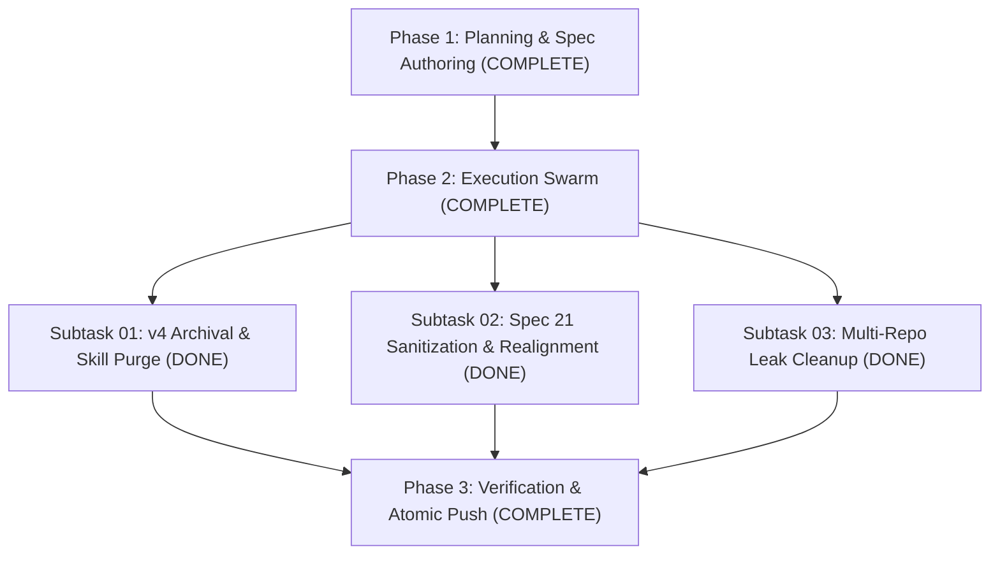

# Master Plan: Coding Guidelines & Folder Structure Instructions

## 1. Plan Overview
- **Task Slug:** `25-coding-guidelines-and-folder-structure-instructions`
- **Parent Goal:** Archive legacy `01-prompts/v4/`, sanitize `02-spec/21-app/` in `coding-guidelines`, and surgically purge leaked guideline/prompt files across downstream repositories while 100% preserving native application specs.
- **Status:** Completed on 30-Oct-26. Phases 1 and 2 were already pushed. The old rule that `02-spec/21-app/` may hold only spec 25 is retired.
- **Main Motto:** Improved work or less friction.
- **Rules Invariants:**
  - Strictly relative Git paths only (`02-spec/...`, `.ai-memory/...`, `01-prompts/...`).
  - Strict lowercase filenames.
  - Zero collateral damage: NEVER delete native application specs in downstream repositories.
  - Workers never run git commands; commits handled atomically via GitMap.

## 2. Subtask Breakdown

### Subtask-01: Archive `01-prompts/v4/` & Verify Skills [DONE]
- **Spec:** `02-spec/21-app/25-coding-guidelines-and-folder-structure-instructions/01-v4-archival-and-skill-purge-spec.md`
- **Subtask Plan:** `.ai-memory/plans/subtasks/25-coding-guidelines-and-folder-structure-instructions/01-subtask-v4-archival.md`
- **Key Actions:**
  1. Copied 5 missing files to `06-archive/v4/`.
  2. Confirmed 56 files in `06-archive/v4/`.
  3. Deleted `01-prompts/v4/` directory.
  4. Pruned lines 225–280 in `.ai-memory/prompts.md`.
  5. Added `"v4"` to `EXCLUDE_NAMES` in `03-ai-scripts/38-sync-prompts-skills-scripts.py`.
  6. Cleaned scripts 47 & 48.

### Subtask-02: Sanitize `02-spec/21-app/` in `coding-guidelines` [DONE]
- **Spec:** `02-spec/21-app/25-coding-guidelines-and-folder-structure-instructions/02-spec-21-sanitization-and-guidelines-realignment-spec.md`
- **Subtask Plan:** `.ai-memory/plans/subtasks/25-coding-guidelines-and-folder-structure-instructions/02-subtask-spec-21-sanitization.md`
- **Key Actions:**
  1. Deleted 44 misplaced milestone subdirectories.
  2. Deleted 7 misplaced loose root files.
  3. Rewrote `02-spec/21-app/readme.md` as container specification.
  4. Preserved `.gitkeep` and `25-coding-guidelines-and-folder-structure-instructions/`.

### Subtask-03: Multi-Repository Leak Detection & Cleanup [DONE]
- **Spec:** `02-spec/21-app/25-coding-guidelines-and-folder-structure-instructions/03-multi-repo-leak-detection-and-cleanup-spec.md`
- **Subtask Plan:** `.ai-memory/plans/subtasks/25-coding-guidelines-and-folder-structure-instructions/03-subtask-multi-repo-leak-cleanup.md`
- **Key Actions:**
  1. In `cat-my`: surgically deleted strictly the 3 leaked guideline folders and `01-prompts/v4/`; preserved 80+ native photo editor specs; committed & pushed.
  2. In `slack-ai-agent`: surgically deleted 7 leaked files in `guidelines/02-spec/21-app/` and `01-prompts/v4/`; committed & pushed.
  3. Across remaining 40 downstream repositories: deleted `01-prompts/v4/`; committed & pushed.
  4. Verified no other repository has leaked `coding-guidelines` files.

## 3. Verification & Completion Criteria
- Zero files in `01-prompts/v4/`.
- 56 files in `06-archive/v4/`.
- Later specs in `02-spec/21-app/` stay. The old "only spec 25" rule is retired. Phase 1 and phase 2 were already done and pushed.
- Linters pass (`python linter-scripts/check-prompts-loaded.py`, `python linter-scripts/check-forbidden-strings.py`).
- No leaks in downstream repositories.
- Atomic commit via `gitmap cpf`.
