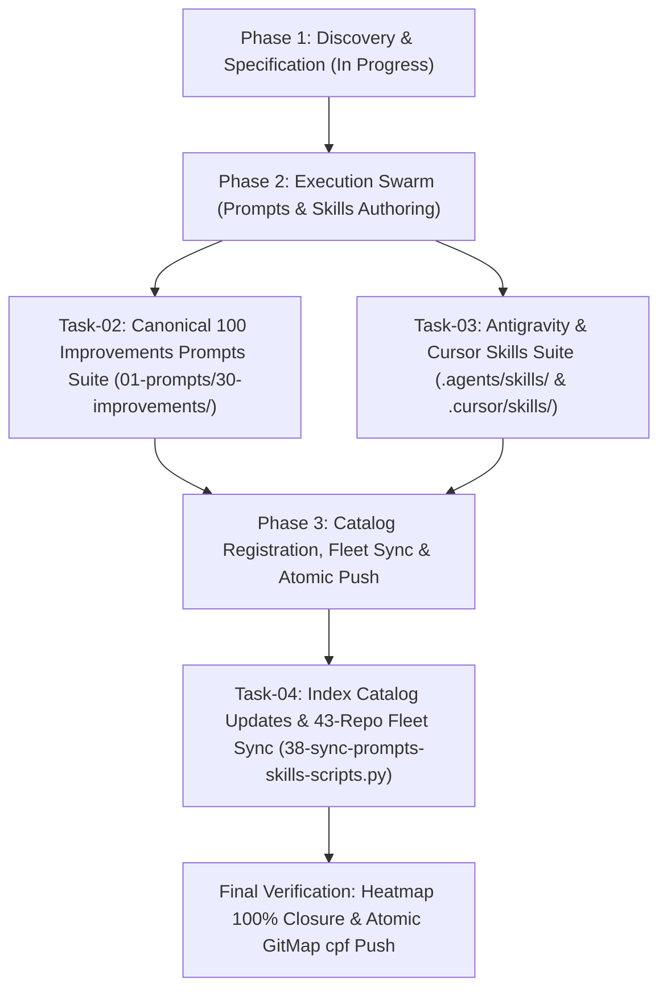

# Master Plan: 01-create-prompts-for-100-improvements

## 1. Task Information
- **Task Title:** Create Prompts for 100 Improvements
- **Task Slug:** `01-create-prompts-for-100-improvements`
- **Status:** `ACTIVE`
- **Preamble Priority Mandate:** Top-Instruction Priority verified and active.
- **Rules Invariants:**
  - Strictly relative Git paths only (`02-spec/...`, `.ai-memory/...`, `01-prompts/...`).
  - Strict lowercase filenames across all files and folders.
  - Zero raw grep/shell searches; GitMap AUM commands exclusively.
  - Workers never execute git commands; index lock collision prevention.
  - Zero builds and test suites ban (Rule R1).
  - Single atomic commit via `gitmap cpf` using hyphen separator without colons.

---

## 2. User Request (Verbatim)

```text
# Create Prompts for 100 Improvements: high priority instruction, non-negotiable task

Based on two prompts, you create one prompt that is find next 100 improvements in the code base. That would create a new folder, Improvements folder inside the prompts. Create first zero one prompt called Find 100 Improvements in the UI Level and list out and also detail, give some sub-points additionally, like what it's going to fix, how it's going to improve the UI, and so on. Some color samples and so on as well should be listed out so that it's easier for the AI to follow through. That's one thing. Second prompt would be find 100 improvements in the code base based on the coding guideline and error manage. List out as detailed as possible, including the file path, file name, functions, what to improve, how to improve with the context, 100 improvements. The next prompt would be find out 100 improvements in the whole system that would actually improve the user experience and that would require the cause, effect, how it's going to do it without causing any harm to the existing code base and so on. Based on that, you should follow the execute parent task in n steps, and based on that, follow that pattern and try to create these three prompts and skills, agent skills, cursor skills, and then seeing this with other repository as well. Also mention in each prompt to keep these ideas as pending into the proper plan folder along with pending tasks and each time running with create next 100 improvements and ideas.

## task: Create Prompts for 100 Improvements
## slug: 01-create-prompts-for-100-improvements

# Actionable Items Must Follow Non-Negotiable

1. Git pull BEFORE starting any work — first try `gitmap pull <repo path>` (or run `gitmap pull` in repository folder); if that fails, fall back to regular `git pull` and resolve any merge conflicts so the repository is completely up to date and clean before starting.
2. Write spec under 02-spec/21-app/01-create-prompts-for-100-improvements/ and enqueue plan task in .ai-memory/plans/pending/01-create-prompts-for-100-improvements.md (subtasks in .ai-memory/plans/subtasks/01-create-prompts-for-100-improvements/) first, where XX is the zero-padded sequence of that folder
3. Search codebase exclusively via GitMap (gitmap aum search, gitmap find, gitmap cat, gitmap ps, gitmap py, gitmap llm train); TOTAL BAN on rg, ripgrep, grep, git grep, Select-String
4. Strictly use relative Git paths (02-spec/..., .ai-memory/..., cmd/...); only add the relative paths, never add the absolute path during your work, and ensure this is respected on the release page and in release notes as well
5. Create a new folder named "Improvements" inside the prompts directory.
6. Develop the first prompt titled "Find 100 Improvements in the UI Level" with detailed sub-points, including what it will fix, how it will improve the UI, and color samples.
7. Develop the second prompt titled "Find 100 Improvements in the Code Base" based on coding guidelines and error management, detailing file paths, file names, functions, and improvement contexts.
8. Develop the third prompt titled "Find 100 Improvements in the Whole System" focusing on user experience improvements, detailing cause and effect without harming the existing code base.
9. Ensure each prompt includes instructions to keep ideas as pending in the proper plan folder along with pending tasks.
10. Integrate these prompts with agent skills, cursor skills, and ensure compatibility with other repositories.

## Must follow and spawn agent using

@[.agents/skills/execute-parent-task-with-n-steps-v6]

## Additional Instructions

- /plan first before doing work for improved work or less friction, faster work and more pure and effective work.
- /learn from @[.agents/skills/gitmap] skill to leverage GitMap high-speed search, toolchain discovery, and caching.
- Track in-flight file touches and prevent write collisions using GitMap RC Heatmap (`gitmap rc heatmap status` / `gitmap rc heatmap tree` / `gitmap rc heatmap live` / `gitmap rc heatmap sync`).
- Only add relative paths, never add absolute paths during work; this must be respected on release page and in release notes as well.
```

---

## 3. Architecture & Operational Flow



---

## 4. Subtask Allocation & Disjoint Bounding Boxes

| Task ID | Title | Assigned Role | Status | Owned Files (Exclusive) |
|:---|:---|:---|:---:|:---|
| `Task-01` | Spec Authoring & Master Plan Initialization | Lead Orchestrator | `ACTIVE` | `02-spec/21-app/01-create-prompts-for-100-improvements/*`, `.ai-memory/plans/pending/01-create-prompts-for-100-improvements.md`, `.ai-memory/plans/subtasks/01-create-prompts-for-100-improvements/*` |
| `Task-02` | Canonical 100 Improvements Prompts Suite | Worker 01 | `PENDING` | `01-prompts/30-improvements/01-find-100-improvements-in-ui-level.md`, `01-prompts/30-improvements/02-find-100-improvements-in-code-base.md`, `01-prompts/30-improvements/03-find-100-improvements-in-whole-system.md`, `01-prompts/30-improvements/readme.md` |
| `Task-03` | Antigravity & Cursor Agent Skills Suite | Worker 02 | `PENDING` | .agents/skills/find-100-improvements-in-ui-level/skill.md, .agents/skills/find-100-improvements-in-code-base/skill.md, .agents/skills/find-100-improvements-in-whole-system/skill.md, `.cursor/skills/find-100-improvements-in-ui-level/skill.md`, `.cursor/skills/find-100-improvements-in-code-base/skill.md`, `.cursor/skills/find-100-improvements-in-whole-system/skill.md` |
| `Task-04` | Catalog Registration, Fleet Sync & Push | Worker 03 / Lead | `PENDING` | `01-prompts/readme.md`, `.ai-memory/prompts.md` |

---

## 5. Verification Evidence Contract

1. Verify all three prompts exist with non-empty contents:
   `gitmap lf 01-prompts/30-improvements`
2. Verify all six agent and Cursor skills exist with symmetrical contents:
   `gitmap lf .agents/skills/find-100-improvements*` and `gitmap lf .cursor/skills/find-100-improvements*`
3. Verify application specifications exist in `02-spec/21-app/01-create-prompts-for-100-improvements/`.
4. Verify subtasks exist in `.ai-memory/plans/subtasks/01-create-prompts-for-100-improvements/`.
5. Verify fleet synchronization script runs cleanly.
6. Verify heatmap shows 100% action closure (`gitmap heatmap status`).
7. Commit and push atomically via `gitmap cpf "prompts - add 100 improvements prompt suite and skills"`.
