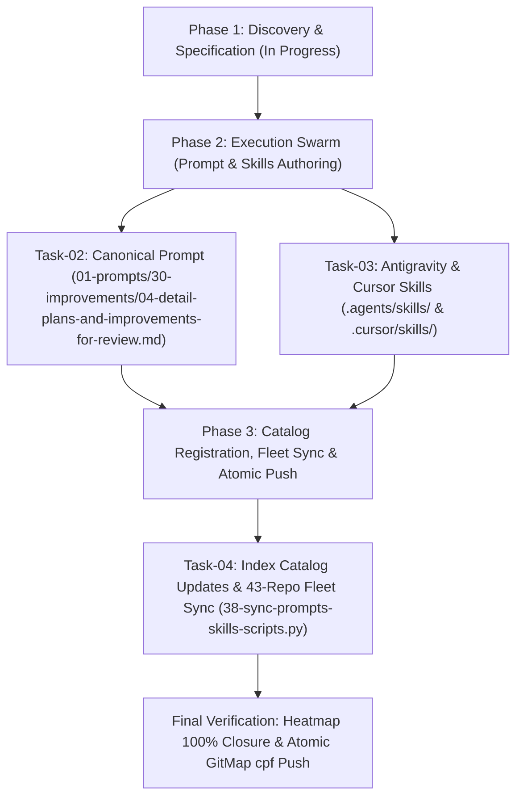

# Master Plan: 02-detail-plans-and-improvements-for-review

## 1. Task Information
- **Task Title:** Detail Plans and Improvements for Review
- **Task Slug:** `02-detail-plans-and-improvements-for-review`
- **Status:** `ACTIVE`
- **Preamble Priority Mandate:** Top-Instruction Priority verified and active.
- **Rules Invariants:**
  - Strictly relative Git paths only (`02-spec/...`, `.ai-memory/...`, `01-prompts/...`).
  - Strict lowercase filenames across all files and folders.
  - Review-first & no-immediate-execution gate: plans and improvements MUST be detailed, audited, and presented for review; NEVER execute or implement changes before review.
  - Zero raw grep/shell searches; GitMap AUM commands exclusively.
  - Workers never execute git commands; index lock collision prevention.
  - Zero builds and test suites ban (Rule R1).
  - Single atomic commit via `gitmap cpf` using hyphen separator without colons.

---

## 2. User Request (Verbatim)

```text
Similarly create another prompt that will help AI to improve the plans and improvement using detailing out with multi steps so that AI can follow througg

```
Can you please detail out all the plans that you have done and improvements so that it can be improved by any AI easily? Okay? So detail out as much as
```

also remember that improvements promtp should not be executeed or implemented rightaaway before  reviewing it

Write and then sync with other repos
```

---

## 3. Architecture & Operational Flow



---

## 4. Subtask Allocation & Disjoint Bounding Boxes

| Task ID | Title | Assigned Role | Status | Owned Files (Exclusive) |
|:---|:---|:---|:---:|:---|
| `Task-01` | Spec Authoring & Master Plan Initialization | Lead Orchestrator | `ACTIVE` | `02-spec/21-app/02-detail-plans-and-improvements-for-review/*`, `.ai-memory/plans/pending/02-detail-plans-and-improvements-for-review.md`, `.ai-memory/plans/subtasks/02-detail-plans-and-improvements-for-review/*` |
| `Task-02` | Canonical Detail Plans & Improvements Prompt | Worker 01 | `PENDING` | `01-prompts/30-improvements/04-detail-plans-and-improvements-for-review.md`, `01-prompts/30-improvements/readme.md` |
| `Task-03` | Antigravity & Cursor Skills Suite | Worker 02 | `PENDING` | `.agents/skills/detail-plans-and-improvements-for-review/skill.md`, `.cursor/skills/detail-plans-and-improvements-for-review/skill.md` |
| `Task-04` | Catalog Registration, Fleet Sync & Push | Worker 03 / Lead | `PENDING` | `01-prompts/readme.md`, `.ai-memory/prompts.md`, `.ai-memory/plans/readme.md`, `02-spec/21-app/readme.md` |

---

## 5. Verification Evidence Contract

1. Verify prompt exists:
   `gitmap lf 01-prompts/30-improvements/04-detail-plans-and-improvements-for-review.md`
2. Verify skills exist:
   `gitmap lf .agents/skills/detail-plans-and-improvements-for-review/` and `gitmap lf .cursor/skills/detail-plans-and-improvements-for-review/`
3. Verify application specifications exist in `02-spec/21-app/02-detail-plans-and-improvements-for-review/`.
4. Verify subtasks exist in `.ai-memory/plans/subtasks/02-detail-plans-and-improvements-for-review/`.
5. Verify fleet synchronization script runs cleanly across 43 repos.
6. Verify heatmap shows 100% action closure (`gitmap heatmap status`).
7. Commit and push atomically via `gitmap cpf "prompts - add detail plans and improvements for review prompt and skills"`.
