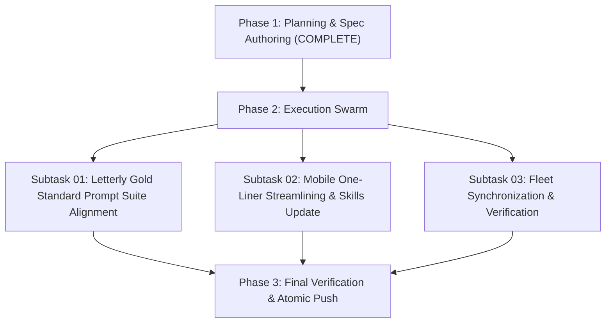

# Master Plan: Execute N-Steps — Letterly Prompt Formatter

## 1. Plan Overview
- **Task Slug:** `03-execute-n-steps-letterly-prompt-formatter`
- **Parent Goal:** Align all Letterly prompts (01..11), Cursor mirrors, and agent skills to the Gold Standard (`01-prompts/22-letterly/03-execute-n-steps-letterly.md`), streamline mobile prompt into a dense one-liner, and synchronize prompts, skills, and shared specs across all 43 fleet repositories.
- **Main Motto:** Improved work or less friction, faster work and more pure and effective work.
- **Rules Invariants:**
  - Strictly relative Git paths only (`02-spec/...`, `.ai-memory/...`, `cmd/...`).
  - Strict lowercase filenames.
  - Zero collateral damage: NEVER touch native application specs in downstream repositories.
  - Workers never run git commands; atomic commits handled via GitMap.

## 2. Subtask Breakdown

### Subtask-01: Letterly Gold Standard Prompt Suite Alignment
- **Spec:** `02-spec/21-app/03-execute-n-steps-letterly-prompt-formatter/01-letterly-gold-standard-and-mode-alignment-spec.md`
- **Plan:** `.ai-memory/plans/subtasks/03-execute-n-steps-letterly-prompt-formatter/01-subtask-letterly-gold-standard-alignment.md`
- **Key Actions:**
  1. Standardize header `## slug: <task-slug>` across desktop, plan, release, cicd, run, and verification prompts.
  2. Standardize Actionable Item 2 with sequential explanation `(xx should be figured out by the folder structure and running AI tools, xx  is sequence 01, 02)`.
  3. Update Additional Instructions plan motto to `for improved work or less friction, faster work and more pure and effective work`.
  4. Synchronize all changes to `01-prompts/23-cursor-prompts/`.

### Subtask-02: Mobile One-Liner Streamlining & Skills Update
- **Spec:** `02-spec/21-app/03-execute-n-steps-letterly-prompt-formatter/02-mobile-one-liner-and-skills-update-spec.md`
- **Plan:** `.ai-memory/plans/subtasks/03-execute-n-steps-letterly-prompt-formatter/02-subtask-mobile-one-liner-and-skills.md`
- **Key Actions:**
  1. Ensure mobile formatters (`01-mobile-letterly.md`, `07-mobile-cicd-fix-letterly.md`) output strictly 1 continuous line with 0 newlines.
  2. Eliminate unnecessary text and commentary for the mobile runner.
  3. Mirror mobile prompts to `01-prompts/23-cursor-prompts/`.
  4. Update `.agents/skills/execute-parent-task-with-n-steps-v6/skill.md`, `.cursor/skills/execute-parent-task-with-n-steps-v6/skill.md`, and companion skills to reflect the gold standard motto.

### Subtask-03: Fleet Synchronization & Verification
- **Spec:** `02-spec/21-app/03-execute-n-steps-letterly-prompt-formatter/03-fleet-synchronization-and-verification-spec.md`
- **Plan:** `.ai-memory/plans/subtasks/03-execute-n-steps-letterly-prompt-formatter/03-subtask-fleet-synchronization.md`
- **Key Actions:**
  1. Synchronize prompts, skills, and shared specs across all 43 workspace repositories using `03-ai-scripts/38-sync-prompts-skills-scripts.py`.
  2. Verify Rule 11 (Spec 21 exclusion) and v4 exclusion across all repositories.
  3. Stage, commit, and push each updated repository to its upstream tracking branch.
  4. Run linters in `coding-guidelines` and commit atomically via `gitmap cpf`.

## 3. Verification & Completion Criteria
- 100% of Letterly prompts and Cursor mirrors match the gold standard.
- Mobile formatters produce single-line dense outputs with 0 newlines.
- All 43 repositories synchronized and pushed upstream.
- Linters pass (`python linter-scripts/check-prompts-loaded.py`, `python linter-scripts/check-forbidden-strings.py`).
- Atomic commit via `gitmap cpf`.
