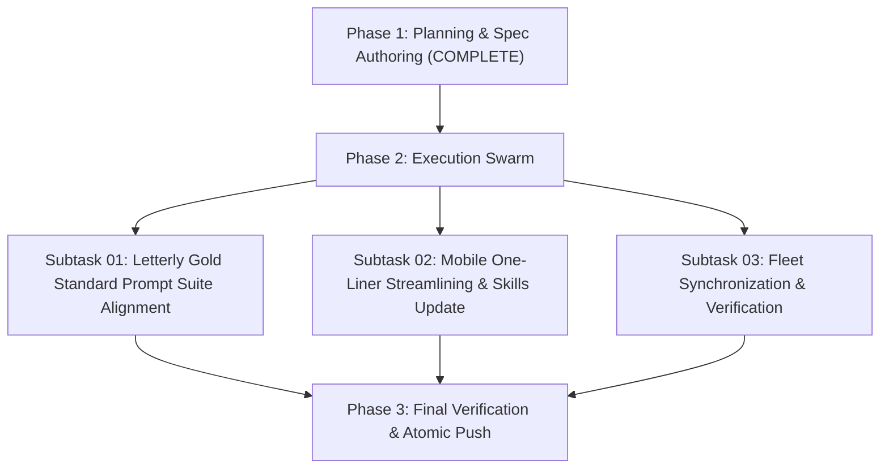

# Master Plan: Execute N-Steps — Letterly Prompt Formatter

## 1. Plan Overview
- **Task Slug:** `03-execute-n-steps-letterly-prompt-formatter`
- **Parent Goal:** Align all Letterly prompts (01..11), Cursor mirrors, and agent skills to the Gold Standard (`01-prompts/22-letterly/03-execute-n-steps-letterly.md`), streamline mobile prompt into a dense one-liner, and synchronize prompts, skills, and shared specs across all 43 fleet repositories.
- **Main Motto:** Improved work or less friction, faster work and more pure and effective work.
- **Rules Invariants:**
  - Strictly relative Git paths only (`02-spec/...`, `.ai-memory/...`, `cmd/...`).
  - Strict lowercase filenames.
  - Zero collateral damage: NEVER touch native application specs in downstream repositories.
  - Workers never run git commands; atomic commits handled via GitMap.

## 2. Subtask Breakdown

### Subtask-01: Letterly Gold Standard Prompt Suite Alignment
- **Spec:** `02-spec/21-app/03-execute-n-steps-letterly-prompt-formatter/01-letterly-gold-standard-and-mode-alignment-spec.md`
- **Plan:** `.ai-memory/plans/subtasks/03-execute-n-steps-letterly-prompt-formatter/01-subtask-letterly-gold-standard-alignment.md`
- **Key Actions:**
  1. Standardize header `## slug: <task-slug>` across desktop, plan, release, cicd, run, and verification prompts.
  2. Standardize Actionable Item 2 with sequential explanation `(xx should be figured out by the folder structure and running AI tools, xx  is sequence 01, 02)`.
  3. Update Additional Instructions plan motto to `for improved work or less friction, faster work and more pure and effective work`.
  4. Synchronize all changes to `01-prompts/23-cursor-prompts/`.

### Subtask-02: Mobile One-Liner Streamlining & Skills Update
- **Spec:** `02-spec/21-app/03-execute-n-steps-letterly-prompt-formatter/02-mobile-one-liner-and-skills-update-spec.md`
- **Plan:** `.ai-memory/plans/subtasks/03-execute-n-steps-letterly-prompt-formatter/02-subtask-mobile-one-liner-and-skills.md`
- **Key Actions:**
  1. Ensure mobile formatters (`01-mobile-letterly.md`, `07-mobile-cicd-fix-letterly.md`) output strictly 1 continuous line with 0 newlines.
  2. Eliminate unnecessary text and commentary for the mobile runner.
  3. Mirror mobile prompts to `01-prompts/23-cursor-prompts/`.
  4. Update `.agents/skills/execute-parent-task-with-n-steps-v6/skill.md`, `.cursor/skills/execute-parent-task-with-n-steps-v6/skill.md`, and companion skills to reflect the gold standard motto.

### Subtask-03: Fleet Synchronization & Verification
- **Spec:** `02-spec/21-app/03-execute-n-steps-letterly-prompt-formatter/03-fleet-synchronization-and-verification-spec.md`
- **Plan:** `.ai-memory/plans/subtasks/03-execute-n-steps-letterly-prompt-formatter/03-subtask-fleet-synchronization.md`
- **Key Actions:**
  1. Synchronize prompts, skills, and shared specs across all 43 workspace repositories using `03-ai-scripts/38-sync-prompts-skills-scripts.py`.
  2. Verify Rule 11 (Spec 21 exclusion) and v4 exclusion across all repositories.
  3. Stage, commit, and push each updated repository to its upstream tracking branch.
  4. Run linters in `coding-guidelines` and commit atomically via `gitmap cpf`.

## 3. Verification & Completion Criteria
- 100% of Letterly prompts and Cursor mirrors match the gold standard.
- Mobile formatters produce single-line dense outputs with 0 newlines.
- All 43 repositories synchronized and pushed upstream.
- Linters pass (`python linter-scripts/check-prompts-loaded.py`, `python linter-scripts/check-forbidden-strings.py`).
- Atomic commit via `gitmap cpf`.

## 4. 2026-10-23 Dispatch Addendum — SQL Repository Pattern & Enum Actions

New user dispatch (verbatim in spec `02-spec/21-app/03-execute-n-steps-letterly-prompt-formatter/04-sql-repository-pattern-and-enum-actions-spec.md`) adds a NEW content requirement on top of Subtasks 01–03: a mandatory prompt instruction + Cursor skills stating that SQL follows the repository pattern in every language, every action comes from an enum (switchable, exhaustively checkable), enum definition/usage/writing is fully specified including a util-methods checkup, and coding-guideline + error-management prompts/skills are fine-tuned without a confirmation round. Ends with commit + push + release for all repositories.

Sequence decision: XX = 03 (this slug's existing spec/plan/subtasks). `gitmap spec next` = 26 applies to brand-new slugs only; do not duplicate.

| Subtask | Owner | Deliverable | Plan file |
|---|---|---|---|
| Subtask-04: SQL/enum prompt instruction + guideline/error prompt fine-tune | Coordinator-01 (prompts track) | Instruction block (spec rules A–D) in `01-prompts/22-letterly/03-execute-n-steps-letterly.md` + Cursor mirror `01-prompts/23-cursor-prompts/03-execute-n-steps-letterly-cursor.md`; aligned wording in `01-prompts/05-coding-guidelines/` + error-management prompts | `.ai-memory/plans/subtasks/03-execute-n-steps-letterly-prompt-formatter/04-subtask-sql-enum-prompt-instruction.md` |
| Subtask-05: SQL/enum skill (agents + Cursor) + enum/db/error skill fine-tune | Coordinator-02 (skills track) | New skill in `.agents/skills/` + `.cursor/skills/` with util-methods checkup checklist; fine-tune constants-and-enums, cg-enum-standards, multi-language-enums-and-traits, app-db-architecture, cg-database-conventions, error-management, cg-error-management (both mirrors where present) | `.ai-memory/plans/subtasks/03-execute-n-steps-letterly-prompt-formatter/05-subtask-sql-enum-skills.md` |
| Subtask-03 (updated): fleet sync + commit/push all repos + release | Coordinator-02, gated on Subtask-04 ledger DONE | `gitmap sync` (supersedes the Python sync script per the gitmap command matrix), every touched repo committed + pushed, coding-guidelines-v24 minor bump + release, relative paths in release notes | `.ai-memory/plans/subtasks/03-execute-n-steps-letterly-prompt-formatter/03-subtask-fleet-synchronization.md` |

Collision control: before writing any shared file, run the GitMap heatmap checks (`gitmap rc heatmap status` / `tree` / `live` / `sync`; fall back to `gitmap heatmap discuss` / `gitmap agent heatmap` if the rc path is unrecognized) and record claims in the subtask ledger. File boxes are disjoint: Coordinator-01 owns `01-prompts/**` for this dispatch; Coordinator-02 owns `.agents/skills/**` + `.cursor/skills/**`; indexes and this plan stay with the lead.

Phase 3 (lead): verify both ledgers + release, update indexes (`.ai-memory/plans/readme.md`, `02-spec/21-app/readme.md`), final report.
