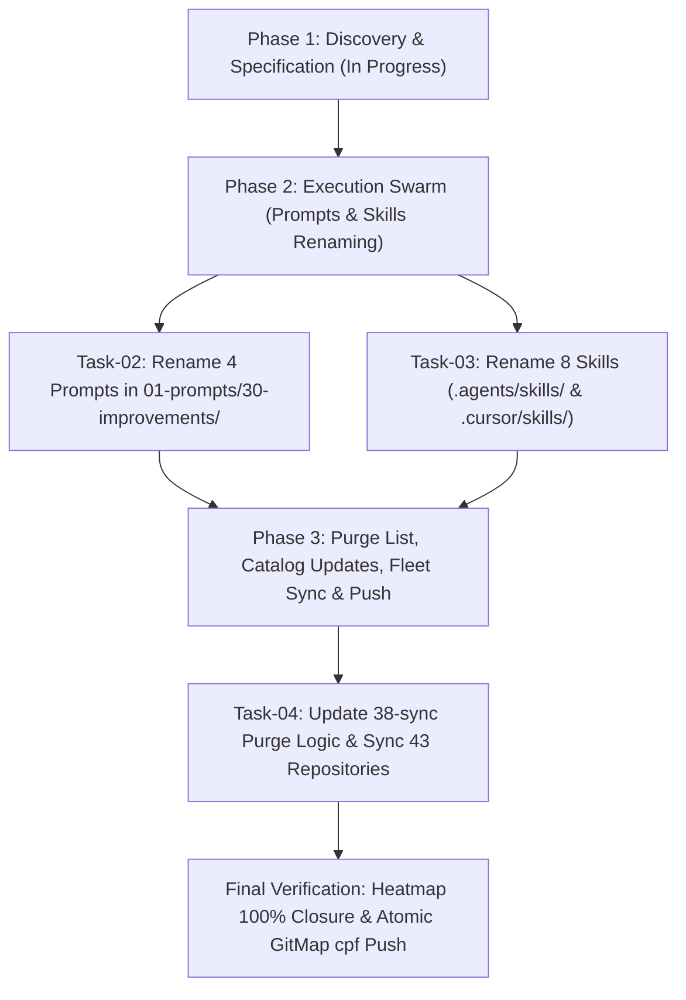

# Master Plan: 03-rename-and-sync-100-improvements-prompts-and-skills

## 1. Task Information
- **Task Title:** Rename and Sync 100 Improvements Prompts and Skills
- **Task Slug:** `03-rename-and-sync-100-improvements-prompts-and-skills`
- **Status:** `ACTIVE`
- **Preamble Priority Mandate:** Top-Instruction Priority verified and active.
- **Rules Invariants:**
  - Strictly relative Git paths only (`02-spec/...`, `.ai-memory/...`, `01-prompts/...`).
  - Strict lowercase filenames across all files and folders.
  - Symmetrical renaming across prompts, `.agents/skills/`, and `.cursor/skills/`.
  - Zero raw grep/shell searches; GitMap AUM commands exclusively.
  - Workers never execute git commands; index lock collision prevention.
  - Zero builds and test suites ban (Rule R1).
  - Single atomic commit via `gitmap cpf` using hyphen separator without colons.

---

## 2. User Request (Verbatim)

```text
pelase name and sync with skills and other repos as

next-100-ui-improvements
next-100-code-improvements

next-detail-out-100-improvements

and also update prompt name, skills and sync with all other repos
```

---

## 3. Renaming Specification Matrix

| Old Prompt Path | New Prompt Path | Old Skill Slug | New Skill Slug |
|:---|:---|:---|:---|
| `01-prompts/30-improvements/01-find-100-improvements-in-ui-level.md` | `01-prompts/30-improvements/01-next-100-ui-improvements.md` | `find-100-improvements-in-ui-level` | `next-100-ui-improvements` |
| `01-prompts/30-improvements/02-find-100-improvements-in-code-base.md` | `01-prompts/30-improvements/02-next-100-code-improvements.md` | `find-100-improvements-in-code-base` | `next-100-code-improvements` |
| `01-prompts/30-improvements/03-find-100-improvements-in-whole-system.md` | `01-prompts/30-improvements/03-next-100-whole-system-improvements.md` | `find-100-improvements-in-whole-system` | `next-100-whole-system-improvements` |
| `01-prompts/30-improvements/04-detail-plans-and-improvements-for-review.md` | `01-prompts/30-improvements/04-next-detail-out-100-improvements.md` | `detail-plans-and-improvements-for-review` | `next-detail-out-100-improvements` |

---

## 4. Architecture & Operational Flow



---

## 5. Subtask Allocation & Disjoint Bounding Boxes

| Task ID | Title | Assigned Role | Status | Owned Files (Exclusive) |
|:---|:---|:---|:---:|:---|
| `Task-01` | Spec Authoring & Master Plan Initialization | Lead Orchestrator | `COMPLETED` | `02-spec/21-app/03-rename-and-sync-100-improvements-prompts-and-skills/*`, `.ai-memory/plans/pending/03-rename-and-sync-100-improvements-prompts-and-skills.md`, `.ai-memory/plans/subtasks/03-rename-and-sync-100-improvements-prompts-and-skills/*` |
| `Task-02` | Rename & Update Prompts Suite | Worker 01 | `COMPLETED` | `01-prompts/30-improvements/*` |
| `Task-03` | Rename & Update Agent & Cursor Skills | Worker 02 | `COMPLETED` | `.agents/skills/next-*`, `.cursor/skills/next-*` |
| `Task-04` | Update Purge Logic, Catalogs & Fleet Sync | Worker 03 / Lead | `COMPLETED` | `03-ai-scripts/38-sync-prompts-skills-scripts.py`, `01-prompts/readme.md`, `.ai-memory/prompts.md`, `.ai-memory/plans/readme.md`, `02-spec/21-app/readme.md` |

---

## 6. Verification Evidence Contract

1. Verify 4 renamed prompts exist and old ones deleted:
   `gitmap lf 01-prompts/30-improvements`
2. Verify 8 renamed skills exist (4 in `.agents/skills/`, 4 in `.cursor/skills/`) and old ones deleted:
   `gitmap find "*next-100*" .agents/skills .cursor/skills`
   `gitmap find "*next-detail*" .agents/skills .cursor/skills`
3. Verify application specifications exist in `02-spec/21-app/03-rename-and-sync-100-improvements-prompts-and-skills/`.
4. Verify subtasks exist in `.ai-memory/plans/subtasks/03-rename-and-sync-100-improvements-prompts-and-skills/`.
5. Verify linters pass (`check-relative-paths.py`, `check-forbidden-strings.py`, `check-prompts-loaded.py`).
6. Verify fleet synchronization script runs cleanly across 43 repos.
7. Verify heatmap shows 100% action closure (`gitmap heatmap status`).
8. Commit and push atomically via `gitmap cpf "prompts - rename 100 improvements suite to next-100 and sync fleet"`.
