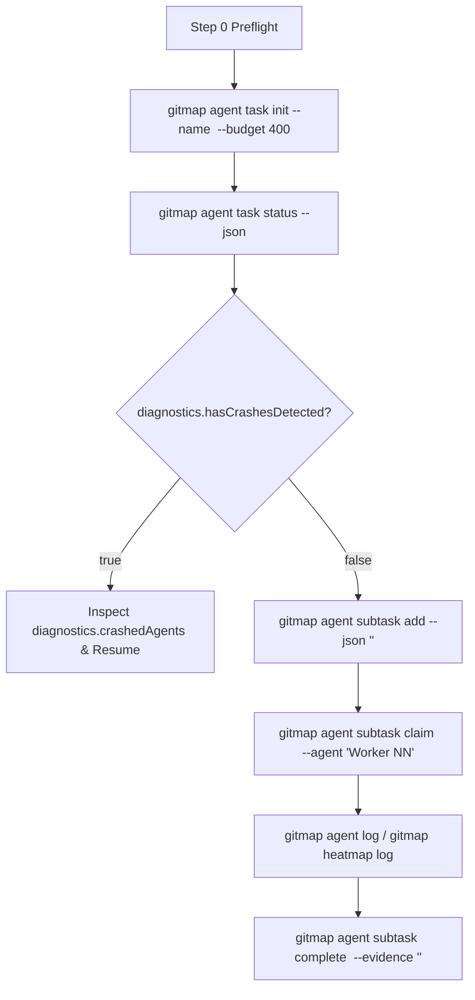

# Subtask: Data Schema Verification & V6 Concurrency Parity

> [!IMPORTANT]
> Subtask Identifier: `.ai-memory/plans/subtasks/cg-execute-folder-synchronization-and-heatmap-integration/01-data-schema-and-v6-parity.md`
> Parent Plan: `.ai-memory/plans/cg-execute-folder-synchronization-and-heatmap-integration.md`
> Canonical Spec Reference: `02-spec/21-app/cg-execute-folder-synchronization-and-heatmap-integration/02-implementation-spec.md`
> Status: `DONE`

---

## 1. Objective

Establish full data schema verification protocols, column casing standardization, and schema integrity linters across all Antigravity execution prompts and skills. Standardize the SQLite agent task management protocol (`ParentTask`, `Subtask`, `AgentActionLog`) using compiled Go GitMap commands (`gitmap agent task`, `gitmap agent subtask`, `gitmap agent log`), enforce affirmative boolean standards (`IsActive`, `HasCompleted`, `IsBlocked`), eliminate legacy Python SQLite scripts, and provide automated schema linting.



---

## 2. Data Schema Verification & Casing Invariants

### 2.1 SQLite Model & Column Casing Invariants
All multi-agent coordination within Antigravity runs leverages the compiled GitMap Go SQLite engine with WAL mode (`PRAGMA journal_mode=WAL; PRAGMA busy_timeout=5000;`). The database is located at `.ai-memory/temp-agents/<slug>/agent-task.db`.

1. **Table Names:** Strict PascalCase (`ParentTask`, `Subtask`, `AgentActionLog`).
2. **Boolean Column Fields:** Strict affirmative boolean prefixes (`is`, `has`).
   - `ParentTask`: `IsCompleted`, `IsActive`
   - `Subtask`: `IsActive`, `HasCompleted`, `IsBlocked`
   - Banned prefixes: `can`, `should`, `was`, `did` (TOTAL BAN).
   - Never evaluate explicit `== true`.
3. **JSON Payloads & CLI Arguments:**
   - Subtask addition format:
     ```json
     [
       {
         "code": "Task-01",
         "title": "Descriptive Title",
         "owned_files": ["relative/path/to/file.ext"],
         "agent_role": "Worker 01"
       }
     ]
     ```
   - In-flight action logging arguments:
     `gitmap agent log --subtask <id> --agent "Worker NN" --action "<action>" --file "<file>" --details "<details>"`
   - Subtask completion arguments:
     `gitmap agent subtask complete <id> --agent "Worker NN" --evidence "PASS exit 0, <evidence>"`
   - Subtask failure arguments:
     `gitmap agent subtask fail <id> --agent "Worker NN" --reason "<root-cause-analysis>"`

### 2.2 Step 0 Preflight Schema Inspection Protocol
Every V6 execution prompt MUST mandate Step 0 schema verification before subtasks are populated:
1. Initialize the parent task:
   `gitmap agent task init --name "<task name>" --budget 400`
2. Inspect the database schema and integrity:
   `gitmap agent task status --json`
   - Confirm table structure and affirmative boolean flags.
   - Inspect `diagnostics.hasCrashesDetected`. If true, inspect `diagnostics.crashedAgents` to extract crashed agent role, targeted file, and last logged action for crash autopsy.
3. Total Ban on Raw Python SQLite Queries:
   - TOTAL BAN on executing `python 03-ai-scripts/46-agent-sqlite-task-manager.py` (purged script).
   - TOTAL BAN on raw inline queries: `python -c "import sqlite3..."`.
   - All database inspection must occur natively via `gitmap agent task status` or `gitmap agent subtask ls`.

---

## 3. Schema & Prompt Integrity Linter Specification

To prevent regressions and enforce schema uniformity across all prompt and skill files, a dedicated schema linter `03-ai-scripts/47-upgrade-cg-execute-to-v6.py` is established.

### 3.1 Verification Rules Enforced by Linter:
1. **Ban on Legacy SQLite Scripts:**
   Detects and flags any occurrence of `46-agent-sqlite-task-manager.py` or `python -c "import sqlite3`.
2. **Step 0 Preflight Syntax:**
   Ensures execution prompts declare `gitmap agent task init` and `gitmap agent task status` in Step 0.
3. **Hyphen Commit Syntax:**
   Ensures all GitMap commit references use hyphen separation (`gitmap cpf "<module> - <summary>"`) with zero colons in argument payloads.
4. **Strict Relative Git Paths:**
   Flags any absolute filesystem paths (`C:\...`, `/home/...`) or `file:///` URIs.
5. **Strict Lowercase Naming:**
   Ensures all file paths cited in markdown links and code fences are strictly lowercase.

---

## 4. Action Checklist

- [ ] Inspect existing V6 prompts (`01-prompts/14-execute/02-execute-parent-task-with-n-steps-v6.md` and companion skills) to verify that Step 0 Preflight includes Data Schema Verification.
- [ ] Verify that column casing and JSON payload definitions adhere to PascalCase tables and affirmative boolean flags (`IsActive`, `HasCompleted`, `IsBlocked`).
- [ ] Author or update `03-ai-scripts/47-upgrade-cg-execute-to-v6.py` to automate scanning across `01-prompts/` and `.agents/skills/`.
- [ ] Register `47-upgrade-cg-execute-to-v6.py` in `03-ai-scripts/readme.md` under quality linters and migration engines.
- [ ] Execute `python 03-ai-scripts/47-upgrade-cg-execute-to-v6.py` against `01-prompts/15-cg-execute/` and `01-prompts/v4/15-cg-execute/` to establish baseline compliance.

---

## 5. Acceptance Criteria & Verification Evidence Contract

1. **Schema Preflight Verification:**
   All execution prompts and companion skills explicitly command `gitmap agent task status --json` in Step 0.
2. **Zero Legacy Python SQLite Invocations:**
   Zero references to `46-agent-sqlite-task-manager.py` or inline `sqlite3` scripts across all prompts, skills, and documentation.
3. **Linter Execution & Exit Code:**
   `python 03-ai-scripts/47-upgrade-cg-execute-to-v6.py` executes cleanly and exits with code 0.
4. **Path & Filename Hygiene:**
   100% strictly relative Git paths and strictly lowercase filenames across all subtask deliverables.
