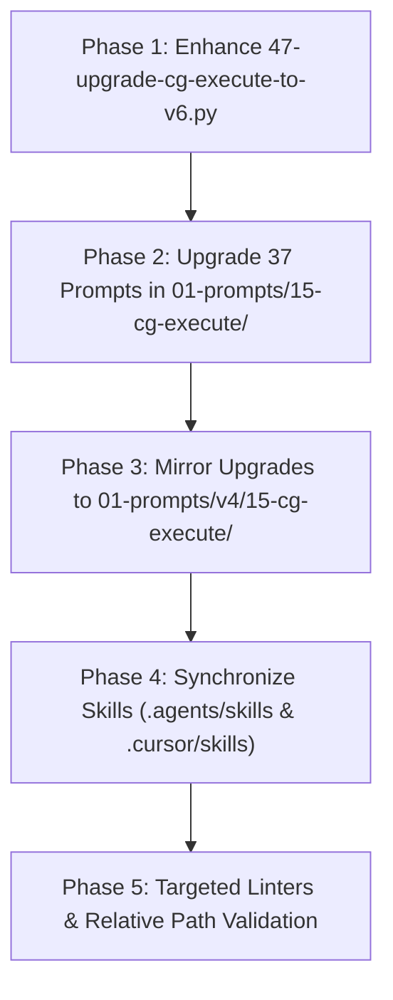

# Subtask: CG-Execute Prompts Modernization & Dual-Folder Synchronization

> [!IMPORTANT]
> Subtask Identifier: `.ai-memory/plans/subtasks/cg-execute-folder-synchronization-and-heatmap-integration/02-cg-prompts-modernization.md`
> Parent Plan: `.ai-memory/plans/cg-execute-folder-synchronization-and-heatmap-integration.md`
> Canonical Spec Reference: `02-spec/21-app/cg-execute-folder-synchronization-and-heatmap-integration/02-implementation-spec.md`
> Status: `DONE`

---

## 1. Objective

Upgrade all 37 prompts within `01-prompts/15-cg-execute/` and `01-prompts/v4/15-cg-execute/` to the V6 Antigravity multi-agent orchestration architecture. Upgrade `03-ai-scripts/47-upgrade-cg-execute-to-v6.py` to systematically inject V6 header parameters ($N = 400$, $A = 3$, $H = 2$, Capacity = 6), the Extreme "Understood" Turn-1 Showcase (5 Mandatory Pillars + 4-part verification schema), Data Schema Verification, Brain & Comprehensive Roadmap Creation, Section 3 GitMap Table with Heatmap commands, Section 7.2 Worker Brief with Rule 9 Mandatory Heatmap Telemetry, Section 7.4 Immediate Dynamic Respawn & Join Protocol, Section 12 Heatmap verification checkbox, and GitMap hyphen commit formats. Maintain dual-folder parity with `01-prompts/v4/15-cg-execute/` and synchronize corresponding Antigravity skills.

---

## 2. Upgrade Architecture & Transformation Phases

### 2.1 Phase 1: Script Modernization (`03-ai-scripts/47-upgrade-cg-execute-to-v6.py`)
Enhance `03-ai-scripts/47-upgrade-cg-execute-to-v6.py` to support full automated migration:
1. **Header Parameters Injection:**
   Inject standard V6 parameter block:
   - $N = 400$, $A = 3$, $H = 2$, $C = 30$, Concurrency Capacity = 6.
   - Tree Hierarchy definition: Root Orchestrator -> Branch Coordinators -> Leaf Workers & Dynamic Assistants.
   - Budget allocation: Phase 1 (100), Phase 2 (150), Phase 3 (150).
2. **Metadata Box & Top Priority Mandate:**
   Inject standard V6 metadata alert block citing `Prompt Version: 6.0.0` and `Runtime: Google Antigravity 2.0 (IDE and CLI)` with IDE-detectable semicolon slash command syntax (`slashCommand;goal`, `slashCommand;learn`, `slashCommand;plan`).
3. **Turn-1 Understood Showcase:**
   Inject Phase 1A Step 2 with the 5 Mandatory Pillars:
   - Pillar 1: Strategic Intent & Systems Reasoning
   - Pillar 2: Explicit Scope Boundaries (In-Scope vs. Excluded/Deferred)
   - Pillar 3: Non-Negotiable Constraints & Negative Guardrails Ingestion
   - Pillar 4: Blast Radius & Dependency Topology
   - Pillar 5: Multi-Agent Concurrency Topology
4. **Step 0 Preflight Schema Inspection:**
   Inject `gitmap agent task init --name "<slug>" --budget 400` and `gitmap agent task status --json` with crash forensics.
5. **Phase 1 Step 3 Brain & Roadmap Mandate:**
   Inject mandatory up-front Brain roadmap generation before worker wave dispatch.
6. **GitMap Command Primacy & Heatmap Table:**
   Inject the expanded Section 3 command table containing live streaming search, indexed search, and the full GitMap Heatmap suite (`gitmap heatmap log`, `gitmap heatmap discuss`, `gitmap heatmap query`, `gitmap heatmap rc`).
7. **Worker Brief Envelope & Rule 9 Heatmap Telemetry:**
   Replace legacy worker briefs with the V6 Self-Contained Worker Brief incorporating:
   - Boundaries & Crash Prevention (Worker Git Ban).
   - Rule 9 Mandatory Heatmap Telemetry.
   - 5-part GitMap Heatmap suite (contention check, in-flight action logging, real-time stream, multi-AI rc sync, non-blocking queries).
8. **Dynamic Respawn & Dynamic Join:**
   Inject Section 7.4 Immediate Dynamic Respawn & Join Protocol (100% duty cycle pinned at 3 active subagents).
9. **Banned Operations Checklist & Commit Format:**
   Inject Section 12 with the Heatmap Telemetry & Contention Inspection checkbox, and enforce GitMap hyphen commit syntax (`gitmap cpf "<module> - 
"`).
10. **Special Suffix Precedence for Prompt 31 (`31-cg-execute-in-below-steps.md`):**
    Preserve Bottom-Instruction Priority Mandate, the trailing `--` divider, and `## 🚨 High Priority Instructions Below` boundary.

### 2.2 Phase 2: Mass Prompt Migration (37 Prompts)
Run the enhanced migration engine against all 37 prompt files in `01-prompts/15-cg-execute/`:
- `01-execute-coding-guideline-fix.md` through `37-string-normalization-and-equalfoldany.md`.
- Verify that custom slash command prompts, rule IDs, and specific guideline references remain preserved verbatim.
- Update `01-prompts/15-cg-execute/readme.md` to reflect V6 versioning (6.0.0) and 400-step budget.

### 2.3 Phase 3: Dual-Folder Mirroring (`01-prompts/v4/15-cg-execute/`)
- Replicate all 37 upgraded prompts and `readme.md` from `01-prompts/15-cg-execute/` into `01-prompts/v4/15-cg-execute/`.
- Ensure exact byte-level line ending (LF) and content parity across both folders.

### 2.4 Phase 4: Skill Propagation (`.agents/skills/` and `.cursor/skills/`)
- Extract instruction bodies from each prompt and update corresponding skills in `.agents/skills/<slug>/skill.md`.
- Mirror all companion skills to `.cursor/skills/<slug>/skill.md` with identical YAML frontmatter.

### 2.5 Phase 5: Verification & Quality Gate
Execute targeted linters to confirm 100% compliance:
- Relative path validation: `python linter-scripts/check-relative-paths.py`
- Doc path and markdown link validation: `python 03-ai-scripts/22-doc-path-linter.py 01-prompts/15-cg-execute/`
- Prompts index validation: `python linter-scripts/check-prompts-loaded.py`
- Schema linter: `python linter-scripts/check-agent-task-schema.py`

---

## 3. Action Checklist

- [ ] Inspect existing `03-ai-scripts/47-upgrade-cg-execute-to-v6.py` and implement the 10 injection modules.
- [ ] Implement custom preservation logic for `31-cg-execute-in-below-steps.md`.
- [ ] Run `python 03-ai-scripts/47-upgrade-cg-execute-to-v6.py` in test/dry-run mode to verify AST transformations.
- [ ] Apply upgrades to all 37 prompts in `01-prompts/15-cg-execute/`.
- [ ] Mirror all upgraded prompts to `01-prompts/v4/15-cg-execute/`.
- [ ] Synchronize candidate skills across `.agents/skills/` and `.cursor/skills/`.
- [ ] Update catalog `readme.md` in `01-prompts/15-cg-execute/` and `01-prompts/v4/15-cg-execute/`.
- [ ] Execute targeted linters (`check-relative-paths.py`, `22-doc-path-linter.py`, `check-prompts-loaded.py`).
- [ ] Verify clean git status before concluding.

---

## 4. Acceptance Criteria & Verification Evidence Contract

1. **37 Prompts Upgraded in Primary Folder:**
   All 37 prompts in `01-prompts/15-cg-execute/` declare `Prompt Version: 6.0.0`, `N = 400`, `A = 3`, `H = 2`, Capacity = 6, and include the complete V6 injection suite.
2. **100% Dual-Folder Parity:**
   Every prompt in `01-prompts/v4/15-cg-execute/` matches its counterpart in `01-prompts/15-cg-execute/` with zero drift.
3. **Heatmap Telemetry Suite Injected:**
   Every upgraded prompt features the Section 3 Heatmap table, Rule 9 Mandatory Heatmap Telemetry in the worker brief, and the Section 12 Heatmap verification checkbox.
4. **Special Handling of Prompt 31 Verified:**
   `31-cg-execute-in-below-steps.md` preserves its Bottom-Instruction Priority Mandate, the trailing `--` divider, and `## 🚨 High Priority Instructions Below` boundary anchor.
5. **Skill Mirroring Verified:**
   All corresponding skills in `.agents/skills/` and `.cursor/skills/` are updated and in sync.
6. **Targeted Linters Passing:**
   `python linter-scripts/check-relative-paths.py` and `python 03-ai-scripts/22-doc-path-linter.py` pass with exit code 0.
7. **Strict Relative Git Paths:**
   Zero absolute filesystem paths and zero `file:///` URIs across all modified files.
