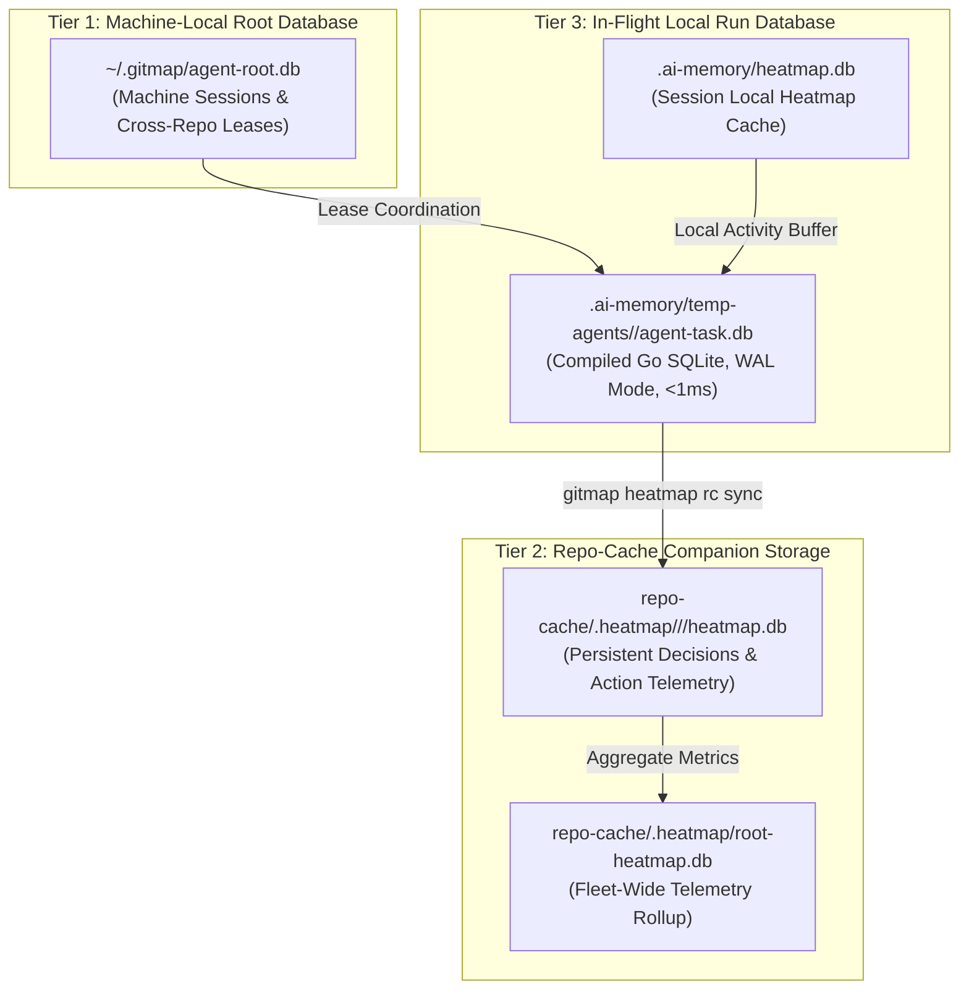

# Subtask 03: Modernize Companion Skills, Data Schema & Database Location Transparency

> [/goal](slashCommand;goal) Autonomously modernize all companion skills across `.agents/skills/` and `.cursor/skills/` to V6 execution standards, embed Step 0 Data Schema Verification, incorporate the 3-Tier Database Location Transparency contract, fix database column casing to PascalCase in `app-db-architecture`, and guarantee 100% byte-for-byte parity between Antigravity and Cursor IDE skill mirrors.
>
> [/learn](slashCommand;learn) Enforce strict PascalCase database column standards (`CreatedAt`, `UserId`, `IsActive`) across `app-db-architecture` and `cg-database-conventions`. Mandate that every companion skill outputs transparent database locations (`.ai-memory/temp-agents/...`, `repo-cache/.heatmap/...`) and executable inspection queries (`gitmap heatmap rc query`) for full crash forensics and auditability.
>
> [/plan](slashCommand;plan) Execute structured updates across all 18 companion skills, synchronize `.agents/skills/` with `.cursor/skills/`, embed high-speed GitMap heatmap diagnostic commands, and verify schema compliance without modifying external repositories.

---

## Canonical References

- Architecture Specification: `02-spec/21-app/cg-execute-folder-synchronization-and-heatmap-integration/01-architecture-spec.md`
- Implementation Specification: `02-spec/21-app/cg-execute-folder-synchronization-and-heatmap-integration/02-implementation-spec.md`
- Database Naming Conventions: [`02-spec/04-database-conventions/02-naming-conventions.md`](../../../../02-spec/04-database-conventions/02-naming-conventions.md)
- Split SQLite Architecture: [`02-spec/05-split-db-architecture/readme.md`](../../../../02-spec/05-split-db-architecture/readme.md)

---

## 1. Context & Scope

The companion skills under `.agents/skills/` and `.cursor/skills/` provide IDE-detectable guidance, quick reference instructions, and execution boundaries for AI agents operating on specific coding guideline rules.

To achieve complete parity with the V6 Coding Guidelines Execution Suite (`01-prompts/15-cg-execute/`), the companion skills must be updated to embed:
1. **V6 Concurrency Invariants:** `N = 400`, `A = 3`, `H = 2`, `Capacity = 6` with dynamic immediate respawn and collaborative dynamic join modes.
2. **Step 0 Data Schema Verification:** Mandate running `gitmap agent task status --ddl` and `gitmap agent task status --json` before modifying database entities or claiming subtasks.
3. **Database Location Transparency Contract:** Require explicit disclosure of physical SQLite database paths across all 3 tiers with executable read-only diagnostic commands.
4. **Cognitive Heatmap Telemetry:** Mandate pre-edit lease contention inspection (`gitmap heatmap discuss`) and cognitive decision logging (`gitmap heatmap log` / `gitmap agent log`) before touching or editing files.
5. **Database Column Casing Fix:** Correct legacy `camelCase` column definitions in `app-db-architecture` to strictly enforce **PascalCase** columns (`PluginSlug`, `CreatedAt`, `IsActive`) in lockstep with `02-spec/04-database-conventions/`.
6. **100% Mirror Parity:** Ensure every skill in `.agents/skills/` matches its mirror in `.cursor/skills/` with identical YAML frontmatter and unified markdown instructions.

---

## 2. 3-Tier Database Location & Diagnostic Architecture

All updated companion skills must reference the 3-Tier SQLite topology and command suite:

### 2.1 Database Location Transparency Contract
Whenever an agent executes a companion skill or reports telemetry, it MUST fulfill the Database Location Transparency Contract by outputting:
- **Local Run DB:** `.ai-memory/temp-agents/<slug>/agent-task.db` (In-flight subtasks, worker leases, WAL mode).
- **Local Heatmap Cache:** `.ai-memory/heatmap.db` (Session file touch and modification traces).
- **Companion Telemetry DB:** `repo-cache/.heatmap/<ai-slug>/<repo-slug>/heatmap.db` (Persistent cognitive reasoning, commit checkpoints).
- **Executable Query:** `gitmap heatmap rc query "SELECT ActionType, FilePath, ReasoningText FROM AgentActionLog ORDER BY AgentActionLogId DESC LIMIT 5" --format table`

### 2.2 Executable Diagnostic Commands Matrix

| Operation | Full Command | High-Speed Alias | Purpose |
| :--- | :--- | :--- | :--- |
| **Preflight Schema DDL** | `gitmap agent task status --ddl` | `gitmap task status -d` | Verifies PascalCase tables, columns, and positive booleans |
| **Task Metadata JSON** | `gitmap agent task status --json` | `gitmap task status -j` | Validates active task ledger and subtask state |
| **Contention & Leases** | `gitmap heatmap discuss [--window 15m]` | `gitmap agent heatmap` | Pre-edit blast radius & file lease collision check |
| **Cognitive Action Log** | `gitmap heatmap log -t <slug> -a <type> -f <path> -r <reason>` | `gitmap heatmap log` | Records cognitive decisions and rationale to local DB |
| **Real-Time Stream** | `gitmap heatmap live` | `gitmap heatmap live` | Real-time continuous activity feed across active subagents |
| **Hierarchical Tree** | `gitmap heatmap tree [-t <slug>]` | `gitmap heatmap tree` | Visualizes touched files and density by subtask |
| **Read-Only SQL Query** | `gitmap heatmap rc query "<sql>" [--format json]` | `gitmap rc query` | Zero-lock `mode=ro` SQL query against companion database |
| **Master Tables Catalog**| `gitmap heatmap rc tables` | `gitmap rc tables` | Discovers companion SQLite tables and row counts |
| **View Table Records** | `gitmap heatmap rc view <table> [--limit <n>]` | `gitmap rc view` | Rapid tabular view of cognitive records in companion DB |
| **Companion DB Sync** | `gitmap heatmap rc sync` | `gitmap rc sync` | Bi-directional synchronization between local and `repo-cache` |

---

## 3. Targeted Companion Skills Inventory

The following 18 companion skills are targeted for modernization across `.agents/skills/` and `.cursor/skills/`:

### 3.1 `app-db-architecture` (Column Casing Fix & Split SQLite Standard)
- **Target Files:**
  - `.agents/skills/app-db-architecture/skill.md`
  - `.cursor/skills/app-db-architecture/skill.md`
- **Surgical Changes:**
  - Fix Rule 2 Column Naming: Change from `camelCase` to **PascalCase** (`PluginSlug`, `CreatedAt`, `IsActive`, `DisplayName`).
  - Reiterate Table Naming: Strictly singular **PascalCase** (`User`, `AgentSite`, `Transaction`).
  - Primary Key Standard: `{TableName}Id` (`UserId`, `AgentSiteId`).
  - Boolean Prefix Standard: Positive prefixes only (`Is*`, `Has*`). Total ban on negative columns (`isNotActive`, `hasNoLicense`).
  - Split SQLite Topology: Formalize `root.db` (system/tenants), `app.db` (domain entities), and `session.db` (ephemeral auth/sessions).
  - Embed Preflight DDL commands: `gitmap agent task status --ddl`.

### 3.2 `cg-execute` (Orchestration Suite Index & Catalog)
- **Target Files:**
  - `.agents/skills/cg-execute/skill.md`
  - `.cursor/skills/cg-execute/skill.md`
- **Surgical Changes:**
  - Update source prompt reference to `01-prompts/15-cg-execute/readme.md`.
  - Embed V6 Header Parameters: `N = 400`, `A = 3`, `H = 2`, `Capacity = 6`.
  - Embed Step 0 Schema Verification: `gitmap agent task status --ddl` / `--json`.
  - Embed Cognitive Heatmap suite: `gitmap heatmap discuss`, `gitmap heatmap log`, `gitmap heatmap rc query`.
  - Embed Database Location Transparency reporting requirements.
  - Enforce GitMap hyphen commit format (`gitmap cpf "<module> - 
"`).

### 3.3 `cg-database-conventions` (Database Conventions & Split DB)
- **Target Files:**
  - `.agents/skills/cg-database-conventions/skill.md`
  - `.cursor/skills/cg-database-conventions/skill.md`
- **Surgical Changes:**
  - Re-verify PascalCase singular tables (`User`, `Transaction`), PascalCase columns (`PluginSlug`, `CreatedAt`), `{TableName}Id` primary keys.
  - Add Step 0 DDL inspection commands (`gitmap agent task status --ddl`).
  - Add Database Location Transparency section for database migrations and queries.

### 3.4 `cg-boolean-and-naming` (Positive Booleans & Affirmative Prefixes)
- **Target Files:**
  - `.agents/skills/cg-boolean-and-naming/skill.md`
  - `.cursor/skills/cg-boolean-and-naming/skill.md`
- **Surgical Changes:**
  - Reinforce positive prefixes (`is`, `has`) only; total ban on explicit `== true`.
  - Ban mixed polarity conditions (`if isA && !isB`).
  - Reinforce canonical map lookups (`val, isFound := map[k]`) and `isDefined` for affirmative non-empty checks.
  - Add Heatmap Telemetry requirement logging boolean refactoring decisions with reasoning.

### 3.5 `cg-error-management` (Structured Error Envelopes & AppError)
- **Target Files:**
  - `.agents/skills/cg-error-management/skill.md`
  - `.cursor/skills/cg-error-management/skill.md`
- **Surgical Changes:**
  - Mandate `*appfault.AppError` return type across all Go packages.
  - Eliminate multi-value error tuples `(T, error)` in favor of `Result[T]` envelopes.
  - Add Database Location Transparency for logging error diagnostic traces.

### 3.6 `cg-enum-standards` (Cross-Language Enums & Pattern Matching)
- **Target Files:**
  - `.agents/skills/cg-enum-standards/skill.md`
  - `.cursor/skills/cg-enum-standards/skill.md`
- **Surgical Changes:**
  - Standardize string-backed enums, `*Type` suffixes, and exhaustive matchers.
  - Eliminate magic string and numeric literals.
  - Embed GitMap search commands for discovering un-typed constants.

### 3.7 `cg-file-size-and-function-reduction` (File & Function Size Caps)
- **Target Files:**
  - `.agents/skills/cg-file-size-and-function-reduction/skill.md`
  - `.cursor/skills/cg-file-size-and-function-reduction/skill.md`
- **Surgical Changes:**
  - Enforce <= 100 lines file cap and <= 8-15 lines function cap.
  - Mandate two-part decomposition strategy without vertical whitespace compression.
  - Add Heatmap Telemetry logging file decomposition blast radius.

### 3.8 `cg-string-efficiency` (String Operations & Optimization)
- **Target Files:**
  - `.agents/skills/cg-string-efficiency/skill.md`
  - `.cursor/skills/cg-string-efficiency/skill.md`
- **Surgical Changes:**
  - Enforce zero-allocation `strings.EqualFold`, lazy evaluation, and loop hoisting.
  - Short-circuit lazy string evaluations while strictly preserving business logic.

### 3.9 `cg-string-normalization-and-equalfoldany` (EqualFoldAny Standardization)
- **Target Files:**
  - `.agents/skills/cg-string-normalization-and-equalfoldany/skill.md`
  - `.cursor/skills/cg-string-normalization-and-equalfoldany/skill.md`
- **Surgical Changes:**
  - Standardize on `strutil.EqualFoldAny` and `strutil.EqualFoldAnyTrim` in `pkg/strutil`.
  - Replace chained OR equality (`a == "x" || a == "y"`) with centralized helper calls.

### 3.10 `cg-clean-repo-build-and-caches` (Repository & OS Cache Cleaning)
- **Target Files:**
  - `.agents/skills/cg-clean-repo-build-and-caches/skill.md`
  - `.cursor/skills/cg-clean-repo-build-and-caches/skill.md`
- **Surgical Changes:**
  - Multi-tier cleanup: repo temp, OS temp, Go/npm/TS caches.
  - Dry-run preview verification before deletion.
  - Strict preservation of lowercase hygiene and tracked git state.

### 3.11 `cg-code-dryness-and-library-extraction` (DRY Architecture & Extraction)
- **Target Files:**
  - `.agents/skills/cg-code-dryness-and-library-extraction/skill.md`
  - `.cursor/skills/cg-code-dryness-and-library-extraction/skill.md`
- **Surgical Changes:**
  - 300-step 3-phase self-loop (100 Analyze / 100 Plan / 100 Execute).
  - Extract reusable packages and utilities without running full builds or test suites.

### 3.12 `cg-golang-pointer-reduction-and-value-semantics` (Value Semantics)
- **Target Files:**
  - `.agents/skills/cg-golang-pointer-reduction-and-value-semantics/skill.md`
  - `.cursor/skills/cg-golang-pointer-reduction-and-value-semantics/skill.md`
- **Surgical Changes:**
  - Reduce `*T` pointer usage on small structs; enforce value semantics for receivers and parameters.
  - Eliminate unnecessary heap allocations.

### 3.13 `cg-extract-types` (Type Extraction to `types.go`)
- **Target Files:**
  - `.agents/skills/cg-extract-types/skill.md`
  - `.cursor/skills/cg-extract-types/skill.md`
- **Surgical Changes:**
  - Centralize domain structs, Result wrappers, and generic aliases in dedicated `types.go` files.
  - Eliminate raw generic signatures across public package APIs.

### 3.14 `cg-isolate-os-tests` (OS Isolation in Unit Tests)
- **Target Files:**
  - `.agents/skills/cg-isolate-os-tests/skill.md`
  - `.cursor/skills/cg-isolate-os-tests/skill.md`
- **Surgical Changes:**
  - Enforce injectable `OSActionExecutor` to guarantee unit tests never execute real OS shutdown, reboot, or heavy system calls.
  - Enforce mock duration assertions in test suites.

### 3.15 `cg-variadic-and-spread-parameters` (Variadic Function Signatures)
- **Target Files:**
  - `.agents/skills/cg-variadic-and-spread-parameters/skill.md`
  - `.cursor/skills/cg-variadic-and-spread-parameters/skill.md`
- **Surgical Changes:**
  - Replace single-item slice wrappers (`[]string{id}`) with variadic parameters (`...T`, `...items`).
  - Eliminate artificial slice allocations at callsites.

### 3.16 `cg-execute-in-below-steps` (Below-Precedence Prompt Execution)
- **Target Files:**
  - `.agents/skills/cg-execute-in-below-steps/skill.md`
  - `.cursor/skills/cg-execute-in-below-steps/skill.md`
- **Surgical Changes:**
  - Retain Bottom-Instruction Priority Mandate (Below Precedence) with trailing `--` divider.
  - Update worker boundaries and GitMap heatmap logging while preserving suffix priority routing.

### 3.17 `cg-follow-other-prompts` (External Prompt Ingestion)
- **Target Files:**
  - `.agents/skills/cg-follow-other-prompts/skill.md`
  - `.cursor/skills/cg-follow-other-prompts/skill.md`
- **Surgical Changes:**
  - External prompt reference chaining with micro-batch bounds (5-8 files).
  - Enforce zero build and zero test suite invariants.

### 3.18 `cg-branch-immutability-and-clean-construction` (Branch Immutability)
- **Target Files:**
  - `.agents/skills/cg-branch-immutability-and-clean-construction/skill.md`
  - `.cursor/skills/cg-branch-immutability-and-clean-construction/skill.md`
- **Surgical Changes:**
  - Ban field mutations across conditional branching ladders; mandate pure constructor helper returns.
  - Decompose compound conditions into affirmative booleans.

---

## 4. Action Checklist

- [x] Modernize `.agents/skills/app-db-architecture/skill.md`:
  - [x] Correct Rule 2 column casing specification from `camelCase` to `PascalCase` (`PluginSlug`, `CreatedAt`, `IsActive`).
  - [x] Reaffirm singular PascalCase table names (`User`, `AgentSite`, `Transaction`) and `{TableName}Id` keys.
  - [x] Embed Step 0 Preflight schema inspection: `gitmap agent task status --ddl` / `--json`.
  - [x] Incorporate 3-Tier Database Location Transparency section and executable query examples.
- [x] Mirror changes to `.cursor/skills/app-db-architecture/skill.md` with 100% byte and line parity.
- [x] Modernize `.agents/skills/cg-execute/skill.md`:
  - [x] Update source prompt reference to `01-prompts/15-cg-execute/readme.md`.
  - [x] Embed V6 Concurrency Invariants (`N = 400`, `A = 3`, `H = 2`, Capacity = 6).
  - [x] Embed Cognitive Heatmap command table (`gitmap heatmap discuss`, `gitmap heatmap log`, `gitmap heatmap rc query`).
  - [x] Embed Database Location Transparency reporting requirements.
  - [x] Enforce GitMap hyphen commit format (`gitmap cpf "<module> - 
"`).
- [x] Mirror changes to `.cursor/skills/cg-execute/skill.md`.
- [x] Modernize `.agents/skills/cg-database-conventions/skill.md`:
  - [x] Reaffirm PascalCase singular tables, PascalCase columns, `{TableName}Id` keys, and positive boolean prefixes.
  - [x] Embed Step 0 Preflight DDL commands and Database Location Transparency.
- [x] Mirror changes to `.cursor/skills/cg-database-conventions/skill.md`.
- [x] Modernize remaining companion skills across `.agents/skills/` and `.cursor/skills/`:
  - [x] `cg-boolean-and-naming`
  - [x] `cg-error-management`
  - [x] `cg-enum-standards`
  - [x] `cg-file-size-and-function-reduction`
  - [x] `cg-string-efficiency`
  - [x] `cg-string-normalization-and-equalfoldany`
  - [x] `cg-clean-repo-build-and-caches`
  - [x] `cg-code-dryness-and-library-extraction`
  - [x] `cg-golang-pointer-reduction-and-value-semantics`
  - [x] `cg-extract-types`
  - [x] `cg-isolate-os-tests`
  - [x] `cg-variadic-and-spread-parameters`
  - [x] `cg-execute-in-below-steps`
  - [x] `cg-follow-other-prompts`
  - [x] `cg-branch-immutability-and-clean-construction`
- [x] Verify 100% parity across all 18 companion skills between `.agents/skills/` and `.cursor/skills/`.
- [x] Verify strict relative Git paths and zero absolute filesystem paths across all skill files.

---

## 5. Acceptance Criteria & Verification Evidence

1. **Schema Casing Accuracy:** `app-db-architecture` explicitly mandates PascalCase columns (`PluginSlug`, `CreatedAt`, `IsActive`) in both `.agents/skills/` and `.cursor/skills/`.
2. **Database Location Transparency:** All updated skills specify exact paths for Tier 1 (`~/.gitmap/agent-root.db`), Tier 2 (`repo-cache/.heatmap/...`), and Tier 3 (`.ai-memory/temp-agents/...`).
3. **Heatmap & Telemetry Suite:** All skills document pre-edit contention checks (`gitmap heatmap discuss`) and cognitive decision logging (`gitmap heatmap log` / `gitmap agent log`).
4. **100% Mirror Parity:** Every file under `.agents/skills/<slug>/skill.md` is identical in content and formatting to its counterpart under `.cursor/skills/<slug>/skill.md`.
5. **Path & Lowercase Hygiene:** Zero absolute filesystem paths, zero `file:///` URIs, and strictly lowercase filenames across all modified skills.
