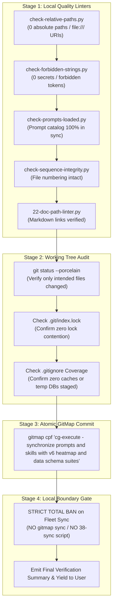

# Subtask 04: Local Quality Linters, Working Tree Verification & Atomic Commit

> [/goal](slashCommand;goal) Autonomously execute the comprehensive local verification gate, validate zero absolute paths across modified files, confirm zero secrets or forbidden strings, verify prompt and skills synchronization, inspect git working tree cleanliness, and conclude with an atomic GitMap commit while strictly avoiding external repository synchronization.
>
> [/learn](slashCommand;learn) Enforce the user's non-negotiable boundary: **"Do not sync with other repos. First complete here so that I can verify."** External fleet synchronization via `gitmap sync` or `38-sync-prompts-skills-scripts.py` is strictly prohibited. Atomic commits must use GitMap hyphen format (`gitmap cpf "<module> - <summary>"`) without colons inside the message argument.
>
> [/plan](slashCommand;plan) Run local verification linters in sequence, verify zero drift between dual prompt folders and companion skills, inspect git status to verify only intended files are staged, execute the atomic GitMap commit, and produce a transparent verification report for the user.

---

## Canonical References

- Architecture Specification: [`02-spec/21-app/cg-execute-folder-synchronization-and-heatmap-integration/01-architecture-spec.md`](../../../../02-spec/21-app/cg-execute-folder-synchronization-and-heatmap-integration/01-architecture-spec.md)
- Implementation Specification: [`02-spec/21-app/cg-execute-folder-synchronization-and-heatmap-integration/02-implementation-spec.md`](../../../../02-spec/21-app/cg-execute-folder-synchronization-and-heatmap-integration/02-implementation-spec.md)
- Companion Subtask 03: [`03-skills-and-rc-agent.md`](03-skills-and-rc-agent.md)

---

## 1. Context & Verification Architecture

Subtask 04 serves as the final quality and commit gate for the task `cg-execute-folder-synchronization-and-heatmap-integration`.

The verification pipeline executes in four sequential stages:
1. **Targeted Quality Linters:** Automated validation of relative paths, forbidden strings, prompt catalogs, sequence integrity, and documentation markdown links.
2. **Working Tree & Blast Radius Audit:** Verification that only intended files across `01-prompts/`, `.agents/skills/`, `.cursor/skills/`, `02-spec/21-app/`, and `.ai-memory/` have been modified or staged, with zero stray lock files or transient caches.
3. **Atomic GitMap Commit & Remote Push:** Single atomic commit and push of the local repository via `gitmap cpf` enforcing hyphen format.
4. **Local Completion Boundary Enforcement:** Total ban on multi-repo fleet synchronization to honor user verification instructions.



---

## 2. Local Quality Linters Suite

Before committing any modifications, the lead agent MUST run the following linters and confirm clean exit code 0 across all checks:

### 2.1 Relative Paths Linter
- **Command:** `python linter-scripts/check-relative-paths.py`
- **Objective:** Guarantees zero absolute filesystem paths (e.g. `C:\...`, `D:\...`, `/home/...`) and zero `file:///` URIs across all tracked files.
- **Pass Threshold:** `exit 0` with `✅ PASS: No absolute filesystem paths or file:/// URIs found`.

### 2.2 Forbidden Strings & Secrets Linter
- **Command:** `python linter-scripts/check-forbidden-strings.py`
- **Objective:** Verifies that no API keys, private credentials, tokens, stale repository slugs, legacy module namespaces, or forbidden implementation phrases were introduced.
- **Pass Threshold:** `exit 0` with `🎉 All forbidden-string rules passed`.

### 2.3 Prompts Loaded & Catalog Parity Linter
- **Command:** `python linter-scripts/check-prompts-loaded.py`
- **Objective:** Validates that the active prompt catalog on disk is in 100% parity with prompt registries and indexes.
- **Pass Threshold:** `exit 0` with `✅ Prompt index is in sync with 01-prompts/`.

### 2.4 Sequence Integrity Linter
- **Command:** `python linter-scripts/check-sequence-integrity.py`
- **Objective:** Ensures proper sequential numbering across prompt files (`01-`, `02-`, ...) without sequence gaps or colliding prefixes.
- **Pass Threshold:** `exit 0` with all sequences validated.

### 2.5 Documentation & Link Path Linter
- **Command:**
  ```bash
  python 03-ai-scripts/22-doc-path-linter.py 01-prompts/15-cg-execute/
  python 03-ai-scripts/22-doc-path-linter.py .agents/skills/
  ```
- **Objective:** Verifies that all relative markdown links (`[link text](path/to/file.md)`) point to valid files on disk.
- **Pass Threshold:** `exit 0` with 0 broken references.

---

## 3. Working Tree & Blast Radius Inspection

Before invoking the atomic commit command, inspect the git working tree to verify containment:

### 3.1 Working Tree Audit Protocol
1. **Status Inspection:**
   Run `git status --porcelain` (or `git status -s`) to review modified, added, and untracked files.
2. **Permitted Blast Radius:**
   Only files within the following paths are permitted to have modifications:
   - `01-prompts/15-cg-execute/*.md` (37 upgraded prompts)
   - `01-prompts/v4/15-cg-execute/*.md` (37 mirrored prompts)
   - `.agents/skills/cg-*` and `.cursor/skills/cg-*` (upgraded companion skills)
   - `.agents/skills/app-db-architecture/skill.md` and `.cursor/skills/app-db-architecture/skill.md` (PascalCase column fix)
   - `02-spec/21-app/cg-execute-folder-synchronization-and-heatmap-integration/*.md` (task architecture and implementation specs)
   - `.ai-memory/plans/subtasks/cg-execute-folder-synchronization-and-heatmap-integration/*.md` (task execution subtasks)
   - Index and registry files (`01-prompts/readme.md`, `.ai-memory/prompts.md`, `.ai-memory/plans/readme.md`, `02-spec/21-app/readme.md`)
3. **Lock File & Artifact Hygiene:**
   - Confirm that `.git/index.lock` does not exist.
   - Confirm that transient SQLite databases (`.ai-memory/temp-agents/*/agent-task.db`, `.ai-memory/heatmap.db`) are ignored by `.gitignore` or clean.
   - If any ignored file was accidentally tracked, untrack it via `git rm --cached <path>`.

---

## 4. GitMap Atomic Commit & Push Ceremony

Once all linters pass and the working tree is confirmed clean, execute the atomic commit via GitMap:

### 4.1 Commit Command Invariant
```bash
gitmap cpf "cg-execute - synchronize prompts and skills with v6 heatmap and data schema suites"
```

### 4.2 Formatting & Execution Invariants
- **Hyphen-Separated Formatting:** The message argument must use hyphen syntax: `"<module> - <summary>"`.
- **TOTAL BAN ON COLONS:** NEVER include a colon inside the commit message argument (e.g. `gitmap cpf "cg-execute: ..."` is strictly forbidden because GitMap automatically prefixes `Feature: ` or `Bug: `).
- **TOTAL BAN ON RAW GIT COMMITS:** Subagents and lead orchestrators NEVER execute `git commit -m`, `git add -A`, or `git push`. GitMap natively handles staging, formatted commit generation, and remote push in a single atomic transaction.
- **Upstream Verification:** Verify the commit succeeds with exit code 0 and pushes cleanly to `origin/main` (or tracking branch).

---

## 5. Non-Negotiable Boundary: Strict Local Completion Gate

> [!CRITICAL]
> **TOTAL BAN ON FLEET SYNCHRONIZATION:**
> The user has issued an explicit non-negotiable instruction:
> **"Do not sync with other repos. First complete here so that I can verify."**
>
> 1. AI agents MUST NOT execute `gitmap sync`.
> 2. AI agents MUST NOT execute `python 03-ai-scripts/38-sync-prompts-skills-scripts.py`.
> 3. AI agents MUST NOT push or mutate any connected external repositories.
> 4. All work is considered 100% complete once the local repository `coding-guidelines` is verified, committed, and pushed.
> 5. The lead orchestrator will yield to the user for interactive verification before any future fleet synchronization is planned.

---

## 6. Action Checklist

- [ ] Execute `python linter-scripts/check-relative-paths.py` and confirm 0 errors.
- [ ] Execute `python linter-scripts/check-forbidden-strings.py` and confirm all rules pass.
- [ ] Execute `python linter-scripts/check-prompts-loaded.py` and confirm prompt index is in sync.
- [ ] Execute `python linter-scripts/check-sequence-integrity.py` and confirm sequence integrity.
- [ ] Execute `python 03-ai-scripts/22-doc-path-linter.py 01-prompts/15-cg-execute/` and confirm 0 broken links.
- [ ] Execute `python 03-ai-scripts/22-doc-path-linter.py .agents/skills/` and confirm 0 broken links.
- [ ] Inspect git working tree status (`git status --porcelain`):
  - [ ] Verify only intended files in `01-prompts/`, `.agents/skills/`, `.cursor/skills/`, `02-spec/21-app/`, and `.ai-memory/plans/` are modified.
  - [ ] Verify zero untracked transient databases or caches staged.
  - [ ] Verify zero `.git/index.lock` collisions.
- [ ] Stage, commit, and push atomically via GitMap:
  ```bash
  gitmap cpf "cg-execute - synchronize prompts and skills with v6 heatmap and data schema suites"
  ```
- [ ] Verify commit pushed to tracking branch with exit code 0.
- [ ] Enforce local completion boundary: strictly omit `gitmap sync` and `38-sync-prompts-skills-scripts.py`.
- [ ] Emit clean final summary report for user verification.

---

## 7. Acceptance Criteria & Verification Evidence

1. **Relative Path Hygiene:** `python linter-scripts/check-relative-paths.py` exits 0 with 0 absolute filesystem paths and 0 `file:///` URIs.
2. **Secrets & Hygiene:** `python linter-scripts/check-forbidden-strings.py` exits 0 with all checks passing.
3. **Prompt Parity:** `python linter-scripts/check-prompts-loaded.py` exits 0 confirming prompt catalog parity.
4. **Working Tree Cleanliness:** Only intended prompt, skill, spec, and plan files are committed.
5. **Atomic Commit Verified:** `gitmap cpf "cg-execute - synchronize prompts and skills with v6 heatmap and data schema suites"` executes successfully with upstream push confirmation.
6. **Local Isolation Confirmed:** Zero external repositories mutated; fleet synchronization held in reserve until explicit user authorization.
