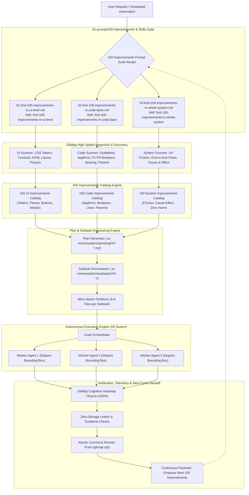
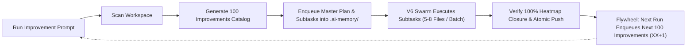

# Specification 01: 100 Improvements Prompts Suite Architecture & Execution Engine

## 1. System Overview & Problem Statement

Modern software repositories and applications frequently face subtle, compounding entropy across three critical dimensions:
1. **User Interface (UI) Degradation:** Drifting color tokens, failing contrast ratios, broken z-index stacking, untracked visual hierarchies, non-semantic typography, rigid button states, and jarring motion physics.
2. **Codebase Structural Inconsistency:** Violation of core coding guidelines, ad-hoc error propagation, negative and mixed-polarity boolean conditions, untyped function returns, dense control flow lacking vertical breathing room, functions exceeding reasonable line caps, and bloated parameter signatures.
3. **Whole-System UX Friction:** Subtle interaction latency, unexpected UI blocking during I/O operations, lack of optimistic updates, unhandled network edge cases, poor error messaging, and brittle workflows that risk unintended side effects or regressions.

To systematically eliminate this entropy and establish an autonomous, compounding flywheel of software excellence, this specification introduces the **100 Improvements Prompts Suite** (`01-prompts/30-improvements/`) and its corresponding **Antigravity & Cursor Agent Skills** (`.agents/skills/` and `.cursor/skills/`).

The suite provides three specialized autonomous execution workflows:
1. **UI Level Improvements:** Focuses on design token fidelity, WCAG AAA/AA contrast compliance, 4-plane depth hierarchy, 60/30/10 visual balance, live DOM text enforcement, responsive button hierarchies, and spring-based motion physics.
2. **Code Base Improvements:** Focuses on strict coding guideline conformance, `pkg/appfault.AppError` error management, positive boolean discipline (P1 through P9), monadic result envelopes (`Result[T]`), vertical spacing rules (Rules 4, 5, 10), functions restricted to $\le 15$ lines, and parameter struct encapsulation for signatures with $> 2\text{--}3$ parameters.
3. **Whole System Improvements:** Focuses on systemic user experience optimization, friction reduction, 4-part cause-and-effect impact audits, zero-harm regression prevention, backward compatibility preservation, and isolated rollback guarantees.

Each prompt in the suite operates as an autonomous, self-looping discovery and planning engine. When executed, it thoroughly inspects the workspace, identifies exactly 100 concrete, numbered opportunities, and enqueues a structured master pending plan in `.ai-memory/plans/pending/XX-<slug>.md` along with modular, bounded subtasks in `.ai-memory/plans/subtasks/XX-<slug>/`. Upon completion of an active execution cycle, the workflow self-loops to discover and enqueue the *next* 100 improvements, creating a continuous improvement cycle.

---

## 2. Mermaid Architecture Diagram



---

## 3. Canonical Prompt Categories & Technical Disciplines

### 3.1 Prompt 01: Find 100 Improvements in the UI Level

The UI Level prompt (`01-prompts/30-improvements/01-find-100-improvements-in-ui-level.md`) audits, documents, and organizes visual and front-end improvements across seven non-negotiable disciplines:

```
+-------------------------------------------------------------------------+
|                  UI Level Improvement Dimensions (1-100)                |
+-------------------------------------------------------------------------+
|  1. Color Token System: HSL/OKLCH semantic palette, no raw hexes        |
|  2. Contrast Ratios: WCAG 2.1 AAA (7:1) and AA (4.5:1 / 3:1)            |
|  3. 4-Plane Depth Hierarchy: Canvas (0), Surface (1), Elev (2), Over (3)|
|  4. 60/30/10 Distribution: Dominant (60%), Structural (30%), Pop (10%) |
|  5. Live DOM Text Standard: Semantic HTML only, zero rasterized text    |
|  6. Button & Control System: 44x44px touch targets, full pseudo-states  |
|  7. Motion Physics: Spring curves, <=250ms, prefers-reduced-motion      |
+-------------------------------------------------------------------------+
```

#### A. Color Tokens & Semantic Palettes
- **Mandatory Tokenization:** Direct hardcoded hex colors (e.g. `#ffffff`, `#1e293b`), arbitrary `rgb()`/`hsl()` values, and ad-hoc utility classes are strictly flagged for refactoring into semantic design tokens.
- **Semantic Color Tokens Reference:**
  - Background Tokens: `--bg-canvas`, `--bg-surface`, `--bg-surface-elevated`, `--bg-surface-hover`, `--bg-modal-overlay`.
  - Content/Text Tokens: `--text-primary`, `--text-secondary`, `--text-muted`, `--text-inverted`, `--text-accent`.
  - Border Tokens: `--border-subtle`, `--border-default`, `--border-strong`, `--border-focus`.
  - Functional Accent Tokens: `--color-primary`, `--color-success`, `--color-warning`, `--color-error`, `--color-info`.
- **Theme Adaptability:** Support seamless light and dark mode switching via CSS custom property overrides without requiring component class changes.

#### B. Contrast Ratios & Accessibility Compliance
- **WCAG 2.1 Standards:**
  - Body & Paragraph Text: Minimum contrast ratio of 4.5:1 (AA) and target of 7:1 (AAA) against surrounding background surfaces.
  - Large Text ($\ge 18\text{pt}$ or $\ge 14\text{pt}$ bold): Minimum contrast ratio of 3:1 (AA) and target of 4.5:1 (AAA).
  - Essential Graphical Objects & Interactive Controls: Minimum contrast ratio of 3:1 against adjacent background colors.
- **Audit Requirement:** For every UI improvement item involving typography or borders, the exact calculated contrast ratio must be stated alongside remediation color hexes.

#### C. 4-Plane Depth Hierarchy
All user interfaces must be organized into four explicit, non-overlapping architectural planes:

| Plane Index | Plane Name | Semantic Token | Typical Usage | Elevation / Z-Index |
|:---|:---|:---|:---|:---|
| **Plane 0** | Base Canvas | `--bg-canvas` | App background, underlying page viewport | 0dp / `z-index: 0` |
| **Plane 1** | Structural Surface | `--bg-surface` | Cards, sidebars, header shells, main content sections | 1dp / `z-index: 10` |
| **Plane 2** | Elevated Interactive | `--bg-surface-elevated` | Dropdown menus, popovers, flyout side panels, autocomplete | 4dp / `z-index: 50` |
| **Plane 3** | Modal & Overlay | `--bg-modal-overlay` | Dialogs, lightbox modals, global toasts, critical alerts | 16dp / `z-index: 100+` |

#### D. 60/30/10 Visual Proportion Rule
- **60% Dominant Neutral Surface:** Base canvas, primary reading surfaces, and negative breathing space (`--bg-canvas`, neutral tones).
- **30% Structural Secondary Surface:** Card containers, navigation borders, table headers, sidebar structures (`--bg-surface`, secondary neutrals).
- **10% High-Contrast Accent:** Primary call-to-action buttons, active navigation indicators, key metrics, focus rings (`--color-primary`, accent highlight). Prevents visual clutter and focal point fatigue.

#### E. Live DOM Text Standard
- **Total Ban on Baked Glyphs:** Text MUST NEVER be rasterized inside PNG, JPEG, WebP, or SVG graphical assets.
- **DOM Accessibility:** All headings, badges, labels, metrics, and callouts must be live, selectable, translatable, and readable by assistive technologies (ARIA standards) with responsive line wrapping.

#### F. Button & Interactive Control System
- **Touch Target Minimums:** All interactive targets (buttons, links, icon toggles, inputs) must measure at least $44 \times 44\text{px}$ (or $48 \times 48\text{px}$ on touch-first viewports) in interactive hit area.
- **Full Pseudo-State Coverage:** Every interactive element must specify explicit styling for `hover`, `focus-visible` (dual-offset outline ring), `active` (scale-down 0.98 feedback), and `disabled` (`opacity: 0.5`, `cursor: not-allowed`, no hover trigger) states.

#### G. Motion Physics & Transition Budget
- **Physics-Based Transitions:** Avoid linear timing curves. Use natural ease-out or spring cubic-bezier curves (e.g. `cubic-bezier(0.16, 1, 0.3, 1)`).
- **Duration Budget:** Micro-interactions (hover, color changes) $\le 150\text{ms}$; component transitions (drawers, modals, accordions) $\le 250\text{ms}$.
- **Accessibility:** Mandatory wrapping in `@media (prefers-reduced-motion: reduce)` to disable non-essential animations for users with vestibular sensitivities.

---

### 3.2 Prompt 02: Find 100 Improvements in the Code Base

The Code Base prompt (`01-prompts/30-improvements/02-find-100-improvements-in-code-base.md`) audits, catalogs, and plans technical refactorings based on `02-spec/02-coding-guidelines/` and `02-spec/03-error-manage/` across seven structural pillars:

```
+-------------------------------------------------------------------------+
|                Code Base Improvement Pillars (1-100)                    |
+-------------------------------------------------------------------------+
|  1. Error Handling: Return *appfault.AppError, Result[T] envelopes     |
|  2. Positive Booleans (P1-P9): is/has only, no explicit == true         |
|  3. Vertical Spacing (Rules 4, 5, 10): Blank lines before/after exits   |
|  4. Function Sizing: <= 15 lines max (prefer <= 8 lines)                |
|  5. Parameter Structs: DTOs/*Params structs for > 2-3 arguments         |
|  6. File Sizing & Modularity: <= 100 lines per file where practical     |
|  7. Type Safety: Zero bare any, no unhandled exceptions, typed enums    |
+-------------------------------------------------------------------------+
```

#### A. Structured Error Management & `pkg/appfault.AppError`
- **Go Functions:** All functions returning failure metadata must return structured `*appfault.AppError` (or `type Fault = AppError`) rather than bare `error`.
- **Result Monads:** Functions returning values alongside possible errors must use monadic result envelopes (`Result[T]`, `ResultSlice[T]`, `ResultMap[K, V]`).
- **No Bare Void:** Go functions must never return bare void if fallible; always return `*appfault.AppError` or `Result[T]`.
- **Universal Response Envelopes:** Cross-boundary API responses must serialize standard JSON envelopes with status, data, and structured appfault payloads.

#### B. Positive Boolean Standard (Principles P1 through P9)
1. **P1 (Affirmative Prefix):** All boolean variables, methods, properties, and predicates must start with `is` or `has` (e.g. `isReady`, `hasPermission`).
2. **P2 (No Negative Identifiers):** Negative tokens (`not`, `no`, `non`, `isNot`, `hasNo`, `isEmpty`, `isInvalid`) are strictly forbidden. Use affirmative semantic opposites (e.g. `isEmpty` $\to$ `isOccupied` or use affirmative logic).
3. **P3 (Named Guards):** Invert negative checks and extract them into clearly named positive guard variables.
4. **P4 (Complex Expression Extraction):** Any condition with $2+$ logical operators must be extracted into discrete, positively named intermediate boolean variables.
5. **P5 (Explicit Parameter Discipline):** Functions must never accept loose boolean flags (`func run(force bool)`); use explicit option structs or typed enums.
6. **P6 (Zero Mixed Polarity):** Combining a positive and negative condition in a single `if` statement (e.g. `if isA && !isB`) is strictly prohibited. Decompose into intermediate booleans.
7. **P7 (No Inline Statements in Conditionals):** Inline assignments inside `if` statements (e.g. `if err := doWork(); err != nil`) are forbidden; separate assignment from condition.
8. **P8 (No Raw System Calls in Logic):** Raw I/O or system evaluations must not appear inline in boolean branching; extract to isolated, testable helper functions.
9. **P9 (Total Ban on Explicit True):** NEVER evaluate a boolean explicitly against `true` or `false` (`if isReady == true`). Always evaluate implicitly (`if isReady { ... }`).

#### C. Vertical Spacing Rules (Rules 4, 5, 10)
- **Rule 4 (Blank Line Before Exit):** Insert a mandatory blank line before `return` or `throw` when preceded by other statements in the same block. If `return`/`throw` is the sole statement in the block, no blank line is required.
- **Rule 5 (Blank Line After Closing Brace):** Insert a mandatory blank line after every closing brace `}` unless followed immediately by another closing brace `}`.
- **Rule 10 (Blank Line Before `if`):** Insert a mandatory blank line before any `if` statement when preceded by assignments, method calls, or declarations.

#### D. Function & File Size Caps
- **Function Size:** Functions must not exceed 15 lines of executable body logic, with a preferred target of $\le 8$ lines. Decompose large functions into single-purpose helpers.
- **Parameter Structs:** Functions accepting more than 2–3 arguments must encapsulate them into a dedicated value-based or pointer-based Parameter Struct / DTO (e.g. `CreateParams`, `FetchOptions`).
- **File Length:** Target modular files of $\le 100$ lines, cleanly partitioning responsibilities into separate module files.

---

### 3.3 Prompt 03: Find 100 Improvements in the Whole System

The Whole System prompt (`01-prompts/30-improvements/03-find-100-improvements-in-whole-system.md`) analyzes the software end-to-end to eliminate user friction, optimize latency, enhance reliability, and improve workflow efficiency without causing regressions:

```
+-------------------------------------------------------------------------+
|               Whole System Improvement Disciplines (1-100)              |
+-------------------------------------------------------------------------+
|  1. Friction Reduction: Fewer clicks, keyboard parity, optimistic state |
|  2. 4-Part Cause & Effect: Root cause, effect, fix, blast radius        |
|  3. Zero Harm & Regression Safety: Invariant safety, shadow validation  |
|  4. Backward Compatibility: Schema migrations, API contract safety      |
|  5. Telemetry & Observability: Traceability, structured logging         |
|  6. Network & Storage Resilience: Offline fallback, cache invalidation  |
+-------------------------------------------------------------------------+
```

#### A. User Experience (UX) Friction Elimination
- **Click Path Streamlining:** Consolidate redundant confirmation dialogues, multi-step forms, and navigation detours into streamlined single-action flows.
- **Keyboard Parity:** Full keyboard navigation support (standard shortcuts, `/` search focus, `Esc` dismiss, `Tab` order).
- **Optimistic UI Updates:** Reflect user actions immediately in the UI while asynchronous requests process in the background, with automatic graceful rollback on error.
- **Graceful Error Recovery:** Informative, human-readable error messages with one-click retry actions, clear remediation instructions, and non-blocking toast notifications.

#### B. 4-Part Cause and Effect Analysis Matrix
For every single one of the 100 whole-system improvements, the catalog must document:
1. **Root Cause:** The underlying architectural, algorithmic, or interface flaw causing friction, delay, or instability.
2. **Immediate Effect:** The visible detriment to the user, developer, or runtime system (e.g. 800ms UI freeze, 3 extra clicks, silent state desynchronization).
3. **Proposed Remediation:** The surgical architectural fix, optimization, or workflow adjustment.
4. **Blast Radius & Mitigation:** Analysis of touched modules, potential regression vectors, and verification guarantees ensuring zero harm.

#### C. Zero Harm & Regression Prevention Guarantee
- **Non-Destructive Evolution:** No removal of public methods, database columns, or API properties without multi-stage deprecation.
- **Shadow Verification:** High-risk refactorings must run alongside existing routines or utilize non-breaking wrapper adapters.
- **Reversible Checkpoints:** Every improvement subtask must be bounded (5–8 files) and verifiable in isolation.

---

## 4. Plan Enqueueing & Subtask Decomposition Mechanics

A cornerstone requirement of the 100 Improvements Prompts Suite is that prompts do not perform untracked or uncontrolled sprawling edits. Instead, every run systematically discovers and translates the 100 improvements into a structured backlog of pending actionable plans.

### 4.1 Plan File Directory Conventions

All generated plans and subtasks must strictly reside within the repository memory hierarchy:

```
.ai-memory/
  plans/
    pending/
      XX-<slug>.md                     <-- Master Pending Plan File
    subtasks/
      XX-<slug>/
        01-subtask-<name>.md           <-- Bounded Subtask 01 (Items 1-10)
        02-subtask-<name>.md           <-- Bounded Subtask 02 (Items 11-20)
        ...
        10-subtask-<name>.md           <-- Bounded Subtask 10 (Items 91-100)
```

Where:
- `XX` is the zero-padded sequential index (`01`, `02`, etc.) determined by inspecting existing directories in `.ai-memory/plans/pending/` and `02-spec/21-app/`.
- `<slug>` is the hyphen-separated lowercase task slug (e.g. `01-ui-100-improvements-phase-1`).

### 4.2 Master Pending Plan Structure

The master plan file (`.ai-memory/plans/pending/XX-<slug>.md`) adheres to the standard format:
- **Header Metadata:** Task title, slug, status (`PENDING`), plan motto, and non-negotiable invariants.
- **User Request / Intent:** Contextual overview of the 100 improvements discovered.
- **Master Improvements Catalog:** Exhaustive table of all 100 numbered improvements ($1\text{--}100$) including category, target file/symbol, issue description, and proposed remediation.
- **Subtask Decomposition Matrix:** Partitioning of the 100 items into 10–15 bounded subtasks (each covering 5–10 improvements across 5–8 files).
- **Verification Evidence Contract:** Clear acceptance checklist and validation commands.

### 4.3 Subtask File Structure

Each subtask file (`.ai-memory/plans/subtasks/XX-<slug>/YY-subtask-<name>.md`) maintains a strictly bounded scope:
- **Task Identifiers:** Subtask Code (`Subtask-YY`), Parent Plan, Slug, Status (`PENDING`), Plan Motto.
- **Owned Deliverables (Disjoint Bounding Box):** Explicit list of files owned exclusively by this subtask.
- **Actionable Item Checklist:** Specific markdown checkboxes for each improvement item within this batch.
- **Verification Criteria:** Step-by-step audit checks to verify compliance before marking as complete.

### 4.4 The 100-Improvement Continuous Flywheel



The execution protocol mandates:
1. When an improvement prompt runs, it scans for uncompleted previous improvement plans in `.ai-memory/plans/pending/`.
2. If an active plan exists, the agent resumes execution of remaining subtasks.
3. If all previous improvement plans are completed and archived in `.ai-memory/plans/completed/`, the prompt discovers and enqueues the **next 100 improvements**, incrementing sequence `XX` and logging the cycle in `.ai-memory/`.

---

## 5. Companion Skills Architecture & Multi-Repository Synchronization

### 5.1 Dual-Skill Symmetry: Antigravity and Cursor IDE

To ensure consistent behavior across both Google Antigravity agents and Cursor IDE, every prompt in the suite has two symmetrical skill files:

| Prompt File | Antigravity Agent Skill | Cursor IDE Skill |
|:---|:---|:---|
| `01-prompts/30-improvements/01-find-100-improvements-in-ui-level.md` | `.agents/skills/find-100-improvements-in-ui-level/skill.md` | `.cursor/skills/find-100-improvements-in-ui-level/skill.md` |
| `01-prompts/30-improvements/02-find-100-improvements-in-code-base.md` | `.agents/skills/find-100-improvements-in-code-base/skill.md` | `.cursor/skills/find-100-improvements-in-code-base/skill.md` |
| `01-prompts/30-improvements/03-find-100-improvements-in-whole-system.md` | `.agents/skills/find-100-improvements-in-whole-system/skill.md` | `.cursor/skills/find-100-improvements-in-whole-system/skill.md` |

- **Antigravity Skill Syntax:** References skills via `[<skill-name>](file;.agents/skills/<skill-name>)`.
- **Cursor Skill Syntax:** References skills via `[<skill-name>](file;.cursor/skills/<skill-name>)`.
- **Slash Commands:** Always formatted as `[/plan](slashCommand;plan)` and `[/learn](slashCommand;learn)`.

### 5.2 Multi-Repository Synchronization Contract

When synchronizing the 100 Improvements Prompts Suite and its companion skills across connected repositories in the fleet via `03-ai-scripts/38-sync-prompts-skills-scripts.py`, the five non-negotiable boundaries apply:
1. **Spec 21 Exclusion (TOTAL BAN):** Never sync `02-spec/21-*` through `02-spec/25-*`. Specifications remain strictly local to `coding-guidelines`.
2. **Additive-Only AI Scripts:** Canonical prompt templates and shared skills are synchronized cleanly; target repository custom modifications must not be overwritten.
3. **Bump Script Protection (IMMUTABLE):** Never overwrite target repo versioning manifests or scripts (`bump*`, `version.json`).
4. **Memory & Plans Protection (TOTAL ISOLATION):** Target `.ai-memory/plans/` and `.ai-memory/memory/` remain isolated and are never overwritten or mirrored.
5. **Zero Secrets Leakage:** Secrets remain strictly confined to `repo-secrets` via `gitmap rs`.

---

## 6. Verification & Quality Assurance Protocol

To confirm the architectural integrity of the 100 Improvements Prompts Suite:

1. **Relative Path Hygiene:**
   - Scan all newly authored files for forbidden absolute paths or absolute file URIs:
     `gitmap aum search "file:" 01-prompts/30-improvements` (must return 0 hits for filesystem URI schemes).
     `gitmap aum search "file:" .agents/skills/find-100-improvements*` (must return 0 hits for filesystem URI schemes).
     `gitmap aum search "file:" .cursor/skills/find-100-improvements*` (must return 0 hits for filesystem URI schemes).
2. **Strict Lowercase File Naming:**
   - Verify all paths, folders, and markdown files are strictly lowercase without uppercase characters.
3. **Prompt & Skill Index Registration:**
   - Verify inclusion in `01-prompts/readme.md` and `.ai-memory/prompts.md`.
4. **Cognitive Heatmap Tracking:**
   - Log all inspection, authoring, and verification actions in GitMap Cognitive Heatmap (`gitmap heatmap log` / `gitmap heatmap update`) to verify 100% action closure before atomic commit.
5. **Zero CI/CD Artifact Impact:**
   - Ensure all reports and plan files are committed directly to Git without relying on temporary CI storage or `actions/upload-artifact`.
