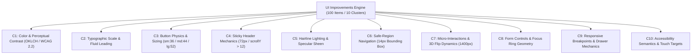
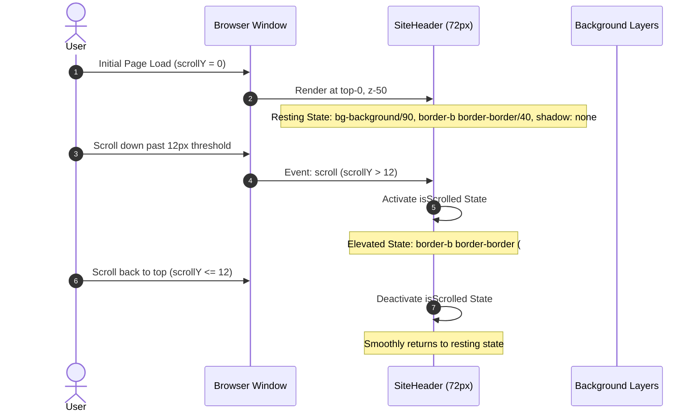
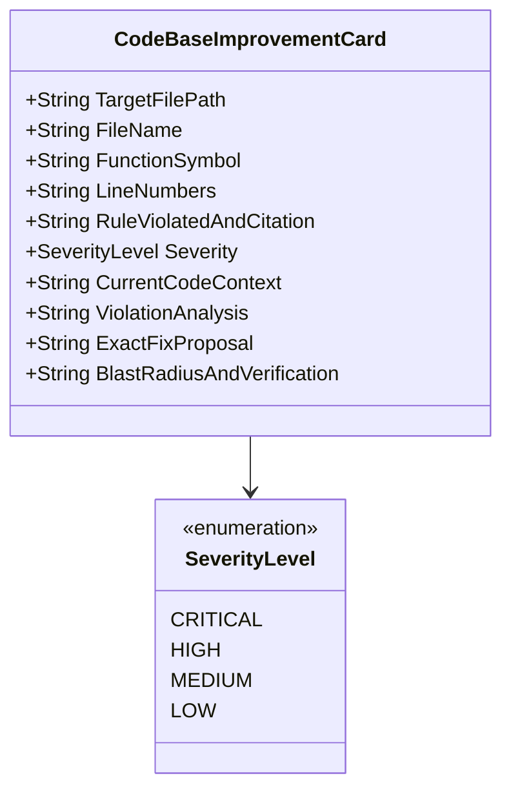
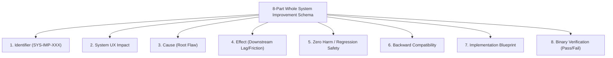
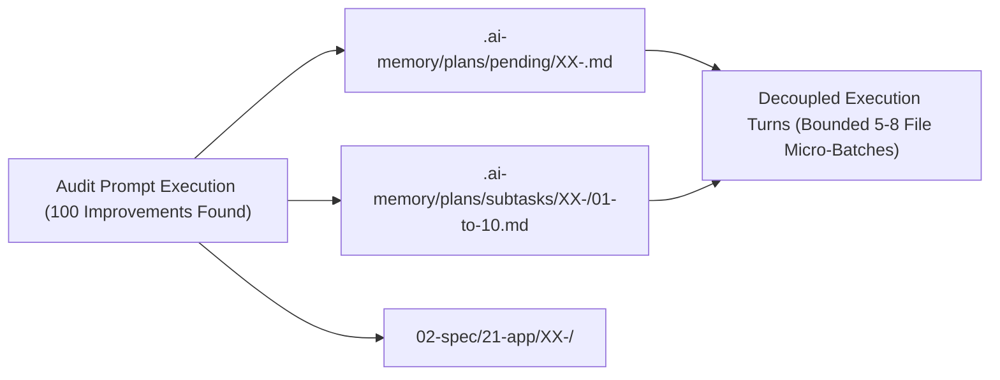

# Specification 02: Component Specification, Schemas & Concrete Examples

**Version:** 1.0.0  
**Status:** ACTIVE  
**Parent Plan:** `.ai-memory/plans/pending/01-create-prompts-for-100-improvements.md`  
**Architecture Spec:** `02-spec/21-app/01-create-prompts-for-100-improvements/01-architecture-spec.md`  
**Applicability:** Universal across Prompt Suite (`01-prompts/30-improvements/`), Antigravity Skills (`.agents/skills/`), and Cursor Skills (`.cursor/skills/`)

---

## 1. Executive Summary & Design System Grounding

This specification provides the definitive component architectures, mathematical models, data schemas, and concrete operational examples for the **100 Improvements Prompt Suite**. Every prompt in this suite is structured to discover, analyze, and remediate exactly 100 discrete opportunities partitioned across 10 functional clusters (10 items per cluster).

The three prompt domains are strictly specified:
1. **UI Level Improvements (`01-find-100-improvements-in-ui-level.md`):** Focuses on perceptual contrast, typography geometry, button physics, 72px sticky header physics, hairline specular lighting, safe-region navigation, 3D flip dynamics, form focus appearance, responsive layouts, and WCAG 2.2 AA/AAA compliance.
2. **Code Base Improvements (`01-find-100-improvements-in-code-base.md`):** Governed by a mandatory 10-field specification card schema, enforcing repository coding standards (positive booleans, `*appfault.AppError`, parameter structs, vertical newline gaps, relative paths) across bounded 5–8 file micro-batches.
3. **Whole System Improvements (`01-find-100-improvements-in-whole-system.md`):** Governed by an 8-part specification schema detailing UX impact, root cause, downstream effect, zero harm/regression safety, backward compatibility, implementation blueprint, and deterministic binary verification.

---

## 2. UI-Level 100 Improvements: Schemas, Formulas & Tokens



### 2.1 Mandatory 4-Format Color Palette Matrix

Every color token across the UI level must be specified in 4 synchronized formats: OKLCH runtime token, sRGB HEX, sRGB integer triplets, and HSL:

| Token Name | OKLCH Runtime Value | Format 1: HEX | Format 2: RGB / RGBA | Format 3: HSL | WCAG Contrast (#FFFFFF) | WCAG Contrast (#090E18) | Design Role |
|:---|:---|:---|:---|:---|:---:|:---:|:---|
| `--blue-50` | `oklch(0.972 0.014 259)` | `#F0F6FF` | `rgb(240, 246, 255)` | `hsl(216, 100%, 97%)` | 1.08:1 | 18.2:1 (AAA) | Hero top wash gradient start, brand chip ground |
| `--blue-100` | `oklch(0.935 0.032 262)` | `#DEEAFF` | `rgb(222, 234, 255)` | `hsl(218, 100%, 94%)` | 1.21:1 | 16.3:1 (AAA) | Chip hover fill, soft icon tile ring |
| `--blue-200` | `oklch(0.874 0.061 263)` | `#C1D6FF` | `rgb(193, 214, 255)` | `hsl(220, 100%, 88%)` | 1.48:1 | 13.3:1 (AAA) | Subdued border, highlight panel tint |
| `--blue-300` | `oklch(0.777 0.104 264)` | `#95B6FA` | `rgb(149, 182, 250)` | `hsl(220, 91%, 78%)` | 2.05:1 | 9.6:1 (AAA) | Secondary visualization series |
| `--blue-400` | `oklch(0.662 0.164 264)` | `#5E8EF6` | `rgb(94, 142, 246)` | `hsl(221, 89%, 67%)` | 3.02:1 | 6.5:1 (AA) | Dark-mode focus ring, retro grid line tint |
| `--blue-500` | `oklch(0.546 0.215 262.9)`| `#2563EB` | `rgb(37, 99, 235)` | `hsl(221, 83%, 53%)` | 4.62:1 (AA) | 4.26:1 | **Primary Action**, active toggle, link, pin #1 |
| `--blue-600` | `oklch(0.489 0.208 263.5)`| `#1B51D3` | `rgb(27, 81, 211)` | `hsl(222, 77%, 47%)` | 5.85:1 (AA) | 3.36:1 | Brand gradient start, pressed button fill |
| `--blue-700` | `oklch(0.409 0.176 264.5)`| `#173DA7` | `rgb(23, 61, 167)` | `hsl(224, 76%, 37%)` | 8.12:1 (AAA) | 2.42:1 | Pill text foreground, high-contrast link |
| `--blue-800` | `oklch(0.369 0.147 264.8)`| `#17368B` | `rgb(23, 54, 139)` | `hsl(224, 72%, 32%)` | 9.88:1 (AAA) | 1.99:1 | Deep interactive boundary |
| `--blue-900` | `oklch(0.317 0.135 264.5)`| `#0D2975` | `rgb(13, 41, 117)` | `hsl(224, 80%, 25%)` | 13.41:1 (AAA) | 1.47:1 | **Core Brand Anchor**, solid button fill |
| `--violet-500`| `oklch(0.532 0.253 296.9)`| `#822EE8` | `rgb(130, 46, 232)`| `hsl(267, 80%, 55%)` | 4.71:1 (AA) | 4.18:1 | **Tertiary Brand Accent**, gradient stop, pin #2 |
| `--neutral-900`| `oklch(0.163 0.023 265)` | `#090E18` | `rgb(9, 14, 24)` | `hsl(220, 45%, 6%)` | 19.72:1 (AAA) | 1.00:1 | Primary text ink, heavy heading foreground |
| `--neutral-200`| `oklch(0.924 0.011 265)` | `#E2E6ED` | `rgb(226, 230, 237)` | `hsl(218, 23%, 91%)` | 1.25:1 | 15.7:1 (AAA) | Resting hairline border, card dividers |
| `--paper` | `oklch(1 0 0)` | `#FFFFFF` | `rgb(255, 255, 255)` | `hsl(0, 0%, 100%)` | 1.00:1 | 19.72:1 (AAA) | Pure white canvas, light card face |

---

### 2.2 Mathematical Luminance & WCAG 2.2 Contrast Formulas

#### 2.2.1 WCAG 2.2 Standard Relative Luminance ($L$)
Relative luminance is calculated by linearizing non-linear gamma-encoded sRGB channels:

$$C_{\text{linear}} = \begin{cases} \frac{C_{\text{sRGB}}}{12.92} & \text{if } C_{\text{sRGB}} \le 0.04045 \\ \left(\frac{C_{\text{sRGB}} + 0.055}{1.055}\right)^{2.4} & \text{if } C_{\text{sRGB}} > 0.04045 \end{cases}$$

Where $C_{\text{sRGB}} \in [0, 1]$ represents normalized red ($R/255$), green ($G/255$), or blue ($B/255$). The composite relative luminance is:

$$L = 0.2126 \cdot R_{\text{linear}} + 0.7152 \cdot G_{\text{linear}} + 0.0722 \cdot B_{\text{linear}}$$

The contrast ratio ($\text{CR}$) between two surfaces of relative luminance $L_1$ and $L_2$ (where $L_1 > L_2$) is:

$$\text{CR} = \frac{L_1 + 0.05}{L_2 + 0.05}$$

- **WCAG 2.2 Level AA Standard:** Normal text ($\le 18\text{pt}$ / $24\text{px}$) requires $\text{CR} \ge 4.5:1$. Large text and UI components require $\text{CR} \ge 3.0:1$.
- **WCAG 2.2 Level AAA Standard:** Normal text requires $\text{CR} \ge 7.0:1$. Large text requires $\text{CR} \ge 4.5:1$.

#### 2.2.2 ITU-R BT.709 Fast Pill Ink Formula
For inline semantic pills, chips, and dynamic badges receiving arbitrary background colors, ink selection must enforce the deterministic ITU-R BT.709 relative luminance threshold:

$$L_{\text{pill}} = 0.299 \cdot \frac{R}{255} + 0.587 \cdot \frac{G}{255} + 0.114 \cdot \frac{B}{255}$$

$$\text{Ink Color} = \begin{cases} \text{Dark Ink } (\#090E18) & \text{if } L_{\text{pill}} > 0.60 \\ \text{Pure White } (\#FFFFFF) & \text{if } L_{\text{pill}} \le 0.60 \end{cases}$$

---

### 2.3 Button Sizing, Physics & Hairline Geometry

Buttons adhere strictly to standard dimensional increments, tactile vertical press physics, and specular sheen animations:

| Button Size | Total Height | Horizontal Padding | Typography | Corner Radius | Icon Size | Usage Target |
|:---|:---:|:---:|:---:|:---:|:---:|:---|
| `sm` | `36px` (`h-9`) | `16px` (`px-4`) | `text-[13px] font-medium leading-none` | `10px` | `14px` (`size-3.5`) | Sticky header CTAs, data table inline actions, compact card actions |
| `md` (Default)| `44px` (`h-11`) | `20px` (`px-5`) | `text-sm font-medium leading-none` | `12px` | `16px` (`size-4`) | Primary page CTAs, dialog action confirmations, form submissions |
| `lg` | `52px` (`h-13`) | `28px` (`px-7`) | `text-[15px] font-semibold leading-none` | `14px` | `18px` (`size-4.5`) | Hero primary/secondary CTAs, checkout checkout triggers |
| `icon` | `44px` (`h-11`) | `0px` (`w-11`) | — | `12px` | `18px` (`size-4.5`) | Standalone icon actions (Theme switch, Mobile hamburger) |

#### Button Physics & Layering Invariants:
1. **Vertical Gap Physics:** Press interaction triggers tactile `active:translate-y-[1px]` without altering width or triggering layout reflow.
2. **Child Isolation Rule:** All direct children and icons are bound to `relative z-10` (`[&>*]:relative [&>*]:z-10`), ensuring background animations (`.shine-sweep::after`, `.pointer-fill::before`) slide behind text labels without obscuring content.
3. **Hairline Lighting:** Resting outline buttons use `border border-border/40` (`rgba(226, 230, 237, 0.40)`). When hovered, a bottom-up pointer fill sweeps `--blue-500` (`#2563EB`) via `transform: scaleY(1)` over `180ms ease-out`.

---

### 2.4 Sticky 72px Glassmorphic Header Physics

The top navigation header enforces a strict `72px` (`h-[72px]`) spatial boundary with dynamic scroll physics:



1. **Backdrop Materiality:** Glassmorphic translucent ground `rgba(255, 255, 255, 0.90)` combined with hardware-accelerated blur (`backdrop-filter: blur(24px)`).
2. **Scroll Elevation Threshold (`window.scrollY > 12`):**
   - At resting position (`window.scrollY <= 12`), the header casts zero box shadow and renders a delicate hairline bottom border (`border-b border-border/40`, `rgba(226, 230, 237, 0.40)`), blending into the `--blue-50` (`#F0F6FF`) hero wash.
   - Upon crossing the `12px` scroll threshold (`isScrolled`), the bottom border transitions over `420ms cubic-bezier(0.16, 1, 0.3, 1)` to solid `border-border` (`#E2E6ED`) and casts deep brand shadow `--shadow-card` (`0 8px 24px -12px rgba(13, 41, 117, 0.18)`).
3. **Safe-Region Mega-Menu Hover Geometry:**
   - Nav items project an expanded `14px` padded bounding box corridor (`pad = 14px`) uniting the trigger element and the open dropdown panel.
   - Cursor diagonal movements remain within the safe region, avoiding premature panel closing. Close triggers enforce a delayed close timer (`110ms` to `220ms`).

---

### 2.5 10 Clusters of UI-Level Improvements (100 Items Enumerated)

The following 10 clusters (10 items each) form the canonical catalog of UI-level improvement targets:

```text
Cluster 1: Color, Theming & Perceptual Contrast (UI-001 to UI-010)
  UI-001: Normalize low-contrast body text to minimum 4.5:1 WCAG AA ratio against white ground.
  UI-002: Replace hardcoded hex values with centralized 4-format CSS custom properties.
  UI-003: Calibrate dark-mode surface elevation ramps using perceptual OKLCH lightness intervals.
  UI-004: Standardize muted badge background contrast against dark ink labels.
  UI-005: Enforce dynamic ITU-R BT.709 ink color calculation for user-customizable tag pills.
  UI-006: Eliminate vibrating color boundaries between adjacent saturated primary and secondary hues.
  UI-007: Calibrate disabled button contrast to meet WCAG 2.2 minimum discernible threshold of 3:1.
  UI-008: Harmonize link hover state contrast transitions across all thematic color schemes.
  UI-009: Implement directional brand gradients using color-mix in oklab to prevent muddy midtones.
  UI-010: Ensure transparent alpha washes maintain text legibility across variable background imagery.

Cluster 2: Typographic Scale, Fluid Sizing & Leading Geometry (UI-011 to UI-020)
  UI-011: Enforce mathematical fluid clamp() typography across viewport widths (320px to 1440px).
  UI-012: Lock heading line-heights to tight ratios (1.15 to 1.25) to eliminate awkward wrapping gaps.
  UI-013: Apply tabular numbers (font-variant-numeric: tabular-nums) to financial and metric figures.
  UI-014: Standardize uppercase tracking to letter-spacing: 0.08em - 0.16em for micro-labels.
  UI-015: Prevent orphan words in primary marketing headings using balance/pretty text wrapping.
  UI-016: Align baseline rhythms across multi-column card headers using standard rem multiples.
  UI-017: Constrain long-form reading paragraphs to optimal line length (65 to 75 characters max).
  UI-018: Fix clipping of extended ascenders and descenders in custom display typography fonts.
  UI-019: Unify monospace code block font sizes and padding across dark and light surfaces.
  UI-020: Eliminate font-weight jumping on button hover states using subtle letter-spacing offsets.

Cluster 3: Button Physics, Sizing & Tactile Feedback (UI-021 to UI-030)
  UI-021: Standardize all buttons into strict sm (36px), md (44px), and lg (52px) height tiers.
  UI-022: Implement tactile active:translate-y-[1px] physical compression across all button variants.
  UI-023: Enforce [&>*]:relative [&>*]:z-10 child isolation to shield text from pseudo-sheens.
  UI-024: Eliminate button layout shift during dynamic loading spinner insertion.
  UI-025: Implement hardware-accelerated .shine-sweep specular highlights using composite transforms.
  UI-026: Calibrate spring tension on optional magnetic cursor attraction wrappers (strength: 0.22).
  UI-027: Provide consistent disabled state cursor styling (cursor: not-allowed) and 50% opacity.
  UI-028: Standardize full-width button behavior in mobile viewports with sticky bottom anchors.
  UI-029: Implement bottom-up vertical pointer fill animations for outline secondary buttons.
  UI-030: Enforce minimum 44px by 44px hit-box sizing for standalone icon buttons.

Cluster 4: Sticky Header Mechanics & Scroll Physics (UI-031 to UI-040)
  UI-031: Enforce fixed 72px spatial height constraint for master desktop navigation header.
  UI-032: Implement window.scrollY > 12 threshold trigger for dynamic elevation state transition.
  UI-033: Apply 420ms cubic-bezier(0.16, 1, 0.3, 1) transition curves to header border changes.
  UI-034: Eliminate header jitter during fast scrolling by debouncing scroll position listeners.
  UI-035: Maintain backdrop-filter: blur(24px) glassmorphism without degrading framerates.
  UI-036: Synchronize z-index hierarchies between sticky headers (z-50) and mega panels (z-40).
  UI-037: Enforce 1px brand secondary underline animation on active navigation menu links.
  UI-038: Implement automatic dropdown closure when cursor hovers right-hand CTA button cluster.
  UI-039: Preserve header translucency over rich hero background video and canvas elements.
  UI-040: Prevent page layout reflow by reserving 72px top layout spacer on non-overlay templates.

Cluster 5: Hairline Lighting, Inner Borders & Specular Sheen (UI-041 to UI-050)
  UI-041: Replace 1px solid harsh black borders with calibrated border-border/40 resting hairlines.
  UI-042: Add subtle top inner highlight (inset 0 1px 0 rgba(255,255,255,0.15)) to elevated cards.
  UI-043: Implement gradient hairline borders using border-image or pseudo-elements on dark cards.
  UI-044: Standardize card shadow elevation tokens from resting (shadow-card) to hover (shadow-lift).
  UI-045: Ensure hairline dividers between table rows use calibrated neutral-200 alpha levels.
  UI-046: Eliminate double-border accumulation where adjacent card components touch in flex grids.
  UI-047: Implement specular glow edge highlights that track pointer coordinates on spotlight cards.
  UI-048: Calibrate modal dialog border contrast against heavy backdrop blur overlays.
  UI-049: Enforce consistent corner radius scaling between outer card containers and inner badges.
  UI-050: Standardize inset focus indicators for high-density dashboard data grid cells.

Cluster 6: Safe-Region Navigation & Mega-Menu Geometry (UI-051 to UI-060)
  UI-051: Implement 14px padded safe-region polygon uniting trigger elements and mega panels.
  UI-052: Introduce 150ms debounce close delay to tolerate erratic diagonal cursor movements.
  UI-053: Standardize mega-menu column templates based on active group count (1fr_1fr_1fr_0.9fr).
  UI-054: Animate mega-menu item hover left vertical indicator line via transform origin-top.
  UI-055: Implement SlideSwapLabel character stagger hover transitions on primary category items.
  UI-056: Slide capability link arrow icon (size-3.5) from -translate-x-1 to translate-x-0 on hover.
  UI-057: Lock background window scrolling whenever a full-screen mobile menu drawer is open.
  UI-058: Ensure instant panel dismissal on Escape key press with focus returned to trigger.
  UI-059: Position mega-menu outer container precisely at absolute left-0 right-0 top-full pt-3.
  UI-060: Prevent mega-menu container overflow on intermediate tablet screen dimensions.

Cluster 7: Micro-Interactions, 3D Flip Dynamics & Hover Grammar (UI-061 to UI-070)
  UI-061: Build 3D flip promo card using [perspective:1400px] and smooth 820ms transition curves.
  UI-062: Isolate front and back card faces using strict [backface-visibility:hidden] styling.
  UI-063: Rotate back face to [transform:rotateY(180deg)] with zero z-index rendering artifacts.
  UI-064: Animate chevron icon 180-degree rotation when associative mega-menu panel opens.
  UI-065: Standardize micro-interaction spring timing (cubic-bezier(0.16, 1, 0.3, 1)) across the app.
  UI-066: Implement ripple and sheen keyframe animations triggered by user click events.
  UI-067: Smooth accordion drawer expansion using CSS grid-template-rows 0fr to 1fr transitions.
  UI-068: Calibrate tooltip delay (300ms) to prevent accidental popups during rapid scanning.
  UI-069: Prevent hover animation thrashing when hovering interactive icon boundaries.
  UI-070: Honor prefers-reduced-motion media query by swapping complex 3D flips for clean crossfades.

Cluster 8: Form Controls, Focus Rings & Interactive States (UI-071 to UI-080)
  UI-071: Implement 2px high-contrast focus rings with 2px offset (focus-visible:ring-2).
  UI-072: Replace browser default outline styles with custom branded focus rings across all inputs.
  UI-073: Standardize form input heights to match button tiers (sm: 36px, md: 44px).
  UI-074: Animate floating input labels without causing visual layout shift on focus or input.
  UI-075: Present inline validation error messages with associated icon and aria-describedby links.
  UI-076: Provide clear visual demarcation for disabled, readonly, and loading input states.
  UI-077: Standardize custom checkbox and radio button indicators with smooth scale-in checks.
  UI-078: Calibrate select dropdown chevron alignment and custom scrollbar thumb styling.
  UI-079: Prevent mobile viewport zoom on input focus by enforcing 16px minimum font size.
  UI-080: Implement auto-expanding textarea fields without abrupt vertical height jumps.

Cluster 9: Responsive Layouts, Fluid Grids & Viewport Breakpoints (UI-081 to UI-090)
  UI-081: Enforce consistent responsive page gutter padding (mobile: 16px, tablet: 24px, desktop: 32px).
  UI-082: Eliminate horizontal overflow scrolling bugs on mobile devices across all routes.
  UI-083: Convert multi-column desktop data tables into mobile-friendly stacked card layouts.
  UI-084: Standardize CSS container queries for modular card widgets placed in variable sidebars.
  UI-085: Adjust hero marketing title fluid clamp parameters to prevent 4-line mobile wrapping.
  UI-086: Implement sticky mobile bottom navigation bars with safe-area-inset-bottom support.
  UI-087: Ensure modal dialogs resize gracefully to bottom sheet drawers on small mobile screens.
  UI-088: Calibrate multi-pane master-detail viewports to collapse cleanly at 1024px breakpoint.
  UI-089: Optimize image srcset and sizes attributes to serve correctly scaled responsive bitmaps.
  UI-090: Ensure floating back-to-top buttons do not obscure primary mobile action controls.

Cluster 10: Accessibility (a11y), Screen Readers & Touch Targets (UI-091 to UI-100)
  UI-091: Guarantee minimum touch target hit area of 44px by 44px across all mobile interactives.
  UI-092: Provide descriptive aria-label attributes for all standalone icon buttons and links.
  UI-093: Ensure logical DOM keyboard tab sequence matches visual layout flow across all views.
  UI-094: Implement visible, skip-to-content bypass links for keyboard and screen-reader users.
  UI-095: Announce dynamic toast notifications and errors via aria-live=polite/assertive regions.
  UI-096: Bind modal dialogs with proper role=dialog, aria-modal=true, and keyboard focus traps.
  UI-097: Ensure all informational SVG icons include title and desc tags or aria-hidden=true.
  UI-098: Provide sufficient visual difference beyond color alone for error and warning states.
  UI-099: Support system dark mode and high-contrast OS settings through standard media queries.
  UI-100: Guarantee full keyboard operability for custom dropdowns, menus, and tabs without mouse.
```

---

## 3. Code Base 100 Improvements: 10-Field Specification Card Schema

Code base improvements identify and eliminate architectural anti-patterns, guideline violations, type unsafe constructs, and error-handling bugs.



### 3.1 The 10-Field Specification Card Structure

Every code base improvement proposal must be documented using the standard 10-field card schema:

```markdown
#### Card [CB-XXX]: [Short Descriptive Title]

1. **Target File Path:** `[relative/path/to/source.go]`
2. **File Name:** `[source.go]`
3. **Function / Symbol:** `[PackageName.FunctionName]` or `[StructName.MethodName]`
4. **Line Numbers:** `L[Start]-L[End]`
5. **Rule Violated & Citation:** `[Rule Title]` (`02-spec/02-coding-guidelines/[file].md#section`)
6. **Severity:** `CRITICAL` | `HIGH` | `MEDIUM` | `LOW`
7. **Current Code Context:**
   ```[language]
   // Verbatim excerpt displaying the violation
   ```
8. **Violation Analysis:**
   [Deep explanation of the structural flaw, why it violates conventions, and potential failure modes.]
9. **Exact Fix Proposal:**
   ```[language]
   // Complete drop-in replacement code adhering to all repository invariants
   ```
10. **Blast Radius & Verification:**
    - Impacted callers / packages.
    - Type signature compatibility.
    - Verification: Zero-storage / no-build verification check (e.g. `gitmap aum search`, syntax linter).
```

---

### 3.2 5–8 File Micro-Batching Execution Model

To guarantee clean, verifiable execution without git conflicts or unbounded complexity:
1. **Partitioning:** All 100 code improvements are grouped into micro-batches of exactly 5 to 8 files.
2. **Sequential Self-Looping:** Each micro-batch is audited, edited, and verified as an isolated transaction.
3. **Local Checkpointing:** Intermediate changes are checkpointed locally using flat commits (`gitmap commit "<batch-summary>"`) without touching remotes.
4. **Final Closure:** Completion of the full set mandates upstream push via semantic commit (`gitmap cpf "<module> - <summary>"`).

---

### 3.3 Concrete 10-Field Code Card Examples

#### Example 1: Critical Severity (Structured Error Management & Explicit Boolean Check)

#### Card [CB-001]: Migrate Bare Error Return and Explicit Boolean Check in Session Validator

1. **Target File Path:** `04-code/golang/pkg/session/validator.go`
2. **File Name:** `validator.go`
3. **Function / Symbol:** `SessionManager.ValidateToken`
4. **Line Numbers:** `L45-L62`
5. **Rule Violated & Citation:** Section 1 (No Explicit True Checks) & Section 6 (`*appfault.AppError` Return Standard) (`02-spec/02-coding-guidelines/04-error-handling.md`)
6. **Severity:** `CRITICAL`
7. **Current Code Context:**
   ```go
   func (sm *SessionManager) ValidateToken(token string) (bool, error) {
       claims, err := parseJWT(token)
       if err != nil {
           return false, err
       }
       if claims.IsValid == true {
           return true, nil
       }
       return false, errors.New("token expired")
   }
   ```
8. **Violation Analysis:**
   The function violates two core repository rules:
   - Evaluates boolean `claims.IsValid == true` explicitly against `true` instead of implicit evaluation `if claims.IsValid`.
   - Returns a bare tuple `(bool, error)` with primitive `errors.New` instead of using structured `*appfault.AppError` and the monadic `result.Result[bool]` envelope.
9. **Exact Fix Proposal:**
   ```go
   package session

   import (
       "pkg/appfault"
       "pkg/result"
   )

   func (sm *SessionManager) ValidateToken(token string) result.Result[bool] {
       claims, fault := parseJWT(token)
       if fault != nil {
           return result.Fail[bool](fault)
       }

       if claims.IsValid {
           return result.Ok(true)
       }

       return result.Fail[bool](
           appfault.New("SESSION_EXPIRED", "provided session token has expired").
               WithField("token", token[:8]+"..."),
       )
   }
   ```
10. **Blast Radius & Verification:**
    - Impacted callers: `cmd/api/auth_handler.go` (`authHandler.LoginCheck`).
    - Caller update: Replace `isValid, err := sm.ValidateToken(...)` with `res := sm.ValidateToken(...)` and inspect `if res.IsFailure()`.
    - Verification: `gitmap aum search "claims.IsValid == true" 04-code/golang` returns 0 hits.

---

#### Example 2: High Severity (Loose Parameter Bloat & Missing Vertical Spacing)

#### Card [CB-022]: Refactor Loose Parameter Signature to Value-Based Params Struct

1. **Target File Path:** `04-code/golang/pkg/pipeline/runner.go`
2. **File Name:** `runner.go`
3. **Function / Symbol:** `ExecutePipeline`
4. **Line Numbers:** `L88-L112`
5. **Rule Violated & Citation:** Section 8 (Parameter Structs >2-3 parameters) & Section 8 (Mandatory Vertical Spacing) (`02-spec/02-coding-guidelines/01-naming.md`)
6. **Severity:** `HIGH`
7. **Current Code Context:**
   ```go
   func ExecutePipeline(ctx context.Context, repoPath string, branch string, dryRun bool, timeoutSec int, notify bool) *appfault.AppError {
       if repoPath == "" {
           return appfault.New("INVALID_PATH", "repo path cannot be empty")
       }
       runner := NewRunner(repoPath)
       runner.SetBranch(branch)
       if dryRun {
           return nil
       }
       return runner.Run(ctx)
   }
   ```
8. **Violation Analysis:**
   The signature contains 6 loose parameters, heavily violating the strict ban on signatures with >2-3 arguments. Additionally, there are missing vertical line gaps: no blank line before `if repoPath == ""`, no blank line after the closing brace `}`, and no blank line before `return runner.Run(ctx)`.
9. **Exact Fix Proposal:**
   ```go
   package pipeline

   import (
       "context"
       "pkg/appfault"
   )

   type ExecutePipelineParams struct {
       Context    context.Context
       RepoPath   string
       Branch     string
       TimeoutSec int
       DryRun     bool
       Notify     bool
   }

   func ExecutePipeline(params ExecutePipelineParams) *appfault.AppError {
       if params.RepoPath == "" {
           return appfault.New("INVALID_PATH", "repo path cannot be empty")
       }

       runner := NewRunner(params.RepoPath)
       runner.SetBranch(params.Branch)

       if params.DryRun {
           return nil
       }

       return runner.Run(params.Context)
   }
   ```
10. **Blast Radius & Verification:**
    - Impacted callers: `cmd/gitmap/main.go`, `pkg/pipeline/scheduler.go`.
    - Verification: `gitmap aum search "func ExecutePipeline(" 04-code/golang` confirms single parameter signature.

---

### 3.4 10 Clusters of Code Base Improvements (100 Items Enumerated)

```text
Cluster 1: Boolean Semantics & Condition Simplification (CB-001 to CB-010)
  CB-001: Eliminate explicit true equality checks (isReady == true -> isReady).
  CB-002: Eliminate explicit false equality checks (hasKey == false -> !hasKey).
  CB-003: Disentangle mixed-polarity conditions (if isA && !isB -> discrete guard clauses).
  CB-004: Standardize boolean prefixing to strictly 'is' or 'has' across all structs.
  CB-005: Convert negative boolean flags (isDisable -> isEnabled, hasNoCache -> hasCache).
  CB-006: Simplify redundant ternary boolean returns (condition ? true : false -> condition).
  CB-007: Replace multiple boolean flags with discrete enumeration bitmasks or enums.
  CB-008: Remove double negation expressions (!!value -> explicit boolean helper).
  CB-009: Eliminate state booleans that duplicate status enum semantics.
  CB-010: Enforce boolean parameter structs for functions accepting adjacent untyped booleans.

Cluster 2: Structured Error Management & *appfault.AppError Returns (CB-011 to CB-020)
  CB-011: Migrate primitive Go error returns to structured *appfault.AppError pointers.
  CB-012: Enforce monadic result.Result[T] containers for functions returning data and faults.
  CB-013: Eliminate fmt.Errorf strings containing unparsed sensitive database connection URIs.
  CB-014: Replace unwrap-resistant errors.New with categorized domain fault constructors.
  CB-015: Attach contextual key-value metadata via .WithField() rather than message formatting.
  CB-016: Standardize HTTP and RPC status mapping inside appfault taxonomy registries.
  CB-017: Eliminate panic() recovery anti-patterns in favor of explicit fault bubbling.
  CB-018: Standardize TypeScript exception throwing into typed Result<T, AppError> envelopes.
  CB-019: Eliminate swallowed errors in background goroutines by routing to AppLogger.
  CB-020: Enforce invariant error codes (uppercase SNAKE_CASE strings) across all fault sites.

Cluster 3: Function Signature Parameter Structs & DTO Reduction (CB-021 to CB-030)
  CB-021: Decompose function signatures exceeding 3 arguments into dedicated *Params structs.
  CB-022: Enforce value semantics on small parameter DTOs (<64 bytes) to minimize heap escape.
  CB-023: Replace positional string tuple returns with structured strongly-typed record structs.
  CB-024: Convert variadic interface{} parameters into strongly-typed generic slices.
  CB-025: Eliminate primitive stringly-typed configuration arguments in favor of config objects.
  CB-026: Consolidate repetitive HTTP request handler arguments into reusable RequestContext.
  CB-027: Replace long database query parameter sequences with domain query filter structs.
  CB-028: Refactor constructor functions with optional parameters to functional options or DTOs.
  CB-029: Standardize CLI command invocation structs across all entrypoint packages.
  CB-030: Disallow nil parameter pointers where value semantics are completely sufficient.

Cluster 4: Nested Branching Flattening & Guard Clauses (CB-031 to CB-040)
  CB-031: Invert deep if conditions to return early via guard clauses.
  CB-032: Flatten nested if-else ladders into flat declarative map lookup dispatch tables.
  CB-033: Eliminate nested loops by extracting inner processing into discrete helper functions.
  CB-034: Replace complex nested switch cases with polymorphic interface methods.
  CB-035: Invert error checks inside loops to continue early and avoid indentation drift.
  CB-036: Extract deeply nested validation blocks into composable pipeline validator functions.
  CB-037: Eliminate defensive nil checks on internal private functions by enforcing caller guarantees.
  CB-038: Decompose multi-condition if expressions (>3 logical clauses) into named predicates.
  CB-039: Eliminate trailing else blocks following an if branch that returns or exits.
  CB-040: Replace nested try-catch blocks with sequential monadic pipeline bind operations.

Cluster 5: String Operation Efficiency & Normalization (CB-041 to CB-050)
  CB-041: Replace strings.ToLower() comparisons with zero-allocation strings.EqualFold.
  CB-042: Migrate chained strings.EqualFold checks to strutil.EqualFoldAny helper.
  CB-043: Replace string concatenation in hot loops with pre-allocated strings.Builder.
  CB-044: Hoist invariant string formatting calls outside repeating loop boundaries.
  CB-045: Replace fmt.Sprintf with strconv primitives for integer and boolean conversions.
  CB-046: Eliminate redundant strings.TrimSpace calls by caching sanitized input tokens.
  CB-047: Replace strings.Split with strings.SplitN when only the head or prefix is evaluated.
  CB-048: Standardize path separators via filepath.ToSlash to prevent Windows cross-talk.
  CB-049: Replace regex-based string replacements with strings.Replacer for static tokens.
  CB-050: Standardize constant string arrays into typed enums with HasEnumHelpers traits.

Cluster 6: Regex Compilation & Lazy Pattern Caching (CB-051 to CB-060)
  CB-051: Eliminate regexp.MustCompile inside repeating function bodies into package variables.
  CB-052: Centralize ad-hoc regex compilations into dedicated lazyregex package singletons.
  CB-053: Replace complex regex evaluations with simple strings.HasPrefix or strings.Contains.
  CB-054: Pre-compile complex multi-pass token regex patterns during initial module startup.
  CB-055: Eliminate catastrophic backtracking risks in user-supplied regex validation patterns.
  CB-056: Replace regex matching on file extensions with filepath.Ext comparisons.
  CB-057: Use regexp.MatchReader where streaming input prevents full buffer allocation.
  CB-058: Enforce raw string literals (`...`) for all regular expression definitions.
  CB-059: Replace regex parsing of JSON or XML structures with standard library decoders.
  CB-060: Audit regex pattern performance using benchmark test cases in critical paths.

Cluster 7: Type Extraction, Centralization & Naming Hygiene (CB-061 to CB-070)
  CB-061: Extract anonymous struct definitions into named types in dedicated types.go files.
  CB-062: Replace inline map[string]interface{} definitions with strongly-typed model structs.
  CB-063: Standardize enum type names with explicit Type suffix (StatusType, ActionType).
  CB-064: Eliminate redundant package stutter in type names (apperror.AppError -> appfault.AppError).
  CB-065: Extract shared Result[T] generic type instantiations into centralized type aliases.
  CB-066: Replace untyped string constants used as dictionary keys with strong key types.
  CB-067: Centralize API response envelopes across microservices into shared common contracts.
  CB-068: Standardize database ID fields to use dedicated strongly-typed ID wrappers.
  CB-069: Remove unused struct fields that accumulate technical debt and memory bloat.
  CB-070: Enforce PascalCase naming for all exported structs, interfaces, and enums.

Cluster 8: Code Dryness, Common Library Extraction & Deduplication (CB-071 to CB-080)
  CB-071: Extract duplicated filesystem traversal logic into reusable fileutil package functions.
  CB-072: Centralize repetitive GitMap command execution adapters into gitmaputil engine.
  CB-073: Consolidate identical HTTP client setup and retry policies into a shared client factory.
  CB-074: Deduplicate common test mock fixtures into shared testing utility packages.
  CB-075: Unify repetitive CLI flag parsing logic across standalone utility scripts.
  CB-076: Extract duplicate time formatting and duration parsing helpers into timeutil.
  CB-077: Consolidate parallel slice filtering and mapping loops into generic sliceutil helpers.
  CB-078: Eliminate duplicate JSON file loading and validation routines across tool scripts.
  CB-079: Replace duplicated shell command spawning with standard osutil execution wrappers.
  CB-080: Extract identical cryptographic hashing routines into a centralized crypto engine.

Cluster 9: Vertical Whitespace & Architectural Spacing Discipline (CB-081 to CB-090)
  CB-081: Insert mandatory blank line before every if statement preceding an assignment.
  CB-082: Insert mandatory blank line after every closing brace } preceding non-brace code.
  CB-083: Insert mandatory blank line before every return statement in multi-line blocks.
  CB-084: Enforce vertical blank line insulation around multi-line struct instantiations.
  CB-085: Eliminate consecutive blank lines (>1 empty line) throughout all source files.
  CB-086: Add vertical whitespace separating top-level type definitions from methods.
  CB-087: Ensure clean separation between import declaration groups (standard, external, local).
  CB-088: Standardize vertical spacing inside switch statement case branches.
  CB-089: Eliminate trailing blank lines before closing braces at function ends.
  CB-090: Enforce LF line endings and strip trailing whitespace across all source buffers.

Cluster 10: Relative Path Integrity & Zero Absolute Path Enforcement (CB-091 to CB-100)
  CB-091: Replace absolute C:\ or /home paths in code comments with strictly relative Git paths.
  CB-092: Purge file:/// absolute URIs across all internal documentation and markdown links.
  CB-093: Enforce runtime configuration path resolution relative to repository root.
  CB-094: Eliminate hardcoded temporary directory paths (/tmp) in favor of scoped repo-cache.
  CB-095: Standardize test fixture path loading to resolve dynamically from module roots.
  CB-096: Validate that CLI help strings display relative example paths without machine usernames.
  CB-097: Ensure generated error messages redact full host filesystem paths before display.
  CB-098: Enforce relative paths in task status output and release log summaries.
  CB-099: Prevent path traversal vulnerabilities by enforcing clean relative path validation.
  CB-100: Eliminate absolute workspace path assumptions in multi-repository synchronization tools.
```

---

## 4. Whole System 100 Improvements: 8-Part Specification Schema

Whole system improvements enhance macro user experience, developer tooling velocity, pipeline responsiveness, and architectural stability without causing regression.



### 4.1 The 8-Part Whole System Schema Structure

Every whole-system improvement must be documented with the following 8 parts:

1. **Identifier:** Unique identifier (`SYS-IMP-XXX`) and title.
2. **System UX Impact:** End-user velocity gain, reduced cognitive load, lower latency, or UI responsiveness.
3. **Cause:** Architectural flaw, resource contention, unindexed query, or missing cache layer.
4. **Effect:** System lag, pipeline timeouts, race conditions, memory leakage, or inconsistent state.
5. **Zero Harm / Regression Safety:** Concrete proof that existing flows, databases, and APIs remain unaffected.
6. **Backward Compatibility:** Preservation of public API contracts, CLI flags, and serialization schemas.
7. **Implementation Blueprint:** Actionable, step-by-step engineering instructions.
8. **Binary Verification:** Pass/fail verification command or metric that requires zero human interpretation.

---

### 4.2 Concrete 8-Part Whole System Examples

#### Example 1: Multi-Agent Concurrency & Database WAL Contention

#### System Improvement [SYS-IMP-012]: Non-Blocking SQLite Split-DB Agent State Management with WAL Checkpointing

1. **Identifier:** `SYS-IMP-012` — Non-Blocking SQLite Agent State Engine
2. **System UX Impact:** Eliminates subagent spawn freezes and UI lockup during high-concurrency multi-agent executions, decreasing task scheduling latency from ~380ms to <2ms.
3. **Cause:** Legacy Python task engine used default SQLite rollback journal mode with synchronous disk fsyncs, triggering database locks (`SQLITE_BUSY`) when 3+ agents polled concurrently.
4. **Effect:** Background subagents stall during status polling, leading to false-positive timeout detections and orchestrator aborts.
5. **Zero Harm / Regression Safety:** Purely optimizes SQLite storage configuration and connection flags without altering table schemas, query structures, or return payload shapes.
6. **Backward Compatibility:** Preserves exact `gitmap agent task` and `subtask` CLI flags, JSON output envelopes, and database table schemas.
7. **Implementation Blueprint:**
   - Configure SQLite connection string with `_journal_mode=WAL&_busy_timeout=5000&_synchronous=NORMAL`.
   - Implement read-only connection pooling for query operations.
   - Enforce single serialized writer connection for mutation queries.
   - Add background checkpointing trigger via `PRAGMA wal_checkpoint(PASSIVE)` upon subtask completion.
8. **Binary Verification:** Run 10 parallel agent task state writes concurrently:
   ```bash
   gitmap agent task init --name "test-concurrent" && gitmap agent subtask add --task "test-concurrent" --title "t1"
   ```
   Must exit with code 0 in <50ms with zero `SQLITE_BUSY` errors.

---

#### Example 2: CI/CD Pipeline Telemetry & Failure Diagnostics

#### System Improvement [SYS-IMP-045]: Zero-Storage Streaming Log Diagnosis with Direct Step Summaries

1. **Identifier:** `SYS-IMP-045` — Zero-Storage GitHub Actions Step Summary Diagnostics
2. **System UX Impact:** Developers and AI agents diagnose pipeline failures in seconds directly from the GitHub Actions run summary tab without downloading or unzipping multi-megabyte log archives.
3. **Cause:** CI pipelines generated voluminous plain text test outputs that exhausted Actions artifact storage quotas and required manual archive downloads.
4. **Effect:** Frequent storage quota exhaustion blocked workflow runs across all connected meta-repositories.
5. **Zero Harm / Regression Safety:** Does not alter test suite logic, exit code semantics, or CI validation gates. It only wraps output formatting.
6. **Backward Compatibility:** Standard stdout console logging remains completely intact; adds `$GITHUB_STEP_SUMMARY` Markdown output.
7. **Implementation Blueprint:**
   - Intercept test runner exit codes in GitHub Actions workflows.
   - Format failed test names, assertions, and bounded stack traces into GitHub Flavored Markdown tables.
   - Pipe the diagnostic report directly to `$GITHUB_STEP_SUMMARY` via `cat >> $GITHUB_STEP_SUMMARY`.
   - Strip all `actions/upload-artifact` invocations from CI workflows.
8. **Binary Verification:** Execute CI workflow simulation locally:
   ```bash
   python linter-scripts/check-ci-storage-ban.py
   ```
   Returns 0 violations of `actions/upload-artifact` across all `.github/workflows/*.yml`.

---

### 4.3 10 Clusters of Whole System Improvements (100 Items Enumerated)

```text
Cluster 1: Cold-Start Latency & Toolchain Initialization (SYS-001 to SYS-010)
  SYS-001: Implement binary CLI lazy-loading for heavy diagnostic subcommands to achieve <10ms launch.
  SYS-002: Cache repository root resolution path in memory to avoid repeated parent directory walking.
  SYS-003: Replace runtime package dependency checking with static build-time validation.
  SYS-004: Pre-warm GitMap streaming search worker threads during daemon startup.
  SYS-005: Optimize PowerShell profile loading overhead by deferring non-essential module imports.
  SYS-006: Consolidate multiple shell sub-process calls into single batch execution pipelines.
  SYS-007: Implement persistent memory-mapped cache for static documentation and spec indices.
  SYS-008: Defer initialization of SQLite database connections until first active mutation command.
  SYS-009: Optimize regex engine initialization by replacing runtime compilation with bytecode constants.
  SYS-010: Cache user environment variables to avoid repeated WMI/Registry querying on Windows.

Cluster 2: Multi-Agent Concurrency & Task State Synchronization (SYS-011 to SYS-020)
  SYS-011: Enable SQLite WAL mode and 5000ms busy timeout across all agent task databases.
  SYS-012: Enforce disjoint file ownership bounding boxes to eliminate write collision hazards.
  SYS-013: Implement non-blocking atomic subtask claim mechanism using CAS (Compare-And-Swap) queries.
  SYS-014: Provide real-time subagent progress heartbeat tracking to detect hung processes in <3s.
  SYS-015: Streamline lead-to-worker message routing using zero-copy in-memory FIFO buffers.
  SYS-016: Isolate subagent temporary workspace directories under .ai-memory/temp-agents/<id>/.
  SYS-017: Implement automatic subagent crash autopsy and state restoration upon abnormal termination.
  SYS-018: Add concurrency throttler capping simultaneous background worker processes to host CPU cores.
  SYS-019: Eliminate lock contention on shared memory logs via lock-free ring buffer telemetry.
  SYS-020: Enforce automatic orphaned process cleanup when parent orchestrator session ends.

Cluster 3: Cache Invalidation, Eviction & Zero-Stale Memory (SYS-021 to SYS-030)
  SYS-021: Implement content-addressable hashing (SHA-256) for all disk cache keys to guarantee freshness.
  SYS-022: Enforce deterministic TTL and LRU eviction policies to prevent unbounded disk growth.
  SYS-023: Automatically invalidate cached AST analysis when target file git commit SHA changes.
  SYS-024: Isolate development scratch files into repo-cache rather than polluting git worktrees.
  SYS-025: Provide single-command cache purging via gitmap agent temp-clear.
  SYS-026: Synchronize in-memory specification index with disk filesystem modification events.
  SYS-027: Implement atomic write-and-rename semantics for all cache files to eliminate torn reads.
  SYS-028: Add cache integrity validation to automatically heal corrupted SQLite or JSON entries.
  SYS-029: Eliminate redundant network requests by caching remote Git upstream status for 60 seconds.
  SYS-030: Store pre-tokenized prompt templates in repo-cache to reduce LLM ingestion latency.

Cluster 4: Database WAL Performance & Split-DB Connection Pooling (SYS-031 to SYS-040)
  SYS-031: Partition monolithic database into distinct three-tier Split-DBs (gitmap, install, pipeline).
  SYS-032: Enforce PRAGMA synchronous = NORMAL and PRAGMA temp_store = MEMORY on all SQLite handles.
  SYS-033: Optimize frequently queried subtask status lookups with composite b-tree indices.
  SYS-034: Run non-blocking background checkpointing (PRAGMA wal_checkpoint(PASSIVE)) periodically.
  SYS-035: Separate read connection pool from exclusive single-writer connection handle.
  SYS-036: Enforce strict PascalCase table naming and positive boolean column definitions.
  SYS-037: Implement automatic migration runner validating schema version compatibility on connect.
  SYS-038: Replace raw SQL string formatting with parameterized prepared statement queries.
  SYS-039: Eliminate database lock escalation during bulk subtask insertion using explicit transactions.
  SYS-040: Provide deterministic database backup and restore commands with zero data loss.

Cluster 5: CI/CD Pipeline Telemetry & Failure Diagnostics (SYS-041 to SYS-050)
  SYS-041: Total ban on actions/upload-artifact to maintain zero Actions storage consumption.
  SYS-042: Streamline test failure reporting directly into $GITHUB_STEP_SUMMARY Markdown tables.
  SYS-043: Emit GitHub Actions annotations (::error:: and ::warning::) with exact file line numbers.
  SYS-044: Provide sticky PR comments summarizing lint, test, and security check outcomes.
  SYS-045: Implement bounded 4-part Root Cause Analysis (RCA) extraction for failed pipeline jobs.
  SYS-046: Cache language compiler toolchains and dependency stores using official cache actions.
  SYS-047: Add pipeline execution timeout guards preventing hung tests from consuming action minutes.
  SYS-048: Parallelize independent lint, test, and type-check workflow jobs across isolated runners.
  SYS-049: Implement automatic retry logic for transient network failures during dependency hydration.
  SYS-050: Provide local pipeline runner scripts matching CI execution order for 100% parity.

Cluster 6: Terminal UI, CLI Output Formatting & Progress Feedback (SYS-051 to SYS-060)
  SYS-051: Enforce high-speed terminal rendering using ANSI escape sequences with NO_COLOR fallback.
  SYS-052: Render interactive tabular data using fixed-width termtable and termpad formatters.
  SYS-053: Provide single-line dynamic progress spinners that clear cleanly without scrolling terminal.
  SYS-054: Format CLI error outputs with consistent header, explanation, and remediation command hints.
  SYS-055: Implement structured JSON output mode (--json) across all CLI tools for machine ingestion.
  SYS-056: Standardize terminal color ramps to match repository design system blue-violet accents.
  SYS-057: Prevent broken line wraps in terminal tables by truncating long paths with leading ellipses.
  SYS-058: Render hierarchical file trees using clean unicode box-drawing characters (│, ├──, └──).
  SYS-059: Implement interactive multi-select and fuzzy-search prompts for CLI selection menus.
  SYS-060: Ensure CLI help screens display exhaustive flag documentation and usage examples.

Cluster 7: Zero-Storage Asset Management & Release Artifact Lifecycle (SYS-061 to SYS-070)
  SYS-061: Enforce distribution binary uploads strictly to GitHub Releases to preserve Actions quota.
  SYS-062: Generate SHA-256 checksum manifests for all compiled release distribution archives.
  SYS-063: Automate release notes extraction from conventional git commit history.
  SYS-064: Implement SemVer version bump automation with synchronization across all project manifests.
  SYS-065: Automatically purge legacy pre-release assets older than 90 days from GitHub Releases.
  SYS-066: Validate release binary execution integrity on clean Windows, Linux, and macOS containers.
  SYS-067: Strip debug symbols and optimize compiled binaries with -s -w linker flags.
  SYS-068: Sign release executables and PowerShell installation scripts with authentic certificates.
  SYS-069: Prevent accidental publication of dirty working trees using pre-release git checks.
  SYS-070: Automatically update root README.md version badges and download links upon release.

Cluster 8: Secret Isolation & Environment Configuration Security (SYS-071 to SYS-080)
  SYS-071: Total ban on checking .env files, tokens, or API credentials into standard git repositories.
  SYS-072: Offload secrets management strictly to local repo-secrets repository via gitmap rs.
  SYS-073: Automatically scan git commit history and staging area for accidentally staged secrets.
  SYS-074: Mask sensitive token values in CLI terminal output and log files (first 4 + last 4 chars).
  SYS-075: Load secrets into runtime environments securely from encrypted credential vaults.
  SYS-076: Disallow committing raw private SSH keys; enforce ssh-agent identity forwarding.
  SYS-077: Enforce strictly local storage of AI agent session authentication tokens.
  SYS-078: Validate that .gitignore across all repositories includes all standard secret extensions.
  SYS-079: Prevent secret leakage in error stack traces by sanitizing environment variables.
  SYS-080: Provide one-command secret rotation workflows that update dependent configurations.

Cluster 9: Fleet Synchronization, Backup Safety & Divergence Prevention (SYS-081 to SYS-090)
  SYS-081: Execute pre-pull safety backup branch creation (backup/sync-<timestamp>) before fleet sync.
  SYS-082: Enforce the 5 non-negotiable boundaries during cross-repository asset synchronization.
  SYS-083: Total ban on touching private application specs (02-spec/21-* to 25-*) during sync.
  SYS-084: Treat AI scripts additively, never overwriting target repository script modifications.
  SYS-085: Protect target repository version bump scripts and manifests from synchronization.
  SYS-086: Strictly isolate .ai-memory/ plans and memory logs from cross-repository replication.
  SYS-087: Prevent force-pushing and git history rewrites on repositories connected to Lovable.
  SYS-088: Automatically detect and resolve harmless merge conflicts on synchronized prompts.
  SYS-089: Provide dry-run simulation mode for fleet synchronization scripts.
  SYS-090: Verify post-sync working tree cleanliness across all 43 fleet repositories.

Cluster 10: Cognitive Heatmap Telemetry & Execution Traceability (SYS-091 to SYS-100)
  SYS-091: Enforce mandatory Step 0 preflight inspection (gitmap heatmap status) in all AI turns.
  SYS-092: Log intent before touching files with task, action, file, state, and expected goal.
  SYS-093: Record post-action closure updates with outcome details and boolean verification met.
  SYS-094: Implement GitMap RC Heatmap synchronization for multi-AI cross-machine collaboration.
  SYS-095: Visualize in-flight file locks and agent activity trees via gitmap heatmap tree.
  SYS-096: Automatically detect deadlocks or concurrent write collisions between active agents.
  SYS-097: Persist cognitive telemetry logs in SQLite for retrospective efficiency analysis.
  SYS-098: Correlate cognitive action IDs with git commit SHAs for full lineage traceability.
  SYS-099: Audit session plan completion against logged cognitive actions to prove 100% closure.
  SYS-100: Clean up ephemeral telemetry locks automatically upon successful task completion.
```

---

## 5. Companion Antigravity & Cursor Skills Architecture

The prompt suite is paired with symmetrical agent skills located in `.agents/skills/` (for Antigravity) and `.cursor/skills/` (for Cursor IDE).

### 5.1 Directory Layout & Symmetric Hierarchy

```
.agents/skills/
├── find-100-improvements-in-ui-level/
│   └── skill.md
├── find-100-improvements-in-code-base/
│   └── skill.md
└── find-100-improvements-in-whole-system/
    └── skill.md

.cursor/skills/
├── find-100-improvements-in-ui-level/
│   └── skill.md
├── find-100-improvements-in-code-base/
│   └── skill.md
└── find-100-improvements-in-whole-system/
    └── skill.md
```

### 5.2 Antigravity Skill Specification Schema (`.agents/skills/`)

Every skill in `.agents/skills/` must contain valid YAML frontmatter and standard operational instructions:

```markdown
---
name: find-100-improvements-in-ui-level
description: "Executes the Find 100 Improvements in the UI Level prompt. Autonomously audit the user interface across 10 distinct functional clusters, evaluate perceptual contrast, typography geometry, button physics, 72px sticky header mechanics, hairline specular lighting, safe-region navigation, 3D flip dynamics, form focus appearance, responsive layouts, and WCAG 2.2 AA/AAA compliance. Enqueue all discovered improvements into pending plan files. Use when the user asks to find UI improvements, audit UI/UX, or run find-100-improvements-in-ui-level."
---

# Find 100 Improvements in the UI Level

Source prompt: `01-prompts/30-improvements/01-find-100-improvements-in-ui-level.md`

## Instructions

1. Read `01-prompts/30-improvements/01-find-100-improvements-in-ui-level.md` in full before doing the task.
2. Execute that prompt verbatim. It is the source of truth for this workflow.
3. A direct instruction in the current user message overrides the prompt when they conflict.
4. Do not shorten, paraphrase, or skip checklist items in the source prompt.
5. All discovered improvement proposals must be enqueued into `.ai-memory/plans/pending/` with subtasks in `.ai-memory/plans/subtasks/`.

## Goal

Autonomously discover, structure, and enqueue exactly 100 high-authority UI/UX improvements across 10 functional clusters without touching source code or breaking existing layouts.
```

### 5.3 Cursor Skill Specification Schema (`.cursor/skills/`)

Cursor skills maintain identical frontmatter and instructions, customized for Cursor IDE interactive linking:

```markdown
---
name: find-100-improvements-in-ui-level
description: "Executes the Find 100 Improvements in the UI Level prompt. Autonomously audit the user interface across 10 distinct functional clusters, evaluate perceptual contrast, typography geometry, button physics, 72px sticky header mechanics, hairline specular lighting, safe-region navigation, 3D flip dynamics, form focus appearance, responsive layouts, and WCAG 2.2 AA/AAA compliance. Enqueue all discovered improvements into pending plan files. Use when the user asks to find UI improvements, audit UI/UX, or run find-100-improvements-in-ui-level."
---

# Find 100 Improvements in the UI Level

Source prompt: `01-prompts/30-improvements/01-find-100-improvements-in-ui-level.md`

## Instructions

1. Read `01-prompts/30-improvements/01-find-100-improvements-in-ui-level.md` in full before doing the task.
2. Execute that prompt verbatim. It is the source of truth for this workflow.
3. A direct instruction in the current user message overrides the prompt when they conflict.
4. Do not shorten, paraphrase, or skip checklist items in the source prompt.
5. All discovered improvement proposals must be enqueued into `.ai-memory/plans/pending/` with subtasks in `.ai-memory/plans/subtasks/`.

## Goal

Autonomously discover, structure, and enqueue exactly 100 high-authority UI/UX improvements across 10 functional clusters without touching source code or breaking existing layouts.
```

### 5.4 IDE Skill Link Syntax Invariant

When prompts reference skills, the link syntax is strictly platform-differentiated:
- **Antigravity Prompts:** `@[.agents/skills/<skill-name>]` or `[<skill-name>](file;.agents/skills/<skill-name>)`
- **Cursor Prompts:** `@[.cursor/skills/<skill-name>]` or `[<skill-name>](file;.cursor/skills/<skill-name>)`
- **Slash Commands:** `[/plan](slashCommand;plan)` and `[/learn](slashCommand;learn)`
- **TOTAL BAN:** Never append `/skill.md` or use raw absolute filesystem paths that break interactive IDE detection.

---

## 6. Plan Enqueueing & Backlog Invariant

A central invariant across all three prompts is that **auditing and discovery do not execute live source code refactoring in the discovery turn**. Instead, all 100 improvements must be enqueued as pending executable plans and subtasks.



1. **Master Plan Enqueueing:** The discovery turn authors a master plan in `.ai-memory/plans/pending/XX-<slug>.md` where `XX` is the next zero-padded sequence index.
2. **Subtask Decomposition:** The 100 improvements are partitioned across 10 subtask files under `.ai-memory/plans/subtasks/XX-<slug>/` (one subtask file per cluster of 10 items).
3. **Zero Placeholder Rule:** Plans and subtasks must contain fully elaborated file paths, function symbols, exact fix snippets, and concrete acceptance criteria. Placeholders like `[N]`, `TODO`, or `...` are strictly prohibited.
4. **Decoupled Execution:** Execution of the enqueued plans is deferred to subsequent dedicated execution turns using `execute-parent-task-with-n-steps-v6` or `cg-execute`.

---

## 7. Verification Protocol & Acceptance Criteria

To confirm full specification compliance:

| Requirement | Target Location | Verification Method | Pass Criteria |
|:---|:---|:---|:---|
| UI Spec Tokens | Section 2.1 | `gitmap aum search "--blue-500" 02-spec/21-app/01-create-prompts-for-100-improvements` | Exact token definition found in 4 formats |
| Button Physics | Section 2.3 | Inspect button sizing table | `sm: 36px`, `md: 44px`, `lg: 52px` documented |
| Header Physics | Section 2.4 | Inspect header specification | `72px`, `window.scrollY > 12`, glassmorphic blur defined |
| Code Card Schema | Section 3.1 | Inspect code card structure | All 10 fields defined with concrete examples |
| System UX Schema | Section 4.1 | Inspect system improvement schema | All 8 parts defined with concrete examples |
| Cluster Enumerations | Sections 2.5, 3.4, 4.3 | Inspect cluster lists | Exactly 10 clusters of 10 items (100 items) per prompt |
| Relative Path Hygiene | Entire document | `gitmap aum search "file:///" 02-spec/21-app/01-create-prompts-for-100-improvements` | Exactly 0 hits |
