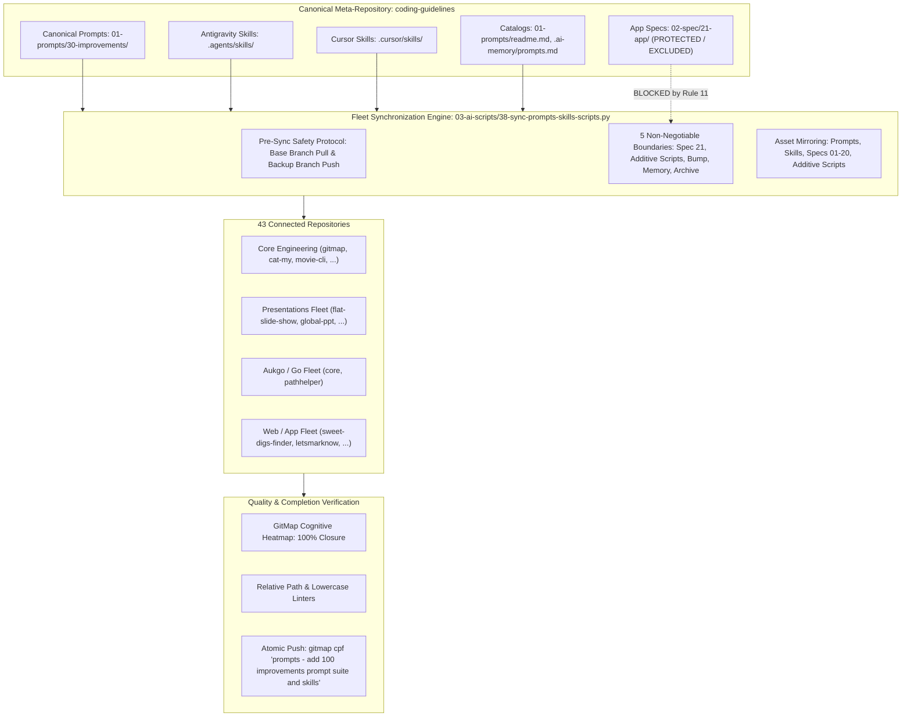
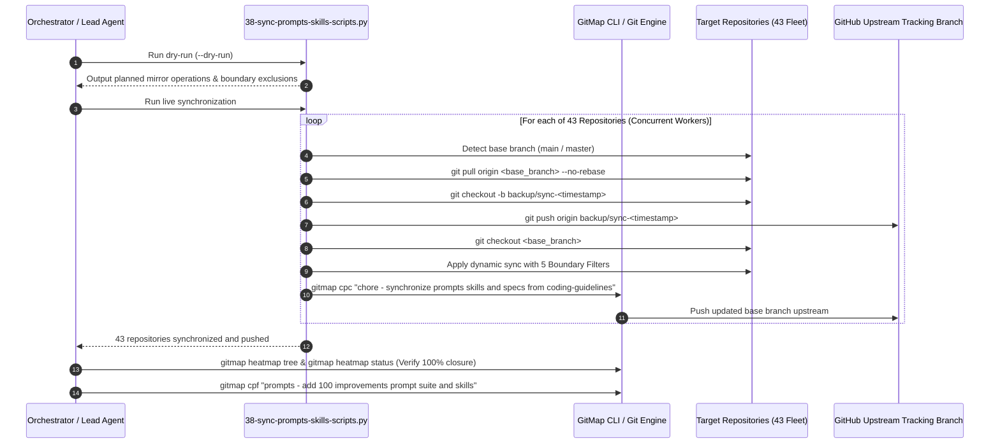
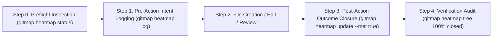

# Specification 03: Migration, Fleet Synchronization & Quality Verification

## 1. System Overview & Problem Statement

The **100 Improvements Prompt Suite** establishes a structured, autonomous methodology for uncovering, analyzing, cataloging, and staging actionable software improvements across three complementary engineering dimensions:
1. **UI Level:** Visual fidelity, accessibility, design tokens, color systems, and responsiveness (`01-prompts/30-improvements/01-find-100-improvements-in-ui-level.md`).
2. **Code Base:** Strict adherence to coding guidelines, boolean standards, error wrappers (`*appfault.AppError`), and cyclomatic complexity reduction (`01-prompts/30-improvements/02-find-100-improvements-in-code-base.md`).
3. **Whole System:** End-to-end user experience, telemetry, performance bottlenecks, failure blast radiuses, and non-destructive enhancements (`01-prompts/30-improvements/03-find-100-improvements-in-whole-system.md`).

These canonical prompts are augmented by dual-runtime skill definitions targeting both Google Antigravity (`.agents/skills/find-100-improvements-*`) and Cursor IDE (`.cursor/skills/find-100-improvements-*`).



### The Problem
When new prompts and skills are developed within `coding-guidelines`, they remain localized until systematically propagated across all 43 connected repositories in the workspace. However, unconstrained multi-repository file copying introduces severe risks:
- Leaking private application specifications (`02-spec/21-*` through `02-spec/25-*`) into downstream repositories.
- Overwriting repository-specific version bump scripts (`bump*`) and breaking custom release logic.
- Polluting downstream operational execution plans (`.ai-memory/plans/`) and memory contexts (`.ai-memory/memory/`).
- Overwriting custom automation scripts maintained by downstream target repositories.
- Leaving uncommitted changes or unpushed local branches across the fleet, violating the completion invariant.

### The Solution
This specification establishes the standardized fleet migration protocol, catalog registration matrix, cognitive heatmap verification gates, and atomic release ceremonies to ensure flawless synchronization without cross-repository contamination.

---

## 2. Fleet Synchronization Protocol & Engine Architecture

Fleet synchronization is executed via `03-ai-scripts/38-sync-prompts-skills-scripts.py`. The engine automates pre-change safety, asset mirroring, boundary filtering, and remote tracking push.

### Step-by-Step Execution Sequence



### Dynamic Asset Discovery in Sync Engine

The sync engine dynamically maps the following asset collections from `coding-guidelines`:
1. `01-prompts/` $\rightarrow$ `01-prompts/` (mirrors all canonical prompt directories, including `30-improvements/`).
2. `.agents/skills/` $\rightarrow$ `.agents/skills/` (mirrors canonical Antigravity skills while preserving local-only downstream skills).
3. `.cursor/skills/` $\rightarrow$ `.cursor/skills/` (mirrors canonical Cursor skills while preserving local-only downstream skills).
4. `03-ai-scripts/` $\rightarrow$ `03-ai-scripts/` (additive-only mode: copies new scripts; never overwrites modified scripts).
5. `.agents/scripts/` $\rightarrow$ `.agents/scripts/` (additive-only mode).
6. Shared specifications: `02-spec/01-*` through `02-spec/20-*` dynamically scanned and mirrored.

### Target Repositories Catalog (43 Repositories)

| Index | Repository Name | Relative Workspace Path | Tier / Ecosystem |
| :---: | :--- | :--- | :--- |
| 1 | `ai-empathy-prompt-tuner-v1` | `02-prompts/ai-empathy-prompt-tuner` | Prompts & AI Tuning |
| 2 | `alim-cv-v8` | `alim-cv` | Documentation & Portfolio |
| 3 | `alim-karim-profile-v2` | `alim-karim-profile` | Documentation & Portfolio |
| 4 | `alim.karim.profile` | `aukgit/alim.karim.profile` | Documentation & Portfolio |
| 5 | `Antigravity-Manager` | `antigravity-manager` | System & Developer Tools |
| 6 | `cat-my-v12` | `cat-my` | CLI & Developer Utilities |
| 7 | `core-v9` | `03-aukgo/core` | Aukgo / Go Shared Libraries |
| 8 | `digital-name-card` | `digital-name-card` | Web & Identity |
| 9 | `flat-slide-show` | `presentations-repos/flat-slide-show` | Presentations Engine |
| 10 | `gitlogger-new-v2` | `gitlogger-new` | Git & Telemetry Utilities |
| 11 | `gitmap-v28` | `gitmap` | GitMap Core Architecture |
| 12 | `global-ppt-v1` | `presentations-repos/global-ppt-v1` | Presentations Engine |
| 13 | `hiltrax-v1` | `presentations-repos/hiltrax` | Presentations Engine |
| 14 | `icon-coding-guidelines` | `icon-coding-guidelines` | Design & Visual Assets |
| 15 | `img-pdf-v2` | `img-pdf` | Image & Document Processing |
| 16 | `ki-health-ppt-v5` | `presentations-repos/ki-health-ppt` | Presentations Engine |
| 17 | `kubernetes-training-v1` | `aukgit/kubernetes-training` | Cloud & Infrastructure |
| 18 | `lara-licensing-v4` | `lara-licensing` | Licensing & Auth Services |
| 19 | `lara-publishing-v1` | `lara-publishing` | Publishing Framework |
| 20 | `laravel-automation-v1` | `laravel-automation` | Backend Automation |
| 21 | `letsmarknow-ui-v2` | `letsmarknow-ui` | Frontend Web UI |
| 22 | `letsmarknow-v2` | `letsmarknow` | Web Application Core |
| 23 | `macro-ahk-v55` | `macro-ahk` | Macro & Automation Engine |
| 24 | `maid-app-spec-presentation-v1` | `presentations-repos/maid-app-spec-presentation` | Presentations Engine |
| 25 | `movie-cli-v8` | `movie-cli` | CLI & Media Workflow |
| 26 | `pathhelper` | `03-aukgo/pathhelper` | Aukgo / Go Shared Libraries |
| 27 | `presentation-aug-2026-plans-alim` | `presentations-repos/presentation-aug-2026-plans-alim` | Presentations Engine |
| 28 | `prompts-connect-v3` | `02-prompts/prompts-connect` | Prompts & Workflow Utilities |
| 29 | `punam-case-studies-v1` | `punam-case-studies-v1` | Case Studies & Docs |
| 30 | `rasia-logo` | `presentations-repos/rasia-logo` | Design & Visual Assets |
| 31 | `scripts-fixer-v20` | `scripts-fixer` | Linter & Remediation Tools |
| 32 | `slides-spec` | `presentations-repos/slides-spec` | Presentations Engine |
| 33 | `spec-builder-v11` | `spec-builder` | Spec Architecture Scaffolding |
| 34 | `sweet-digs-finder` | `web-system/sweet-digs-finder` | Fullstack Web Application |
| 35 | `ui-prompts-cat` | `ui-prompts-cat` | UI & Prompt Engineering |
| 36 | `white-presentation-v1` | `presentations-repos/white-presentation-v1` | Presentations Engine |
| 37 | `workflowy-ui-v1` | `workflowy-ui` | Frontend Web UI |
| 38 | `workflowy-v3` | `workflowy` | Web Application Core |
| 39 | `wp-exam-v2` | `wp-exam` | WordPress Testing & Exam Engine |
| 40 | `wp-git-log-v3` | `wp-git-log` | WordPress Git Integration |
| 41 | `wp-html-automate` | `wp-html-automate` | WordPress HTML Utilities |
| 42 | `wp-link-manager-v5` | `wp-link-manager` | WordPress Link Architecture |
| 43 | `wp-onboarding-v17` | `wp-onboarding` | WordPress User Onboarding |

---

## 3. The 5 Non-Negotiable Boundaries

Under Section 11 of `AGENTS.md`, synchronization must enforce five immutable isolation boundaries:

### Boundary 1: Spec 21 Exclusion (TOTAL BAN)
- **Rule:** NEVER synchronize, copy, or touch `02-spec/21-*` through `02-spec/25-*` (private application specifications, issues, databases, design systems, and audits). Only shared foundational specifications `02-spec/01-*` through `02-spec/20-*` are synchronized across repositories.
- **Enforcement in Engine:** Function `is_spec_21(path)` detects any path segment containing `21-`, `22-`, `23-`, `24-`, or `25-` and returns `True`, immediately halting mirroring for that file.
- **Verification:** Post-sync audit ensures zero `02-spec/21-app/` files exist in any target repository.

### Boundary 2: Additive-Only AI Scripts
- **Rule:** Brand-new AI scripts (`03-ai-scripts/`, `.agents/scripts/`) that do not exist in the target repository are copied cleanly. Existing scripts already present in or modified by the target repository must NEVER be overwritten.
- **Enforcement in Engine:** Parameter `additive_only=True` prevents copying over existing destination files in script directories.
- **Verification:** Check that target repositories maintain their unique script revisions.

### Boundary 3: Bump Script Protection (IMMUTABLE)
- **Rule:** NEVER overwrite version bump scripts, manifests, or configuration files (`bump*`, `bump_versions.py`, `bump-version.mjs`, `version.json`, `version.template.json`). Each repository maintains custom SemVer release targets, tagging logic, and build steps.
- **Enforcement in Engine:** Function `is_bump_script(path)` filters out all files matching `bump` or `version`.
- **Verification:** Confirm SemVer configurations remain un-mutated across all repositories.

### Boundary 4: Memory & Plans Protection (TOTAL ISOLATION)
- **Rule:** NEVER modify, sync, or mirror `.ai-memory/memory/`, `.ai-memory/plans/`, `.ai-memory/temp-agents/`, `.ai-memory/cicd-issues/`, or `.ai-memory/ambiguous-questions/`. Each repository independently owns its operational memory, backlog, and active subtasks.
- **Enforcement in Engine:** Function `is_protected_memory_or_plan(path)` strictly blocks copying into any operational `.ai-memory` paths. Only canonical documentation index files (`.ai-memory/prompts.md`, `.ai-memory/coding-guidelines.md`) are synchronized conditionally.
- **Verification:** Target repository `.ai-memory/plans/` directory must contain exclusively local task files.

### Boundary 5: Archive Exclusion
- **Rule:** NEVER synchronize `06-archive/` or `06-old-prompts/`. Legacy archived prompt tiers and deprecated historical materials reside exclusively in `coding-guidelines` for historical reference and must never pollute downstream repositories.
- **Enforcement in Engine:** Set `EXCLUDE_NAMES` contains `"06-archive"` and `"06-old-prompts"`.
- **Verification:** Downstream repositories must not contain any `06-archive/` directory.

---

## 4. Catalog Updates & Registration Requirements

To ensure zero-drift discoverability across IDEs, documentation viewers, and autonomous agents, the 100 Improvements suite must be indexed across three canonical catalogs:

### 1. `01-prompts/readme.md` (Master Prompts Catalog)
- **Directory Index:** Register Category `30-improvements/` in the tree view:
  ```text
  01-prompts/
  ...
  ├── 29-chat-management/
  └── 30-improvements/
  ```
- **Table of Categories:** Add entry for category 30:
  ```markdown
  | **30** | `30-improvements/` | `01-find-100-improvements-in-ui-level.md`, `02-find-100-improvements-in-code-base.md`, `03-find-100-improvements-in-whole-system.md` | Autonomous 100 improvements discovery across UI, codebase guidelines, and whole-system UX |
  ```

### 2. `01-prompts/30-improvements/readme.md` (Group Index & Catalog)
- Canonical entry point for Category 30, following Rule 13 (unadorned `readme.md`, strict lowercase).
- Matrix documenting the three prompts, their execution models, input scopes, and output locations:
  1. `01-find-100-improvements-in-ui-level.md` $\rightarrow$ UI visual fidelity, theme tokens, WCAG contrast, responsive layout.
  2. `02-find-100-improvements-in-code-base.md` $\rightarrow$ Coding guidelines, error management, boolean hygiene, function complexity.
  3. `03-find-100-improvements-in-whole-system.md` $\rightarrow$ System UX, telemetry, user friction, non-destructive enhancements.
- Explicit requirement: Each prompt directs results into `.ai-memory/plans/pending/` with subtasks in `.ai-memory/plans/subtasks/` for subsequent execution.

### 3. `.ai-memory/prompts.md` (Operational Memory Prompts Matrix)
- Add entries under category `30-improvements`:
  ```markdown
  | `30-improvements` | [`30-improvements/01-find-100-improvements-in-ui-level.md`](../01-prompts/30-improvements/01-find-100-improvements-in-ui-level.md) | Find 100 Improvements in UI Level — Visual Fidelity, Color Tokens & Accessibility (must follow) |
  | `30-improvements` | [`30-improvements/02-find-100-improvements-in-code-base.md`](../01-prompts/30-improvements/02-find-100-improvements-in-code-base.md) | Find 100 Improvements in Code Base — Guidelines, Error Management & Typing (must follow) |
  | `30-improvements` | [`30-improvements/03-find-100-improvements-in-whole-system.md`](../01-prompts/30-improvements/03-find-100-improvements-in-whole-system.md) | Find 100 Improvements in Whole System — System UX, Telemetry & Non-Destructive Flow (must follow) |
  | `30-improvements` | [`30-improvements/readme.md`](../01-prompts/30-improvements/readme.md) | 30 — Improvements Prompts Library |
  ```
- Verification: Run `python linter-scripts/check-prompts-loaded.py` to confirm 100% matrix linkage.

---

## 5. GitMap Cognitive Heatmap Telemetry & Verification Criteria

In accordance with `AGENTS.md` Section 15, all file touches and verification gates must be tracked via the GitMap Cognitive Heatmap:

### Telemetry Lifecycle



### Cognitive Logging Directives

1. **Preflight Check:**
   ```bash
   gitmap heatmap status
   gitmap heatmap tables
   ```
2. **Intent Logging (Pre-Action):**
   ```bash
   gitmap heatmap log --task "01-create-prompts-for-100-improvements" --action "CREATE" --file "02-spec/21-app/01-create-prompts-for-100-improvements/03-migration-and-verification-spec.md" --state "SPECIFICATION" --expected "Author migration and verification spec covering fleet sync boundaries and heatmap gates"
   ```
3. **Outcome Closure (Post-Action):**
   ```bash
   gitmap heatmap update --id <ACTION_ID> --outcome "Specification authored with 5 boundaries, 43 repos table, catalog index, and acceptance criteria" --met true
   ```
4. **Verification Gate:**
   ```bash
   gitmap heatmap tree --task "01-create-prompts-for-100-improvements"
   gitmap heatmap status --task "01-create-prompts-for-100-improvements"
   ```
   *Pass Threshold:* 100% actions marked closed (`met=true`). Zero pending or unclosed file operations.

---

## 6. Atomic Commit & Push Ceremony

Under `AGENTS.md` Section 10 and Section 13, all task deliverables must be committed and pushed atomically:

### Command Syntax Mandate
- **Exact Command:**
  ```bash
  gitmap cpf "prompts - add 100 improvements prompt suite and skills"
  ```
- **Hyphen Format Mandate:** The message argument must use the hyphen separator format (`<module> - <summary>`). GitMap automatically prepends `Feature: ` to the commit message. NEVER include colons inside the message string (e.g., `prompts: add...` is strictly prohibited).
- **Auto-Push Primacy:** `gitmap cpf` stages all files, creates the commit, and pushes upstream to GitHub tracking branch in a single atomic transaction.
- **Mandatory Completion Invariant ('No Push = Not Done'):** A task is strictly INCOMPLETE if code remains uncommitted or unpushed to the remote repository. The lead agent must verify a clean working tree and up-to-date tracking branch before concluding.

---

## 7. Acceptance Criteria

| ID | Verification Item | Target Deliverables / Boundaries | Binary Pass Criterion |
| :---: | :--- | :--- | :--- |
| **AC-01** | **Spec Authoring** | `02-spec/21-app/01-create-prompts-for-100-improvements/03-migration-and-verification-spec.md` | File exists, strictly relative links, lowercase, non-empty, contains 5 boundaries, 43 repos table, and heatmap gates. |
| **AC-02** | **Subtask Plan** | `.ai-memory/plans/subtasks/01-create-prompts-for-100-improvements/03-subtask-migration-and-verification.md` | File exists, status PENDING, references parent plan and Spec 03, contains granular binary action checklist. |
| **AC-03** | **Boundary 1 (Spec 21 Exclusion)** | Target Repositories (43 Fleet) | Zero `02-spec/21-*` through `02-spec/25-*` files copied to any target repository. |
| **AC-04** | **Boundary 2 (Additive Scripts)** | `03-ai-scripts/`, `.agents/scripts/` | Target repositories retain local custom scripts; only new scripts added. |
| **AC-05** | **Boundary 3 (Bump Script Protection)** | `bump*`, `version.json` | All version bump scripts and manifests completely untouched across all 43 repositories. |
| **AC-06** | **Boundary 4 (Memory Isolation)** | `.ai-memory/plans/`, `.ai-memory/memory/` | Target repositories retain exclusive ownership of their operational memory and plans. |
| **AC-07** | **Boundary 5 (Archive Exclusion)** | `06-archive/`, `06-old-prompts/` | Zero archive files copied to any downstream target repository. |
| **AC-08** | **Catalog 1 (`01-prompts/readme.md`)** | `01-prompts/readme.md` | Category `30-improvements/` added to Directory Index and Table of Categories. |
| **AC-09** | **Catalog 2 (`30-improvements/readme.md`)** | `01-prompts/30-improvements/readme.md` | Group index created following Rule 13, indexing all three prompts with relative links. |
| **AC-10** | **Catalog 3 (`.ai-memory/prompts.md`)** | `.ai-memory/prompts.md` | Prompts Matrix updated with all three prompts and group readme; verified via linter. |
| **AC-11** | **Heatmap Closure** | GitMap Heatmap DB | `gitmap heatmap status` reports 100% action closure for task `01-create-prompts-for-100-improvements`. |
| **AC-12** | **Atomic Push Ceremony** | `coding-guidelines` Git tracking branch | `gitmap cpf "prompts - add 100 improvements prompt suite and skills"` executed and pushed upstream. |
