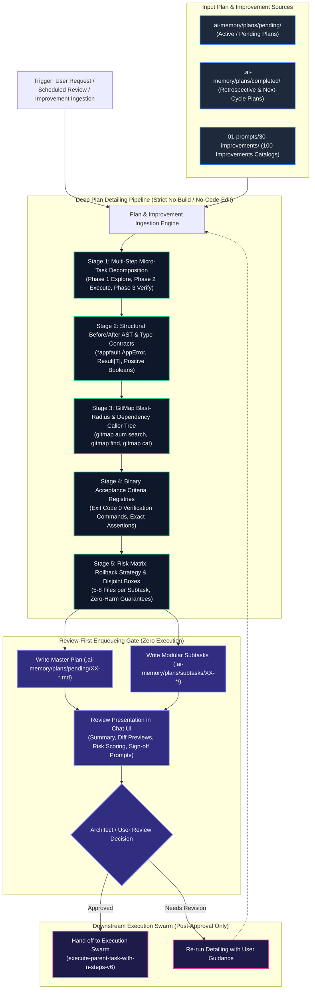

# Specification 01: Detail Plans and Improvements for Review — Architecture & Contracts Specification

## 1. System Overview & Problem Statement

### 1.1 The Core Problem: The Premature Execution Pathology
In autonomous agent workflows, AI models exhibit a chronic failure mode: **premature execution without contextual depth**. When handed high-level plans, backlog items, or broad improvement proposals, AI agents routinely skip thorough exploration and architectural decomposition, leaping directly into source code modifications. This pathology results in:
1. **Silent Regressions & Broken API Contracts:** Modifying functions, types, or configuration keys without tracing caller dependency trees or downstream consumers.
2. **Untracked & Unreviewed Blast Radius:** Touching files across arbitrary directories without human or architectural visibility, creating merge conflicts and corrupted repository state.
3. **Shallow Plan Artifacts:** Plans documented only as vague one-liner tasks (e.g. "Refactor auth logic", "Optimize queries") that provide zero actionable guidance for subsequent agents, leading to hallucinations and inconsistent patterns.
4. **Wasted Compute & CI/CD Pollution:** Repeatedly running failed test suites, broken builds, or incomplete implementations that violate the core repository rule to never run unauthorized builds or break CI/CD pipelines.
5. **Contextual Drift in Multi-AI Handoffs:** When one agent hands off work to another, the absence of granular Before/After diffs, type signatures, and binary verification commands forces the incoming agent to guess intent.

### 1.2 The Solution: The Detail Plans & Improvements Review-First Engine
To permanently solve this pathology, this specification establishes the **Detail Plans and Improvements for Review Engine**, implemented canonically as:
- **Canonical Prompt:** `01-prompts/30-improvements/04-detail-plans-and-improvements-for-review.md`
- **Antigravity Skill:** `.agents/skills/detail-plans-and-improvements-for-review/skill.md`
- **Cursor IDE Skill:** `.cursor/skills/detail-plans-and-improvements-for-review/skill.md`

This engine functions as a specialized **architectural detailing, decomposition, and review presentation pipeline**. It takes existing plans (pending, active, or completed) or newly discovered improvement items (such as those from the 100 Improvements catalogs) and expands them into exhaustive, multi-step, fully specified implementation blueprints.

### 1.3 The Review-First / No-Immediate-Execution Mandate
A non-negotiable invariant of this engine is the **Strict Review-First Gate**:
> [!IMPORTANT]
> **Strict Review-First & Zero Immediate Execution Mandate:**
> Plans and improvements detailed by this prompt MUST NEVER be executed, implemented, built, or tested immediately during the detailing run.
> All detailing outputs are strictly enqueued into `.ai-memory/plans/pending/XX-<slug>.md` with companion subtasks in `.ai-memory/plans/subtasks/XX-<slug>/` and presented in chat for explicit user or architect review.
> Implementation may only occur after explicit human sign-off through subsequent, dedicated execution prompts (e.g. `execute-parent-task-with-n-steps-v6` or `unified-ai-prompt-v4`).

---

## 2. Mermaid Architecture Diagram



---

## 3. Deep Plan Detailing Pipeline Specifications

The detailing pipeline converts high-level intent into deterministic engineering blueprints through five rigorous stages.

### 3.1 Stage 1: Multi-Step Micro-Task Decomposition
Plans must never remain monolithic. Every high-level task is decomposed into bounded, isolated phases adhering to Section 3 of `AGENTS.md`:

```
+-------------------------------------------------------------------------------+
|                       Three-Phase Micro-Task Decomposition                    |
+-------------------------------------------------------------------------------+
| Phase 1: Read & Understand (Isolated Loop)                                    |
|   - Zero code writing, zero file modification.                                |
|   - Targeted file reading and symbol identification via GitMap.               |
|   - Explicit architectural boundary mapping.                                  |
+-------------------------------------------------------------------------------+
| Phase 2: Bounded Micro-Tasking (Sequential Self-Looping)                      |
|   - Partitioning into subtasks of strictly 5-8 files maximum.                 |
|   - Single-file or single-concern bounding boxes per worker.                  |
|   - Sequential verification checkpoints after every batch.                    |
+-------------------------------------------------------------------------------+
| Phase 3: Verification & Acceptance Audit (Quality Gate)                       |
|   - Linter compliance, relative path audit, zero-storage summary.            |
|   - 100% cognitive heatmap closure verification.                              |
|   - Atomic git commit preparation (post-approval).                            |
+-------------------------------------------------------------------------------+
```

### 3.2 Stage 2: Structural Before/After AST & Type Contracts
Shallow plans state *what* should change; detailed plans specify *exact code structures*. For every proposed modification, the plan must document:
1. **Exact Type Signatures:** Complete interface definitions, struct fields, enum constants, and generic constraints.
2. **Error Return Contracts:** Mandatory enforcement of structured `*appfault.AppError` and monadic result envelopes (`Result[T]`, `ResultSlice[T]`, `ResultMap[K, V]`). Bare `error` or untyped exceptions are strictly prohibited.
3. **Positive Boolean Declarations:** All boolean predicates, flags, and guard variables must be specified with affirmative `is` or `has` prefixes (Principles P1 through P9), prohibiting negative identifiers (`isEmpty`, `isInvalid`) and mixed polarities (`isA && !isB`).
4. **Vertical Line Spacing Constraints:** Explicitly annotating mandatory blank lines before `if`, after `}`, and before `return`.
5. **Structural Diff Mockups:** Before and after code snippets showing exact replacements.

### 3.3 Stage 3: GitMap Blast-Radius & Caller Dependency Trees
AI agents must understand every ripple effect of a change before touching code. The detailing engine mandates live codebase inspection using high-speed GitMap commands:
- **Symbol Caller Discovery:**
  `gitmap aum search "<symbol_name>" [directory] -e <.ext>`
- **Type Usage Discovery:**
  `gitmap aum search "type <TypeName>" [directory] -e <.ext>`
- **Directory Inventory:**
  `gitmap lf <directory>`
- **Zero-Disk Code Streaming:**
  `gitmap cat <filepath>`
- **Total Ban on Shell Search:** Absolute prohibition of `rg`, `ripgrep`, `grep`, `git grep`, `Select-String`, `dir`, and `ls`.

The detailing engine organizes findings into a **Caller Dependency Matrix**:
| Target Symbol | File Location | Direct Callers | Downstream Impact | Regression Mitigation |
|:---|:---|:---|:---|:---|
| `ValidateConfig` | `pkg/config/validate.go` | 4 call sites | Configuration parsing | Add fallback backward compatibility shim |
| `ProcessBatch` | `pkg/worker/batch.go` | 2 call sites | Worker pool execution | Wrap in monadic `Result[T]` without breaking caller |

### 3.4 Stage 4: Binary Acceptance Criteria Registries
Acceptance criteria must never be subjective or conversational (e.g. "Ensure code looks clean"). Every criterion must be a **binary, testable assertion**:
- **Exit Code 0 Command:** The exact command line to run (e.g. `gitmap aum search "== true" pkg/` must return 0 hits).
- **Exact Output Assertion:** Specific stdout string or exit code expected.
- **Negative Invariant Assertions:** Verification that prohibited patterns (e.g. absolute paths, bare errors) do not exist.

### 3.5 Stage 5: Risk Matrix, Rollback Strategy & Disjoint Bounding Boxes
Every subtask detailed by the engine must provide:
- **Blast Radius Rating:** Low (isolated internal helper), Medium (package-internal interface), High (cross-package API or schema change).
- **Disjoint Bounding Box:** Explicit, non-overlapping file ownership list. No two subtasks may own the same file.
- **Rollback Guarantee:** Clear instructions on how to revert changes cleanly without collateral damage.

---

## 4. The Review-First Enqueueing Gate Specification

### 4.1 Strict No-Immediate-Execution Invariant
When the detailing prompt executes:
1. **NO Codebase Changes:** The agent must not edit application source code, configuration files, or scripts outside `.ai-memory/plans/`.
2. **NO Build Executions:** The agent must not run compilers (`go build`, `pnpm build`, `cargo build`).
3. **NO Test Suite Executions:** The agent must not run unit or integration tests (`go test`, `pytest`, `npm test`).
4. **NO Version Bumps or Tagging:** The agent must not touch version files, changelogs, or release tags.
5. **NO Git Mutations:** The agent must not stage, commit, or push changes during detailing.

### 4.2 Destination Artifact Contracts
All detailed output must strictly be persisted into:
1. **Master Pending Plan:** `.ai-memory/plans/pending/XX-<slug>.md`
2. **Modular Subtasks:** `.ai-memory/plans/subtasks/XX-<slug>/YY-subtask-<name>.md`
3. **Chat Review Summary:** A structured markdown report presented directly to the user detailing the plan, risks, and next steps.

Where:
- `XX` is the zero-padded sequential index matching the highest pending sequence in `.ai-memory/plans/pending/`.
- `<slug>` is a clean, lowercase hyphenated identifier (e.g. `02-detail-plans-and-improvements-for-review`).
- `YY` is the zero-padded subtask sequence (`01`, `02`, `03`...).

---

## 5. Canonical Detailed Plan Specification Schema (10-Field Standard)

Every plan generated or enriched by the detailing engine must adhere to the **10-Field Detailed Plan Schema**:

```text
+-------------------------------------------------------------------------------+
|                 10-Field Detailed Plan Specification Schema                   |
+-------------------------------------------------------------------------------+
|  1. Metadata & Identification: Title, Slug, Parent, Status, Motto, Invariants |
|  2. Problem Statement & Architectural Context: Root friction, business value  |
|  3. Phased Task Breakdown: Phase 1 Explore, Phase 2 Micro-Batch, Phase 3 Audit |
|  4. Subtask Decomposition Table: Disjoint bounding boxes, file quotas (5-8)   |
|  5. Structural Before/After Diffs: Exact code replacements & AST contracts    |
|  6. Type Definitions & Envelopes: *appfault.AppError, Result[T], positive bool|
|  7. Blast Radius & Caller Dependency Tree: Direct callers, downstream impacts  |
|  8. Risk Scoring & Rollback Strategy: Low/Med/High rating, reversion steps     |
|  9. Binary Verification Registry: Exact GitMap commands, exit code 0 checks    |
| 10. Review Sign-Off & Execution Hand-Off: Next-step prompt links & conditions |
+-------------------------------------------------------------------------------+
```

---

## 6. Subtask File Structural Standard

Subtasks generated under `.ai-memory/plans/subtasks/XX-<slug>/` must strictly adhere to the unified format:

```markdown
# Subtask YY: <Subtask Title>

## 1. Task Details
- **Parent Task:** `XX-<slug>`
- **Subtask Code:** `Subtask-YY`
- **Slug:** `YY-subtask-<name>`
- **Specification:** `02-spec/21-app/XX-<slug>/01-architecture-spec.md`
- **Status:** `PENDING`
- **Plan Motto:** `[/plan](slashCommand;plan) first before doing work for improved work or less friction, faster work and more pure and effective work.`

---

## 2. Owned Deliverables & Scope (Disjoint Bounding Box)
- Strictly 5-8 files maximum per subtask.
- Mutually exclusive with all other subtasks.

---

## 3. Action Checklist
- [ ] **Phase 1: Read & Understand**
  - [ ] Targeted file reads and symbol inspection.
- [ ] **Phase 2: Bounded Refactoring**
  - [ ] Surgical modifications adhering to coding guidelines.
- [ ] **Phase 3: Verification & Closure**
  - [ ] Quality gate verification and heatmap update.

---

## 4. Verification Evidence & Quality Gates
1. Exit Code 0 GitMap checks.
2. Relative path verification.
3. Lowercase naming verification.
```

---

## 7. Companion Skills & Multi-Repository Synchronization

### 7.1 Symmetric Skill Registration
The prompt is mirrored identically across both AI agent platforms:
- **Antigravity Skill:** `.agents/skills/detail-plans-and-improvements-for-review/skill.md`
  - In-skill link format: `[<skill-name>](file;.agents/skills/<skill-name>)`
- **Cursor IDE Skill:** `.cursor/skills/detail-plans-and-improvements-for-review/skill.md`
  - In-skill link format: `[<skill-name>](file;.cursor/skills/<skill-name>)`
- **Slash Commands:** Formatted as `[/plan](slashCommand;plan)` and `[/learn](slashCommand;learn)`.

### 7.2 Multi-Repository Synchronization Guardrails
When syncing prompts and skills across the 43-repo fleet via `03-ai-scripts/38-sync-prompts-skills-scripts.py`, the 5 non-negotiable boundaries strictly apply:
1. **Spec 21 Exclusion (TOTAL BAN):** Never sync `02-spec/21-*` through `02-spec/25-*`. Specifications are strictly private to `coding-guidelines`.
2. **Additive-Only AI Scripts:** Never overwrite customized scripts in target repos.
3. **Bump Script Protection:** Never touch `bump_versions.py` or version manifests.
4. **Memory Isolation:** Never sync `.ai-memory/memory/` or `.ai-memory/plans/`.
5. **Zero Secrets Leakage:** Secrets remain strictly in `repo-secrets` via `gitmap rs`.

---

## 8. Non-Negotiable Invariants & Quality Verification

| Invariant Code | Rule Description | Enforcement Check |
|:---|:---|:---|
| `INV-01` | Strict Relative Git Paths Only | Zero absolute paths and zero absolute file URIs. |
| `INV-02` | Strict Lowercase Naming | All directories and filenames strictly lowercase. |
| `INV-03` | Review-First Gate | Zero code changes, zero builds, zero tests during detailing. |
| `INV-04` | GitMap Search Primacy | Zero usage of `rg`, `ripgrep`, `grep`, `dir`, or `ls`. |
| `INV-05` | Disjoint Bounding Boxes | 5–8 files maximum per subtask, zero file ownership overlaps. |
| `INV-06` | Structured Error Standard | All failure returns use `*appfault.AppError` and `Result[T]`. |
| `INV-07` | Positive Boolean Standard | Implicit evaluation only, affirmative `is`/`has` prefixes, zero explicit `== true`. |
