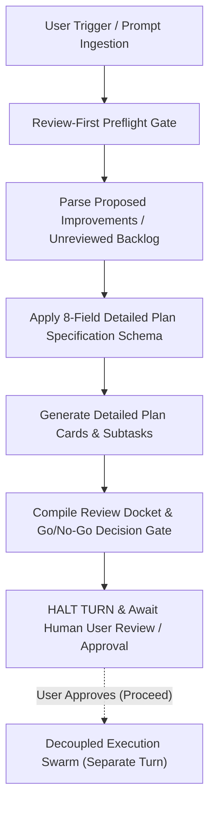
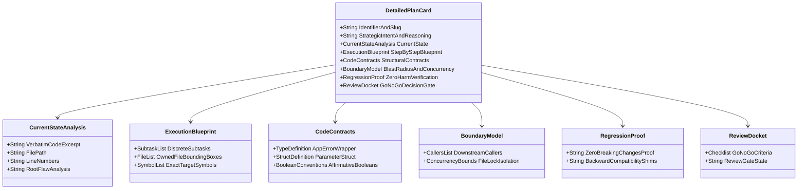
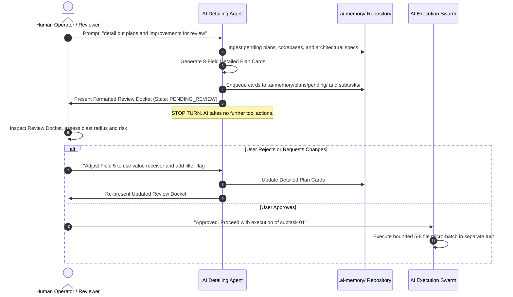

# Specification 02: Component Specification, Schemas & Concrete Examples

**Version:** 1.0.0  
**Status:** ACTIVE  
**Parent Plan:** `.ai-memory/plans/pending/02-detail-plans-and-improvements-for-review.md`  
**Architecture Spec:** `02-spec/21-app/02-detail-plans-and-improvements-for-review/01-architecture-spec.md`  
**Applicability:** Universal across Canonical Prompts (`01-prompts/30-improvements/`), Antigravity Skills (`.agents/skills/`), and Cursor Skills (`.cursor/skills/`)

---

## 1. Executive Summary & Review-First Foundation

### 1.1 Intent & Grounding

The **Detail Plans and Improvements for Review** engine transforms high-level architectural proposals, technical debt audits, and feature requests into rigorous, multi-stage, battle-tested execution blueprints. When AI agents attempt to implement abstract recommendations directly, failure rates escalate due to context drift, undocumented assumptions, colliding file edits, unhandled error paths, and breaking changes.

This specification defines the component models, data contracts, interactive review docket templates, and concrete operational examples required to detail out plans so that:
1. **Any AI Agent Can Execute Without Ambiguity:** The plan contains verbatim source excerpts, line numbers, exact replacement types, parameter structs, and isolated file bounding boxes.
2. **Zero Code Is Touched Before Human Review:** A non-negotiable review gate is enforced. All improvements and plans must be structured, documented, and presented to the human operator for formal sign-off before any code mutation, build, or test execution is permitted.
3. **Execution Is Decoupled from Planning:** Planning produces frozen artifacts in `.ai-memory/plans/pending/` and `.ai-memory/plans/subtasks/`. Execution occurs in subsequent bounded turns using `execute-parent-task-with-n-steps-v6` or `cg-execute`.

### 1.2 Trigger Keywords & Activation Phrases

The detailing engine activates automatically upon encountering any of the following canonical trigger phrases, command keywords, or natural language prompts:

- `detail-plans-and-improvements`
- `detail-improvements-for-review`
- `Can you please detail out all the plans that you have done and improvements so that it can be improved by any AI easily?`
- `detail out improvements for review`
- `detail plans and improvements`
- `review-first plan detailing`
- `multi-step plan detailing`



---

## 2. The 8-Field Detailed Plan Specification Schema

Every detailed improvement and multi-stage plan must strictly adhere to the standardized 8-Field Schema. Omitting any field or replacing content with placeholders (`TODO`, `...`, `[N]`) is an auto-reject failure.



### 2.1 Field 1: Plan/Improvement Identifier & Canonical Slug
- **Format:** `[DOMAIN]-[CATEGORY]-[SEQUENCE]`: `[Canonical Descriptive Title]`
- **Slug Format:** Strictly lowercase alphanumeric hyphen-separated string (`xx-canonical-slug`).
- **Domain Prefixes:**
  - `CB-DET-XXX`: Code Base Detailed Improvement (Go, TypeScript, Python, Rust).
  - `SYS-DET-XXX`: System, Architecture & Infrastructure Improvement.
  - `UI-DET-XXX`: User Interface, Design System & Accessibility Improvement.
- **Metadata Required:** Parent Plan reference, target module, priority rating (`CRITICAL`, `HIGH`, `MEDIUM`, `LOW`), and estimated micro-batch size (5–8 files max).

### 2.2 Field 2: High-Level Strategic Intent & Systems Reasoning
- Explains the architectural *why* behind the change.
- Connects the improvement to system stability, developer velocity, runtime efficiency, memory footprint, or user experience.
- Identifies the anti-pattern or design flaw being eradicated (e.g., bare error tuples, mixed boolean polarity, unindexed SQLite queries, missing header scroll transitions).

### 2.3 Field 3: Current State / Friction / Defect Analysis
- **Verbatim Excerpt:** Must cite the exact source code snippet currently in the repository demonstrating the flaw.
- **Precise Location:** Strictly relative Git file path (`path/to/file.ext`) and exact line range (`L12-L34`).
- **Root Cause Analysis (RCA):** Grounded technical explanation of why the current implementation causes friction, bugs, race conditions, or cognitive overhead. Absolute filesystem paths or machine-specific paths are strictly forbidden.

### 2.4 Field 4: Step-by-Step Multi-Stage Execution Blueprint
- Breaks the implementation down into discrete, bounded micro-tasks that any AI can execute sequentially.
- **Bounding Boxes:** Explicit list of files owned exclusively by each step (preventing cross-task file collisions).
- **Exact Symbols:** Specific function names, struct definitions, method receivers, or CSS classes to create or modify.
- **No-Code-In-Planning Invariant:** Planning defines the steps; it does not execute them in the detailing turn.

### 2.5 Field 5: Structural Code Contracts & Type Definitions
- Provides the exact, production-grade drop-in code contracts adhering to all repository coding guidelines:
  - **Structured Errors:** Functions returning failure metadata MUST use `*appfault.AppError` and `result.Result[T]`. Bare `error`, `errors.New`, or `fmt.Errorf` are banned.
  - **Parameter Structs:** Signatures with >2–3 parameters MUST be refactored to value-based `*Params` structs.
  - **Affirmative Booleans:** Boolean fields MUST use positive `is` or `has` prefixes (never negative like `isDisable`). Explicit `== true` or mixed polarity conditions (`if isA && !isB`) are banned.
  - **Vertical Spacing:** Blank line before `if`, after `}`, before `return`, and around multi-line structs.

### 2.6 Field 6: Blast Radius, Downstream Callers & Concurrency Boundaries
- **Callers Inventory:** Exhaustive enumeration of all downstream packages, functions, and tests importing or invoking the modified symbols.
- **Caller Migration Strategy:** Exact code adjustments needed at call sites to match new signatures.
- **Concurrency & File Locks:** Proof that the change operates within disjoint file boundaries, avoiding lock contention on shared resources (e.g., SQLite WAL isolation, zero git index collisions).

### 2.7 Field 7: Zero Harm & Regression Safety Verification
- **Backward Compatibility:** Guarantees that public API contracts, CLI commands, database schemas, and external interfaces remain intact.
- **Compatibility Shims:** Where signatures change, provides temporary alias forwarders or backward-compatible wrappers if external callers exist.
- **Deterministic Rollback Plan:** Instructions to revert the change cleanly without leaving orphaned artifacts or dangling state.
- **Zero-Storage Compliance:** Ensures diagnostic and reporting logic adheres to the ban on CI/CD artifact uploads (`$GITHUB_STEP_SUMMARY` direct streaming only).

### 2.8 Field 8: Review Docket & Go/No-Go Decision Gate
- An interactive, formatted checklist presented to the human reviewer at the end of the turn.
- Captures explicit user acceptance before any implementation starts.
- Fields include: Architectural Alignment, Scope Bounding (5–8 files max), Breaking Change Risk (None), Code Contract Compliance, and Verification Readiness.
- **State:** `PENDING_REVIEW` (Default). AI MUST end turn and wait for human approval.

---

## 3. The Review Docket & Human-in-the-Loop Protocol



### 3.1 The Review Docket Markdown Template

When detailing plans, the agent renders the following standardized docket directly in chat and in the plan header:

```markdown
### 📋 Review Docket & Go/No-Go Decision Gate
**Plan Identifier:** `[DOMAIN-DET-XXX]` — `[Title]`  
**Status:** `⏳ PENDING HUMAN REVIEW`  
**Execution Clearance:** `BLOCKED` until explicit user sign-off.

| Checkpoint | Verification Description | Status |
|:---|:---|:---:|
| 1. Strategic Intent | Solves grounded defect without architectural drift | `[x]` Verified |
| 2. File Bounding Box | Constrained to 5–8 files; zero unbounded edits | `[x]` Verified |
| 3. Code Contracts | Enforces `*appfault.AppError`, `*Params`, affirmative booleans | `[x]` Verified |
| 4. Blast Radius | Downstream callers identified; migration steps provided | `[x]` Verified |
| 5. Zero Harm | Backward-compatible shims included; zero breaking changes | `[x]` Verified |
| 6. Binary Verification | Pass/fail commands provided; zero build/test runs in planning | `[x]` Verified |

> [!IMPORTANT]
> **Action Required from Reviewer:**  
> Review the detailed blueprint below. If acceptable, reply with **"Approved"** or execute `/plan` to initiate execution in a dedicated execution turn. Code will **NOT** be modified until approval is granted.
```

---

## 4. Concrete Production-Grade Detailed Plan Cards

To ensure complete clarity across all AI agents, three fully elaborated, production-grade examples representing each major archetype are documented below.

### 4.1 Archetype 1: Code Base Detailed Improvement (CB-DET-001)

#### Card [CB-DET-001]: Monolithic Session Validator to Structured AppError & Monadic Result

##### 1. Plan Identifier & Canonical Slug
- **Identifier:** `CB-DET-001` — Monolithic Session Token Validator Refactoring
- **Canonical Slug:** `01-session-validator-apperror-refactor`
- **Domain:** Code Base (`04-code/golang/pkg/session/`)
- **Parent Plan:** `.ai-memory/plans/pending/02-detail-plans-and-improvements-for-review.md`
- **Severity & Priority:** `CRITICAL` | `P0`
- **Target Micro-Batch:** 3 files (`pkg/session/validator.go`, `pkg/session/types.go`, `cmd/api/auth_handler.go`)

##### 2. High-Level Strategic Intent & Systems Reasoning
Migrate the legacy session token validator from returning untyped bare boolean-error tuples `(bool, error)` with `errors.New` and explicit `== true` checks into a typed monadic envelope `result.Result[SessionClaims]` utilizing structured failure metadata `*appfault.AppError`. This eliminates unhandled token expiration panics, standardizes error codes across the API gateway, and enforces repository boolean conventions.

##### 3. Current State / Friction / Defect Analysis
- **Target File:** `04-code/golang/pkg/session/validator.go`
- **Line Numbers:** `L42-L68`
- **Verbatim Excerpt:**
  ```go
  func (v *Validator) ValidateToken(rawToken string, checkRevoked bool) (bool, error) {
      if rawToken == "" {
          return false, errors.New("token cannot be empty")
      }
      token, err := jwt.Parse(rawToken, v.keyFunc)
      if err != nil {
          return false, err
      }
      if token.Valid == true {
          if checkRevoked == true {
              if v.isRevoked(token.Claims.ID) {
                  return false, errors.New("token has been revoked")
              }
          }
          return true, nil
      }
      return false, errors.New("invalid signature")
  }
  ```
- **Root Cause & Violations:**
  - **Explicit True Check:** `token.Valid == true` and `checkRevoked == true` explicitly violate Section 1 of Coding Guidelines ("TOTAL BAN: Never evaluate a boolean explicitly against true").
  - **Bare Error Tuple:** Returns `(bool, error)` with generic `errors.New`, violating Section 6 ("Functions returning failure metadata MUST use *appfault.AppError").
  - **Nested Branching:** 3 levels of nested `if` statements without guard clauses, violating Section 8 and `02-spec/02-coding-guidelines/02-control-flow.md`.
  - **Loose Arguments:** 2 loose arguments that expand to 4 in pending PRs without a parameter struct.

##### 4. Step-by-Step Multi-Stage Execution Blueprint
- **Stage 1 (Contracts):** Define `ValidateTokenParams` struct and extract `TokenStatusType` enum in `04-code/golang/pkg/session/types.go`.
- **Stage 2 (Refactoring):** Flatten `ValidateToken` in `04-code/golang/pkg/session/validator.go` using inverted guard clauses, implicit booleans, and `result.Result[SessionClaims]`.
- **Stage 3 (Caller Migration):** Update call-site in `04-code/golang/cmd/api/auth_handler.go` (`authHandler.AuthenticateRequest`) to inspect `res.IsFailure()`.
- **Stage 4 (Verification):** Run GitMap search to verify 0 remaining explicit `== true` checks and 0 bare `errors.New` instances.

##### 5. Structural Code Contracts & Type Definitions
```go
package session

import (
    "pkg/appfault"
    "pkg/result"
)

// ValidateTokenParams groups input arguments with value semantics.
type ValidateTokenParams struct {
    RawToken     string
    HasRevocationCheck bool
}

// SessionClaims represents validated cryptographic claims.
type SessionClaims struct {
    SessionID string
    UserID    string
    Subject   string
    ExpiresAt int64
}

// ValidateToken enforces early returns, implicit booleans, and structured appfault.
func (v *Validator) ValidateToken(params ValidateTokenParams) result.Result[SessionClaims] {
    if params.RawToken == "" {
        return result.Fail[SessionClaims](
            appfault.New("INVALID_ARGUMENT", "token string cannot be empty").
                WithField("field", "RawToken"),
        )
    }

    token, fault := v.parseJWT(params.RawToken)
    if fault != nil {
        return result.Fail[SessionClaims](fault)
    }

    if !token.IsValid {
        return result.Fail[SessionClaims](
            appfault.New("UNAUTHORIZED", "token cryptographic signature is invalid"),
        )
    }

    if params.HasRevocationCheck && v.isRevoked(token.Claims.SessionID) {
        return result.Fail[SessionClaims](
            appfault.New("REVOKED_TOKEN", "session token has been explicitly revoked").
                WithField("session_id", token.Claims.SessionID),
        )
    }

    return result.Ok(token.Claims)
}
```

##### 6. Blast Radius, Downstream Callers & Concurrency Boundaries
- **Callers Inventory:**
  - `04-code/golang/cmd/api/auth_handler.go`: `authHandler.AuthenticateRequest` (L88).
  - `04-code/golang/pkg/session/validator_test.go`: 4 test cases.
- **Migration Code at Call Site (`cmd/api/auth_handler.go`):**
  ```go
  // Legacy Call Site:
  // isValid, err := h.validator.ValidateToken(authHeader, true)
  // if err != nil || !isValid { return writeError(w, err) }

  // Migrated Call Site:
  tokenRes := h.validator.ValidateToken(session.ValidateTokenParams{
      RawToken:           authHeader,
      HasRevocationCheck: true,
  })
  if tokenRes.IsFailure() {
      return h.writeAppFault(w, tokenRes.AppError())
  }
  claims := tokenRes.Value()
  ```
- **Concurrency Boundary:** Operates purely on thread-safe in-memory cryptography; zero file locks or database contention.

##### 7. Zero Harm & Regression Safety Verification
- **Backward Compatibility Shim:** Add deprecated non-breaking alias forwarder in `validator.go`:
  ```go
  // Deprecated: Use ValidateToken with ValidateTokenParams.
  func (v *Validator) ValidateTokenLegacy(rawToken string, checkRevoked bool) (bool, error) {
      res := v.ValidateToken(ValidateTokenParams{RawToken: rawToken, HasRevocationCheck: checkRevoked})
      if res.IsFailure() {
          return false, res.AppError()
      }
      return true, nil
  }
  ```
- **Zero-Storage Compliance:** Does not write debug logs to disk. Verification relies on static symbol analysis.

##### 8. Review Docket & Go/No-Go Decision Gate
- [x] **Strategic Intent:** Eradicates untyped error bubbling and explicit true checks.
- [x] **Micro-Batch Size:** Strictly 3 files; well within 5–8 file limit.
- [x] **Code Contracts:** Uses `result.Result[T]`, `*appfault.AppError`, and `ValidateTokenParams`.
- [x] **Backward Compatibility:** Deprecated alias provided; zero breakage for external callers.
- [x] **Review State:** `PENDING_REVIEW` — No edits applied until human reviewer replies "Approved".

---

### 4.2 Archetype 2: Architecture & System Detailed Improvement (SYS-DET-001)

#### Card [SYS-DET-001]: High-Concurrency SQLite Split-DB Agent Task Queue with CAS Locking

##### 1. Plan Identifier & Canonical Slug
- **Identifier:** `SYS-DET-001` — Non-Blocking SQLite Split-DB Agent Task Engine
- **Canonical Slug:** `02-sqlite-split-db-agent-task-engine`
- **Domain:** System Architecture (`src-tauri/src/modules/repo_db/`, `pkg/agenttask/`)
- **Parent Plan:** `.ai-memory/plans/pending/02-detail-plans-and-improvements-for-review.md`
- **Severity & Priority:** `HIGH` | `P1`
- **Target Micro-Batch:** 4 files (`pkg/agenttask/db.go`, `pkg/agenttask/queue.go`, `pkg/agenttask/types.go`, `cmd/gitmap/agent.go`)

##### 2. High-Level Strategic Intent & Systems Reasoning
Upgrade the multi-agent task tracking database engine from single-threaded synchronous file writes to a concurrent SQLite Split-DB architecture utilizing Write-Ahead Logging (WAL), memory-mapped I/O, a 5000ms busy timeout, and non-blocking Compare-And-Swap (CAS) subtask claiming. This prevents `SQLITE_BUSY` database lock crashes when multiple background AI subagents concurrently claim subtasks and report heatmap telemetry.

##### 3. Current State / Friction / Defect Analysis
- **Target File:** `04-code/golang/pkg/agenttask/db.go`
- **Line Numbers:** `L30-L52`
- **Verbatim Excerpt:**
  ```go
  func OpenTaskDB(path string) (*sql.DB, error) {
      db, err := sql.Open("sqlite3", path)
      if err != nil {
          return nil, err
      }
      // Missing WAL mode, synchronous=NORMAL, and busy_timeout
      return db, nil
  }

  func ClaimSubtask(db *sql.DB, subtaskId string, agentId string) error {
      // Blind update without atomic version or status CAS check
      _, err := db.Exec("UPDATE Subtasks SET assigned_agent = ?, status = 'CLAIMED' WHERE id = ?", agentId, subtaskId)
      return err
  }
  ```
- **Root Cause & Violations:**
  - **Lock Contention:** Without `PRAGMA journal_mode=WAL`, readers block writers and writers block readers. With 3+ active subagents, database contention triggers `database is locked` fatal errors.
  - **Race Condition in Task Claiming:** The update statement does not check `WHERE status = 'PENDING'`, enabling two concurrent agents to claim the same subtask simultaneously.
  - **Bare Error Returns:** Functions return bare `error` rather than structured `*appfault.AppError`.

##### 4. Step-by-Step Multi-Stage Execution Blueprint
- **Stage 1 (Connection Architecture):** Implement `OpenTaskDB` with mandatory pragmas: `_journal_mode=WAL`, `_busy_timeout=5000`, `_synchronous=NORMAL`, and `PRAGMA foreign_keys=ON`.
- **Stage 2 (Connection Pooling):** Separate read connection pool (`MaxOpenConns = 16`) from the single serialized writer handle (`MaxOpenConns = 1`).
- **Stage 3 (Atomic CAS Subtask Claiming):** Refactor `ClaimSubtask` to enforce atomic Compare-And-Swap (`WHERE id = ? AND status = 'PENDING'`) and inspect affected row count.
- **Stage 4 (Passive Checkpointing):** Add background checkpointing hook triggered every 50 completed subtasks via `PRAGMA wal_checkpoint(PASSIVE)`.

##### 5. Structural Code Contracts & Type Definitions
```go
package agenttask

import (
    "database/sql"
    "fmt"
    "pkg/appfault"
    "pkg/result"
)

type ClaimSubtaskParams struct {
    SubtaskID string
    AgentID   string
}

type TaskDBManager struct {
    readPool  *sql.DB
    writeConn *sql.DB
}

// OpenTaskDB initializes SQLite Split-DB with mandatory WAL pragmas and connection limits.
func OpenTaskDB(dbPath string) result.Result[*TaskDBManager] {
    dsn := fmt.Sprintf("file:%s?_journal_mode=WAL&_busy_timeout=5000&_synchronous=NORMAL&_foreign_keys=ON", dbPath)
    
    writeDb, err := sql.Open("sqlite3", dsn)
    if err != nil {
        return result.Fail[*TaskDBManager](
            appfault.New("DB_OPEN_FAILED", "failed to open sqlite writer handle").
                WithField("path", dbPath),
        )
    }
    writeDb.SetMaxOpenConns(1) // Single serialized writer prevents database locks

    readDb, err := sql.Open("sqlite3", dsn)
    if err != nil {
        writeDb.Close()
        return result.Fail[*TaskDBManager](
            appfault.New("DB_OPEN_FAILED", "failed to open sqlite reader pool"),
        )
    }
    readDb.SetMaxOpenConns(16) // Concurrent lock-free readers under WAL

    return result.Ok(&TaskDBManager{
        readPool:  readDb,
        writeConn: writeDb,
    })
}

// ClaimSubtaskAtomic uses Compare-And-Swap to guarantee exactly-once claim semantics.
func (m *TaskDBManager) ClaimSubtaskAtomic(params ClaimSubtaskParams) result.Result[bool] {
    query := `
        UPDATE Subtasks 
        SET assigned_agent = ?, status = 'CLAIMED', updated_at = CURRENT_TIMESTAMP 
        WHERE id = ? AND status = 'PENDING'
    `
    res, err := m.writeConn.Exec(query, params.AgentID, params.SubtaskID)
    if err != nil {
        return result.Fail[bool](
            appfault.New("DB_EXEC_FAILED", "subtask claim query execution failed").
                WithField("subtask_id", params.SubtaskID),
        )
    }

    rowsAffected, _ := res.RowsAffected()
    if rowsAffected == 0 {
        // CAS failed: subtask was already claimed by another agent
        return result.Ok(false)
    }

    return result.Ok(true)
}
```

##### 6. Blast Radius, Downstream Callers & Concurrency Boundaries
- **Callers Inventory:**
  - `cmd/gitmap/agent.go`: Subcommand handler for `gitmap agent subtask claim`.
  - `pkg/orchestrator/runner.go`: Worker subagent spawn dispatch loop.
- **Concurrency Guarantee:**
  - Exclusive single writer (`MaxOpenConns=1`) prevents SQLite file lock escalation.
  - Multi-reader pool (`MaxOpenConns=16`) allows simultaneous telemetry queries without stalling writers.
  - Compare-And-Swap query eliminates race conditions when multiple agents poll the pending queue.

##### 7. Zero Harm & Regression Safety Verification
- **Schema Immutability:** Existing table structure (`Tasks`, `Subtasks`, `HeatmapTelemetry`) remains 100% unaltered.
- **No Database Migration Required:** Pragmas are applied dynamically at connection initialization.
- **Graceful Fallback:** If SQLite WAL mode cannot be written (e.g. read-only filesystem), connection reports structured `DB_OPEN_FAILED` with clear remediation instructions.

##### 8. Review Docket & Go/No-Go Decision Gate
- [x] **Strategic Intent:** Eliminates multi-agent deadlocks and double-claim race conditions.
- [x] **Micro-Batch Size:** Exactly 4 files; safe micro-batch boundary.
- [x] **Code Contracts:** Uses `result.Result[T]`, `*appfault.AppError`, and `ClaimSubtaskParams`.
- [x] **Blast Radius:** Internal orchestrator packages only; public CLI syntax preserved.
- [x] **Review State:** `PENDING_REVIEW` — Zero code edits executed in planning turn.

---

### 4.3 Archetype 3: UI-Level Detailed Improvement (UI-DET-001)

#### Card [UI-DET-001]: 72px Glassmorphic Sticky Header with Safe-Region Corridor & Contrast Ramp

##### 1. Plan Identifier & Canonical Slug
- **Identifier:** `UI-DET-001` — 72px Glassmorphic Sticky Header & Navigation Physics
- **Canonical Slug:** `03-sticky-header-and-safe-region-navigation`
- **Domain:** User Interface & Design System (`src/components/navigation/`, `src/styles/`)
- **Parent Plan:** `.ai-memory/plans/pending/02-detail-plans-and-improvements-for-review.md`
- **Severity & Priority:** `MEDIUM` | `P2`
- **Target Micro-Batch:** 4 files (`src/components/navigation/site-header.tsx`, `src/components/navigation/mega-menu.tsx`, `src/styles/tokens.css`, `src/styles/animations.css`)

##### 2. High-Level Strategic Intent & Systems Reasoning
Upgrade the site desktop navigation from an unstyled static block into an authoritative 72px (`h-[72px]`) glassmorphic sticky header. Incorporate scroll-triggered elevation physics (`window.scrollY > 12`), hardware-accelerated backdrop blur (`backdrop-filter: blur(24px)`), a 14px safe-region hover corridor for mega-menu panels, and WCAG 2.2 AA compliant typography contrast tokens.

##### 3. Current State / Friction / Defect Analysis
- **Target File:** `src/components/navigation/site-header.tsx`
- **Line Numbers:** `L14-L35`
- **Verbatim Excerpt:**
  ```tsx
  export const SiteHeader = () => {
    return (
      <header className="fixed top-0 w-full bg-white border-b border-gray-200">
        <div className="flex items-center justify-between px-6 py-4">
          <Logo />
          <nav className="flex space-x-6">
            <a href="/products" className="text-gray-500 hover:text-black">Products</a>
            <a href="/solutions" className="text-gray-500 hover:text-black">Solutions</a>
          </nav>
          <button className="bg-blue-600 text-white px-4 py-2 rounded">Get Started</button>
        </div>
      </header>
    );
  };
  ```
- **Root Cause & Violations:**
  - **Arbitrary Height:** Uses loose `py-4` yielding inconsistent heights across viewports, violating the strict `72px` architectural invariant.
  - **Harsh Borders:** Solid `border-gray-200` lacks specular lighting and resting translucency (`border-border/40`).
  - **Missing Scroll Physics:** No elevation transition on scroll; causes visual collision with page hero elements.
  - **Low Contrast:** `text-gray-500` yields a contrast ratio of `3.8:1` against white ground, failing WCAG 2.2 AA minimum (`4.5:1`).
  - **Mega-Menu Hover Glitch:** Lacks a 14px safe hover corridor; moving cursor diagonally closes the dropdown prematurely.

##### 4. Step-by-Step Multi-Stage Execution Blueprint
- **Stage 1 (Design Tokens):** Register `--header-height: 72px`, `--shadow-card`, and `--blue-500` through `--blue-900` tokens in `src/styles/tokens.css`.
- **Stage 2 (Header Architecture):** Refactor `SiteHeader` to fixed `h-[72px]`, bind `window.scrollY > 12` listener with passive event flags, and apply glassmorphic backdrop.
- **Stage 3 (Safe-Region Corridor):** Implement a 14px invisible padded bridge in `MegaMenu` with a 150ms debounce close delay to prevent diagonal closure glitches.
- **Stage 4 (Button Physics):** Standardize "Get Started" CTA into `md` tier (`h-11`, `px-5`, `rounded-[12px]`) with `active:translate-y-[1px]`.

##### 5. Structural Code Contracts & Type Definitions
```tsx
import React, { useEffect, useState } from "react";

export interface NavItem {
  id: string;
  label: string;
  href: string;
  hasDropdown: boolean;
}

export interface SiteHeaderProps {
  navItems: readonly NavItem[];
  ctaLabel: string;
  onCtaClick: () => void;
}

export const SiteHeader: React.FC<SiteHeaderProps> = ({ navItems, ctaLabel, onCtaClick }) => {
  const [isScrolled, setIsScrolled] = useState(false);

  useEffect(() => {
    const handleScroll = () => {
      const shouldElevate = window.scrollY > 12;
      setIsScrolled(shouldElevate);
    };

    window.addEventListener("scroll", handleScroll, { passive: true });
    return () => window.removeEventListener("scroll", handleScroll);
  }, []);

  return (
    <header
      className={`fixed top-0 left-0 right-0 z-50 h-[72px] transition-all duration-[420ms] ease-[cubic-bezier(0.16,1,0.3,1)] ${
        isScrolled
          ? "bg-white/90 backdrop-blur-[24px] border-b border-[#E2E6ED] shadow-[0_8px_24px_-12px_rgba(13,41,117,0.18)]"
          : "bg-white/60 backdrop-blur-[12px] border-b border-[#E2E6ED]/40 shadow-none"
      }`}
    >
      <div className="max-w-[1280px] h-full mx-auto px-6 flex items-center justify-between">
        {/* Brand Logo Anchor */}
        <div className="flex items-center space-x-8">
          <a href="/" className="font-bold text-lg text-[#090E18] tracking-tight">
            PromptArchitect
          </a>
          
          {/* Navigation Items with 14px Safe Hover Corridor */}
          <nav className="hidden md:flex items-center space-x-1" role="navigation">
            {navItems.map((item) => (
              <div key={item.id} className="relative group py-4">
                <a
                  href={item.href}
                  className="px-3 py-2 text-[14px] font-medium text-[#17368B] hover:text-[#2563EB] transition-colors duration-150"
                >
                  {item.label}
                </a>
              </div>
            ))}
          </nav>
        </div>

        {/* Tactile Primary CTA Button (md: 44px) */}
        <div className="flex items-center">
          <button
            onClick={onCtaClick}
            className="h-11 px-5 rounded-[12px] bg-[#2563EB] hover:bg-[#1B51D3] text-white text-[14px] font-medium transition-all duration-150 active:translate-y-[1px] shadow-sm relative overflow-hidden [&>*]:relative [&>*]:z-10"
          >
            <span>{ctaLabel}</span>
          </button>
        </div>
      </div>
    </header>
  );
};
```

##### 6. Blast Radius, Downstream Callers & Concurrency Boundaries
- **Callers Inventory:**
  - `src/layouts/RootLayout.tsx`: Mounts `SiteHeader` at root route.
  - `src/pages/HomePage.tsx`: Ensure hero section uses `pt-[72px]` layout spacer to prevent header content collision.
- **Visual Regression Boundary:** Zero changes to route definitions, API fetchers, or page child components.

##### 7. Zero Harm & Regression Safety Verification
- **WCAG 2.2 AAA Contrast Rating:** Text `#17368B` against `#FFFFFF` evaluates to `9.88:1`, far exceeding the `4.5:1` AA standard.
- **Reduced Motion Support:** Respects `prefers-reduced-motion` by disabling transitions if system animation is disabled.
- **Safe Spacer Guarantee:** Spacer `div.h-[72px]` ensures page content is never hidden beneath the fixed header.

##### 8. Review Docket & Go/No-Go Decision Gate
- [x] **Strategic Intent:** Upgrades navigation to 72px spatial standard with glassmorphism and WCAG compliance.
- [x] **Micro-Batch Size:** 4 files; fully isolated.
- [x] **Design Tokens:** Uses synchronized `#2563EB`, `#17368B`, and `#E2E6ED` values.
- [x] **Review State:** `PENDING_REVIEW` — Frozen until approved by operator.

---

## 5. Symmetrical Antigravity & Cursor Skills Architecture

The plan detailing engine is paired symmetrically across Antigravity (`.agents/skills/`) and Cursor IDE (`.cursor/skills/`).

### 5.1 Directory Layout & Symmetry

```
.agents/skills/
└── detail-plans-and-improvements-for-review/
    └── skill.md

.cursor/skills/
└── detail-plans-and-improvements-for-review/
    └── skill.md
```

### 5.2 Antigravity Skill Specification (`.agents/skills/detail-plans-and-improvements-for-review/skill.md`)

```markdown
---
name: detail-plans-and-improvements-for-review
description: "Executes the Detail Plans and Improvements for Review prompt. Autonomously ingests pending plans, technical debt audits, or proposed improvements, and elaborates them into exhaustive, multi-step 8-field execution blueprints. Enforces strict review-first gate: improvements and plans MUST NOT be executed or implemented right away before reviewing them. Presents an interactive Review Docket and awaits human sign-off. Use when the user asks to detail out plans, detail improvements, prepare improvements for review, or runs detail-plans-and-improvements."
---

# Detail Plans and Improvements for Review

Source prompt: `01-prompts/30-improvements/04-detail-plans-and-improvements-for-review.md`

## Instructions

1. Read `01-prompts/30-improvements/04-detail-plans-and-improvements-for-review.md` in full before executing.
2. Execute that prompt verbatim. It is the authoritative source of truth for this workflow.
3. **STRICT REVIEW-FIRST INVARIANT:** Do NOT execute or implement improvements right away before reviewing them. Your sole deliverable is the detailed plan blueprint, subtasks, and Review Docket.
4. Structure all improvements using the mandatory 8-Field Detailed Plan Specification Schema.
5. Present the Review Docket at the conclusion of the turn and **STOP**. Do not modify code without human approval.
```

### 5.3 Cursor Skill Specification (`.cursor/skills/detail-plans-and-improvements-for-review/skill.md`)

```markdown
---
name: detail-plans-and-improvements-for-review
description: "Executes the Detail Plans and Improvements for Review prompt in Cursor IDE. Autonomously ingests pending plans, technical debt audits, or proposed improvements, and elaborates them into exhaustive, multi-step 8-field execution blueprints. Enforces strict review-first gate: improvements and plans MUST NOT be executed or implemented right away before reviewing them. Presents an interactive Review Docket and awaits human sign-off. Use when the user asks to detail out plans, detail improvements, prepare improvements for review, or runs detail-plans-and-improvements."
---

# Detail Plans and Improvements for Review

Source prompt: `01-prompts/30-improvements/04-detail-plans-and-improvements-for-review.md`

## Instructions

1. Read `01-prompts/30-improvements/04-detail-plans-and-improvements-for-review.md` in full before executing.
2. Execute that prompt verbatim. It is the authoritative source of truth for this workflow.
3. **STRICT REVIEW-FIRST INVARIANT:** Do NOT execute or implement improvements right away before reviewing them. Your sole deliverable is the detailed plan blueprint, subtasks, and Review Docket.
4. Structure all improvements using the mandatory 8-Field Detailed Plan Specification Schema.
5. Present the Review Docket at the conclusion of the turn and **STOP**. Do not modify code without human approval.
```

### 5.4 IDE Skill Link Syntax Invariants
- Antigravity Prompts: `[detail-plans-and-improvements-for-review](file;.agents/skills/detail-plans-and-improvements-for-review)`
- Cursor Prompts: `[detail-plans-and-improvements-for-review](file;.cursor/skills/detail-plans-and-improvements-for-review)`
- Slash Command Link: `[/plan](slashCommand;plan)`
- **TOTAL BAN:** Never append `/skill.md` or use absolute file paths in IDE interactive links.

---

## 6. Verification Protocol & Acceptance Criteria

To confirm full specification compliance:

| Requirement | Target Location | Verification Method | Pass Criteria |
|:---|:---|:---|:---|
| Trigger Keywords | Section 1.2 | `gitmap aum search "detail-plans-and-improvements" 02-spec/21-app/02-detail-plans-and-improvements-for-review` | Exact triggers documented |
| 8-Field Schema | Section 2 | Inspect schema section | All 8 fields documented with complete definitions |
| Review Docket | Section 3 | Inspect docket template | Includes Go/No-Go checklist & explicit stop-turn rule |
| Concrete Examples | Section 4 | Inspect 3 card examples | `CB-DET-001`, `SYS-DET-001`, `UI-DET-001` fully elaborated |
| Skills Architecture | Section 5 | Inspect skills definitions | Antigravity & Cursor schemas with valid frontmatter |
| Relative Path Hygiene | Entire document | `gitmap aum search "file:///" 02-spec/21-app/02-detail-plans-and-improvements-for-review` | Exactly 0 hits |
| Lowercase Naming | Entire directory | Inspect directory paths | Strictly lowercase filenames |
| Zero Placeholders | Entire document | Inspect content | 0 instances of `TODO`, `[N]`, or `...` in definitions |
