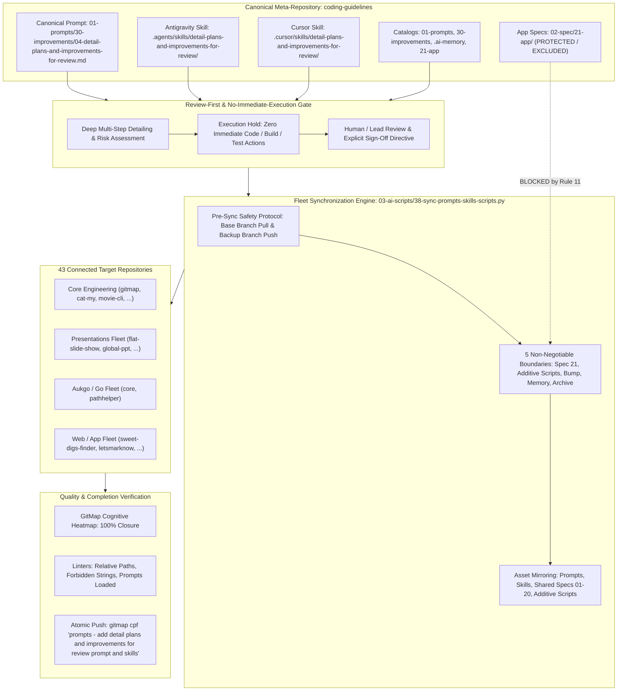
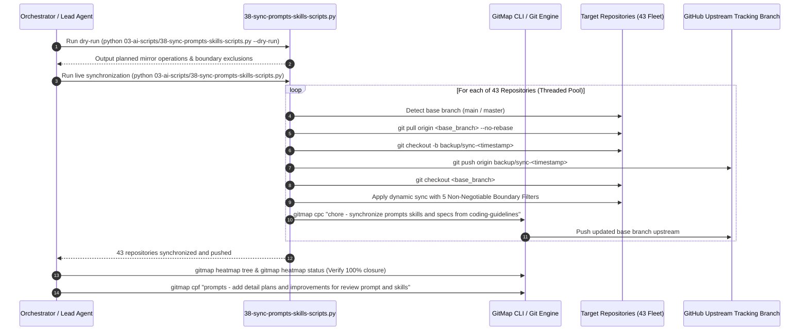
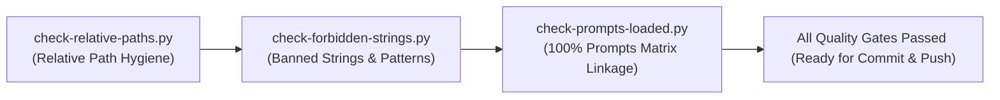
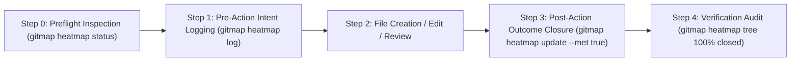

# Specification 03: Migration, Fleet Synchronization & Quality Verification

## 1. System Overview & Problem Statement

Task `02-detail-plans-and-improvements-for-review` establishes the **Detail Plans and Improvements for Review Prompt & Skills Suite**, expanding Category 30 (`01-prompts/30-improvements/`) with:
1. **Canonical Execution Prompt:** `01-prompts/30-improvements/04-detail-plans-and-improvements-for-review.md`.
2. **Antigravity Agent Skill:** `.agents/skills/detail-plans-and-improvements-for-review/skill.md`.
3. **Cursor IDE Skill:** `.cursor/skills/detail-plans-and-improvements-for-review/skill.md`.

This capability empowers autonomous AI agents to systematically inspect all past completed plans (`.ai-memory/plans/completed/`), active pending backlogs (`.ai-memory/plans/pending/`), and discovered improvement vectors, decomposing them into exhaustive, multi-step execution blueprints with granular subtasks so that any AI can follow through with minimal friction and maximum precision.



### The Inherent Problem & Architectural Risk
When new prompts, skills, and detailed improvements are introduced into `coding-guidelines`, three distinct hazards arise:
1. **Premature Implementation Without Review:** An autonomous AI encountering detailed improvement plans may prematurely begin implementing source code modifications, triggering regressions, breaking APIs, or altering production behaviors before architectural review.
2. **Fleet Synchronization Cross-Contamination:** Propagating prompt and skill updates across 43 downstream repositories can inadvertently leak private application domain specifications (`02-spec/21-*` through `02-spec/25-*`), overwrite target repository version bump scripts (`bump*`), corrupt target-specific memory (`.ai-memory/memory/` and `.ai-memory/plans/`), or overwrite custom AI scripts.
3. **Catalog Drift & Undetected Broken Links:** Adding a new canonical prompt without updating all master catalogs and running linter verification causes silent discovery failure for subsequent AI agents.

### The Architectural Solution
This specification formalizes the multi-repository fleet synchronization protocol, the strict **Review-First & No-Immediate-Execution Gate**, the **5 Non-Negotiable Boundaries**, catalog registration matrices across all 5 documentation roots, linter verification gates, GitMap cognitive heatmap telemetry, and atomic release ceremonies.

---

## 2. Review-First & No-Immediate-Execution Invariant

In strict compliance with user directives, prompt `04-detail-plans-and-improvements-for-review.md` and its companion skills embed a hard, non-negotiable review gate:

### 1. Zero Immediate Execution Policy
- When detailing plans or improvements, AI agents are strictly confined to:
  - Architecture discovery and codebase inspection via GitMap commands (`gitmap aum search`, `gitmap find`, `gitmap cat`).
  - Authoring granular, multi-step specifications in `02-spec/21-app/XX-<slug>/`.
  - Enqueueing actionable pending plans in `.ai-memory/plans/pending/XX-<slug>.md` with subtasks in `.ai-memory/plans/subtasks/XX-<slug>/`.
  - Formulating risk assessments, blast radius models, and rollback guarantees.
- Agents MUST NEVER execute code modifications, build commands, package installations, or test suites during the detailing phase.

### 2. Explicit Review Sign-Off Protocol
- Every detailed plan and improvement item generated must conclude with an explicit review presentation:
  - **Review State:** `PENDING_REVIEW`
  - **Required Reviewers:** Lead Architect / Human Operator
  - **Approval Token:** Must require explicit subsequent invocation instruction before any execution subtask is claimed or executed.
- If an agent detects a prompt attempting to execute un-reviewed improvements, it must immediately halt, flag the review gate violation, and output a structured review summary.

---

## 3. Fleet Synchronization Protocol & Engine Architecture

Fleet synchronization is orchestrated via `03-ai-scripts/38-sync-prompts-skills-scripts.py`. The script manages pre-flight repository discovery, pre-change safety branches, asset mirroring under boundary guardrails, and upstream tracking branch synchronization.

### Step-by-Step Execution Sequence



### Dynamic Asset Discovery in Sync Engine

The sync engine dynamically maps the following asset collections from `coding-guidelines`:
1. `01-prompts/` $\rightarrow$ `01-prompts/` (mirrors all canonical prompt directories, including `30-improvements/04-detail-plans-and-improvements-for-review.md`).
2. `.agents/skills/` $\rightarrow$ `.agents/skills/` (mirrors canonical Antigravity skills, including `detail-plans-and-improvements-for-review/`).
3. `.cursor/skills/` $\rightarrow$ `.cursor/skills/` (mirrors canonical Cursor skills, including `detail-plans-and-improvements-for-review/`).
4. `03-ai-scripts/` $\rightarrow$ `03-ai-scripts/` (additive-only mode: copies brand-new scripts; never overwrites existing target scripts).
5. `.agents/scripts/` $\rightarrow$ `.agents/scripts/` (additive-only mode).
6. Shared specifications: `02-spec/01-*` through `02-spec/20-*` dynamically scanned and mirrored.

### Target Repositories Catalog (43 Connected Repositories)

| Index | Repository Name | Relative Workspace Path | Tier / Ecosystem |
| :---: | :--- | :--- | :--- |
| 1 | `ai-empathy-prompt-tuner-v1` | `02-prompts/ai-empathy-prompt-tuner` | Prompts & AI Tuning |
| 2 | `alim-cv-v8` | `alim-cv` | Documentation & Portfolio |
| 3 | `alim-karim-profile-v2` | `alim-karim-profile` | Documentation & Portfolio |
| 4 | `alim.karim.profile` | `aukgit/alim.karim.profile` | Documentation & Portfolio |
| 5 | `Antigravity-Manager` | `antigravity-manager` | System & Developer Tools |
| 6 | `cat-my-v12` | `cat-my` | CLI & Developer Utilities |
| 7 | `core-v9` | `03-aukgo/core` | Aukgo / Go Shared Libraries |
| 8 | `digital-name-card` | `digital-name-card` | Web & Identity |
| 9 | `flat-slide-show` | `presentations-repos/flat-slide-show` | Presentations Engine |
| 10 | `gitlogger-new-v2` | `gitlogger-new` | Git & Telemetry Utilities |
| 11 | `gitmap-v28` | `gitmap` | GitMap Core Architecture |
| 12 | `global-ppt-v1` | `presentations-repos/global-ppt-v1` | Presentations Engine |
| 13 | `hiltrax-v1` | `presentations-repos/hiltrax` | Presentations Engine |
| 14 | `icon-coding-guidelines` | `icon-coding-guidelines` | Design & Visual Assets |
| 15 | `img-pdf-v2` | `img-pdf` | Image & Document Processing |
| 16 | `ki-health-ppt-v5` | `presentations-repos/ki-health-ppt` | Presentations Engine |
| 17 | `kubernetes-training-v1` | `aukgit/kubernetes-training` | Cloud & Infrastructure |
| 18 | `lara-licensing-v4` | `lara-licensing` | Licensing & Auth Services |
| 19 | `lara-publishing-v1` | `lara-publishing` | Publishing Framework |
| 20 | `laravel-automation-v1` | `laravel-automation` | Backend Automation |
| 21 | `letsmarknow-ui-v2` | `letsmarknow-ui` | Frontend Web UI |
| 22 | `letsmarknow-v2` | `letsmarknow` | Web Application Core |
| 23 | `macro-ahk-v55` | `macro-ahk` | Macro & Automation Engine |
| 24 | `maid-app-spec-presentation-v1` | `presentations-repos/maid-app-spec-presentation` | Presentations Engine |
| 25 | `movie-cli-v8` | `movie-cli` | CLI & Media Workflow |
| 26 | `pathhelper` | `03-aukgo/pathhelper` | Aukgo / Go Shared Libraries |
| 27 | `presentation-aug-2026-plans-alim` | `presentations-repos/presentation-aug-2026-plans-alim` | Presentations Engine |
| 28 | `prompts-connect-v3` | `02-prompts/prompts-connect` | Prompts & Workflow Utilities |
| 29 | `punam-case-studies-v1` | `punam-case-studies-v1` | Case Studies & Docs |
| 30 | `rasia-logo` | `presentations-repos/rasia-logo` | Design & Visual Assets |
| 31 | `scripts-fixer-v20` | `scripts-fixer` | Linter & Remediation Tools |
| 32 | `slides-spec` | `presentations-repos/slides-spec` | Presentations Engine |
| 33 | `spec-builder-v11` | `spec-builder` | Spec Architecture Scaffolding |
| 34 | `sweet-digs-finder` | `web-system/sweet-digs-finder` | Fullstack Web Application |
| 35 | `ui-prompts-cat` | `ui-prompts-cat` | UI & Prompt Engineering |
| 36 | `white-presentation-v1` | `presentations-repos/white-presentation-v1` | Presentations Engine |
| 37 | `workflowy-ui-v1` | `workflowy-ui` | Frontend Web UI |
| 38 | `workflowy-v3` | `workflowy` | Web Application Core |
| 39 | `wp-exam-v2` | `wp-exam` | WordPress Testing & Exam Engine |
| 40 | `wp-git-log-v3` | `wp-git-log` | WordPress Git Integration |
| 41 | `wp-html-automate` | `wp-html-automate` | WordPress HTML Utilities |
| 42 | `wp-link-manager-v5` | `wp-link-manager` | WordPress Link Architecture |
| 43 | `wp-onboarding-v17` | `wp-onboarding` | WordPress User Onboarding |

---

## 4. The 5 Non-Negotiable Boundaries

Under `AGENTS.md` Section 11, synchronization must enforce five immutable isolation boundaries:

### Boundary 1: Spec 21 Exclusion (TOTAL BAN)
- **Rule:** NEVER synchronize, copy, or touch `02-spec/21-*` through `02-spec/25-*` (private application specifications, issues, databases, design systems, and audits). Only shared foundational specifications `02-spec/01-*` through `02-spec/20-*` are synchronized across repositories.
- **Enforcement in Engine:** Function `is_spec_21(path)` detects any path segment containing `21-`, `22-`, `23-`, `24-`, or `25-` and returns `True`, immediately halting mirroring for that file.
- **Verification:** Post-sync audit ensures zero `02-spec/21-app/` files exist in any target repository.

### Boundary 2: Additive-Only AI Scripts
- **Rule:** Brand-new AI scripts (`03-ai-scripts/`, `.agents/scripts/`) that do not exist in the target repository are copied cleanly. Existing scripts already present in or modified by the target repository must NEVER be overwritten.
- **Enforcement in Engine:** Parameter `additive_only=True` prevents copying over existing destination files in script directories.
- **Verification:** Check that target repositories maintain their unique script revisions.

### Boundary 3: Bump Script Protection (IMMUTABLE)
- **Rule:** NEVER overwrite version bump scripts, manifests, or configuration files (`bump*`, `bump_versions.py`, `bump-version.mjs`, `version.json`, `version.template.json`). Each repository maintains custom SemVer release targets, tagging logic, and build steps.
- **Enforcement in Engine:** Function `is_bump_script(path)` filters out all files matching `bump` or `version`.
- **Verification:** Confirm SemVer configurations remain un-mutated across all repositories.

### Boundary 4: Memory & Plans Protection (TOTAL ISOLATION)
- **Rule:** NEVER modify, sync, or mirror `.ai-memory/memory/`, `.ai-memory/plans/`, `.ai-memory/temp-agents/`, `.ai-memory/cicd-issues/`, or `.ai-memory/ambiguous-questions/`. Each repository independently owns its operational memory, backlog, and active subtasks.
- **Enforcement in Engine:** Function `is_protected_memory_or_plan(path)` strictly blocks copying into any operational `.ai-memory` paths. Only canonical documentation index files (`.ai-memory/prompts.md`, `.ai-memory/coding-guidelines.md`) are synchronized conditionally.
- **Verification:** Target repository `.ai-memory/plans/` directory must contain exclusively local task files.

### Boundary 5: Archive Exclusion
- **Rule:** NEVER synchronize `06-archive/` or `06-old-prompts/`. Legacy archived prompt tiers and deprecated historical materials reside exclusively in `coding-guidelines` for historical reference and must never pollute downstream repositories.
- **Enforcement in Engine:** Set `EXCLUDE_NAMES` contains `"06-archive"` and `"06-old-prompts"`.
- **Verification:** Downstream repositories must not contain any `06-archive/` directory.

---

## 5. Catalog Updates & Registration Requirements

To guarantee 100% discoverability across IDEs, documentation viewers, and AI discovery agents, five master catalogs must be updated:

### 1. `01-prompts/readme.md` (Master Prompts Catalog)
- **Table of Categories Update:** Update Category 30 row to register prompt `04-detail-plans-and-improvements-for-review.md`:
  ```markdown
  | **30** | `30-improvements/` | `01-find-100-improvements-in-ui-level.md`, `02-find-100-improvements-in-code-base.md`, `03-find-100-improvements-in-whole-system.md`, `04-detail-plans-and-improvements-for-review.md` | Autonomous continuous improvement flywheel across UI, codebase, whole-system UX, and multi-step plan detailing with review-first gates |
  ```

### 2. `01-prompts/30-improvements/readme.md` (Category 30 Catalog)
- **Directory Index & Catalog Table:** Add prompt 04 entry:
  ```markdown
  | [`04-detail-plans-and-improvements-for-review.md`](04-detail-plans-and-improvements-for-review.md) | V6 / 1.0.0 | Plan & Improvement Detailing | Multi-step detailing of completed and pending plans and improvements for review, strict no-immediate-execution gate, and bounded subtask generation. |
  ```
- **Review Gate Documentation:** Add a prominent section detailing the Review-First invariant and how downstream AI agents must consume the detailed plans without auto-executing code changes.

### 3. `.ai-memory/prompts.md` (Operational Memory Prompts Matrix)
- **Prompts Matrix Update:** Add row under Category `30-improvements`:
  ```markdown
  | `30-improvements` | [`30-improvements/04-detail-plans-and-improvements-for-review.md`](../01-prompts/30-improvements/04-detail-plans-and-improvements-for-review.md) | Detail Plans and Improvements for Review — Multi-Step Detailing & Review-First Gate (must follow) |
  ```
- **Validation:** Must pass `python linter-scripts/check-prompts-loaded.py` with zero orphan or dangling prompt errors.

### 4. `.ai-memory/plans/readme.md` (Plans Index)
- **Pending Plans Section:** Add entry for task `02-detail-plans-and-improvements-for-review`:
  ```markdown
  - [02-detail-plans-and-improvements-for-review.md](pending/02-detail-plans-and-improvements-for-review.md): Detail Plans and Improvements for Review: Multi-step detailing of completed and pending plans, review-first and no-immediate-execution gate, dual-runtime skills, and 43-repo fleet synchronization.
  ```

### 5. `02-spec/21-app/readme.md` (Application Domain Specifications Index)
- **Active Contents Table:** Add entry for container folder `02-detail-plans-and-improvements-for-review/`:
  ```markdown
  | [`02-detail-plans-and-improvements-for-review/`](02-detail-plans-and-improvements-for-review/) | Detail Plans and Improvements for Review (Multi-Step Detailing, Review-First Gate, Fleet Sync) | Active Task Spec | Active |
  ```

---

## 6. Linter Verification Criteria & Tooling Gate

Before any commit or fleet push, the following three core linters must execute with zero failures:



### 1. `linter-scripts/check-relative-paths.py`
- **Execution Command:**
  ```bash
  python linter-scripts/check-relative-paths.py
  ```
- **Verification Rule:** Strictly bans absolute filesystem paths (e.g. `d:\work\...`, `C:\Users\...`, `/home/...`) and absolute file URIs (`file:///...`).
- **Pass Threshold:** 0 violations across all modified and newly created files in `02-spec/`, `.ai-memory/`, `01-prompts/`, `.agents/`, and `.cursor/`.

### 2. `linter-scripts/check-forbidden-strings.py`
- **Execution Command:**
  ```bash
  python linter-scripts/check-forbidden-strings.py
  ```
- **Verification Rule:** Validates configuration against `linter-scripts/forbidden-strings.toml`, ensuring no prohibited tokens, unescaped sensitive strings, or invalid placeholders exist.
- **Pass Threshold:** 0 violations.

### 3. `linter-scripts/check-prompts-loaded.py`
- **Execution Command:**
  ```bash
  python linter-scripts/check-prompts-loaded.py
  ```
- **Verification Rule:** Verifies that every prompt file under `01-prompts/` is indexed in `.ai-memory/prompts.md`, and that no dangling references exist in the index.
- **Pass Threshold:** Exit code `0` (PASS — index matches prompt directory exactly).

---

## 7. GitMap Cognitive Heatmap Telemetry Protocol

In accordance with `AGENTS.md` Section 15, all file touches, specification actions, and verification gates must be tracked via the GitMap Cognitive Heatmap:



### Cognitive Logging Commands

1. **Preflight Check:**
   ```bash
   gitmap heatmap status
   gitmap heatmap tables
   ```
2. **Intent Logging (Pre-Action):**
   ```bash
   gitmap heatmap log --task "02-detail-plans-and-improvements-for-review" --action "CREATE" --file "02-spec/21-app/02-detail-plans-and-improvements-for-review/03-migration-and-verification-spec.md" --state "SPECIFICATION" --expected "Author migration and verification spec covering fleet sync boundaries, linters, and heatmap gates"
   ```
3. **Outcome Closure (Post-Action):**
   ```bash
   gitmap heatmap update --id <ACTION_ID> --outcome "Specification authored with review-first gate, 5 boundaries, 43 repos catalog, 5 catalog updates, and linters" --met true
   ```
4. **Verification Gate:**
   ```bash
   gitmap heatmap tree --task "02-detail-plans-and-improvements-for-review"
   gitmap heatmap status --task "02-detail-plans-and-improvements-for-review"
   ```
   *Pass Threshold:* 100% actions marked closed (`met=true`). Zero unclosed or dangling operations.

---

## 8. Atomic Commit & Push Ceremony

Under `AGENTS.md` Section 10 and Section 13, all task deliverables must be committed and pushed atomically:

### Command Syntax Mandate
- **Exact Command:**
  ```bash
  gitmap cpf "prompts - add detail plans and improvements for review prompt and skills"
  ```
- **Hyphen Separator Mandate:** The message argument must use the hyphen separator format (`<module> - <summary>`). GitMap automatically prepends `Feature: ` to the commit message. NEVER include colons inside the message string (e.g. `prompts: add...` is strictly prohibited).
- **Auto-Push Primacy:** `gitmap cpf` stages all files, creates the semantic commit, and pushes upstream to GitHub tracking branch in a single atomic transaction.
- **Mandatory Completion Invariant ('No Push = Not Done'):** If the code is not committed to Git and pushed upstream to GitHub, the task is strictly considered INCOMPLETE and NOT DONE. The lead agent must verify a clean working tree and up-to-date tracking branch before concluding.

---

## 9. Acceptance Criteria

| ID | Verification Item | Target Deliverables / Boundaries | Binary Pass Criterion |
| :---: | :--- | :--- | :--- |
| **AC-01** | **Spec Authoring** | `02-spec/21-app/02-detail-plans-and-improvements-for-review/03-migration-and-verification-spec.md` | File exists, strictly relative links, lowercase, non-empty, contains review-first gate, 5 boundaries, 43 repos table, 5 catalog updates, and heatmap gates. |
| **AC-02** | **Subtask Plan** | `.ai-memory/plans/subtasks/02-detail-plans-and-improvements-for-review/03-subtask-migration-and-verification.md` | File exists, status PENDING, references parent plan and Spec 03, contains granular binary action checklist. |
| **AC-03** | **Review-First Gate** | Prompt `04-detail-plans-and-improvements-for-review.md` & Skills | Strict no-immediate-execution rule embedded; detailed plans must require review before code execution. |
| **AC-04** | **Boundary 1 (Spec 21 Exclusion)** | Target Repositories (43 Fleet) | Zero `02-spec/21-*` through `02-spec/25-*` files copied to any target repository. |
| **AC-05** | **Boundary 2 (Additive Scripts)** | `03-ai-scripts/`, `.agents/scripts/` | Target repositories retain local custom scripts; only brand-new scripts added. |
| **AC-06** | **Boundary 3 (Bump Script Protection)** | `bump*`, `version.json` | All version bump scripts and manifests completely untouched across all 43 repositories. |
| **AC-07** | **Boundary 4 (Memory Isolation)** | `.ai-memory/plans/`, `.ai-memory/memory/` | Target repositories retain exclusive ownership of their operational memory and plans. |
| **AC-08** | **Boundary 5 (Archive Exclusion)** | `06-archive/`, `06-old-prompts/` | Zero archive files copied to any downstream target repository. |
| **AC-09** | **Catalog 1 (`01-prompts/readme.md`)** | `01-prompts/readme.md` | Category 30 row updated to register prompt 04. |
| **AC-10** | **Catalog 2 (`30-improvements/readme.md`)** | `01-prompts/30-improvements/readme.md` | Group index documents prompt 04 and review-first invariant. |
| **AC-11** | **Catalog 3 (`.ai-memory/prompts.md`)** | `.ai-memory/prompts.md` | Prompts Matrix updated with prompt 04; passes `check-prompts-loaded.py`. |
| **AC-12** | **Catalog 4 (`.ai-memory/plans/readme.md`)** | `.ai-memory/plans/readme.md` | Pending plans section links `02-detail-plans-and-improvements-for-review.md`. |
| **AC-13** | **Catalog 5 (`02-spec/21-app/readme.md`)** | `02-spec/21-app/readme.md` | Active contents table indexes `02-detail-plans-and-improvements-for-review/`. |
| **AC-14** | **Linter 1 (Relative Paths)** | `linter-scripts/check-relative-paths.py` | Runs clean with 0 absolute path or `file:///` violations. |
| **AC-15** | **Linter 2 (Forbidden Strings)** | `linter-scripts/check-forbidden-strings.py` | Runs clean with 0 forbidden string violations. |
| **AC-16** | **Linter 3 (Prompts Loaded)** | `linter-scripts/check-prompts-loaded.py` | Runs clean with exit code 0 (all prompts indexed). |
| **AC-17** | **Heatmap Closure** | GitMap Heatmap DB | `gitmap heatmap status` reports 100% action closure for task `02-detail-plans-and-improvements-for-review`. |
| **AC-18** | **Atomic Push Ceremony** | `coding-guidelines` Git tracking branch | `gitmap cpf "prompts - add detail plans and improvements for review prompt and skills"` executed and pushed upstream. |
