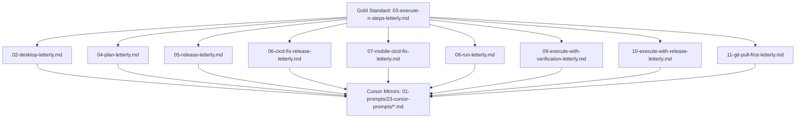

# Specification 01: Letterly Gold Standard & Prompt Suite Alignment

## 1. System Overview & Problem Statement

The Letterly prompt formatting system transforms raw speech-to-text transcripts and task briefs into high-authority, executable AI instruction blocks. `01-prompts/22-letterly/03-execute-n-steps-letterly.md` has been designated as the canonical **Gold Standard** for all Letterly formatters and their Cursor IDE mirrors (`01-prompts/23-cursor-prompts/`).

All remaining Letterly prompt templates (`02-desktop`, `04-plan`, `05-release`, `06-cicd-fix-release`, `07-mobile-cicd-fix`, `08-run`, `09-execute-with-verification`, `10-execute-with-release`, `11-git-pull-first`) must be upgraded to mirror the gold standard's exact conventions:
1. Re-anchoring the plan directive motto to:
   `[/plan](slashCommand;plan) first before doing work for improved work or less friction, faster work and more pure and effective work.`
2. Streamlining the slug format in headers to `## slug: <task-slug>` while clarifying that during folder and plan authoring, `XX` is the zero-padded sequential index (`01`, `02`).
3. Standardizing Actionable Item 2:
   `2. Write spec under 02-spec/21-app/XX-<slug>/ and enqueue plan task in .ai-memory/plans/pending/XX-<slug>.md (subtasks in .ai-memory/plans/subtasks/XX-<slug>/) first, (xx should be figured out by the folder structure and running AI tools, xx  is sequence 01, 02)`
4. Ensuring that when writing about planning, there is no need to include execute steps; planning is strictly dedicated to architecture, specification, boundaries, and task decomposition (no-build, no-test, no-code-changes) with execution decoupled to subsequent phases.

## 2. Invariants & Diff Matrix

| Template File | Header Slug Format | Actionable Item 2 Format | Additional Instructions Plan Motto |
| :--- | :--- | :--- | :--- |
| `03-execute-n-steps-letterly.md` | `## slug: <task-slug>` | `Write spec under 02-spec/21-app/XX-<slug>/ and enqueue plan task in .ai-memory/plans/pending/XX-<slug>.md (subtasks in .ai-memory/plans/subtasks/XX-<slug>/) first, (xx should be figured out by the folder structure and running AI tools, xx is sequence 01, 02)` | `[/plan](slashCommand;plan) first before doing work for improved work or less friction, faster work and more pure and effective work.` |
| `02-desktop-letterly.md` | Match Gold Standard | Match Gold Standard | Match Gold Standard |
| `04-plan-letterly.md` | Match Gold Standard | Spec first under `02-spec/21-app/XX-<slug>/` | Match Gold Standard |
| `05-release-letterly.md` | `## slug: <task-slug>` | Match Gold Standard release spec | Match Gold Standard |
| `06-cicd-fix-release-letterly.md` | `## slug: <task-slug>` | Match Gold Standard cicd spec | Match Gold Standard |
| `07-mobile-cicd-fix-letterly.md` | Single-line streamlined | Match Gold Standard | Match Gold Standard |
| `08-run-letterly.md` | `## slug: <task-slug>` | Match Gold Standard | Match Gold Standard |
| `09-execute-with-verification-letterly.md` | `## slug: <task-slug>` | Match Gold Standard | Match Gold Standard |
| `10-execute-with-release-letterly.md` | `## slug: <task-slug>` | Match Gold Standard | Match Gold Standard |
| `11-git-pull-first-letterly.md` | `## slug: <task-slug>` | Match Gold Standard | Match Gold Standard |

## 3. Cursor Mirrors Synchronicity

Every file in `01-prompts/22-letterly/` maintains an exact 1:1 mirror in `01-prompts/23-cursor-prompts/` with the `-cursor.md` suffix (e.g. `03-execute-n-steps-letterly-cursor.md`). The only architectural distinction in Cursor formatters is IDE skill link syntax (`[<skill>](file;.cursor/skills/<skill>)`), while preserving identical actionable items, headers, and additional instructions.

## 4. Verification Protocol

1. `gitmap aum search "for improved work or less friction, faster work and more pure and effective work" 01-prompts/22-letterly` returns 11 hits.
2. `gitmap aum search "for improved work or less friction, faster work and more pure and effective work" 01-prompts/23-cursor-prompts` returns 11 hits.
3. Linters pass (`python linter-scripts/check-prompts-loaded.py`).
