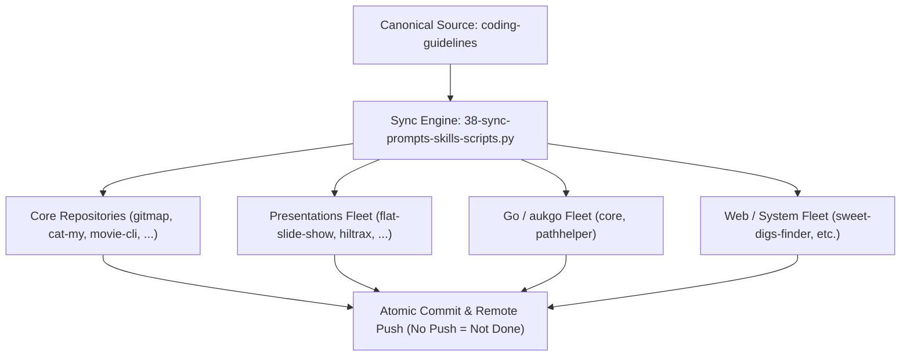

# Specification 03: Fleet Synchronization & Verification

## 1. System Overview & Problem Statement

Upon completing canonical prompt and skill enhancements in `coding-guidelines`, all updated assets (`01-prompts/22-letterly/`, `01-prompts/23-cursor-prompts/`, `.agents/skills/`, `.cursor/skills/`, and shared specifications `02-spec/01-*` .. `02-spec/20-*`) must be synchronized across all 43 connected repositories in the workspace using `03-ai-scripts/38-sync-prompts-skills-scripts.py`.

## 2. Target Repositories Catalog

The synchronization covers the complete list of 43 target repositories provided by the user:

| Index | Repository Name | Relative Workspace Path |
| :--- | :--- | :--- |
| 1 | `ai-empathy-prompt-tuner-v1` | `02-prompts/ai-empathy-prompt-tuner` |
| 2 | `alim-cv-v8` | `alim-cv` |
| 3 | `alim-karim-profile-v2` | `alim-karim-profile` |
| 5 | `alim.karim.profile` | `aukgit/alim.karim.profile` |
| 6 | `Antigravity-Manager` | `antigravity-manager` |
| 9 | `cat-my-v12` | `cat-my` |
| 12 | `core-v9` | `03-aukgo/core` |
| 13 | `digital-name-card` | `digital-name-card` |
| 17 | `flat-slide-show` | `presentations-repos/flat-slide-show` |
| 18 | `gitlogger-new-v2` | `gitlogger-new` |
| 19 | `gitmap-v28` | `gitmap` |
| 20 | `global-ppt-v1` | `presentations-repos/global-ppt-v1` |
| 22 | `hiltrax-v1` | `presentations-repos/hiltrax` |
| 23 | `icon-coding-guidelines` | `icon-coding-guidelines` |
| 24 | `img-pdf-v2` | `img-pdf` |
| 25 | `ki-health-ppt-v5` | `presentations-repos/ki-health-ppt` |
| 27 | `kubernetes-training-v1` | `aukgit/kubernetes-training` |
| 28 | `lara-licensing-v4` | `lara-licensing` |
| 29 | `lara-publishing-v1` | `lara-publishing` |
| 30 | `laravel-automation-v1` | `laravel-automation` |
| 31 | `letsmarknow-ui-v2` | `letsmarknow-ui` |
| 32 | `letsmarknow-v2` | `letsmarknow` |
| 33 | `macro-ahk-v55` | `macro-ahk` |
| 34 | `maid-app-spec-presentation-v1` | `presentations-repos/maid-app-spec-presentation` |
| 35 | `movie-cli-v8` | `movie-cli` |
| 39 | `pathhelper` | `03-aukgo/pathhelper` |
| 40 | `presentation-aug-2026-plans-alim` | `presentations-repos/presentation-aug-2026-plans-alim` |
| 46 | `prompts-connect-v3` | `02-prompts/prompts-connect` |
| 47 | `punam-case-studies-v1` | `punam-case-studies-v1` |
| 49 | `rasia-logo` | `presentations-repos/rasia-logo` |
| 54 | `scripts-fixer-v20` | `scripts-fixer` |
| 56 | `slides-spec` | `presentations-repos/slides-spec` |
| 57 | `spec-builder-v11` | `spec-builder` |
| 59 | `sweet-digs-finder` | `web-system/sweet-digs-finder` |
| 60 | `ui-prompts-cat` | `ui-prompts-cat` |
| 61 | `white-presentation-v1` | `presentations-repos/white-presentation-v1` |
| 62 | `workflowy-ui-v1` | `workflowy-ui` |
| 63 | `workflowy-v3` | `workflowy` |
| 64 | `wp-exam-v2` | `wp-exam` |
| 65 | `wp-git-log-v3` | `wp-git-log` |
| 66 | `wp-html-automate` | `wp-html-automate` |
| 67 | `wp-link-manager-v5` | `wp-link-manager` |
| 68 | `wp-onboarding-v17` | `wp-onboarding` |

## 3. Strict Boundary Invariants

1. **Rule 11 (Spec 21 Exclusion):** `02-spec/21-*` is unconditionally excluded from synchronization. Zero application specifications will be copied to or removed from target repositories.
2. **Permanent `v4` Exclusion:** `"v4"` is in `EXCLUDE_NAMES` to guarantee deprecated prompts are never reintroduced.
3. **Additive-Only AI Scripts:** Existing custom scripts in target repositories are protected from overwrite.
4. **Completion Invariant ("No Push = Not Done"):** Every updated repository must be committed and pushed to its remote tracking branch via `gitmap cpc`.

## 4. Verification Protocol

1. `python 03-ai-scripts/38-sync-prompts-skills-scripts.py` executes with 0 errors.
2. All target repositories show clean working trees and up-to-date tracking branches.
3. Zero `v4` prompts or `02-spec/21-app` files leaked into any repository.
