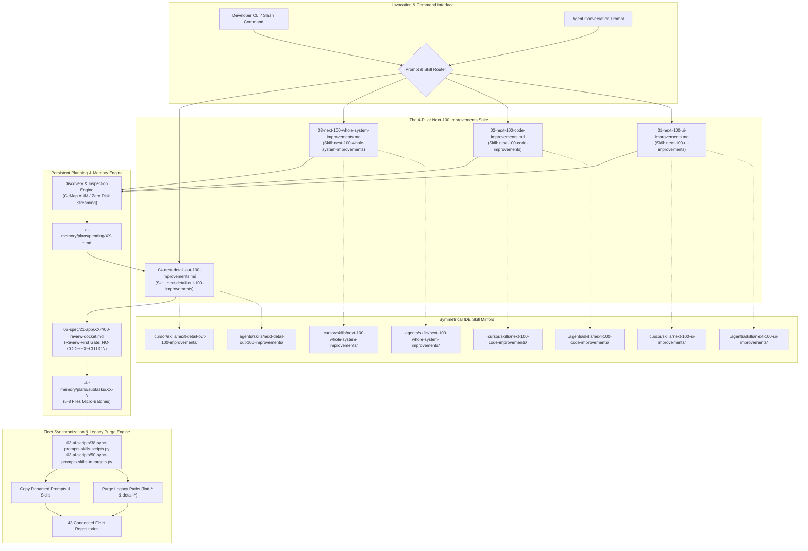

# Specification 01: 100 Improvements Prompts & Skills Suite Architecture, Renaming & Fleet Purge

## 1. Executive Summary & Architectural Rationale

### 1.1 Problem Statement: The Entropy of Static Audits
Software codebases naturally experience entropy across three critical vectors: User Interface (UI) design fidelity, codebase hygiene/guideline compliance, and whole-system user experience (UX) friction. Historically, initial tooling named these exploratory operations using the `find-100-improvements-*` prefix:
- `01-find-100-improvements-in-ui-level.md`
- `02-find-100-improvements-in-code-base.md`
- `03-find-100-improvements-in-whole-system.md`
- `04-detail-plans-and-improvements-for-review.md`

While effective for single-pass audits, the `find-` framing introduced several conceptual and operational limitations:
1. **Static vs. Continuous Flywheel Semantics:** The verb `find` suggests a one-time static discovery effort. In high-velocity engineering, improvement is a continuous, self-looping flywheel: once 100 items are discovered, triaged, detailed, or completed, the engineering system immediately transitions to discovering and addressing the **next** 100 improvements.
2. **Conversational AI & Operator Ergonomics:** Operators invoking agents via CLI or chat interface naturally think in terms of forward velocity: *"Identify the next 100 UI improvements"* or *"Run next 100 code improvements"*. The `next-` prefix matches the agentic execution protocol where each pass operates on the next sequential frontier of repository health.
3. **Naming Asymmetry in Detailing:** The companion detailing prompt `04-detail-plans-and-improvements-for-review.md` lacked direct naming parity with the 100-improvement discovery prompts. Renaming it to `04-next-detail-out-100-improvements.md` establishes clear semantic symmetry across the entire four-pillar suite.
4. **Fleet Staleness & Drift Risk:** In a multi-repository ecosystem (43 connected repositories), changes to canonical prompt and skill definitions must be synchronized cleanly while ensuring legacy, obsolete paths are completely purged from both the source repository and all downstream consumer repositories.

### 1.2 The "Next-100" Architecture
This specification governs the renaming, symmetrical skill mirroring, legacy path deletion, catalog reconciliation, and fleet synchronization of the 100 Improvements Suite.

Under the new architecture:
- Prompts reside in `01-prompts/30-improvements/` prefixed with `01-next-100-ui-improvements.md`, `02-next-100-code-improvements.md`, `03-next-100-whole-system-improvements.md`, and `04-next-detail-out-100-improvements.md`.
- Antigravity IDE skills reside in `.agents/skills/` with matching folder names.
- Cursor IDE skills reside in `.cursor/skills/` with matching folder names.
- Legacy paths are removed from source git trees and actively purged from target repositories during fleet synchronization.

---

## 2. Mermaid Architecture Diagram



---

## 3. Renaming Specification & Target Matrix

### 3.1 Prompt File Mapping
All prompt files reside in `01-prompts/30-improvements/`. The table below establishes the immutable mapping:

| Old Prompt Path | New Prompt Path | Target Purpose |
| :--- | :--- | :--- |
| `01-prompts/30-improvements/01-find-100-improvements-in-ui-level.md` | `01-prompts/30-improvements/01-next-100-ui-improvements.md` | Audits 100 UI design, token, contrast, depth, and layout improvements |
| `01-prompts/30-improvements/02-find-100-improvements-in-code-base.md` | `01-prompts/30-improvements/02-next-100-code-improvements.md` | Audits 100 codebase guideline, error handling, and typing improvements |
| `01-prompts/30-improvements/03-find-100-improvements-in-whole-system.md` | `01-prompts/30-improvements/03-next-100-whole-system-improvements.md` | Audits 100 system-wide UX friction and architecture improvements |
| `01-prompts/30-improvements/04-detail-plans-and-improvements-for-review.md` | `01-prompts/30-improvements/04-next-detail-out-100-improvements.md` | Details discovered improvements into review dockets and subtasks |

### 3.2 Symmetrical Skill Slugs & Mirror Directories
Every prompt is symmetrically mirrored into both `.agents/skills/` (for Antigravity agents) and `.cursor/skills/` (for Cursor IDE agents):

| Target Skill Slug | Antigravity Skill Path | Cursor Skill Path | Primary Markdown File |
| :--- | :--- | :--- | :--- |
| `next-100-ui-improvements` | `.agents/skills/next-100-ui-improvements/` | `.cursor/skills/next-100-ui-improvements/` | `skill.md` |
| `next-100-code-improvements` | `.agents/skills/next-100-code-improvements/` | `.cursor/skills/next-100-code-improvements/` | `skill.md` |
| `next-100-whole-system-improvements` | `.agents/skills/next-100-whole-system-improvements/` | `.cursor/skills/next-100-whole-system-improvements/` | `skill.md` |
| `next-detail-out-100-improvements` | `.agents/skills/next-detail-out-100-improvements/` | `.cursor/skills/next-detail-out-100-improvements/` | `skill.md` |

### 3.3 Skill Frontmatter & Header Normalization Contract
When renaming skill files, the YAML frontmatter and top-level header must be updated strictly to reflect the new identifier:
1. `next-100-ui-improvements`:
   - `name: next-100-ui-improvements`
   - Header: `# Next 100 UI Improvements`
2. `next-100-code-improvements`:
   - `name: next-100-code-improvements`
   - Header: `# Next 100 Code Improvements`
3. `next-100-whole-system-improvements`:
   - `name: next-100-whole-system-improvements`
   - Header: `# Next 100 Whole System Improvements`
4. `next-detail-out-100-improvements`:
   - `name: next-detail-out-100-improvements`
   - Header: `# Next Detail Out 100 Improvements`

---

## 4. Pillar Disciplines & Functional Capabilities

### 4.1 Pillar 1: `next-100-ui-improvements`
- **Scope:** Frontend interfaces, design systems, visual tokens, and micro-interactions.
- **Key Inspection Dimensions:**
  1. *Color Token System:* HSL/OKLCH semantic palette tokens; strict elimination of raw `#hex` or ad-hoc Tailwind colors.
  2. *Contrast Ratios:* Full WCAG 2.2 AA (4.5:1) and AAA (7:1) compliance for body and interactive elements.
  3. *4-Plane Depth Hierarchy:* Plane 0 Canvas, Plane 1 Recessed Wells, Plane 2 Surface Cards, Plane 3 Elevated Modals with hairline border lighting.
  4. *60/30/10 Visual Balance:* 60% neutral canvas, 30% structural surfaces, 10% high-intent focal accents.
  5. *Live DOM Text Standard:* 100% semantic text; zero rasterized typography.
  6. *Button & Control System:* 44x44px touch targets, 6 variants, 4 responsive size tiers.
  7. *Motion Physics:* Spring transitions $\le 250\text{ms}$ with `prefers-reduced-motion` fallbacks.
  8. *React Component Hygiene:* Decomposition of components $> 100$ lines into modular micro-components.

### 4.2 Pillar 2: `next-100-code-improvements`
- **Scope:** Codebase hygiene, architectural patterns, and cross-language coding guidelines.
- **Key Inspection Dimensions:**
  1. *Structured AppError Returns:* Mandatory `*appfault.AppError` return type in Go; typed Result containers in TS/Rust.
  2. *Monadic Result Envelopes:* Eradication of multi-value error tuples (`Result[T]`, `ResultSlice[T]`, `ResultMap[K, V]`).
  3. *Positive Boolean Discipline:* Implicit boolean evaluations (`if isReady`), positive prefixes (`is`, `has`), zero mixed polarity (`if isA && !isB`).
  4. *Vertical Line Gap Spacing:* Mandatory blank lines before `if`, after `}`, before `return`, and around multi-line structs.
  5. *Function Length & Parameter Reduction:* Strict $\le 15$ line preference for functions; parameter struct encapsulation for $> 2\text{--}3$ arguments.
  6. *High-Speed Map Dispatch Tables:* Replacement of repetitive switch/if ladders with declarative map dispatchers.
  7. *Value Semantics & Pointer Reduction:* Value semantics over pointers (`*T`) for small structs, eliminating GC pressure.

### 4.3 Pillar 3: `next-100-whole-system-improvements`
- **Scope:** Systemic user and developer experience, API boundaries, CLI ergonomics, and friction reduction.
- **Key Inspection Dimensions:**
  1. *10 High-Impact UX Clusters:* CLI ergonomics, agent swarms, prompt architecture, fleet sync, performance, telemetry, test isolation, and spec governance.
  2. *4-Part Impact Audit:* Current Behavior, Direct Consequence, Proposed Improvement, and Concrete Architectural Outcome.
  3. *Zero Harm & Regression Safety:* Backward compatibility preservation, zero breaking changes to public interfaces, and isolated rollback guarantees.
  4. *Autonomous Plan Enqueueing:* Writing the complete catalog of 100 improvements directly into `.ai-memory/plans/pending/XX-*.md`.

### 4.4 Pillar 4: `next-detail-out-100-improvements`
- **Scope:** Detailed planning, structural contracts, review dockets, and dependency graphs.
- **Key Invariants:**
  1. *Review-First Gate (NO-CODE-EXECUTION):* Strict prohibition against modifying production code or running builds/tests during detailing.
  2. *Review Docket Generation:* Authoring `02-spec/21-app/XX-<slug>/00-review-docket.md` containing risk classification, rollback complexity, and user sign-off checklists.
  3. *Execution Roadmap & DAG Decomposition:* Breaking down the 100 candidates into sequenced micro-batches (5-8 files per subtask) in `.ai-memory/plans/subtasks/XX-<slug>/`.

---

## 5. Legacy Path Deletion & Multi-Repository Purge Protocol

### 5.1 Local Deletion Invariant (Source Repository)
When new prompt and skill paths are active, the legacy files and folders MUST be completely deleted from the source repository (`coding-guidelines`). Retaining obsolete aliases or duplicate files causes cognitive confusion for AI agents and violates repository hygiene.

#### Paths Scheduled for Local Deletion:
```text
# Legacy Prompts in 01-prompts/30-improvements/:
01-prompts/30-improvements/01-find-100-improvements-in-ui-level.md
01-prompts/30-improvements/02-find-100-improvements-in-code-base.md
01-prompts/30-improvements/03-find-100-improvements-in-whole-system.md
01-prompts/30-improvements/04-detail-plans-and-improvements-for-review.md

# Legacy Antigravity Skills in .agents/skills/:
.agents/skills/find-100-improvements-in-ui-level/
.agents/skills/find-100-improvements-in-code-base/
.agents/skills/find-100-improvements-in-whole-system/
.agents/skills/detail-plans-and-improvements-for-review/

# Legacy Cursor Skills in .cursor/skills/:
.cursor/skills/find-100-improvements-in-ui-level/
.cursor/skills/find-100-improvements-in-code-base/
.cursor/skills/find-100-improvements-in-whole-system/
.cursor/skills/detail-plans-and-improvements-for-review/
```

### 5.2 Multi-Repository Synchronization & Purge Mechanics
Standard fleet synchronization scripts (`03-ai-scripts/38-sync-prompts-skills-scripts.py` and `03-ai-scripts/50-sync-prompts-skills-to-targets.py`) operate under an additive-only paradigm to protect target-local custom scripts or skills.

However, when canonical assets are renamed:
1. Additive synchronization copies the new `next-*` files to target repositories.
2. The legacy `find-*` files would remain in target repositories as dead artifacts unless explicitly deleted.

To prevent fleet-wide clutter, the synchronization engine MUST implement an explicit **Target Repository Purge Manifest**:
```python
LEGACY_PURGE_PATHS = [
    # Legacy Prompts
    "01-prompts/30-improvements/01-find-100-improvements-in-ui-level.md",
    "01-prompts/30-improvements/02-find-100-improvements-in-code-base.md",
    "01-prompts/30-improvements/03-find-100-improvements-in-whole-system.md",
    "01-prompts/30-improvements/04-detail-plans-and-improvements-for-review.md",
    # Legacy Antigravity Skills
    ".agents/skills/find-100-improvements-in-ui-level",
    ".agents/skills/find-100-improvements-in-code-base",
    ".agents/skills/find-100-improvements-in-whole-system",
    ".agents/skills/detail-plans-and-improvements-for-review",
    # Legacy Cursor Skills
    ".cursor/skills/find-100-improvements-in-ui-level",
    ".cursor/skills/find-100-improvements-in-code-base",
    ".cursor/skills/find-100-improvements-in-whole-system",
    ".cursor/skills/detail-plans-and-improvements-for-review",
]
```

During execution against each target repository:
1. The sync engine checks for each path in `LEGACY_PURGE_PATHS`.
2. If present, it deletes the file or directory tree safely prior to or immediately following the copy step.
3. The deletion is recorded in the sync transaction log.

---

## 6. Catalog, Documentation & Linter Alignment

All repository catalogs and documentation indexing prompts must be synchronized with the new filenames:

### 6.1 Catalog Synchronization Targets
1. `01-prompts/readme.md`: Update table for Category 30 to reference `01-next-100-ui-improvements.md`, `02-next-100-code-improvements.md`, `03-next-100-whole-system-improvements.md`, and `04-next-detail-out-100-improvements.md`.
2. `01-prompts/30-improvements/readme.md`: Update directory index table, prompt titles, and cross-links.
3. `.ai-memory/prompts.md`: Update lines 224–228 to reflect the exact new prompt filenames and titles.
4. `.ai-memory/plans/readme.md`: Re-align any cross-references to the 100-improvement suite.
5. `02-spec/21-app/readme.md`: Index this specification (`03-rename-and-sync-100-improvements-prompts-and-skills`).

### 6.2 Linter Verification Contract
The modifications must pass all validation scripts without error:
- `linter-scripts/check-prompts-loaded.py`: Verifies that every file in `01-prompts/` has an exact 1:1 corresponding entry in `.ai-memory/prompts.md`.
- `linter-scripts/check-relative-paths.py`: Verifies zero absolute filesystem paths or `file:///` URIs.
- `linter-scripts/check-forbidden-strings.py`: Verifies zero forbidden tokens.

---

## 7. Strict Non-Negotiable Invariants

1. **Strict Relative Git Paths:** All links and file paths MUST be strictly relative starting from the repository root (`02-spec/...`, `.ai-memory/...`, `01-prompts/...`). TOTAL BAN on absolute filesystem paths (`d:\work\...`, `/Users/...`) and `file:///` URIs.
2. **Strict Lowercase Naming:** All paths, folders, and filenames MUST be strictly lowercase without exception.
3. **No Build & No Test Rule:** Workers and specification authors must NOT run builds or automated test suites during this operational phase.
4. **No Git Execution by Workers:** Workers must NEVER execute `git` commands (`git add`, `git commit`, `git push`, `git status`). Git operations are reserved strictly for the Lead Orchestrator upon complete multi-agent sign-off.
5. **GitMap High-Speed Search Exclusivity:** Codebase navigation and discovery must use `gitmap` commands (`gitmap lf`, `gitmap aum search`, `gitmap find`, `gitmap cat`). Shell search tools (`rg`, `ripgrep`, `grep`, `dir`, `Select-String`) are strictly banned.
6. **Atomic Commit & Remote Push Invariant:** Completion mandates an atomic semantic push via `gitmap cpf "prompts - rename 100 improvements suite to next-100 and sync fleet"` adhering to the 'No Push = Not Done' standard.
