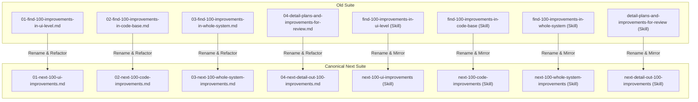
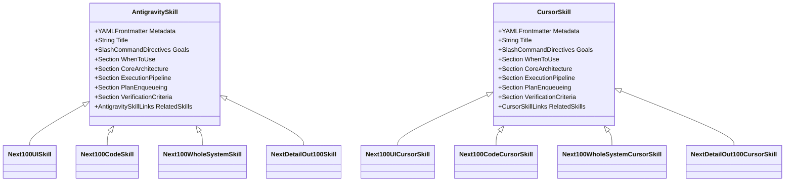
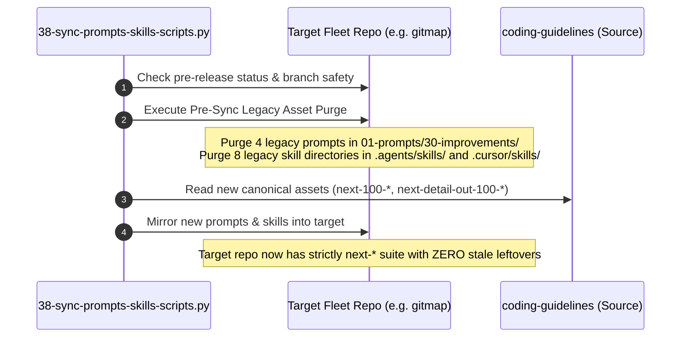

# Specification 02: Component Specification, Schemas & Renaming Transformations

**Version:** 1.0.0  
**Status:** ACTIVE  
**Parent Plan:** `.ai-memory/plans/pending/03-rename-and-sync-100-improvements-prompts-and-skills.md`  
**Architecture Spec:** `02-spec/21-app/03-rename-and-sync-100-improvements-prompts-and-skills/01-architecture-spec.md`  
**Applicability:** Universal across Prompt Suite (`01-prompts/30-improvements/`), Antigravity Skills (`.agents/skills/`), Cursor Skills (`.cursor/skills/`), Sync Scripts (`03-ai-scripts/38-sync-prompts-skills-scripts.py`), and Catalogs (`01-prompts/readme.md`, `01-prompts/30-improvements/readme.md`, `.ai-memory/prompts.md`)

---

## 1. Executive Summary & Renaming Mandate

This component specification details the exact mappings, content transformations, data schemas, YAML frontmatter, IDE link syntax, catalog updates, and target repository purge logic required to migrate the **100 Improvements Prompt and Skill Suite** to the canonical `next-*` nomenclature:

1. **`01-next-100-ui-improvements`:** Focuses on perceptual contrast, typography geometry, button physics, 72px sticky header physics, hairline specular lighting, safe-region navigation, 3D flip dynamics, and WCAG AA/AAA compliance.
2. **`02-next-100-code-improvements`:** Governed by the 10-field specification card schema, enforcing repository coding standards (positive booleans, `*appfault.AppError`, parameter structs, vertical newline gaps, relative paths) across bounded 5–8 file micro-batches.
3. **`03-next-100-whole-system-improvements`:** Governed by the 8-part specification schema detailing UX impact, root cause, downstream effect, zero harm/regression safety, backward compatibility, implementation blueprint, and deterministic binary verification.
4. **`04-next-detail-out-100-improvements`:** Autonomously details out active, pending, and completed plans and candidate improvements into exhaustive multi-step execution roadmaps, structural contracts, and review dockets under a strict review-first gate (no immediate execution without user review).

All transformations strictly uphold the non-negotiable invariants:
- **Strict Relative Git Paths:** Only relative Git paths (e.g. `01-prompts/...`, `.agents/skills/...`, `.cursor/skills/...`); total ban on absolute paths and `file:///` URIs.
- **Strict Lowercase Hygiene:** All paths, filenames, and directories strictly lowercase.
- **Symmetric Skill Mirroring:** Exact functional parity between `.agents/skills/` and `.cursor/skills/` using platform-compliant link syntax (`[skill](file;.agents/skills/skill)` vs `[skill](file;.cursor/skills/skill)`).
- **Target Repository Purge Logic:** Explicit purge lists in `03-ai-scripts/38-sync-prompts-skills-scripts.py` ensuring old prompt and skill files are purged cleanly across all 43 fleet repositories during synchronization.

---

## 2. Exhaustive Renaming Matrix



### 2.1 Complete File and Skill Mapping Table

| Item | Old Relative Path | New Relative Path | Old Skill Slug | New Skill Slug | Slash Command |
|:---:|:---|:---|:---|:---|:---|
| **01** | `01-prompts/30-improvements/01-find-100-improvements-in-ui-level.md` | `01-prompts/30-improvements/01-next-100-ui-improvements.md` | `find-100-improvements-in-ui-level` | `next-100-ui-improvements` | `/next-100-ui-improvements` |
| **02** | `01-prompts/30-improvements/02-find-100-improvements-in-code-base.md` | `01-prompts/30-improvements/02-next-100-code-improvements.md` | `find-100-improvements-in-code-base` | `next-100-code-improvements` | `/next-100-code-improvements` |
| **03** | `01-prompts/30-improvements/03-find-100-improvements-in-whole-system.md` | `01-prompts/30-improvements/03-next-100-whole-system-improvements.md` | `find-100-improvements-in-whole-system` | `next-100-whole-system-improvements` | `/next-100-whole-system-improvements` |
| **04** | `01-prompts/30-improvements/04-detail-plans-and-improvements-for-review.md` | `01-prompts/30-improvements/04-next-detail-out-100-improvements.md` | `detail-plans-and-improvements-for-review` | `next-detail-out-100-improvements` | `/next-detail-out-100-improvements` |

### 2.2 Symmetrical Skill Directory Mapping Table

| Category | Old Skill Folder | New Skill Folder | Entrypoint File |
|:---|:---|:---|:---|
| **Antigravity Skill 01** | `.agents/skills/find-100-improvements-in-ui-level/` | `.agents/skills/next-100-ui-improvements/` | `.agents/skills/next-100-ui-improvements/skill.md` |
| **Antigravity Skill 02** | `.agents/skills/find-100-improvements-in-code-base/` | `.agents/skills/next-100-code-improvements/` | `.agents/skills/next-100-code-improvements/skill.md` |
| **Antigravity Skill 03** | `.agents/skills/find-100-improvements-in-whole-system/` | `.agents/skills/next-100-whole-system-improvements/` | `.agents/skills/next-100-whole-system-improvements/skill.md` |
| **Antigravity Skill 04** | `.agents/skills/detail-plans-and-improvements-for-review/` | `.agents/skills/next-detail-out-100-improvements/` | `.agents/skills/next-detail-out-100-improvements/skill.md` |
| **Cursor Skill 01** | `.cursor/skills/find-100-improvements-in-ui-level/` | `.cursor/skills/next-100-ui-improvements/` | `.cursor/skills/next-100-ui-improvements/skill.md` |
| **Cursor Skill 02** | `.cursor/skills/find-100-improvements-in-code-base/` | `.cursor/skills/next-100-code-improvements/` | `.cursor/skills/next-100-code-improvements/skill.md` |
| **Cursor Skill 03** | `.cursor/skills/find-100-improvements-in-whole-system/` | `.cursor/skills/next-100-whole-system-improvements/` | `.cursor/skills/next-100-whole-system-improvements/skill.md` |
| **Cursor Skill 04** | `.cursor/skills/detail-plans-and-improvements-for-review/` | `.cursor/skills/next-detail-out-100-improvements/` | `.cursor/skills/next-detail-out-100-improvements/skill.md` |

---

## 3. Prompts Suite Transformation Specifications (`01-prompts/30-improvements/`)

Every prompt file in `01-prompts/30-improvements/` must undergo systematic internal content refactoring to eliminate all stale references, synchronize header titles and slugs, update invoke directives, and enforce symmetrical skill bootstrap logic.

### 3.1 Prompt 01: `01-next-100-ui-improvements.md`

#### A. Header, Metadata & Invocations
- **Title Line:** Change `# Find 100 Improvements in the UI Level` to `# Next 100 UI Improvements`.
- **Slug Directive:** Ensure header block contains `## slug: next-100-ui-improvements`.
- **Invoke Directive:**
  ```markdown
  > [!IMPORTANT]
  > Prompt Version: 1.0.0
  > Runtime: Google Antigravity 2.0 (IDE and CLI)
  > Invoke: /next-100-ui-improvements <target-component-or-page>
  ```
- **Trigger Keywords & Aliases:**
  `next-100-ui-improvements`, `next-100-ui`, `ui-100-improvements`, `next-ui-improvements`, `find-100-ui`

#### B. Phase 0 Antigravity Skill Bootstrap Refactoring
```markdown
## Phase 0: Antigravity Skill Bootstrap (Memory Optimization)

Before executing the tasks below, check if this prompt is already installed as a native Antigravity Skill.

1. If `.agents/skills/next-100-ui-improvements/skill.md` does not exist in the workspace, create it now.
2. Extract the core instructions of this prompt and save it into that `skill.md` using the standard YAML frontmatter (with `name` and `description`).
3. Maintain symmetric mirroring in `.cursor/skills/next-100-ui-improvements/skill.md` with IDE link syntax `[next-100-ui-improvements](file;.cursor/skills/next-100-ui-improvements)`.
4. Once installed, rely on progressive disclosure for future runs. Do not keep the entire prompt in active memory if not needed.
```

#### C. Plan Enqueueing & Continuity Target
- When generating subsequent iterative waves, the prompt targets `.ai-memory/plans/pending/XX-next-100-ui-improvements.md` with subtasks in `.ai-memory/plans/subtasks/XX-next-100-ui-improvements/`.

---

### 3.2 Prompt 02: `02-next-100-code-improvements.md`

#### A. Header, Metadata & Invocations
- **Title Line:** Change `# Find 100 Improvements in the Code Base` to `# Next 100 Code Improvements`.
- **Slug Directive:** Ensure header block contains `## slug: next-100-code-improvements`.
- **Invoke Directive:**
  ```markdown
  > [!IMPORTANT]
  > Prompt Version: 1.0.0
  > Runtime: Google Antigravity 2.0 (IDE and CLI)
  > Invoke: /next-100-code-improvements <codebase-or-path>
  ```
- **Trigger Keywords & Aliases:**
  `next-100-code-improvements`, `next-100-code`, `code-100-improvements`, `next-code-improvements`, `find-100-code`

#### B. Phase 0 Antigravity Skill Bootstrap Refactoring
```markdown
## Phase 0: Antigravity Skill Bootstrap (Memory Optimization)

Before executing the tasks below, check if this prompt is already installed as a native Antigravity Skill.

1. If `.agents/skills/next-100-code-improvements/skill.md` does not exist in the workspace, create it now.
2. If `.cursor/skills/next-100-code-improvements/skill.md` does not exist in the workspace, create it now with IDE-detectable Cursor skill link syntax `[next-100-code-improvements](file;.cursor/skills/next-100-code-improvements)`.
3. Once installed, rely on progressive disclosure for future runs. Do not keep the entire prompt in active memory if not needed.
```

#### C. Plan Enqueueing & Continuity Target
- Successive wave plan targets `.ai-memory/plans/pending/XX-next-100-code-improvements.md` with subtasks in `.ai-memory/plans/subtasks/XX-next-100-code-improvements/`.

---

### 3.3 Prompt 03: `03-next-100-whole-system-improvements.md`

#### A. Header, Metadata & Invocations
- **Title Line:** Change `# Find 100 Improvements in the Whole System` to `# Next 100 Whole System Improvements`.
- **Slug Directive:** Ensure header block contains `## slug: next-100-whole-system-improvements`.
- **Invoke Directive:**
  ```markdown
  > [!IMPORTANT]
  > Prompt Version: 1.0.0
  > Runtime: Google Antigravity 2.0 (IDE and CLI)
  > Invoke: /next-100-whole-system-improvements <target-scope>
  ```
- **Trigger Keywords & Aliases:**
  `next-100-whole-system-improvements`, `next-100-system`, `whole-system-100`, `next-system-improvements`, `find-100-system`

#### B. Phase 0 Antigravity Skill Bootstrap Refactoring
```markdown
## Phase 0: Antigravity Skill Bootstrap (Memory Optimization)

Before executing the tasks below, check if this prompt is already installed as a native Antigravity Skill.

1. If `.agents/skills/next-100-whole-system-improvements/skill.md` does not exist in the workspace, create it now.
2. If `.cursor/skills/next-100-whole-system-improvements/skill.md` does not exist in the workspace, create it now with IDE-detectable Cursor skill link syntax `[next-100-whole-system-improvements](file;.cursor/skills/next-100-whole-system-improvements)`.
3. Once installed, rely on progressive disclosure for future runs. Do not keep the entire prompt in active memory if not needed.
```

#### C. Plan Enqueueing & Continuity Target
- Successive wave plan targets `.ai-memory/plans/pending/XX-next-100-whole-system-improvements.md` with subtasks in `.ai-memory/plans/subtasks/XX-next-100-whole-system-improvements/`.

---

### 3.4 Prompt 04: `04-next-detail-out-100-improvements.md`

#### A. Header, Metadata & Invocations
- **Title Line:** Change `# Detail Plans and Improvements for Review` to `# Next Detail Out 100 Improvements`.
- **Slug Directive:** Ensure header block contains `## slug: next-detail-out-100-improvements`.
- **Invoke Directive:**
  ```markdown
  > [!IMPORTANT]
  > Prompt Version: 1.0.0
  > Runtime: Google Antigravity 2.0 (IDE and CLI)
  > Invoke: /next-detail-out-100-improvements <target-scope-or-plan>
  ```
- **Trigger Keywords & Aliases:**
  `next-detail-out-100-improvements`, `next-detail-improvements`, `detail-100-improvements`, `next-detail-plans`, `detail-plans-for-review`

#### B. Phase 0 Antigravity Skill Bootstrap Refactoring
```markdown
## Phase 0: Antigravity Skill Bootstrap (Memory Optimization)

Before executing the tasks below, check if this prompt is already installed as a native Antigravity Skill.

1. If `.agents/skills/next-detail-out-100-improvements/skill.md` does not exist in the workspace, create it now.
2. If `.cursor/skills/next-detail-out-100-improvements/skill.md` does not exist in the workspace, create it now with IDE-detectable Cursor skill link syntax `[next-detail-out-100-improvements](file;.cursor/skills/next-detail-out-100-improvements)`.
3. Once installed, rely on progressive disclosure for future runs. Do not keep the entire prompt in active memory if not needed.
```

#### C. Related Skills Linking Invariants
- Update related skill links in Section 15 to reference `[next-100-ui-improvements](file;.agents/skills/next-100-ui-improvements)`, `[next-100-code-improvements](file;.agents/skills/next-100-code-improvements)`, and `[next-100-whole-system-improvements](file;.agents/skills/next-100-whole-system-improvements)`.

---

## 4. Antigravity & Cursor Skills Architecture Transformation

Symmetric skill pairs must be maintained between `.agents/skills/` (Antigravity native) and `.cursor/skills/` (Cursor IDE native).



### 4.1 Skill 01: `next-100-ui-improvements`

#### YAML Frontmatter (Both Antigravity & Cursor)
```yaml
---
name: next-100-ui-improvements
description: Autonomously scan, discover, plan, and refactor 100 UI-level improvements across color tokens, WCAG contrast, 4-plane depth hierarchy, 60/30/10 balance, typography stacks, button systems, sticky navigation physics, spacing rhythm, CSS3 motion, and React component hygiene.
---
```

#### Internal Header & Link Specifications
- **Header:** `# Next 100 UI Improvements`
- **Antigravity Related Skills Link:**
  `[follow-ui-ux-design-system](file;.agents/skills/follow-ui-ux-design-system)`
- **Cursor Related Skills Link:**
  `[follow-ui-ux-design-system](file;.cursor/skills/follow-ui-ux-design-system)`
- **Plan Enqueueing Directive:**
  References `.ai-memory/plans/pending/XX-next-100-ui-improvements.md` and `.ai-memory/plans/subtasks/XX-next-100-ui-improvements/`.

---

### 4.2 Skill 02: `next-100-code-improvements`

#### YAML Frontmatter (Both Antigravity & Cursor)
```yaml
---
name: next-100-code-improvements
description: Autonomously scan, audit, discover, and document 100 grounded code improvements across 10 coding guideline families using a 10-field specification schema, GitMap streaming search, micro-batching, and pending plan enqueueing.
---
```

#### Internal Header & Link Specifications
- **Header:** `# Next 100 Code Improvements`
- **Antigravity Related Skills Link:**
  `[coding-guidelines](file;.agents/skills/coding-guidelines)`
- **Cursor Related Skills Link:**
  `[coding-guidelines](file;.cursor/skills/coding-guidelines)`
- **Plan Enqueueing Directive:**
  References `.ai-memory/plans/pending/XX-next-100-code-improvements.md` and `.ai-memory/plans/subtasks/XX-next-100-code-improvements/`.

---

### 4.3 Skill 03: `next-100-whole-system-improvements`

#### YAML Frontmatter (Both Antigravity & Cursor)
```yaml
---
name: next-100-whole-system-improvements
description: Autonomously audit, discover, plan, and orchestrate 100 high-impact improvements across the whole system focusing strictly on user and developer experience, Zero Harm regression safety, and automated plan enqueuing into .ai-memory/plans/pending/.
---
```

#### Internal Header & Link Specifications
- **Header:** `# Next 100 Whole System Improvements`
- **Antigravity Related Skills Link:**
  `[unified-ai-prompt-v4](file;.agents/skills/unified-ai-prompt-v4)`
- **Cursor Related Skills Link:**
  `[unified-ai-prompt-v4](file;.cursor/skills/unified-ai-prompt-v4)`
- **Plan Enqueueing Directive:**
  References `.ai-memory/plans/pending/XX-next-100-whole-system-improvements.md` and `.ai-memory/plans/subtasks/XX-next-100-whole-system-improvements/`.

---

### 4.4 Skill 04: `next-detail-out-100-improvements`

#### YAML Frontmatter (Both Antigravity & Cursor)
```yaml
---
name: next-detail-out-100-improvements
description: Autonomously detail out all active, pending, and completed plans and improvements into exhaustive multi-step roadmaps, structural contracts, and review dockets with strict review-first gating (no immediate execution without user review).
---
```

#### Internal Header & Link Specifications
- **Header:** `# Next Detail Out 100 Improvements`
- **Antigravity Related Skills Link:**
  - `[next-100-ui-improvements](file;.agents/skills/next-100-ui-improvements)`
  - `[next-100-code-improvements](file;.agents/skills/next-100-code-improvements)`
  - `[next-100-whole-system-improvements](file;.agents/skills/next-100-whole-system-improvements)`
  - `[execute-parent-task-with-n-steps-v6](file;.agents/skills/execute-parent-task-with-n-steps-v6)`
- **Cursor Related Skills Link:**
  - `[next-100-ui-improvements](file;.cursor/skills/next-100-ui-improvements)`
  - `[next-100-code-improvements](file;.cursor/skills/next-100-code-improvements)`
  - `[next-100-whole-system-improvements](file;.cursor/skills/next-100-whole-system-improvements)`
  - `[execute-parent-task-with-n-steps-v6](file;.cursor/skills/execute-parent-task-with-n-steps-v6)`
- **Plan Enqueueing Directive:**
  References `.ai-memory/plans/pending/XX-next-detail-out-100-improvements.md` and `.ai-memory/plans/subtasks/XX-next-detail-out-100-improvements/`.

---

## 5. Catalog & Documentation Synchronization

Every catalog and documentation file referencing the prompt suite or individual skills must be updated atomically to prevent broken links and index drift.

### 5.1 Category Catalog: `01-prompts/30-improvements/readme.md`

#### A. Directory Index & Catalog Replacement
```markdown
| Prompt File | Version | Scope | Key Capabilities |
| :--- | :--- | :--- | :--- |
| [`01-next-100-ui-improvements.md`](01-next-100-ui-improvements.md) | V6 / 1.0.0 | UI/UX & Design Tokens | 100 UI-level UX improvements covering design token registries, typography clamp formulas, WCAG AAA contrast, glassmorphic depth, virtualized trees, and presenter HUDs. |
| [`02-next-100-code-improvements.md`](02-next-100-code-improvements.md) | V6 / 1.0.0 | Codebase Quality & Hygiene | 100 codebase-level improvements enforcing monadic Result envelopes, domain `*appfault.AppError`, positive booleans, parameter structs, map dispatch tables, and value semantics. |
| [`03-next-100-whole-system-improvements.md`](03-next-100-whole-system-improvements.md) | V6 / 1.0.0 | Whole-System Architecture | 100 whole-system improvements across 10 UX clusters: DX/CLI ergonomics, UI tokens, agent swarms, prompt architecture, fleet sync, code quality, performance, diagnostics, test isolation, and spec governance. |
| [`04-next-detail-out-100-improvements.md`](04-next-detail-out-100-improvements.md) | V6 / 1.0.0 | Multi-Step Detailing & Review Dockets | Autonomously details out active, pending, and completed plans and discovered improvements into exhaustive multi-step execution roadmaps, structural contracts, dependency graphs, and review dockets with strict review-first gating (no immediate execution without user review). |
```

#### B. Companion Skills Section Replacement
```markdown
## Companion Skills

Each prompt in this category is accompanied by symmetric, production-grade skills installed in both Antigravity Agents and Cursor IDE:

- **Antigravity Agents:**
  - [`next-100-ui-improvements`](file;.agents/skills/next-100-ui-improvements)
  - [`next-100-code-improvements`](file;.agents/skills/next-100-code-improvements)
  - [`next-100-whole-system-improvements`](file;.agents/skills/next-100-whole-system-improvements)
  - [`next-detail-out-100-improvements`](file;.agents/skills/next-detail-out-100-improvements)
- **Cursor IDE:**
  - [`next-100-ui-improvements`](file;.cursor/skills/next-100-ui-improvements)
  - [`next-100-code-improvements`](file;.cursor/skills/next-100-code-improvements)
  - [`next-100-whole-system-improvements`](file;.cursor/skills/next-100-whole-system-improvements)
  - [`next-detail-out-100-improvements`](file;.cursor/skills/next-detail-out-100-improvements)
```

#### C. Directory Tree Replacement
```text
01-prompts/30-improvements/
├── 01-next-100-ui-improvements.md
├── 02-next-100-code-improvements.md
├── 03-next-100-whole-system-improvements.md
├── 04-next-detail-out-100-improvements.md
└── readme.md
```

### 5.2 Root Prompts Index: `01-prompts/readme.md`
- Replace entries pointing to `01-find-100-improvements-in-ui-level.md` through `04-detail-plans-and-improvements-for-review.md` with the new filenames.
- Update skill link anchors to `[next-100-ui-improvements](file;.agents/skills/next-100-ui-improvements)` etc.

### 5.3 AI Memory Prompts Catalog: `.ai-memory/prompts.md`
- Update table of registered prompts, slugs, and trigger phrases.
- Add canonical invoke commands (`/next-100-ui-improvements`, `/next-100-code-improvements`, `/next-100-whole-system-improvements`, `/next-detail-out-100-improvements`).

---

## 6. Fleet Synchronization & Target Repository Purge Logic (`03-ai-scripts/38-sync-prompts-skills-scripts.py`)

Because the target fleet of 43 repositories synchronizes canonical assets via `03-ai-scripts/38-sync-prompts-skills-scripts.py`, renaming files in `coding-guidelines` alone would leave orphaned, obsolete files in target repositories unless explicit purge rules are configured.



### 6.1 Target Repository Pre-Sync Purge Blueprint

In `03-ai-scripts/38-sync-prompts-skills-scripts.py`, inside `sync_single_repo()` before the directory mirroring loop, the following explicit purge logic must be enacted:

```python
        # Purge deprecated 100-improvements prompts superseded by next-100 suite
        for dep_prompt in (
            "01-prompts/30-improvements/01-find-100-improvements-in-ui-level.md",
            "01-prompts/30-improvements/02-find-100-improvements-in-code-base.md",
            "01-prompts/30-improvements/03-find-100-improvements-in-whole-system.md",
            "01-prompts/30-improvements/04-detail-plans-and-improvements-for-review.md",
        ):
            dep_path = target / dep_prompt
            if dep_path.exists():
                try:
                    dep_path.unlink()
                except Exception:
                    pass

        # Purge deprecated 100-improvements skill directories superseded by next-100 suite
        for dep_skill_dir in (
            ".agents/skills/find-100-improvements-in-ui-level",
            ".agents/skills/find-100-improvements-in-code-base",
            ".agents/skills/find-100-improvements-in-whole-system",
            ".agents/skills/detail-plans-and-improvements-for-review",
            ".cursor/skills/find-100-improvements-in-ui-level",
            ".cursor/skills/find-100-improvements-in-code-base",
            ".cursor/skills/find-100-improvements-in-whole-system",
            ".cursor/skills/detail-plans-and-improvements-for-review",
        ):
            dep_dir_path = target / dep_skill_dir
            if dep_dir_path.exists():
                try:
                    shutil.rmtree(dep_dir_path, ignore_errors=True)
                except Exception:
                    pass
```

### 6.2 Fleet Execution Invariants
- **Non-Negotiable Boundaries Maintained:**
  - Spec 21 Exclusion: Never sync `02-spec/21-*` across repos.
  - Bump Script Protection: Never overwrite version bump scripts in target repos.
  - Memory & Plans Protection: Never delete or overwrite `.ai-memory/memory/` or `.ai-memory/plans/` in target repos.
  - Zero Secrets: Secrets remain strictly in `repo-secrets` via `gitmap rs`.

---

## 7. Concrete Examples & Transformation Diff Patterns

### 7.1 Example 1: Prompt Header Transformation Diff

#### File: `01-prompts/30-improvements/01-next-100-ui-improvements.md`
```diff
- # Find 100 Improvements in the UI Level
+ # Next 100 UI Improvements

  > [!IMPORTANT]
  > Prompt Version: 1.0.0
  > Runtime: Google Antigravity 2.0 (IDE and CLI)
- > Invoke: /find-100-improvements-in-ui-level <target-component-or-page>
+ > Invoke: /next-100-ui-improvements <target-component-or-page>
  >
  > **Top-Instruction Priority Mandate (Above Precedence / Preamble Precedence):**
  ...
  ## Phase 0: Antigravity Skill Bootstrap (Memory Optimization)

  Before executing the tasks below, check if this prompt is already installed as a native Antigravity Skill.

- 1. If `.agents/skills/find-100-improvements-in-ui-level/skill.md` does not exist in the workspace, create it now.
+ 1. If `.agents/skills/next-100-ui-improvements/skill.md` does not exist in the workspace, create it now.
  2. Extract the core instructions of this prompt and save it into that `skill.md` using the standard YAML frontmatter (with `name` and `description`).
- 3. Maintain symmetric mirroring in `.cursor/skills/find-100-improvements-in-ui-level/skill.md` with IDE link syntax `[find-100-improvements-in-ui-level](file;.cursor/skills/find-100-improvements-in-ui-level)`.
+ 3. Maintain symmetric mirroring in `.cursor/skills/next-100-ui-improvements/skill.md` with IDE link syntax `[next-100-ui-improvements](file;.cursor/skills/next-100-ui-improvements)`.
```

### 7.2 Example 2: Skill Frontmatter & Title Transformation Diff

#### File: `.agents/skills/next-100-code-improvements/skill.md`
```diff
  ---
- name: find-100-improvements-in-code-base
+ name: next-100-code-improvements
  description: Autonomously scan, audit, discover, and document 100 grounded code improvements across 10 coding guideline families using a 10-field specification schema, GitMap streaming search, micro-batching, and pending plan enqueueing.
  ---

- # Find 100 Improvements in the Code Base
+ # Next 100 Code Improvements
```

### 7.3 Example 3: Detailing Prompt Symmetrical Skill Links

#### File: `01-prompts/30-improvements/04-next-detail-out-100-improvements.md`
```diff
  ## Related Skills

- - [find-100-improvements-in-ui-level](file;.agents/skills/find-100-improvements-in-ui-level)
- - [find-100-improvements-in-code-base](file;.agents/skills/find-100-improvements-in-code-base)
- - [find-100-improvements-in-whole-system](file;.agents/skills/find-100-improvements-in-whole-system)
- - [detail-plans-and-improvements-for-review](file;.agents/skills/detail-plans-and-improvements-for-review)
+ - [next-100-ui-improvements](file;.agents/skills/next-100-ui-improvements)
+ - [next-100-code-improvements](file;.agents/skills/next-100-code-improvements)
+ - [next-100-whole-system-improvements](file;.agents/skills/next-100-whole-system-improvements)
+ - [next-detail-out-100-improvements](file;.agents/skills/next-detail-out-100-improvements)
```

---

## 8. Binary Verification Criteria & Invariants

| Check ID | Verification Assertion | Verification Command | Expected Outcome |
|:---:|:---|:---|:---|
| **V-01** | All 4 renamed prompt files exist | `gitmap lf 01-prompts/30-improvements` | Contains `01-next-100-ui-improvements.md`, `02-next-100-code-improvements.md`, `03-next-100-whole-system-improvements.md`, `04-next-detail-out-100-improvements.md` |
| **V-02** | Zero stale prompt files remain | `gitmap find "*find-100*" 01-prompts/30-improvements` | Exactly 0 hits |
| **V-03** | Zero stale prompt 04 remains | `gitmap find "*detail-plans-and-improvements*" 01-prompts/30-improvements` | Exactly 0 hits |
| **V-04** | All 4 Antigravity skills exist | `gitmap find "*next-*" .agents/skills` | Contains 4 directories with `skill.md` |
| **V-05** | All 4 Cursor skills exist | `gitmap find "*next-*" .cursor/skills` | Contains 4 directories with `skill.md` |
| **V-06** | Zero stale Antigravity skills | `gitmap find "*find-100*" .agents/skills` | Exactly 0 hits |
| **V-07** | Zero stale Cursor skills | `gitmap find "*find-100*" .cursor/skills` | Exactly 0 hits |
| **V-08** | Zero absolute filesystem paths | `gitmap aum search "C:\\" 01-prompts/30-improvements` | Exactly 0 hits (except negative guardrail prose) |
| **V-09** | Zero `file:///` URIs | `gitmap aum search "file:///" 01-prompts/30-improvements .agents/skills/next-* .cursor/skills/next-*` | Exactly 0 hits |
| **V-10** | Sync script purge logic present | `gitmap aum search "dep_prompt" 03-ai-scripts/38-sync-prompts-skills-scripts.py` | Verified purge entries for old prompts and skills |
