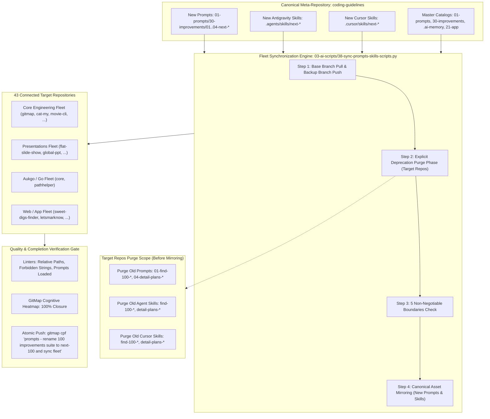
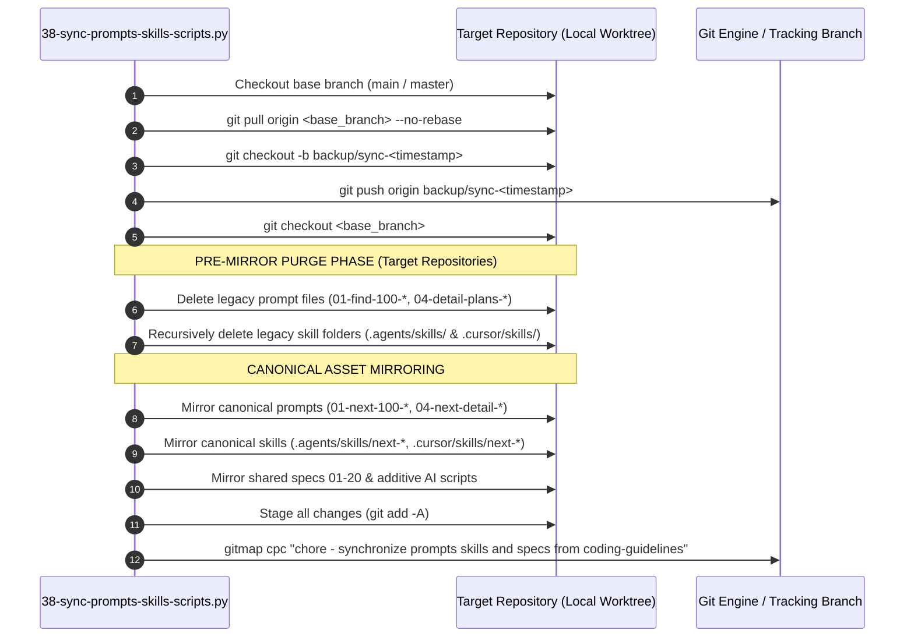
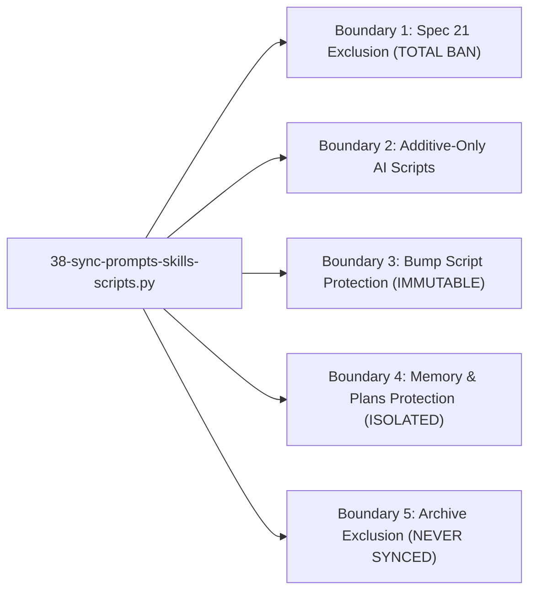
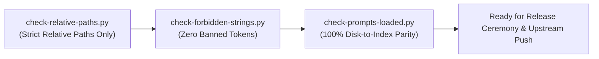
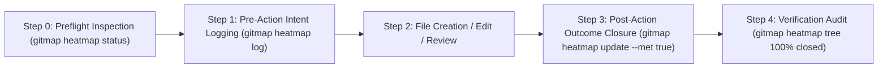

# Specification 03: Migration, Fleet Synchronization & Quality Verification

## 1. System Overview & Migration Problem Statement

Task `03-rename-and-sync-100-improvements-prompts-and-skills` establishes the systematic renaming of the 100 Improvements Prompts and Skills Suite across `01-prompts/30-improvements/`, `.agents/skills/`, and `.cursor/skills/`.

### The Renamed Assets Suite

The renaming aligns the entire continuous improvement flywheel under a clean, intuitive, forward-looking taxonomy (`next-100-*` and `next-detail-out-100-improvements`):

| Asset Category | Previous Identifier / Path | Canonical Renamed Identifier / Path | Target Scope & Responsibility |
| :--- | :--- | :--- | :--- |
| **Prompt 01** | `01-prompts/30-improvements/01-find-100-improvements-in-ui-level.md` | `01-prompts/30-improvements/01-next-100-ui-improvements.md` | Autonomous discovery and planning of 100 UI/UX, styling, token, and visual improvements |
| **Prompt 02** | `01-prompts/30-improvements/02-find-100-improvements-in-code-base.md` | `01-prompts/30-improvements/02-next-100-code-improvements.md` | Autonomous discovery and planning of 100 architectural, code quality, and guideline improvements |
| **Prompt 03** | `01-prompts/30-improvements/03-find-100-improvements-in-whole-system.md` | `01-prompts/30-improvements/03-next-100-whole-system-improvements.md` | Autonomous discovery and planning of 100 holistic system, developer experience, and end-to-end improvements |
| **Prompt 04** | `01-prompts/30-improvements/04-detail-plans-and-improvements-for-review.md` | `01-prompts/30-improvements/04-next-detail-out-100-improvements.md` | Multi-step detailing of active/pending plans into review dockets with strict review-first gating |
| **Agent Skill 01** | `.agents/skills/find-100-improvements-in-ui-level/` | `.agents/skills/next-100-ui-improvements/` | Antigravity runtime skill for UI-level improvements |
| **Agent Skill 02** | `.agents/skills/find-100-improvements-in-code-base/` | `.agents/skills/next-100-code-improvements/` | Antigravity runtime skill for codebase-level improvements |
| **Agent Skill 03** | `.agents/skills/find-100-improvements-in-whole-system/` | `.agents/skills/next-100-whole-system-improvements/` | Antigravity runtime skill for whole-system improvements |
| **Agent Skill 04** | `.agents/skills/detail-plans-and-improvements-for-review/` | `.agents/skills/next-detail-out-100-improvements/` | Antigravity runtime skill for detailing plans and improvements for review |
| **Cursor Skill 01** | `.cursor/skills/find-100-improvements-in-ui-level/` | `.cursor/skills/next-100-ui-improvements/` | Cursor IDE runtime skill for UI-level improvements |
| **Cursor Skill 02** | `.cursor/skills/find-100-improvements-in-code-base/` | `.cursor/skills/next-100-code-improvements/` | Cursor IDE runtime skill for codebase-level improvements |
| **Cursor Skill 03** | `.cursor/skills/find-100-improvements-in-whole-system/` | `.cursor/skills/next-100-whole-system-improvements/` | Cursor IDE runtime skill for whole-system improvements |
| **Cursor Skill 04** | `.cursor/skills/detail-plans-and-improvements-for-review/` | `.cursor/skills/next-detail-out-100-improvements/` | Cursor IDE runtime skill for detailing plans and improvements for review |



### The Inherent Orphan & Collision Hazard

When files and skills are renamed in the canonical `coding-guidelines` meta-repository, propagating changes to downstream repositories introduces a severe operational challenge:

1. **Non-Destructive Mirroring Protection:** The multi-repository synchronization script `03-ai-scripts/38-sync-prompts-skills-scripts.py` implements strict non-destructive invariants (`keeps_local_skill_dirs`) to protect target repositories from losing local custom skills or repo-specific tooling.
2. **The Stale File Dilemma:** Because stale files are intentionally never deleted during routine copy operations, renaming an asset upstream without an explicit purge mechanism will copy the new file (`01-next-100-ui-improvements.md`) while leaving the legacy file (`01-find-100-improvements-in-ui-level.md`) intact inside target repositories.
3. **Severe Downstream Impact:**
   - **Duplicate Discovery:** Autonomous agents scanning downstream repositories encounter duplicate, conflicting prompts and skills for the same domain capability.
   - **IDE Tool Registry Clutter:** Cursor IDE and Antigravity register both old and new skill manifests simultaneously, causing ambiguous skill invocation and degraded agent reasoning.
   - **Catalog Divergence:** Master prompt indices become desynchronized from the actual file trees of target repositories.

### The Architectural Solution

To eliminate this hazard, `03-ai-scripts/38-sync-prompts-skills-scripts.py` incorporates an **Explicit Pre-Mirror Deprecation Purge Phase**. Before any canonical asset is mirrored into a target repository, the synchronization engine systematically sweeps target paths, purging all deprecated prompts and skill directories corresponding to the legacy 100 improvements suite.

---

## 2. Purge Engine Mechanics & Implementation Contract

The purge mechanics are integrated directly into the repository synchronization loop of `03-ai-scripts/38-sync-prompts-skills-scripts.py` (and mirrored in `.agents/scripts/38-sync-prompts-skills-scripts.py`).

### Execution Order & Lifecycle



### Deprecated Prompts Purge Scope

The synchronization engine identifies and unlinks the following legacy prompt files within each target repository before asset transfer:

```python
DEPRECATED_IMPROVEMENT_PROMPTS = [
    "01-prompts/30-improvements/01-find-100-improvements-in-ui-level.md",
    "01-prompts/30-improvements/02-find-100-improvements-in-code-base.md",
    "01-prompts/30-improvements/03-find-100-improvements-in-whole-system.md",
    "01-prompts/30-improvements/04-detail-plans-and-improvements-for-review.md",
]
```

### Deprecated Skills Purge Scope

The synchronization engine identifies and recursively deletes (`shutil.rmtree`) the following legacy skill directories across both `.agents/skills/` and `.cursor/skills/` runtimes:

```python
DEPRECATED_IMPROVEMENT_SKILLS = [
    # Antigravity Skills Runtime
    ".agents/skills/find-100-improvements-in-ui-level",
    ".agents/skills/find-100-improvements-in-code-base",
    ".agents/skills/find-100-improvements-in-whole-system",
    ".agents/skills/detail-plans-and-improvements-for-review",
    # Cursor IDE Skills Runtime
    ".cursor/skills/find-100-improvements-in-ui-level",
    ".cursor/skills/find-100-improvements-in-code-base",
    ".cursor/skills/find-100-improvements-in-whole-system",
    ".cursor/skills/detail-plans-and-improvements-for-review",
]
```

### Purge Implementation Logic in `sync_repo`

Within `sync_repo(target: Path, is_dry_run: bool = False, is_no_push: bool = False)`:

```python
    # Pre-mirror purge for deprecated 100 improvements prompts and skills
    if not is_dry_run:
        # 1. Purge deprecated prompt files
        for dep_prompt in DEPRECATED_IMPROVEMENT_PROMPTS:
            dep_path = target / dep_prompt
            if dep_path.exists():
                try:
                    dep_path.unlink()
                except Exception:
                    pass

        # 2. Purge deprecated skill directories (.agents/skills & .cursor/skills)
        for dep_skill in DEPRECATED_IMPROVEMENT_SKILLS:
            dep_skill_dir = target / dep_skill
            if dep_skill_dir.exists():
                try:
                    shutil.rmtree(dep_skill_dir, ignore_errors=True)
                except Exception:
                    pass
```

### Dry-Run Telemetry & Reporting

When `--dry-run` is supplied to `38-sync-prompts-skills-scripts.py`, the engine logs planned purge operations without modifying filesystem state:

```text
[DRY-RUN] Purge target prompt: <repo>/01-prompts/30-improvements/01-find-100-improvements-in-ui-level.md
[DRY-RUN] Purge target skill dir: <repo>/.agents/skills/find-100-improvements-in-ui-level
[DRY-RUN] Purge target skill dir: <repo>/.cursor/skills/find-100-improvements-in-ui-level
```

---

## 3. Fleet Synchronization Architecture & The 5 Non-Negotiable Boundaries

Under `AGENTS.md` Section 11, multi-repository synchronization across the fleet must strictly adhere to the **5 Non-Negotiable Boundaries**:



### Boundary 1: Spec 21 Exclusion (TOTAL BAN)
- **Mandate:** NEVER synchronize, copy, or touch `02-spec/21-*` through `02-spec/25-*` (private application specifications, issues, databases, design systems, and audits). Only shared foundational specifications `02-spec/01-*` through `02-spec/20-*` are synchronized across repositories.
- **Engine Enforcement:** Function `is_spec_21(path)` evaluates whether any path segment contains `21-` through `29-` and blocks mirroring immediately.
- **Verification:** Target repositories must contain 0 files matching `02-spec/21-*` through `02-spec/25-*`.

### Boundary 2: Additive-Only AI Scripts
- **Mandate:** Brand-new AI scripts (`03-ai-scripts/`, `.agents/scripts/`) that do not exist in the target repository are copied cleanly. Existing scripts modified by or unique to the target repository must NEVER be overwritten.
- **Engine Enforcement:** Parameter `is_additive_only=True` triggers git status and git log inspections on target files before copying.

### Boundary 3: Bump Script Protection (IMMUTABLE)
- **Mandate:** NEVER overwrite version bump scripts, manifests, or configuration files (`bump*`, `bump_versions.py`, `bump-version.mjs`, `version.json`, `version.template.json`). Each repository maintains custom SemVer release targets, tagging logic, and build steps.
- **Engine Enforcement:** Function `is_bump_script(path)` intercepts all files containing `bump` or `version`.

### Boundary 4: Memory & Plans Protection (TOTAL ISOLATION)
- **Mandate:** NEVER modify, sync, or mirror `.ai-memory/memory/`, `.ai-memory/plans/`, `.ai-memory/temp-agents/`, `.ai-memory/cicd-issues/`, or `.ai-memory/ambiguous-questions/`. Each repository independently owns its operational memory, backlog, and active subtasks.
- **Engine Enforcement:** Function `is_protected_memory_or_plan(path)` strictly rejects any target operational memory file or directory. Only canonical indices (`.ai-memory/prompts.md`, `.ai-memory/coding-guidelines.md`) are conditionally synchronized.

### Boundary 5: Archive Exclusion
- **Mandate:** NEVER synchronize `06-archive/` or `06-old-prompts/`. Legacy archived materials reside exclusively in `coding-guidelines` for historical provenance.
- **Engine Enforcement:** Excluded via `EXCLUDE_NAMES` set. Stale archive directories in target repositories are automatically unlinked.

---

## 4. Target Repositories Catalog (43 Connected Repositories)

The purge and synchronization routine is systematically applied across all 43 connected repositories:

| Index | Repository Name | Relative Workspace Path | Tier / Ecosystem |
| :---: | :--- | :--- | :--- |
| 1 | `ai-empathy-prompt-tuner-v1` | `02-prompts/ai-empathy-prompt-tuner` | Prompts & AI Tuning |
| 2 | `alim-cv-v8` | `alim-cv` | Documentation & Portfolio |
| 3 | `alim-karim-profile-v2` | `alim-karim-profile` | Documentation & Portfolio |
| 4 | `alim.karim.profile` | `aukgit/alim.karim.profile` | Documentation & Portfolio |
| 5 | `Antigravity-Manager` | `antigravity-manager` | System & Developer Tools |
| 6 | `cat-my-v12` | `cat-my` | CLI & Developer Utilities |
| 7 | `core-v9` | `03-aukgo/core` | Aukgo / Go Shared Libraries |
| 8 | `digital-name-card` | `digital-name-card` | Web & Identity |
| 9 | `flat-slide-show` | `presentations-repos/flat-slide-show` | Presentations Engine |
| 10 | `gitlogger-new-v2` | `gitlogger-new` | Git & Telemetry Utilities |
| 11 | `gitmap-v28` | `gitmap` | GitMap Core Architecture |
| 12 | `global-ppt-v1` | `presentations-repos/global-ppt-v1` | Presentations Engine |
| 13 | `hiltrax-v1` | `presentations-repos/hiltrax` | Presentations Engine |
| 14 | `icon-coding-guidelines` | `icon-coding-guidelines` | Design & Visual Assets |
| 15 | `img-pdf-v2` | `img-pdf` | Image & Document Processing |
| 16 | `ki-health-ppt-v5` | `presentations-repos/ki-health-ppt` | Presentations Engine |
| 17 | `kubernetes-training-v1` | `aukgit/kubernetes-training` | Cloud & Infrastructure |
| 18 | `lara-licensing-v4` | `lara-licensing` | Licensing & Auth Services |
| 19 | `lara-publishing-v1` | `lara-publishing` | Publishing Framework |
| 20 | `laravel-automation-v1` | `laravel-automation` | Backend Automation |
| 21 | `letsmarknow-ui-v2` | `letsmarknow-ui` | Frontend Web UI |
| 22 | `letsmarknow-v2` | `letsmarknow` | Web Application Core |
| 23 | `macro-ahk-v55` | `macro-ahk` | Macro & Automation Engine |
| 24 | `maid-app-spec-presentation-v1` | `presentations-repos/maid-app-spec-presentation` | Presentations Engine |
| 25 | `movie-cli-v8` | `movie-cli` | CLI & Media Workflow |
| 26 | `pathhelper` | `03-aukgo/pathhelper` | Aukgo / Go Shared Libraries |
| 27 | `presentation-aug-2026-plans-alim` | `presentations-repos/presentation-aug-2026-plans-alim` | Presentations Engine |
| 28 | `prompts-connect-v3` | `02-prompts/prompts-connect` | Prompts & Workflow Utilities |
| 29 | `punam-case-studies-v1` | `punam-case-studies-v1` | Case Studies & Docs |
| 30 | `rasia-logo` | `presentations-repos/rasia-logo` | Design & Visual Assets |
| 31 | `scripts-fixer-v20` | `scripts-fixer` | Linter & Remediation Tools |
| 32 | `slides-spec` | `presentations-repos/slides-spec` | Presentations Engine |
| 33 | `spec-builder-v11` | `spec-builder` | Spec Architecture Scaffolding |
| 34 | `sweet-digs-finder` | `web-system/sweet-digs-finder` | Fullstack Web Application |
| 35 | `ui-prompts-cat` | `ui-prompts-cat` | UI & Prompt Engineering |
| 36 | `white-presentation-v1` | `presentations-repos/white-presentation-v1` | Presentations Engine |
| 37 | `workflowy-ui-v1` | `workflowy-ui` | Frontend Web UI |
| 38 | `workflowy-v3` | `workflowy` | Web Application Core |
| 39 | `wp-exam-v2` | `wp-exam` | WordPress Testing & Exam Engine |
| 40 | `wp-git-log-v3` | `wp-git-log` | WordPress Git Integration |
| 41 | `wp-html-automate` | `wp-html-automate` | WordPress HTML Utilities |
| 42 | `wp-link-manager-v5` | `wp-link-manager` | WordPress Link Architecture |
| 43 | `wp-onboarding-v17` | `wp-onboarding` | WordPress User Onboarding |

---

## 5. Comprehensive Catalog Updates Across All Documentation Roots

All master indices and documentation roots across the canonical meta-repository must be updated to reference the renamed assets:

### 1. `01-prompts/readme.md` (Master Prompts Catalog)
- **Table of Categories Update (Category 30):**
  ```markdown
  | **30** | `30-improvements/` | `01-next-100-ui-improvements.md`, `02-next-100-code-improvements.md`, `03-next-100-whole-system-improvements.md`, `04-next-detail-out-100-improvements.md` | Autonomous continuous improvement flywheel across UI, codebase, whole-system UX, and multi-step plan detailing with review-first gates |
  ```

### 2. `01-prompts/30-improvements/readme.md` (Category 30 Catalog)
- **Directory Index & Catalog Table:**
  ```markdown
  | Prompt File | Version | Target Area | Description |
  | :--- | :---: | :--- | :--- |
  | [`01-next-100-ui-improvements.md`](01-next-100-ui-improvements.md) | V6 / 1.0.0 | UI / Styling / Motion | Autonomous discovery and planning of 100 UI-level improvements across design tokens, accessibility, layout rhythm, and CSS architecture. |
  | [`02-next-100-code-improvements.md`](02-next-100-code-improvements.md) | V6 / 1.0.0 | Code Quality / Guidelines | Autonomous discovery and planning of 100 code improvements across boolean standards, error wrappers, file sizing, and dead code elimination. |
  | [`03-next-100-whole-system-improvements.md`](03-next-100-whole-system-improvements.md) | V6 / 1.0.0 | System / DX / Architecture | Autonomous discovery and planning of 100 system improvements across developer workflows, build performance, caching, and CI/CD pipelines. |
  | [`04-next-detail-out-100-improvements.md`](04-next-detail-out-100-improvements.md) | V6 / 1.0.0 | Plan & Improvement Detailing | Multi-step detailing of active and pending plans into review dockets with strict review-first gating and zero immediate code changes. |
  ```

### 3. `.ai-memory/prompts.md` (Operational Memory Prompts Matrix)
- **Category 30 Entries in Matrix:**
  ```markdown
  | `30-improvements` | [`30-improvements/01-next-100-ui-improvements.md`](../01-prompts/30-improvements/01-next-100-ui-improvements.md) | Next 100 UI Improvements — Autonomous UI Discovery & Planning Flywheel |
  | `30-improvements` | [`30-improvements/02-next-100-code-improvements.md`](../01-prompts/30-improvements/02-next-100-code-improvements.md) | Next 100 Code Improvements — Autonomous Code Quality & Guideline Flywheel |
  | `30-improvements` | [`30-improvements/03-next-100-whole-system-improvements.md`](../01-prompts/30-improvements/03-next-100-whole-system-improvements.md) | Next 100 Whole System Improvements — Full-System Architecture & DX Flywheel |
  | `30-improvements` | [`30-improvements/04-next-detail-out-100-improvements.md`](../01-prompts/30-improvements/04-next-detail-out-100-improvements.md) | Next Detail Out 100 Improvements — Multi-Step Detailing & Review-First Gate |
  ```
- **Validation Contract:** Must pass `python linter-scripts/check-prompts-loaded.py` with 100% parity and 0 orphan errors.

### 4. `.ai-memory/plans/readme.md` (Plans Index)
- **Pending Plans Section Entry:**
  ```markdown
  - [03-rename-and-sync-100-improvements-prompts-and-skills.md](pending/03-rename-and-sync-100-improvements-prompts-and-skills.md): Rename 100 Improvements prompts and skills suite to next-100 and next-detail-out-100-improvements, update master catalogs, purge legacy assets from 43 connected repositories, and synchronize fleet.
  ```

### 5. `02-spec/21-app/readme.md` (Application Specifications Index)
- **Active Contents Table Entry:**
  ```markdown
  | [`03-rename-and-sync-100-improvements-prompts-and-skills/`](03-rename-and-sync-100-improvements-prompts-and-skills/) | Rename and Sync 100 Improvements Prompts and Skills (Suite Taxonomy Upgrade, Deprecation Purge Engine, 43-Repo Fleet Synchronization) | Active Task Spec | Active |
  ```

---

## 6. Linter Verification Suite & Quality Gates

Before any commit or fleet push, three mandatory linters must execute with zero errors:



### 1. `linter-scripts/check-relative-paths.py`
- **Execution:**
  ```bash
  python linter-scripts/check-relative-paths.py
  ```
- **Rule:** Absolute filesystem paths (`C:\`, `/home/`, `/absolute/path/`) and absolute file URIs (`file:///...`) are strictly banned across all markdown and repository files.
- **Pass Threshold:** 0 violations.

### 2. `linter-scripts/check-forbidden-strings.py`
- **Execution:**
  ```bash
  python linter-scripts/check-forbidden-strings.py
  ```
- **Rule:** Validates files against `linter-scripts/forbidden-strings.toml`, prohibiting forbidden template placeholders, raw secrets, unescaped tokens, and malformed links.
- **Pass Threshold:** 0 violations.

### 3. `linter-scripts/check-prompts-loaded.py`
- **Execution:**
  ```bash
  python linter-scripts/check-prompts-loaded.py
  ```
- **Rule:** Every prompt file residing in `01-prompts/` must have a valid, active entry in `.ai-memory/prompts.md`. No orphan prompt files on disk, and no dangling references in the index.
- **Pass Threshold:** Exit code `0` (PASS — index matches disk prompts directory exactly).

---

## 7. Fleet Verification Checklist (43 Repositories)

The following verification matrix governs downstream repository validation following fleet synchronization:

| Verification Area | Requirement / Check | Verification Tool / Command | Pass Criteria |
| :--- | :--- | :--- | :--- |
| **Purged Prompts** | Legacy prompt files (`01-find-100-*`, `04-detail-plans-*`) do not exist in target repo. | Target filesystem probe | 0 legacy prompt files |
| **Purged Agent Skills** | Legacy skills (`find-100-*`, `detail-plans-*`) removed from `.agents/skills/`. | Target directory probe | 0 legacy agent skill folders |
| **Purged Cursor Skills** | Legacy skills (`find-100-*`, `detail-plans-*`) removed from `.cursor/skills/`. | Target directory probe | 0 legacy cursor skill folders |
| **Mirrored Prompts** | New prompts (`01-next-100-*`, `04-next-detail-*`) mirrored cleanly. | Target filesystem probe | 4 new prompt files present |
| **Mirrored Skills** | New skills mirrored into both `.agents/skills/` and `.cursor/skills/`. | Target directory probe | 8 new skill folders present |
| **Boundary 1 (Spec 21)** | Zero `02-spec/21-*` through `25-*` files copied into target repo. | Path exclusion scan | 0 domain spec files |
| **Boundary 2 (Scripts)** | Target-modified AI scripts remain preserved without overwrites. | Git status / log inspection | 0 overwritten custom scripts |
| **Boundary 3 (Bumps)** | Bump scripts (`bump*`) and `version.json` un-mutated. | Git status inspection | 0 modified version files |
| **Boundary 4 (Memory)** | Target `.ai-memory/plans/` and `.ai-memory/memory/` intact. | Directory inspection | 0 mutated memory files |
| **Boundary 5 (Archive)** | Zero `06-archive/` or `06-old-prompts/` directories present. | Directory probe | 0 archive directories |
| **Safety Branch** | Safety backup branch (`backup/sync-<timestamp>`) created and pushed. | Git branch / remote check | Backup branch exists on remote |
| **Base Branch Push** | Changes committed and pushed to upstream base branch (`main`/`master`). | Git log / tracking branch | Clean working tree; pushed |

---

## 8. GitMap Cognitive Heatmap Telemetry Protocol

In compliance with `AGENTS.md` Section 15, all file touches, specification actions, and verification gates must be tracked via the GitMap Cognitive Heatmap:



### Cognitive Logging Lifecycle

1. **Step 0 Preflight Inspection:**
   ```bash
   gitmap heatmap status --task "03-rename-and-sync-100-improvements-prompts-and-skills"
   gitmap heatmap tables
   ```
2. **Pre-Action Intent Logging:**
   Before creating or editing any file:
   ```bash
   gitmap heatmap log --task "03-rename-and-sync-100-improvements-prompts-and-skills" --action "CREATE" --file "<relative-path>" --state "EXECUTION" --expected "<expected-deliverable-goal>"
   ```
3. **Post-Action Outcome Closure:**
   Immediately following completion of each action:
   ```bash
   gitmap heatmap update --id "<action-id>" --outcome "<verified-outcome-summary>" --met true
   ```
4. **Phase 3 Verification Audit:**
   ```bash
   gitmap heatmap tree --task "03-rename-and-sync-100-improvements-prompts-and-skills"
   gitmap heatmap status --task "03-rename-and-sync-100-improvements-prompts-and-skills"
   ```
   *Pass Threshold:* 100% action closure (`met=true`). Zero unclosed or dangling entries.

---

## 9. Release Ceremony & Final Atomic Commit Syntax

Under `AGENTS.md` Section 10 and Section 13 ('No Push = Not Done'):

### 1. Working Tree Preflight Check
- Verify that all prompt files in `01-prompts/30-improvements/` reflect the new `next-*` naming and old ones are deleted.
- Verify that all skill folders in `.agents/skills/` and `.cursor/skills/` reflect the new `next-*` naming and old ones are deleted.
- Verify that all 5 master catalogs are updated.
- Verify that all 3 linters pass with exit code 0.
- Verify that `03-ai-scripts/38-sync-prompts-skills-scripts.py` ran cleanly across all 43 repositories.

### 2. Atomic Commit & Push Command
Execute the atomic commit and push upstream following strict GitMap hyphen formatting (never include colons in message arguments):

```bash
gitmap cpf "prompts - rename 100 improvements suite to next-100 and sync fleet"
```

### 3. Upstream Completion Invariant
- Verify that the commit is successfully pushed to the GitHub upstream tracking branch (`origin/main` or `origin/master`).
- Verify that the working tree is completely clean (`gitmap status`).
- A task is strictly INCOMPLETE and NOT DONE until this upstream push is confirmed.
