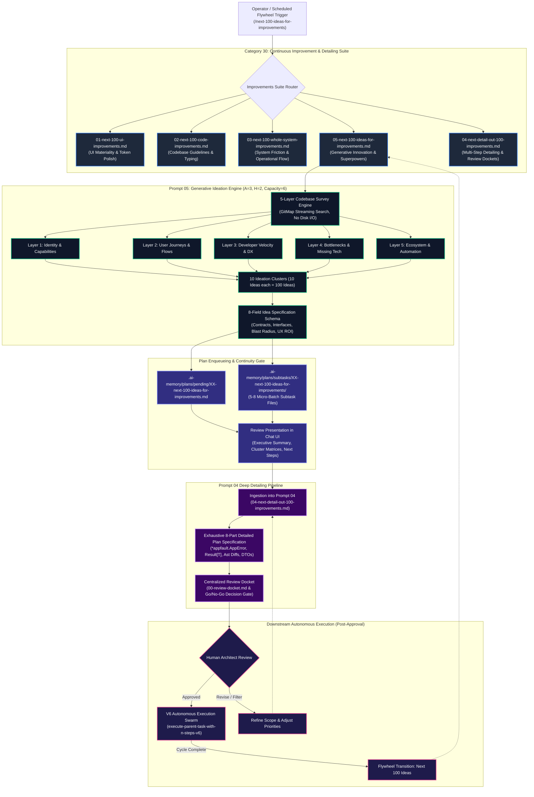

# Specification 01: Next 100 Ideas for Improvements — Architecture, Ideation Flywheel & Systems Design Specification

## 1. Executive Summary & Problem Statement

### 1.1 The Problem: The Innovation Blindness & Incremental Trap
Autonomous AI engineering tools and continuous integration pipelines excel at incremental defect resolution: fixing lint failures, updating deprecated dependencies, flattening nested conditionals, and correcting styling tokens. However, software projects routinely suffer from **Strategic & Innovation Blindness**:
1. **The Incremental Maintenance Trap:** Engineering workflows become consumed by defensive maintenance and reactive bug fixing, failing to identify transformative features, developer ergonomics accelerators, or architectural superpowers that the codebase is uniquely positioned to adopt.
2. **Context Blindness in Generative Ideation:** Generic brainstorming models produce disconnected, impractical suggestions (e.g. "Add AI chatbot", "Migrate to microservices") because they do not survey the real target repository, its concrete domain models, caller trees, user journeys, and execution bottlenecks.
3. **Execution Ambiguity & Shallow Backlogs:** Ideas recorded as brief one-liners (e.g. "Improve caching", "Add export feature") lack architectural boundary definitions, data contracts, risk tiers, and acceptance criteria. Downstream AI agents or human engineers cannot implement them without extensive guessing and trial-and-error.
4. **Premature & Uncoordinated Modification:** Autonomous agents frequently jump from an unvetted idea directly into production code edits, causing regressions, breaking API contracts, and polluting git history without human or architectural review.

### 1.2 The Solution: The Next 100 Ideas for Improvements Flywheel
To permanently solve innovation blindness while preserving strict engineering discipline, this specification establishes the **Next 100 Ideas for Improvements Engine**, implemented canonically across the repository ecosystem as:
- **Canonical Prompt:** `01-prompts/30-improvements/05-next-100-ideas-for-improvements.md`
- **Antigravity IDE Skill:** `.agents/skills/next-100-ideas-for-improvements/skill.md`
- **Cursor IDE Skill:** `.cursor/skills/next-100-ideas-for-improvements/skill.md`

This engine functions as an **autonomous ideation, feature enhancement, innovation, and value-multiplication flywheel**. Running in any target repository, the prompt surveys the codebase across 5 diagnostic inspection layers, explores capabilities, developer velocity, and architectural potential, and synthesizes **100 concrete, high-leverage improvement and innovation ideas** partitioned into 10 thematic clusters.

### 1.3 The Core Invariant: Strict Review-First & Zero Immediate Execution
A non-negotiable architectural invariant of Prompt 05 is the **Strict Review-First Principle**:
> [!IMPORTANT]
> **Strict Review-First & Zero Immediate Execution Mandate:**
> Ideas discovered and formulated under `05-next-100-ideas-for-improvements.md` MUST NEVER be implemented, edited into source files, built, or tested during the discovery run.
> All 100 ideas are strictly enqueued into `.ai-memory/plans/pending/XX-next-100-ideas-for-improvements.md` with modular subtasks in `.ai-memory/plans/subtasks/XX-next-100-ideas-for-improvements/` and presented to the human architect for review.
> Implementation occurs only after human sign-off, proceeding through Prompt 04 (`04-next-detail-out-100-improvements.md`) for deep specification and then canonical execution swarms (`execute-parent-task-with-n-steps-v6`).

---

## 2. Mermaid Architecture Diagram



---

## 3. Synergistic Architecture of the 5-Pillar Improvements Suite

Category `30-improvements` represents a complete, cohesive continuum from discovery to specification, review, execution, and continuous renewal. The five canonical prompts operate in synergistic harmony:

| Prompt Filename | Version | Core Focus | Operational Role | Output Destination |
| :--- | :--- | :--- | :--- | :--- |
| `01-next-100-ui-improvements.md` | V6 / 1.0.0 | UI/UX & Design Tokens | Perceptual polish, token hygiene, WCAG contrast, 4-plane depth, spring physics | `.ai-memory/plans/pending/XX-next-100-ui-improvements.md` |
| `02-next-100-code-improvements.md` | V6 / 1.0.0 | Codebase Quality & Guidelines | Guidelines compliance, monadic `Result[T]`, `*appfault.AppError`, positive booleans, parameter structs | `.ai-memory/plans/pending/XX-next-100-code-improvements.md` |
| `03-next-100-whole-system-improvements.md` | V6 / 1.0.0 | Whole-System Architecture | Systemic friction reduction, operational flow, developer tooling, 4-part cause-and-effect impact audits | `.ai-memory/plans/pending/XX-next-100-whole-system-improvements.md` |
| `04-next-detail-out-100-improvements.md` | V6 / 1.0.0 | Multi-Step Detailing & Review Dockets | Ingestion, AST contracts, caller blast-radius tracing via GitMap, review docket assembly | `02-spec/21-app/XX-*/00-review-docket.md` & `.ai-memory/plans/subtasks/` |
| `05-next-100-ideas-for-improvements.md` | V6 / 1.0.0 | Generative Innovation & Superpowers | Autonomous ideation flywheel, feature expansion, workflow multipliers, ecosystem bridges | `.ai-memory/plans/pending/XX-next-100-ideas-for-improvements.md` |

### 3.1 The Synergistic Flywheel Mechanics (05 Discover -> 04 Detail -> V6 Execute -> 05 Next Cycle)
The relationship between Prompt 05 and Prompt 04 creates an unshakeable bridge between **creative innovation** and **deterministic software engineering**:
1. **Prompt 05 discovers "What Could Be":** It acts as the repository's chief innovation officer. Rather than only identifying broken things, Prompt 05 discovers unbuilt capabilities, missing automation hooks, high-leverage user workflows, and performance leaps grounded in the actual codebase structure.
2. **Prompt 04 details "How It Must Be Built":** Prompt 05 produces 100 structured idea cards with clear architectural boundaries. These feed directly into Prompt 04 (`04-next-detail-out-100-improvements.md`). Prompt 04 takes these ideas, runs live GitMap symbol searches, writes exact parameter structs, maps downstream callers, defines `*appfault.AppError` codes, and generates a Go/No-Go Review Docket.
3. **Execution Swarm implements with Zero Hallucination:** Once approved by the architect, the downstream execution swarm (`execute-parent-task-with-n-steps-v6`) receives self-contained subtasks with exact file boundaries and code contracts, completing the work cleanly.
4. **Flywheel Self-Loops to the Next Frontier:** As completed ideas are merged and pushed, running Prompt 05 again immediately surveys the newly elevated codebase baseline, surfacing the *next* 100 breakthrough ideas.

---

## 4. Codebase Survey & Opportunity Discovery Methodology

When Prompt 05 is triggered in any target project, it does not invent hypothetical features from thin air. Instead, it systematically traverses 5 diagnostic inspection layers using GitMap high-speed commands (`gitmap aum search`, `gitmap find`, `gitmap cat`, `gitmap lf`):

```
+-------------------------------------------------------------------------------------------------+
|                         The 5-Layer Diagnostic Inspection Engine                                |
+-------------------------------------------------------------------------------------------------+
| Layer 1: Identity & Capabilities Discovery                                                      |
|   - Inspects README, docs/, specs, CLI manifests, and package dependencies.                     |
|   - Extracts core mission, primary customer personas, and active feature boundaries.            |
+-------------------------------------------------------------------------------------------------+
| Layer 2: User Journeys, Entry Points & Interaction Friction                                     |
|   - Traces CLI commands, HTTP endpoints, UI page routes, and terminal outputs.                 |
|   - Maps customer paths from onboarding to daily operations, locating drop-offs and friction.   |
+-------------------------------------------------------------------------------------------------+
| Layer 3: Developer Ergonomics & Operational Velocity                                            |
|   - Inspects dev scripts (run.ps1, run.sh), linters, test harnesses, and CI/CD pipelines.       |
|   - Surfaces slow workflows, manual setup steps, missing hot-reload, and debug opacity.        |
+-------------------------------------------------------------------------------------------------+
| Layer 4: Architectural Bottlenecks, Missing Abstractions & State Flows                          |
|   - Analyzes data access patterns, SQLite schemas, caching strategies, and concurrency.         |
|   - Identifies synchronous blocks, memory leaks, unindexed queries, and tight coupling.         |
+-------------------------------------------------------------------------------------------------+
| Layer 5: Ecosystem Expansion, Automation & Multi-AI Collaboration                               |
|   - Surveys MCP plugin surfaces, webhooks, export/import adapters, and cross-repo interfaces.  |
|   - Identifies opportunities for self-healing, agent orchestration, and telemetry feedback.    |
+-------------------------------------------------------------------------------------------------+
```

### 4.1 GitMap High-Speed Search Primacy
To prevent context saturation and comply with Section 12 of `AGENTS.md`:
- Agents exclusively execute GitMap commands (`gitmap aum search "<pattern>" [dir]`, `gitmap find "*.*" [dir]`, `gitmap cat <file>`, `gitmap lf <dir>`).
- TOTAL BAN on shell searches (`rg`, `ripgrep`, `grep`, `Select-String`, `findstr`, `dir`, `ls`, `Get-ChildItem`).
- Zero-disk streaming: file contents are read into context memory via native read tools without generating temporary intermediate files on disk.

---

## 5. The 10 Ideation Taxonomy Clusters (100 Ideas Matrix)

To guarantee comprehensive repository coverage, the 100 generated ideas are partitioned across 10 balanced taxonomy clusters (10 ideas per cluster):

```
+-------------------------------------------------------------------------------------------------+
|                             10 Ideation Clusters (10 Ideas Each)                                |
+-------------------------------------------------------------------------------------------------+
| Cluster 01: Core Feature Superpowers & High-Impact Capabilities       (IDEA-001 to IDEA-010)    |
| Cluster 02: Autonomous Workflows, Automation & Self-Healing           (IDEA-011 to IDEA-020)    |
| Cluster 03: Developer Experience (DX), CLI Ergonomics & Velocity      (IDEA-021 to IDEA-030)    |
| Cluster 04: User Experience (UX), Delight, Accessibility & Polish     (IDEA-031 to IDEA-040)    |
| Cluster 05: Data Architecture, Storage Engines & Caching Flywheels    (IDEA-041 to IDEA-050)    |
| Cluster 06: Extensibility, MCP Plugins & Ecosystem Bridges            (IDEA-051 to IDEA-060)    |
| Cluster 07: Observability, Cognitive Heatmaps & Proactive Diagnostics (IDEA-061 to IDEA-070)    |
| Cluster 08: Performance Optimization, Concurrency & Stream Processing (IDEA-071 to IDEA-080)    |
| Cluster 09: Resilience, Security, Zero Harm & Graceful Degradation    (IDEA-081 to IDEA-090)    |
| Cluster 10: Multi-AI Orchestration, Spec Governance & Memory Synthesis(IDEA-091 to IDEA-100)    |
+-------------------------------------------------------------------------------------------------+
```

### 5.1 Cluster 01: Core Feature Superpowers & High-Impact Capabilities (`IDEA-001` – `IDEA-010`)
Focuses on missing flagship features, high-value domain capabilities, and logical extensions of the application's primary problem-solving surface.
- **Example Vectors:** Adding predictive batch processing, smart query filters, multi-format report generators, instant visual diffing, automated migration wizards, and one-click workspace restoration.

### 5.2 Cluster 02: Autonomous Workflows, Automation & Self-Healing (`IDEA-011` – `IDEA-020`)
Focuses on converting manual multi-step user actions into hands-free, autonomous background workflows.
- **Example Vectors:** Background file watchers with surgical hot-recompilation, deadman switch recovery, automated backup scheduling with zero-touch retention pruning, and intelligent conflict self-resolution.

### 5.3 Cluster 03: Developer Experience (DX), CLI Ergonomics & Velocity (`IDEA-021` – `IDEA-030`)
Focuses on eliminating cognitive load and friction for engineers building and maintaining the project.
- **Example Vectors:** Fuzzy typo correction in CLI routing, interactive terminal command pickers (`gum`/`bubbletea`), zero-config local environment setups (`run.ps1`), sub-millisecond build caching, and self-documenting subcommand trees.

### 5.4 Cluster 04: User Experience (UX), Delight, Accessibility & Polish (`IDEA-031` – `IDEA-040`)
Focuses on end-user interaction quality, responsive UI materiality, accessible navigation, and visual feedback.
- **Example Vectors:** Fluid typography scaling via clamp(), keyboard-first shortcut navigators, optimistic UI state updates with rollback toast notifications, WCAG AAA color contrast mode, and accessible ARIA live regions.

### 5.5 Cluster 05: Data Architecture, Storage Engines & Caching Flywheels (`IDEA-041` – `IDEA-050`)
Focuses on persistence layers, query efficiency, schema evolution, and memory-conscious caching.
- **Example Vectors:** SQLite Split-DB partitioning, WAL mode checkpoint tuning, LRU memory-bounded query caches, deterministic JSON document indexing, and schema migration rollbacks.

### 5.6 Cluster 06: Extensibility, MCP Plugins & Ecosystem Bridges (`IDEA-051` – `IDEA-060`)
Focuses on opening the application to external tooling, protocols, and third-party ecosystems.
- **Example Vectors:** Model Context Protocol (MCP) server endpoints exposing internal tools, webhook notification dispatchers, standardized export/import schemas (JSON-LD, Markdown, CSV), and IDE extension bridges.

### 5.7 Cluster 07: Observability, Cognitive Heatmaps & Proactive Diagnostics (`IDEA-061` – `IDEA-070`)
Focuses on runtime visibility, telemetry, early-warning health indicators, and structured fault tracing.
- **Example Vectors:** GitMap cognitive heatmap telemetry integration, structured JSON logging with caller site annotations, 4-part Root Cause Analysis generators, non-polling ETA monitors, and real-time terminal progress dashboards.

### 5.8 Cluster 08: Performance Optimization, Concurrency & Stream Processing (`IDEA-071` – `IDEA-080`)
Focuses on latency reduction, memory footprint minimization, throughput scaling, and CPU utilization.
- **Example Vectors:** Zero-allocation string scanning with `EqualFoldAny`, lazy regex pre-compilation, worker thread pools with work-stealing queues, SIMD-accelerated text searching, and chunked streaming file transformations.

### 5.9 Cluster 09: Resilience, Security, Zero Harm & Graceful Degradation (`IDEA-081` – `IDEA-090`)
Focuses on system stability under duress, secret protection, failure containment, and defensive fault barriers.
- **Example Vectors:** Offline-first graceful fallback modes, automatic secret scrubbing before log output, exponential backoff with jitter on network retries, file lease contention locks, and read-only circuit breakers.

### 5.10 Cluster 10: Multi-AI Orchestration, Spec Governance & Memory Synthesis (`IDEA-091` – `IDEA-100`)
Focuses on enhancing the repository's native intelligence, autonomous pair programming readiness, and specification integrity.
- **Example Vectors:** Automated specification drift linters, memory consolidation pipelines, dynamic subagent join capacity, structured review dockets, and interactive prompt template generators.

---

## 6. The 8-Field Idea Specification Schema

Every single one of the 100 ideas generated by Prompt 05 must strictly adhere to the standardized **8-Field Idea Specification Schema**. This guarantees uniform quality, zero handoff ambiguity, and seamless ingestion into Prompt 04:

```markdown
### IDEA-NNN: [Cluster Name] — [Concise Actionable Idea Title]

- **1. Strategic Value Proposition & Superpower:**
  - What core capability, UX breakthrough, or operational superpower does this unlock?
  - Why is this a 10x leverage improvement rather than routine maintenance?
- **2. Target Subsystem & Grounded Codebase Anchors:**
  - Target files, modules, or directories (strictly relative Git paths: e.g. `cmd/cli/`, `pkg/engine/`).
  - Existing functions, structs, or configurations that serve as architectural anchors.
- **3. Architectural Blueprint & Technical Pattern:**
  - Concrete design pattern (e.g. Adapter, Map Dispatch, Monadic Result, Split-DB, Pipeline Filter).
  - High-level flow, required new data structures, and algorithmic approach.
- **4. Interface & Contract Signatures:**
  - Exact proposed Go/TypeScript/Python types, interfaces, or structs.
  - Mandatory compliance with `*appfault.AppError`, `Result[T]`, and positive boolean conventions.
- **5. Dependency Graph & Caller Blast Radius:**
  - Upstream prerequisites and downstream modules affected.
  - Estimated caller count and integration boundary isolation.
- **6. Risk Tier, Feasibility & Zero Harm Guarantees:**
  - Complexity / Effort: [Low / Medium / High].
  - Risk Classification: [Low / Medium / High].
  - Zero Harm Guardrails: Backward-compatibility shims, non-breaking defaults, rollback simplicity.
- **7. Binary Acceptance Criteria & Verification Evidence:**
  - Concrete observable assertions verifying successful implementation.
  - Deterministic check commands (e.g. CLI exit code 0, schema validation passes, zero regressions).
- **8. Detailing Handoff Blueprint (Prompt 04 Alignment):**
  - Explicit directives instructing `04-next-detail-out-100-improvements.md` how to expand this idea into bounded 5-8 file subtasks and review dockets.
```

---

## 7. Plan Enqueueing & Continuity Specification

To ensure ideas persist beyond temporary chat sessions, Prompt 05 automatically registers all outputs into the repository's permanent planning engine:

### 7.1 Master Plan File Contract
- **Path:** `.ai-memory/plans/pending/XX-next-100-ideas-for-improvements.md` (where `XX` is the next two-digit zero-padded sequence).
- **Structure:**
  1. Metadata header (Task title, slug, status `PENDING USER REVIEW`, creation timestamp).
  2. Verbatim trigger record.
  3. Executive Scorecard: Breakdown of ideas across 10 clusters with risk and impact distributions.
  4. Complete Catalog of 100 Idea Specification Cards (adhering strictly to Section 6).
  5. Review Docket and Go/No-Go Decision Gate.

### 7.2 Modular Subtask Directory Contract
- **Directory:** `.ai-memory/plans/subtasks/XX-next-100-ideas-for-improvements/`
- **Subtask Partitioning:** Each cluster of 10 ideas is partitioned into bounded subtasks containing strictly 5–8 files to adhere to Rule 8 (`AGENTS.md`):
  - `01-subtask-preflight-and-survey.md`
  - `02-subtask-clusters-01-to-02.md`
  - `03-subtask-clusters-03-to-04.md`
  - `04-subtask-clusters-05-to-06.md`
  - `05-subtask-clusters-07-to-08.md`
  - `06-subtask-clusters-09-to-10.md`
  - `07-subtask-review-docket-and-handoff.md`

### 7.3 Registry Synchronization
Prompt 05 mandates updating the central registry files:
- `.ai-memory/plans/readme.md`: Registers the new pending plan under the active backlog.
- `02-spec/21-app/readme.md`: Indexes the application specification.

---

## 8. Multi-Agent Swarm Concurrency Model (A = 3, H = 2, Capacity = 6)

Execution of Prompt 05 is strictly orchestrated using the canonical Tree Swarm Hierarchy with dynamic worker join:
- **Lead Orchestrator (Root Node):** Owns workspace survey coordination, cluster partitioning, master plan assembly, and final atomic git commit. Never conducts file discoveries solo.
- **Branch Coordinators (A = 3 Agents):**
  - **Worker 01 (Core Domain & Autonomous Workflows):** Focuses on Clusters 01, 02, 05, and 08 (Features, Automation, Data, Performance).
  - **Worker 02 (Developer & User Experience):** Focuses on Clusters 03, 04, 06, and 07 (DX, UX, Extensibility, Observability).
  - **Worker 03 (System Resilience & AI Governance):** Focuses on Clusters 09 and 10 (Security, Zero Harm, AI Orchestration, Detailing Alignment).
- **Dual-Task Hand Capacity (H = 2):** Each worker maintains 2 active operational hands, allowing concurrent tool dispatch and analysis without blocking.
- **Dynamic Join Protocol:** If Worker 01 finishes its clusters early, it immediately joins Worker 02 or Worker 03 to assist in idea card authoring and verification, maintaining pinned concurrency of 6 active operations.

---

## 9. Architectural Invariants & Compliance Matrix

| Constraint Category | Invariant Rule | Enforcement Mechanism |
| :--- | :--- | :--- |
| **Path Hygiene** | Strictly relative Git paths only (`02-spec/...`, `.ai-memory/...`). TOTAL BAN on absolute paths and `file:///` URIs. | Pre-commit relative path linter and prompt validation. |
| **File Naming** | Strict lowercase filenames across all created and modified files (`05-next-100-ideas-for-improvements.md`, `skill.md`). | Automated lowercase check, zero uppercase characters allowed. |
| **Search Primacy** | Exclusively use GitMap commands (`gitmap aum search`, `gitmap find`, `gitmap lf`, `gitmap cat`). Total ban on `rg`, `Select-String`, `dir`. | Tool execution audit in subtask verification. |
| **Execution Gate** | Strict Review-First: zero code modification, zero build commands, zero test executions during ideation run. | Explicit No-Build / No-Test invariant (Rule R1). |
| **Error Handling** | Go failure metadata must use structured `*appfault.AppError` and monadic `Result[T]`. | Idea card contract validation (Field 4). |
| **Boolean Discipline** | Positive booleans only (`is` / `has`), implicit evaluation, no mixed polarity (`isA && !isB` banned). | Coding guidelines audit in idea proposals. |
| **CI/CD Storage** | Zero-Storage GitHub Actions mandate: all reports written to step summaries or stdout, zero artifact uploads. | Architectural constraint in Cluster 03/07 ideas. |
| **Git Operations** | Atomic semantic commit via `gitmap cpf "<module> - <summary>"` without colons. Workers never run git commands. | Lead orchestrator completion invariant. |
