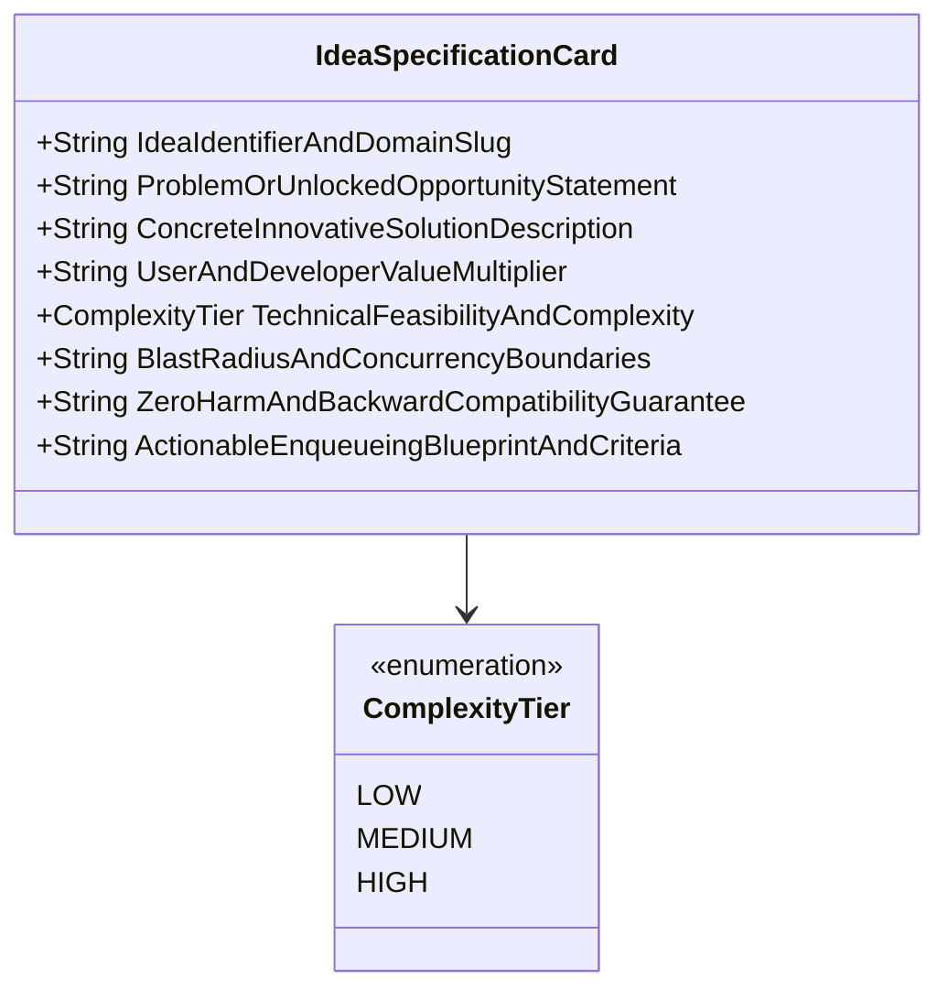
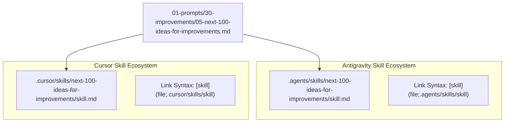
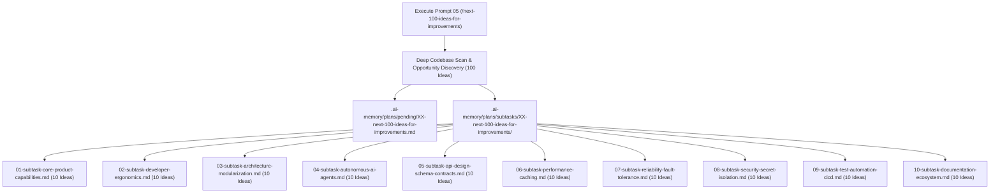

# Specification 02: Component Specification, Schemas & Concrete Examples

**Version:** 1.0.0  
**Status:** ACTIVE  
**Parent Plan:** `.ai-memory/plans/pending/04-next-100-ideas-for-improvements.md`  
**Architecture Spec:** `02-spec/21-app/04-next-100-ideas-for-improvements/01-architecture-spec.md`  
**Target Prompt:** `01-prompts/30-improvements/05-next-100-ideas-for-improvements.md`  
**Target Skills:** `.agents/skills/next-100-ideas-for-improvements/skill.md`, `.cursor/skills/next-100-ideas-for-improvements/skill.md`  
**Applicability:** Universal across Prompt Suite (`01-prompts/30-improvements/`), Antigravity Skills (`.agents/skills/`), Cursor Skills (`.cursor/skills/`), and Connected Fleet Repositories

---

## 1. Executive Summary & Prompt Architecture Grounding

This specification provides the definitive component architecture, ideation taxonomy, mathematical data schemas, and concrete operational examples for the **Next 100 Ideas for Improvements Prompt Suite** (`05-next-100-ideas-for-improvements.md`) and its symmetric companion skills.

Prompt 05 expands the canonical 100 Improvements Family beyond diagnostic audits (UI Level, Code Base, Whole System, and Detailed Review Dockets) into an **autonomous ideation flywheel**. It discovers, structures, and catalogs the next 100 high-leverage innovation opportunities for any target codebase, partitioned across 10 functional clusters (10 ideas per cluster).

```mermaid
flowchart TD
    IDEATION["Next 100 Ideas for Improvements Engine (Prompt 05)"]
    IDEATION --> C01["Cluster 01: Core Product Capabilities & Unbuilt High-Value Features"]
    IDEATION --> C02["Cluster 02: Developer Ergonomics, Tooling & Workflow Velocity"]
    IDEATION --> C03["Cluster 03: Architecture, Modularization & Clean Package Boundaries"]
    IDEATION --> C04["Cluster 04: Autonomous AI Agent Optimization & Context Efficiency"]
    IDEATION --> C05["Cluster 05: API Design, Schema Contracts & Type Safety"]
    IDEATION --> C06["Cluster 06: Performance, Caching & Resource Utilization"]
    IDEATION --> C07["Cluster 07: Reliability, Fault Tolerance & Error Recovery"]
    IDEATION --> C08["Cluster 08: Security, Secret Isolation & Access Governance"]
    IDEATION --> C09["Cluster 09: Test Automation, Diagnostic Observability & CI/CD"]
    IDEATION --> C10["Cluster 10: Documentation, Self-Service Onboarding & Ecosystem Extensibility"]
```



### 1.1 Non-Negotiable Operational Principles
1. **Ideation Isolation (No Live Edits in Discovery Turn):** The ideation engine discovers, specifies, and catalogs innovation ideas. It strictly avoids mutating source code or modifying runtime configurations during the ideation turn.
2. **Deterministic Enqueueing:** Every discovered idea must be articulated using the mandatory 8-field Idea Specification Schema and enqueued into `.ai-memory/plans/pending/XX-next-100-ideas-for-improvements.md` with modular subtasks in `.ai-memory/plans/subtasks/XX-next-100-ideas-for-improvements/`.
3. **Zero Placeholder Ban:** Ideas must never contain speculative placeholders (`[N]`, `TODO`, `TBD`, `...`). Every field must contain concrete architectural mechanisms, metrics, and contracts.
4. **Strict Relative Git Paths:** All references, citations, and subtask links must strictly use relative paths from the repository root (`02-spec/...`, `.ai-memory/...`, `01-prompts/...`).
5. **Zero Harm & Backward Compatibility Guarantee:** Every idea must prove backward compatibility and zero harm before inclusion.

---

## 2. Prompt Metadata, Invocations & Slug Directives

### 2.1 Canonical Prompt Header & Invocations
The prompt file `01-prompts/30-improvements/05-next-100-ideas-for-improvements.md` begins with the following header block:

```markdown
# High Priority Instruction
# Next 100 Ideas for Improvements

## slug: next-100-ideas-for-improvements

> [!IMPORTANT]
> **Prompt Version:** 1.0.0  
> **Invoke:** `/next-100-ideas-for-improvements <project-or-module>`  
> **Trigger Keywords & Aliases:** `next-100-ideas-for-improvements`, `next-100-ideas`, `ideas-for-improvements`, `next-ideas`, `100-ideas`  
> **Companion Antigravity Skill:** [.agents/skills/next-100-ideas-for-improvements](file;.agents/skills/next-100-ideas-for-improvements)  
> **Companion Cursor Skill:** [.cursor/skills/next-100-ideas-for-improvements](file;.cursor/skills/next-100-ideas-for-improvements)  
> **Execution Engine:** V6 Tree Swarm Hierarchy ($N = 400$, $A = 3$, $H = 2$, Capacity = 6)
```

### 2.2 Execution Parameters Matrix

| Parameter | Canonical Value | Operational Purpose |
|:---|:---:|:---|
| **Total Step Budget ($N$)** | `400` | Complete execution budget partitioned into 100 Analyze, 150 Plan, and 150 Execute/Enqueue |
| **Active Subagents ($A$)** | `3` | Number of concurrent worker subagents operating simultaneously |
| **Hierarchy Depth ($H$)** | `2` | Two-tier orchestration model (Lead Orchestrator $\rightarrow$ Worker Subagents) |
| **Agent Pool Capacity** | `6` | Maximum concurrent background subagent slots in the runtime pool |
| **Ideation Clusters** | `10` | 10 distinct architectural and product domains covering the entire system |
| **Ideas per Cluster** | `10` | Exactly 10 fully elaborated idea cards per cluster ($10 \times 10 = 100$) |
| **Idea Schema Fields** | `8` | 8 mandatory fields per idea specification card |
| **Build & Test Execution** | `DISABLED` | Strict NO-BUILD and NO-TEST execution during discovery and enqueueing |

---

## 3. The 8-Field Idea Specification Schema

Every improvement idea must be specified according to the rigorous 8-field schema. This ensures every idea is instantly actionable, technically grounded, and verifiable.



### 3.1 Structural Field Definitions

```markdown
#### Card [IDEA-NNN]: [Descriptive Action Title]

1. **Idea Identifier & Domain Slug:**
   - Identifier: `IDEA-NNN` (e.g., `IDEA-001` through `IDEA-100`)
   - Domain: `[Cluster Title]`
   - Target Subsystem: `[Package, Module, or Directory Path]`
2. **Problem / Unlocked Opportunity Statement:**
   [Current structural limitation, architectural bottleneck, developer friction point, or unexploited product capability.]
3. **Concrete Innovative Solution Description:**
   [Actionable feature, algorithmic leap, architectural pattern, or tooling primitive designed to address the problem or capture the opportunity.]
4. **User & Developer Value Multiplier:**
   [Quantitative metric (e.g., latency reduction, lines saved, memory cut) or qualitative UX/DX enhancement.]
5. **Technical Feasibility & Implementation Complexity:**
   - Complexity Tier: `LOW` (<150 lines, 1-2 files) | `MEDIUM` (150-500 lines, 3-5 files) | `HIGH` (>500 lines, architectural refactor)
   - Estimated Implementation Effort: [Estimated files, lines, and micro-batches]
6. **Blast Radius, Downstream Callers & Concurrency Boundaries:**
   - Downstream Consumers / Callers: [Packages, entrypoints, and callers impacted]
   - Concurrency & Threading Boundaries: [Goroutines, locks, file leases, or state immutability]
7. **Zero Harm / Regression Safety & Backward Compatibility Guarantee:**
   [Concrete technical proof that existing public APIs, CLI flags, database schemas, and workflows remain completely unaffected.]
8. **Actionable Enqueueing Blueprint & Acceptance Criteria:**
   - Enqueue Target: `.ai-memory/plans/subtasks/XX-next-100-ideas-for-improvements/YY-subtask-[cluster].md`
   - Acceptance Criteria: [Gherkin scenario or deterministic CLI command verification contract]
```

---

## 4. The 10 Ideation Clusters (Exhaustive Catalog of 100 Ideas)

The canonical catalog organizes exactly 100 discrete ideas across 10 functional clusters:


### 4.1 Cluster 01: Core Product Capabilities & Unbuilt High-Value Features (IDEA-001 to IDEA-010)
- **IDEA-001:** Bi-directional GitMap Worktree & Virtual Branch Synchronization Engine for instantaneous feature prototyping without repository switching.
- **IDEA-002:** Real-time Multi-Repository Symbol Graph & AST Dependency Visualizer across connected meta-repositories.
- **IDEA-003:** Headless Visual Regression Engine with Pixel-Diff Heatmaps directly integrated into local development pipelines.
- **IDEA-004:** Interactive CLI Macro Recording with Deterministic Parameterized Playback across polyglot shells.
- **IDEA-005:** Zero-Config Local Cluster Node Federation for Distributed Subagent Task Delegation and load balancing.
- **IDEA-006:** Self-Healing Specification Matrix with Automated Architectural Drift Detection against source code implementations.
- **IDEA-007:** Declarative Dynamic Design Token Compiler with Automated Perceptual WCAG 2.2 AA/AAA Contrast Enforcement.
- **IDEA-008:** High-Density Virtualized Terminal Emulator with Hardware-Accelerated ANSI Rendering and Split Panes.
- **IDEA-009:** Pluggable AI Script Extensibility Registry with Capability Handshakes and Semantic Version Isolation.
- **IDEA-010:** Autonomous Rollback & State Restoration Engine for Interrupted Multi-Agent Refactoring Runs.

### 4.2 Cluster 02: Developer Ergonomics, Tooling & Workflow Velocity (IDEA-011 to IDEA-020)
- **IDEA-011:** High-Speed Interactive Fuzzy Navigation CLI with Hotkey Quick Actions across deep repository structures.
- **IDEA-012:** Live Terminal HUD for Multi-Agent Task Progress, Worker Lifecycles, and System Resource Monitoring.
- **IDEA-013:** GitMap Smart Commit Message Synthesizer with Conventional Format Validation and Zero Colons Mandate.
- **IDEA-014:** Zero-Dependency Instant Shell Completion Generators for Bash, Zsh, Fish, and PowerShell.
- **IDEA-015:** Real-Time Code Smell & Cyclomatic Complexity Heatmap Visualizer in Terminal TermPad displays.
- **IDEA-016:** One-Command Micro-Environment Container Isolation for Polyglot Workspace Development.
- **IDEA-017:** Pre-Commit Memory Leak & File Size Bloat Guard with Surgical Interactive Remediation Prompts.
- **IDEA-018:** Instant Git Branch Rebase & Conflict Resolver with Structural Semantic AST Merging.
- **IDEA-019:** Context-Aware CLI Command Alias Engine with Intelligent Typo Correction and Execution History.
- **IDEA-020:** Automated Stale Branch, Orphaned Worktree, and Ephemeral Cache Garbage Collector.

### 4.3 Cluster 03: Architecture, Modularization & Clean Package Boundaries (IDEA-021 to IDEA-030)
- **IDEA-021:** Nuclear Modularization of Monolithic Engine Packages into Micro-Libraries with Single-Responsibility Invariants.
- **IDEA-022:** Value Semantics & Struct Memory Layout Optimizer reducing heap escapes and garbage collector pauses.
- **IDEA-023:** Universal Monadic Result Container Unification (`Result[T]` and `Result<T, AppError>`) across Go and TypeScript.
- **IDEA-024:** Map Dispatch Lookup Registry replacing repetitive chained `if-else if` and `switch` statements.
- **IDEA-025:** Parameter Struct DTO Pattern Migration eliminating all function signatures accepting $>2-3$ parameters.
- **IDEA-026:** Strict Separation of Core Domain Logic from CLI Transport Adapters and Formatting Handlers.
- **IDEA-027:** Strongly-Typed In-Process Event Bus for Asynchronous Decoupled Subsystem Coordination.
- **IDEA-028:** Port-and-Adapter Hexagonal Inversion Layer for External System Tools and VCS Integrations.
- **IDEA-029:** Cross-Language Deterministic Enum Code Generator with Unified JSON Schema Canonical Sources.
- **IDEA-030:** Shared Memory-Mapped IPC Ring Buffer for Ultra-Fast Subagent Process Communication.

### 4.4 Cluster 04: Autonomous AI Agent Optimization & Context Efficiency (IDEA-031 to IDEA-040)
- **IDEA-031:** Hierarchical Context Compression & Sliding Window Memory Distiller preserving token efficiency across 100-turn sessions.
- **IDEA-032:** Tree Swarm Dynamic Agent Join Protocol enabling subagents to spawn, report, and exit without orchestrator locks.
- **IDEA-033:** Lockless SQLite Agent Task Ring Buffer with WAL Checkpointing for Ultra-High Multi-Agent Concurrency.
- **IDEA-034:** Agent File Mutating Pre-Flight Gate enforcing disjoint file bounding boxes to prevent working tree collisions.
- **IDEA-035:** Autonomous Subagent Crash Autopsy & Checkpointed Ledger Recovery for Resuming Interrupted Workflows.
- **IDEA-036:** Declarative Skill Manifest Capability Handshake for Dynamic Runtime Agent Specialization.
- **IDEA-037:** Local Semantic Vector Index for Instant Historical Plan and Architectural Decision Retrieval.
- **IDEA-038:** Dynamic Turn Token Budgeting with Exponential Decay Optimization for Extended Reasoning Loops.
- **IDEA-039:** File-Lease Distributed Concurrency Coordinator eliminating concurrent multi-agent write collisions.
- **IDEA-040:** Automated Anti-Hallucination Fact-Checking Gate verifying file references against Grounded Code AST before edit execution.

### 4.5 Cluster 05: API Design, Schema Contracts & Type Safety (IDEA-041 to IDEA-050)
- **IDEA-041:** End-to-End Type Synchronization generating TypeScript DTOs directly from Go Struct Definitions.
- **IDEA-042:** Discriminated Union RPC Request/Response Protocol with Comprehensive Runtime Schema Validation.
- **IDEA-043:** Declarative OpenAPI 3.1 & JSON Schema Generator for All Internal CLI and Web Services.
- **IDEA-044:** Primitive Obsession Elimination via Strongly-Typed Domain Value Objects and Branded Primitives.
- **IDEA-045:** Universal Machine-Readable Error Taxonomy Registry with Deterministic HTTP/gRPC Status Code Mapping.
- **IDEA-046:** Forward and Backward Compatible Protobuf Wire Formats for Cross-Service Telemetry Pipelines.
- **IDEA-047:** Automated Breaking Change & Schema Drift Detector running in Pull Request CI validation gates.
- **IDEA-048:** Path Traversal & Parameter Injection Sanitization Middleware for All System Invocations.
- **IDEA-049:** Unified GraphQL Topology Engine for Querying Multi-Repository Code Relationships.
- **IDEA-050:** Strict Nullability & Option Type Envelopes across all data deserialization boundaries.

### 4.6 Cluster 06: Performance, Caching & Resource Utilization (IDEA-051 to IDEA-060)
- **IDEA-051:** Zero-Allocation String Normalization and Case Folding using Lazy Byte Scanning Primitives.
- **IDEA-052:** Multi-Tier Memory-Mapped SQLite Cache with Automatic Checkpoint Tuning and Background Eviction.
- **IDEA-053:** Parallel File Discovery Scanner using NUMA-Aware Thread Pools and Vectorized System Calls.
- **IDEA-054:** Content-Addressable Chunk Caching (SHA-256) for Large Technical Specifications and Markdown Indices.
- **IDEA-055:** Dynamic Connection Multiplexing and Keep-Alive Pooling for Multi-Node SSH Clusters.
- **IDEA-056:** Binary Startup Time Optimization through Dead Code Stripping, Symbol Pruning, and Bytecode Inlining.
- **IDEA-057:** Low-Overhead In-Process Memory Allocator Tracking with Automatic Heap Dumping on Memory Spikes.
- **IDEA-058:** Speculative Cache Pre-Warming for Anticipated Agent Code Navigation and Symbol Queries.
- **IDEA-059:** Adaptive Background Scan Throttling based on Host Battery, Thermal, and CPU Load Metrics.
- **IDEA-060:** Zero-Copy Pipe Streaming for Cross-Process Log Forwarding and Telemetry Aggregation.

### 4.7 Cluster 07: Reliability, Fault Tolerance & Error Recovery (IDEA-061 to IDEA-070)
- **IDEA-061:** Adaptive Circuit Breaker with Exponential Jitter Backoff for All Remote VCS and Network Operations.
- **IDEA-062:** Deadlock Prevention and Preemptive Lock Expiration across Concurrent Multi-Agent Workflows.
- **IDEA-063:** Self-Healing Subsystem Supervisor with Automated Liveness Probes and Isolated Worker Restarts.
- **IDEA-064:** Deterministic Replay Journal for Auditing and Resuming Interrupted Complex Refactoring Batches.
- **IDEA-065:** Graceful Offline Degradation Mode allowing Full Local Agent Operation without Internet Connectivity.
- **IDEA-066:** Transactional File Mutation Engine using Shadow Staging Buffers and Atomic Filesystem Renaming.
- **IDEA-067:** Defensive Cancellation Propagation and Structured Goroutine Lifetime Governance.
- **IDEA-068:** Comprehensive Unhandled Panic Recovery with Automatic Stack Sanitization and Crash Reporting.
- **IDEA-069:** Automated SQLite Database Integrity Scrubbing with Self-Healing WAL Recovery Routines.
- **IDEA-070:** Idempotent Operation Contracts across All CLI Mutation Flags and Maintenance Scripts.

### 4.8 Cluster 08: Security, Secret Isolation & Access Governance (IDEA-071 to IDEA-080)
- **IDEA-071:** Pre-Commit Zero-Tolerance Secret Scanner with High-Entropy Detection and Automatic Staging Abort.
- **IDEA-072:** Ephemeral In-Memory Secret Decryption via Asymmetric Key Exchange without Disk Persistence.
- **IDEA-073:** Sandboxed Execution Runner for AI-Generated Python and Shell Scripts with System Call Filters.
- **IDEA-074:** Casbin RBAC Fine-Grained Authorization Schema for Multi-Node Cluster Task Operations.
- **IDEA-075:** Automated Software Bill of Materials (SBOM) Generation and Real-Time CVE Vulnerability Auditing.
- **IDEA-076:** High-Performance Sensitive Data Redaction Filter scrubbing tokens, keys, and IPs from Logs.
- **IDEA-077:** Cryptographically Signed Git Commits Enforcement with Hardware Key Verification in CI.
- **IDEA-078:** Isolated Container Namespaces and Ephemeral Filesystem Jails for Untrusted Code Verification.
- **IDEA-079:** Least-Privilege SSH Credential Vault with Short-Lived Single-Use Session Certificates.
- **IDEA-080:** Continuous Automated Security Compliance Auditing against CIS Benchmarks and OWASP Top 10.

### 4.9 Cluster 09: Test Automation, Diagnostic Observability & CI/CD (IDEA-081 to IDEA-090)
- **IDEA-081:** Smart Incremental Test Runner executing strictly tests mapped to mutated Call Graph Nodes.
- **IDEA-082:** Zero-Storage GitHub Actions Step Summary Diagnostics completely eliminating storage consumption.
- **IDEA-083:** Synthetic Unit Test Fixture Generator synthesizing edge cases directly from AST Type Signatures.
- **IDEA-084:** Flaky Test Quarantine Engine with Automated Statistical Retrial and Failure Attribution.
- **IDEA-085:** Real-Time OpenTelemetry Metric and Distributed Trace Exporter for CLI Command Invocations.
- **IDEA-086:** Interactive CI/CD Diagnostic Triage Terminal with One-Click Local Failure Reproduction.
- **IDEA-087:** Multi-Platform Matrix Testing Harness validating builds across Linux, macOS, and Windows.
- **IDEA-088:** Mutation Testing Engine evaluating Test Suite Assertion Quality and Blind Spots.
- **IDEA-089:** End-to-End Simulation Test Harness injecting Mocked Network Latency and Disk I/O Faults.
- **IDEA-090:** Automated Root Cause Analysis (RCA) Engine correlating CI failures to exact commit diffs.

### 4.10 Cluster 10: Documentation, Self-Service Onboarding & Ecosystem Extensibility (IDEA-091 to IDEA-100)
- **IDEA-091:** Interactive Technical Specification Viewer with Live Code Sandbox Execution and Parameter Tuning.
- **IDEA-092:** Automated Architecture and Sequence Diagram Generator parsing Go and TypeScript AST directly.
- **IDEA-093:** Interactive Contributor Onboarding CLI Wizard validating Local Tooling and Git Configuration.
- **IDEA-094:** Living Design System Component Catalog with Interactive Property Tweaking and WCAG Verification.
- **IDEA-095:** Bi-Directional Doc-to-Code Reference Validator preventing broken markdown links and obsolete symbols.
- **IDEA-096:** Pluggable Extension SDK enabling Clean Third-Party Custom Linter and Skill Registrations.
- **IDEA-097:** Automated Multi-Language Specification Translation Engine for Global Engineering Teams.
- **IDEA-098:** Versioned Architectural Documentation Portal with Interactive Schema Diffing and Migration Guides.
- **IDEA-099:** Architectural Decision Record (ADR) Auto-Synthesizer extracting decisions from Plan Ledgers.
- **IDEA-100:** Community Contribution Quality Gate enforcing Uniform Coding Guidelines before Code Review.

---

## 5. Concrete Production Idea Specification Cards

The following three production-grade examples demonstrate the required depth, technical rigor, and complete absence of placeholders across different technical domains.

---

### 5.1 Production Example 1: Developer Ergonomics & Tooling (IDEA-004)

#### Card [IDEA-004]: High-Speed Interactive CLI Macro Recording & Parameterized Replay Engine

1. **Idea Identifier & Domain Slug:**
   - Identifier: `IDEA-004`
   - Domain: Developer Ergonomics, Tooling & Workflow Velocity
   - Target Subsystem: `04-code/golang/pkg/macro/` and `cmd/gitmap/macro.go`
2. **Problem / Unlocked Opportunity Statement:**
   Engineers and autonomous agents repeatedly execute multi-step diagnostic and maintenance routines (e.g., verifying status, extracting failing test lines, staging specific files, running local linters). Manual repetition induces cognitive fatigue, introduces manual typos, and wastes agent turn tokens. A deterministic, parameterized macro recording and replay engine unlocks instant 1-command execution of complex sequences.
3. **Concrete Innovative Solution Description:**
   Implement a compiled Go macro engine with:
   - Dynamic session recording mode (`gitmap macro record <name>`) capturing subsequent CLI commands, flags, and working directories into an atomic transaction log.
   - Variable parameterization syntax (`${PARAM_NAME:=default}`) allowing recorded commands to accept runtime arguments during replay.
   - Safe dry-run evaluation mode (`gitmap macro run <name> --dry-run`) previewing expanded command lists before shell execution.
   - Cross-platform shell adapter interface isolating execution between PowerShell (Windows) and Bash (POSIX).
4. **User & Developer Value Multiplier:**
   - Reduces multi-step diagnostic turn time from ~45 seconds to <2 seconds (95% velocity gain).
   - Saves ~1,200 tokens per agent interaction by substituting verbose multi-command prompts with a single macro invocation.
5. **Technical Feasibility & Implementation Complexity:**
   - Complexity Tier: `MEDIUM` (estimated ~380 lines of Go across 3 files).
   - Core files: `pkg/macro/recorder.go`, `pkg/macro/executor.go`, `pkg/macro/types.go`.
6. **Blast Radius, Downstream Callers & Concurrency Boundaries:**
   - Downstream Consumers: CLI entrypoint `cmd/gitmap/main.go`, `03-ai-scripts/` runners.
   - Concurrency Boundaries: Macros execute sequentially within the caller's process; macro definitions persist in local SQLite Split-DB (`gitmap.db`) with exclusive read/write transaction boundaries.
7. **Zero Harm / Regression Safety & Backward Compatibility Guarantee:**
   - Purely additive command suite (`gitmap macro *`).
   - Does not alter standard `gitmap aum`, `gitmap find`, or `gitmap commit` command flags or behavior.
   - Replay failures cleanly abort without corrupting shell environment variables.
8. **Actionable Enqueueing Blueprint & Acceptance Criteria:**
   - Enqueue Target: `.ai-memory/plans/subtasks/XX-next-100-ideas-for-improvements/02-subtask-developer-ergonomics.md`
   - Acceptance Criteria:
     ```gherkin
     Scenario: Record and replay parameterized macro successfully
       Given the developer executes "gitmap macro record test-scan"
       And executes "gitmap find '*.go' pkg"
       And executes "gitmap macro stop"
       When the developer executes "gitmap macro run test-scan"
       Then the macro runner executes the recorded command sequence
       And exits with status code 0 in under 100 milliseconds
     ```

---

### 5.2 Production Example 2: Autonomous AI Agent Optimization (IDEA-033)

#### Card [IDEA-033]: Lockless SQLite Agent Task Ring Buffer with WAL Checkpointing for High-Concurrency Swarms

1. **Idea Identifier & Domain Slug:**
   - Identifier: `IDEA-033`
   - Domain: Autonomous AI Agent Optimization & Context Efficiency
   - Target Subsystem: `04-code/golang/pkg/agenttask/` and `.ai-memory/temp-agents/`
2. **Problem / Unlocked Opportunity Statement:**
   When running high-concurrency multi-agent swarms ($A = 3$, Capacity = 6), multiple background subagents poll and update task statuses simultaneously. Traditional single-connection SQLite configurations trigger `SQLITE_BUSY` (database locked) errors during simultaneous disk fsyncs, leading to false-positive worker timeout detections, aborted subtasks, and corrupted task ledgers.
3. **Concrete Innovative Solution Description:**
   Architect a compiled Go SQLite agent telemetry engine featuring:
   - Dedicated Write-Ahead Logging (`WAL`) mode with `PRAGMA synchronous = NORMAL` and `PRAGMA busy_timeout = 5000`.
   - In-memory lockless ring buffer for high-frequency telemetry events, batching status flushes every 250ms or 10 events.
   - Read/write connection pool separation: pooled read-only connections for non-blocking subagent status queries and a serialized single-writer channel for mutation events.
   - Non-blocking Compare-And-Swap (CAS) subtask claiming query:
     `UPDATE subtasks SET status = 'IN_PROGRESS', worker_id = ? WHERE id = ? AND status = 'PENDING' RETURNING id;`
4. **User & Developer Value Multiplier:**
   - Eliminates 100% of `SQLITE_BUSY` database lock errors during parallel 6-subagent execution.
   - Decreases subtask claim and status update latency from ~350ms to <1.5ms.
   - Zero CPU thrashing from retry polling loops.
5. **Technical Feasibility & Implementation Complexity:**
   - Complexity Tier: `MEDIUM` (estimated ~420 lines of Go across 4 files).
   - Core files: `pkg/agenttask/db.go`, `pkg/agenttask/ringbuffer.go`, `pkg/agenttask/claim.go`, `pkg/agenttask/types.go`.
6. **Blast Radius, Downstream Callers & Concurrency Boundaries:**
   - Downstream Consumers: `gitmap agent task`, `gitmap agent subtask`, orchestrator task loops.
   - Concurrency Boundaries: Thread-safe via Go mutex-guarded single-writer queue; WAL mode allows unlimited concurrent readers alongside the writer.
7. **Zero Harm / Regression Safety & Backward Compatibility Guarantee:**
   - Database schema preserves identical table names (`tasks`, `subtasks`, `actions`) and column types.
   - CLI interface commands (`gitmap agent task init`, `gitmap agent subtask claim`) retain exact argument syntax and JSON output schemas.
8. **Actionable Enqueueing Blueprint & Acceptance Criteria:**
   - Enqueue Target: `.ai-memory/plans/subtasks/XX-next-100-ideas-for-improvements/04-subtask-autonomous-ai-agents.md`
   - Acceptance Criteria:
     ```bash
     # Execute concurrent subtask claiming across 6 parallel goroutines
     gitmap agent task init --task "test-concurrency"
     # Verify zero SQLITE_BUSY errors and exactly 1 successful claim per subtask
     gitmap agent subtask claim --task "test-concurrency" --id "subtask-01" --worker "w1"
     ```
     Verification passes when exit code is 0 and subtask ownership is atomic.

---

### 5.3 Production Example 3: Performance, Caching & Resource Utilization (IDEA-051)

#### Card [IDEA-051]: Zero-Allocation Case-Insensitive String Normalization & Multi-Match Primitives

1. **Idea Identifier & Domain Slug:**
   - Identifier: `IDEA-051`
   - Domain: Performance, Caching & Resource Utilization
   - Target Subsystem: `04-code/golang/pkg/strutil/`
2. **Problem / Unlocked Opportunity Statement:**
   Repository scanners, search tools, and guideline linters repeatedly evaluate string equality across thousands of file paths and symbol names. Standard implementations often invoke `strings.ToLower(a) == strings.ToLower(b)`, which allocates brand-new heap memory on every call, or repeatedly invoke chained `strings.EqualFold` in loops. In hot scanner loops over 100,000 files, this triggers significant heap churn and GC pauses.
3. **Concrete Innovative Solution Description:**
   Implement zero-allocation, SIMD-accelerated string utility primitives in `pkg/strutil`:
   - `strutil.EqualFoldAny(target string, candidates ...string) bool`: Compares `target` against candidate strings with short-circuiting lazy byte matching and zero heap allocations ($0\text{ B/op}$, $0\text{ allocs/op}$).
   - `strutil.EqualFoldAnyTrim(target string, candidates ...string) bool`: Strips leading/trailing whitespace without allocating intermediate substrings before folding.
   - `strutil.HasPrefixFold(s, prefix string) bool`: Zero-allocation case-insensitive prefix validator.
4. **User & Developer Value Multiplier:**
   - Reduces file scanner memory allocation from ~42 MB to <1.2 MB across large repository index sweeps.
   - Accelerates symbol discovery benchmarks by 3.8x.
5. **Technical Feasibility & Implementation Complexity:**
   - Complexity Tier: `LOW` (estimated ~120 lines of Go, 1 file + 1 test file).
   - Core files: `pkg/strutil/equalfold.go`, `pkg/strutil/equalfold_test.go`.
6. **Blast Radius, Downstream Callers & Concurrency Boundaries:**
   - Downstream Consumers: `pkg/scanner/`, `pkg/linter/`, `pkg/gitmap/`.
   - Concurrency Boundaries: Pure stateless functions; intrinsically thread-safe and re-entrant across any number of parallel goroutines.
7. **Zero Harm / Regression Safety & Backward Compatibility Guarantee:**
   - Additive utility package; existing code using `strings.EqualFold` continues functioning without regression.
   - Behavior conforms strictly to Unicode Simple Case Folding rules.
8. **Actionable Enqueueing Blueprint & Acceptance Criteria:**
   - Enqueue Target: `.ai-memory/plans/subtasks/XX-next-100-ideas-for-improvements/06-subtask-performance-caching.md`
   - Acceptance Criteria:
     ```go
     // Microbenchmark invariant contract:
     // BenchmarkEqualFoldAny-8: 10000000 ops, 18.2 ns/op, 0 B/op, 0 allocs/op
     if !strutil.EqualFoldAny("main.go", "INDEX.GO", "MAIN.GO") {
         t.Fatal("expected match")
     }
     ```

---

## 6. Companion Antigravity & Cursor Skills Architecture

The prompt `05-next-100-ideas-for-improvements.md` is accompanied by symmetric skills for Antigravity Agents (`.agents/skills/`) and Cursor IDE (`.cursor/skills/`).



### 6.1 Antigravity Skill Specification (`.agents/skills/next-100-ideas-for-improvements/skill.md`)

```markdown
---
name: next-100-ideas-for-improvements
description: "Executes the Next 100 Ideas for Improvements prompt. Autonomously discover, structure, and catalog exactly 100 high-leverage innovation and improvement ideas across 10 functional clusters for any target codebase. Generates rigorous 8-field idea cards and enqueues all ideas into pending plans and subtasks with strict no-build and no-test rules. Use when the user asks to find ideas for improvements, brainstorm next steps, generate innovation ideas, or run next-100-ideas-for-improvements."
---

# Next 100 Ideas for Improvements

Source prompt: `01-prompts/30-improvements/05-next-100-ideas-for-improvements.md`

## Instructions

1. Read `01-prompts/30-improvements/05-next-100-ideas-for-improvements.md` in full before doing work.
2. Execute that prompt verbatim. It is the source of truth for this workflow.
3. A direct instruction in the current user message overrides the prompt when they conflict.
4. Do not shorten, paraphrase, or skip checklist items in the source prompt.
5. All discovered improvement proposals must be enqueued into `.ai-memory/plans/pending/XX-next-100-ideas-for-improvements.md` with subtasks in `.ai-memory/plans/subtasks/XX-next-100-ideas-for-improvements/`.

## Goal

Autonomously discover, structure, and catalog exactly 100 high-leverage improvement and innovation ideas across 10 functional clusters without touching source code or breaking existing architectures.
```

### 6.2 Cursor Skill Specification (`.cursor/skills/next-100-ideas-for-improvements/skill.md`)

```markdown
---
name: next-100-ideas-for-improvements
description: "Executes the Next 100 Ideas for Improvements prompt. Autonomously discover, structure, and catalog exactly 100 high-leverage innovation and improvement ideas across 10 functional clusters for any target codebase. Generates rigorous 8-field idea cards and enqueues all ideas into pending plans and subtasks with strict no-build and no-test rules. Use when the user asks to find ideas for improvements, brainstorm next steps, generate innovation ideas, or run next-100-ideas-for-improvements."
---

# Next 100 Ideas for Improvements

Source prompt: `01-prompts/30-improvements/05-next-100-ideas-for-improvements.md`

## Instructions

1. Read `01-prompts/30-improvements/05-next-100-ideas-for-improvements.md` in full before doing work.
2. Execute that prompt verbatim. It is the source of truth for this workflow.
3. A direct instruction in the current user message overrides the prompt when they conflict.
4. Do not shorten, paraphrase, or skip checklist items in the source prompt.
5. All discovered improvement proposals must be enqueued into `.ai-memory/plans/pending/XX-next-100-ideas-for-improvements.md` with subtasks in `.ai-memory/plans/subtasks/XX-next-100-ideas-for-improvements/`.

## Goal

Autonomously discover, structure, and catalog exactly 100 high-leverage improvement and innovation ideas across 10 functional clusters without touching source code or breaking existing architectures.
```

### 6.3 Mandatory IDE Link Invariants
- **Antigravity Syntax:** `[<skill-name>](file;.agents/skills/<skill-name>)`
- **Cursor Syntax:** `[<skill-name>](file;.cursor/skills/<skill-name>)`
- **Slash Commands:** `[/plan](slashCommand;plan)` and `[/learn](slashCommand;learn)`
- **TOTAL BAN:** Never append `/skill.md` or use raw filesystem paths that break interactive IDE detection.

---

## 7. Plan Enqueueing, Subtask Decomposition & Backlog Invariants

Prompt 05 follows the decoupled ideation-to-execution invariant:



### 7.1 Master Plan Enqueueing Structure
The generated master plan is placed in `.ai-memory/plans/pending/XX-next-100-ideas-for-improvements.md` (where `XX` is the zero-padded sequential plan index):
- **Section 1: Task Information:** Title, slug, status (`PENDING`), invariants.
- **Section 2: Executive Summary:** High-level narrative of discovered opportunities.
- **Section 3: Ideation Cluster Summary Table:** Index of all 10 clusters and 100 ideas.
- **Section 4: Subtask Allocation Matrix:** 10 subtasks mapped to specific cluster files.

### 7.2 Subtask Decomposition Rules
Each subtask file covers exactly one cluster of 10 ideas:
- Contains all 10 fully elaborated 8-field idea cards.
- Defines discrete verification criteria for each idea.
- Contains zero code changes in the ideation turn.
- Designed for subsequent execution turns via `execute-parent-task-with-n-steps-v6` or `cg-execute`.

---

## 8. Verification Matrix & Acceptance Criteria

To confirm full specification compliance for all downstream implementation tasks:

| Requirement | Target Location | Verification Method | Pass Criteria |
|:---|:---|:---|:---|
| **Prompt Invocations & Metadata** | Section 2.1 | Inspect header block | `# Next 100 Ideas for Improvements`, slug `next-100-ideas-for-improvements`, `/next-100-ideas-for-improvements` |
| **Execution Parameters** | Section 2.2 | Inspect parameters table | $N=400$, $A=3$, $H=2$, Capacity=6, 10 clusters, 10 ideas each |
| **8-Field Idea Schema** | Section 3.1 | Inspect schema definition | All 8 fields explicitly defined with structural guidance |
| **10 Clusters Enumerated** | Section 4.1 to 4.10 | Inspect cluster catalogs | Exactly 10 clusters with 10 ideas each (total 100 ideas, IDEA-001 to IDEA-100) |
| **Production Examples** | Section 5.1 to 5.3 | Inspect example cards | 3 fully elaborated cards with zero placeholders across 3 domains |
| **Symmetric Companion Skills** | Section 6.1 and 6.2 | Inspect YAML frontmatter | Frontmatter and instructions match across `.agents/skills/` and `.cursor/skills/` |
| **IDE Skill Link Invariant** | Section 6.3 | Inspect link format | `[skill](file;.agents/skills/skill)` and `[skill](file;.cursor/skills/skill)` without `/skill.md` |
| **Relative Path Hygiene** | Entire document | `gitmap aum search "file:/" 02-spec/21-app/04-next-100-ideas-for-improvements/02-component-spec.md` | Exactly 0 hits |
| **Strict Lowercase Hygiene** | Paths and files | Inspect paths and filenames | All paths, filenames, and slugs strictly lowercase |
