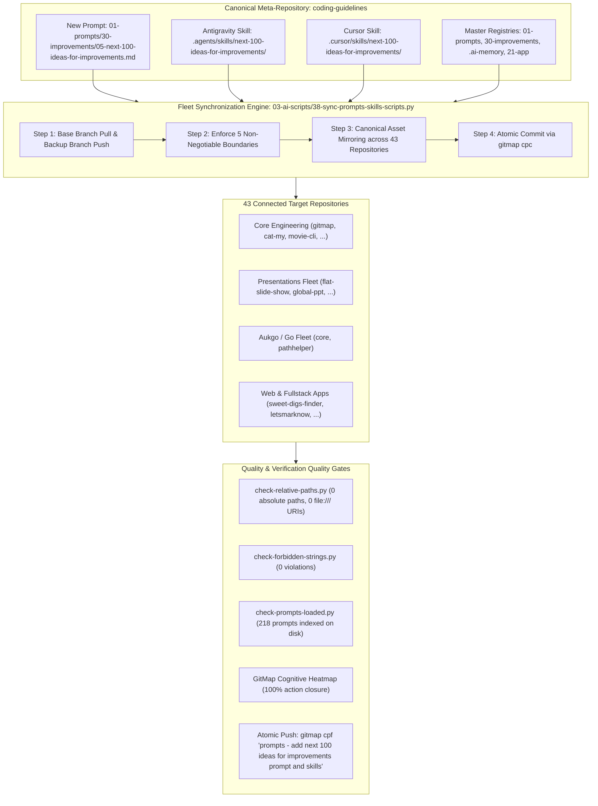
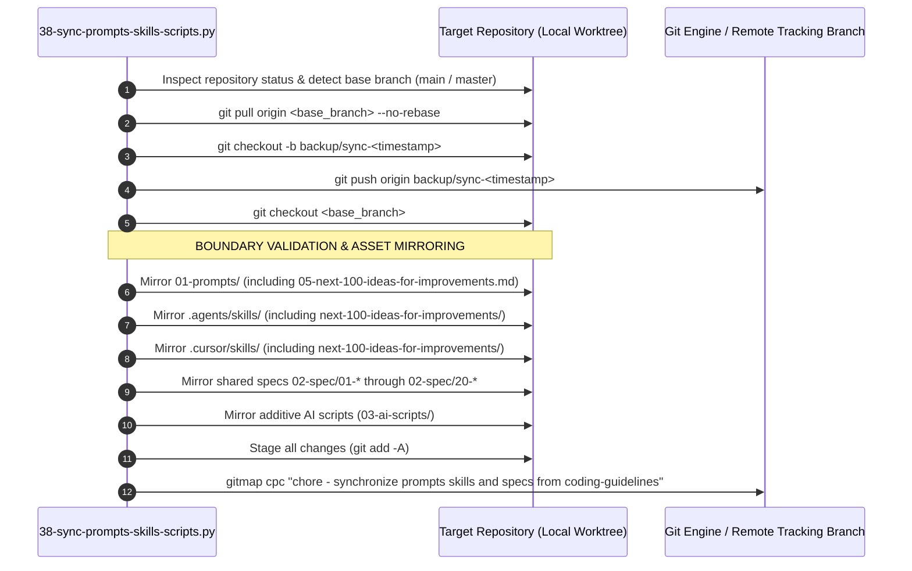
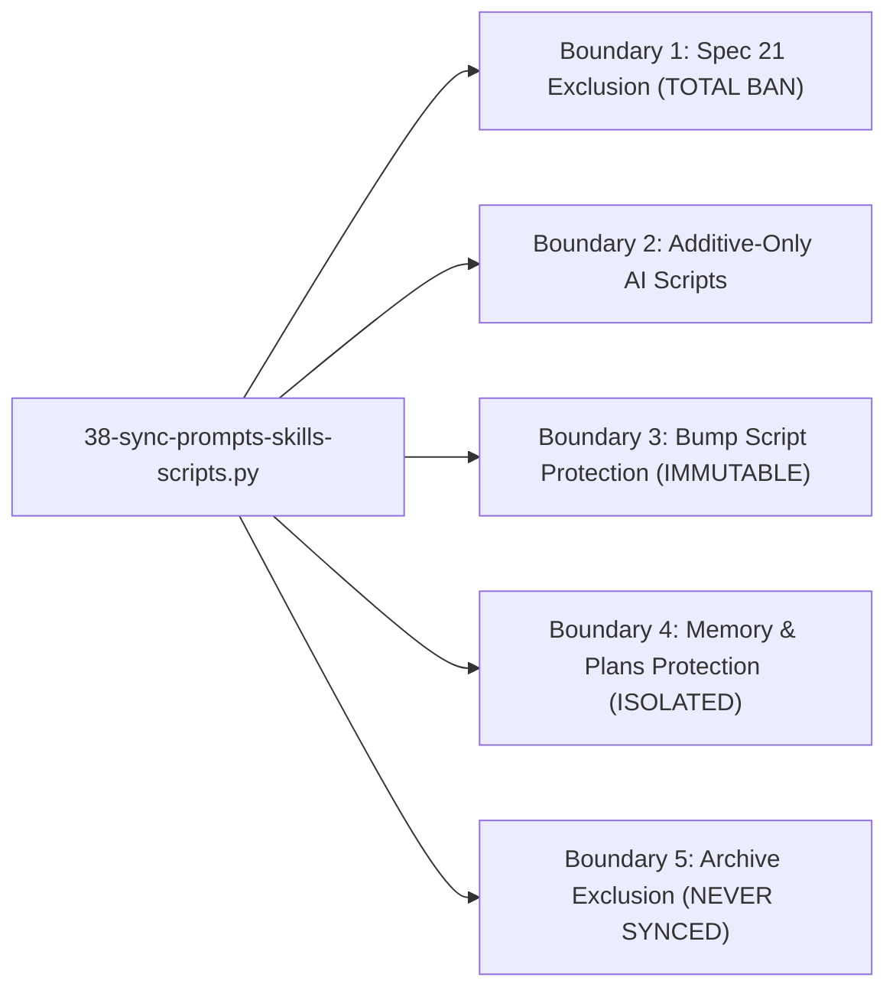
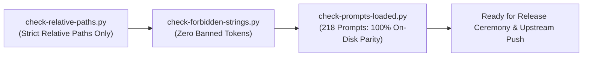
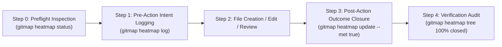

# Specification 03: Migration, Fleet Synchronization & Quality Verification

## 1. System Overview & Problem Statement

Task `04-next-100-ideas-for-improvements` establishes the fifth and crowning component of Category `30-improvements`: `05-next-100-ideas-for-improvements.md` along with its symmetric companion skills in Antigravity (`.agents/skills/next-100-ideas-for-improvements/`) and Cursor IDE (`.cursor/skills/next-100-ideas-for-improvements/`).

### The 5-Part Continuous Improvement & Ideation Suite

With Prompt 05 added, Category `30-improvements` delivers an end-to-end, autonomous innovation and refinement engine across the entire repository lifecycle:

| Prompt Identifier | Canonical File Path | Domain Scope | Primary Responsibility |
| :--- | :--- | :--- | :--- |
| **Prompt 01** | `01-prompts/30-improvements/01-next-100-ui-improvements.md` | UI / UX / Styling / Tokens | Autonomous discovery and planning of 100 UI-level improvements across design token registries, typography clamp scales, WCAG AAA contrast, glassmorphic surfaces, and presenter HUDs. |
| **Prompt 02** | `01-prompts/30-improvements/02-next-100-code-improvements.md` | Codebase Quality & Hygiene | Autonomous discovery and planning of 100 code-level improvements enforcing monadic Result envelopes, domain `*appfault.AppError`, positive booleans, parameter structs, map dispatch tables, and value semantics. |
| **Prompt 03** | `01-prompts/30-improvements/03-next-100-whole-system-improvements.md` | Whole-System Architecture & DX | Autonomous discovery and planning of 100 whole-system improvements across 10 operational UX clusters: DX/CLI ergonomics, UI tokens, agent swarms, prompt architecture, fleet sync, code quality, performance, diagnostics, test isolation, and spec governance. |
| **Prompt 04** | `01-prompts/30-improvements/04-next-detail-out-100-improvements.md` | Plan & Improvement Detailing | Multi-step detailing of active, pending, and completed plans into exhaustive review dockets with strict review-first gating, concrete blueprints, caller blast radius analysis, and binary verification criteria. |
| **Prompt 05** | `01-prompts/30-improvements/05-next-100-ideas-for-improvements.md` | Autonomous Ideation Flywheel | Autonomous discovery, structuring, and cataloging of the next 100 high-leverage innovation, product differentiation, automation, and architectural leap ideas for any target codebase. |

### Companion Skills Symmetrical Matrix

Every prompt in Category `30-improvements` is paired with native runtime skills across both Antigravity and Cursor environments:

| Prompt Key | Antigravity Runtime Skill | Cursor IDE Runtime Skill | Invocation Slash Command |
| :--- | :--- | :--- | :--- |
| **Prompt 01** | `.agents/skills/next-100-ui-improvements/` | `.cursor/skills/next-100-ui-improvements/` | `/next-100-ui-improvements` |
| **Prompt 02** | `.agents/skills/next-100-code-improvements/` | `.cursor/skills/next-100-code-improvements/` | `/next-100-code-improvements` |
| **Prompt 03** | `.agents/skills/next-100-whole-system-improvements/` | `.cursor/skills/next-100-whole-system-improvements/` | `/next-100-whole-system-improvements` |
| **Prompt 04** | `.agents/skills/next-detail-out-100-improvements/` | `.cursor/skills/next-detail-out-100-improvements/` | `/next-detail-out-100-improvements` |
| **Prompt 05** | `.agents/skills/next-100-ideas-for-improvements/` | `.cursor/skills/next-100-ideas-for-improvements/` | `/next-100-ideas-for-improvements` |



### The Multi-Repository Fleet Distribution Challenge

When authoring a major prompt and its companion skills in the central `coding-guidelines` meta-repository, distributing the capability across downstream repositories poses significant operational risks if not strictly governed:

1. **Catalog Drift:** If indices (`.ai-memory/prompts.md`, `01-prompts/readme.md`, `01-prompts/30-improvements/readme.md`) are desynchronized, automated linter pipelines fail and autonomous agents lack visibility into newly published capabilities.
2. **Boundary Violations:** Unchecked synchronization scripts could accidentally leak domain application specifications (`02-spec/21-*`), overwrite repository-specific bump scripts (`bump*`, `version.json`), or overwrite downstream operational memory (`.ai-memory/plans/`, `.ai-memory/memory/`).
3. **IDE Registry Fragmentation:** Incomplete or asymmetrical distribution between `.agents/skills/` and `.cursor/skills/` produces inconsistent agent behaviors across different IDE environments.

This specification establishes the end-to-end migration, synchronization, registry update, and verification protocol to guarantee seamless, zero-drift fleet deployment.

---

## 2. Fleet Synchronization Engine Mechanics & Implementation Contract

The fleet propagation of Prompt 05 and its companion skills is governed by `03-ai-scripts/38-sync-prompts-skills-scripts.py` (mirrored in `.agents/scripts/38-sync-prompts-skills-scripts.py`).

### Lifecycle Sequence & Safety Protocol



### The 5 Non-Negotiable Boundaries

Under `AGENTS.md` Section 11, multi-repository synchronization across the fleet must strictly adhere to the **5 Non-Negotiable Boundaries**:



#### Boundary 1: Spec 21 Exclusion (TOTAL BAN)
- **Mandate:** NEVER synchronize, copy, or touch `02-spec/21-*` through `02-spec/25-*` (private application specifications, issues, databases, UI designs, and specification audits). Only shared foundational specifications `02-spec/01-*` through `02-spec/20-*` are synchronized across repositories.
- **Engine Enforcement:** Function `is_spec_21(path)` evaluates whether any path segment contains `21-` through `29-` and blocks mirroring immediately.
- **Verification Rule:** Target repositories must contain 0 files matching `02-spec/21-*` through `02-spec/25-*`.

#### Boundary 2: Additive-Only AI Scripts
- **Mandate:** Brand-new AI scripts (`03-ai-scripts/`, `.agents/scripts/`) that do not exist in the target repository are copied cleanly. Existing scripts modified by or unique to the target repository must NEVER be overwritten.
- **Engine Enforcement:** Flag `is_additive_only=True` triggers git status and change-detection inspections before copying any script file.

#### Boundary 3: Bump Script Protection (IMMUTABLE)
- **Mandate:** NEVER overwrite version bump scripts, manifests, or configuration files (`bump*`, `bump_versions.py`, `bump-version.mjs`, `version.json`, `version.template.json`). Each repository maintains custom SemVer release targets, tagging logic, and build steps.
- **Engine Enforcement:** Function `is_bump_script(path)` intercepts all files containing `bump` or `version`.

#### Boundary 4: Memory & Plans Protection (TOTAL ISOLATION)
- **Mandate:** NEVER modify, sync, or mirror `.ai-memory/memory/`, `.ai-memory/plans/`, `.ai-memory/temp-agents/`, `.ai-memory/cicd-issues/`, or `.ai-memory/ambiguous-questions/`. Each repository independently owns its operational memory, backlog, and active subtasks.
- **Engine Enforcement:** Function `is_protected_memory_or_plan(path)` strictly rejects any target operational memory file or directory. Only canonical indices (`.ai-memory/prompts.md`, `.ai-memory/coding-guidelines.md`) are conditionally synchronized.

#### Boundary 5: Archive Exclusion
- **Mandate:** NEVER synchronize `06-archive/` or `06-old-prompts/`. Legacy archived materials reside exclusively in `coding-guidelines` for historical provenance.
- **Engine Enforcement:** Excluded via `EXCLUDE_NAMES` set. Stale archive directories in target repositories are automatically unlinked.

---

## 3. Target Repositories Catalog (43 Connected Repositories)

The synchronization routine propagates Prompt 05 and companion skills across all 43 connected repositories:

| Index | Repository Name | Relative Workspace Path | Tier / Ecosystem |
| :---: | :--- | :--- | :--- |
| 1 | `ai-empathy-prompt-tuner-v1` | `02-prompts/ai-empathy-prompt-tuner` | Prompts & AI Tuning |
| 2 | `alim-cv-v8` | `alim-cv` | Documentation & Portfolio |
| 3 | `alim-karim-profile-v2` | `alim-karim-profile` | Documentation & Portfolio |
| 4 | `alim.karim.profile` | `aukgit/alim.karim.profile` | Documentation & Portfolio |
| 5 | `Antigravity-Manager` | `antigravity-manager` | System & Developer Tools |
| 6 | `cat-my-v12` | `cat-my` | CLI & Developer Utilities |
| 7 | `core-v9` | `03-aukgo/core` | Aukgo / Go Shared Libraries |
| 8 | `digital-name-card` | `digital-name-card` | Web & Identity |
| 9 | `flat-slide-show` | `presentations-repos/flat-slide-show` | Presentations Engine |
| 10 | `gitlogger-new-v2` | `gitlogger-new` | Git & Telemetry Utilities |
| 11 | `gitmap-v28` | `gitmap` | GitMap Core Architecture |
| 12 | `global-ppt-v1` | `presentations-repos/global-ppt-v1` | Presentations Engine |
| 13 | `hiltrax-v1` | `presentations-repos/hiltrax` | Presentations Engine |
| 14 | `icon-coding-guidelines` | `icon-coding-guidelines` | Design & Visual Assets |
| 15 | `img-pdf-v2` | `img-pdf` | Image & Document Processing |
| 16 | `ki-health-ppt-v5` | `presentations-repos/ki-health-ppt` | Presentations Engine |
| 17 | `kubernetes-training-v1` | `aukgit/kubernetes-training` | Cloud & Infrastructure |
| 18 | `lara-licensing-v4` | `lara-licensing` | Licensing & Auth Services |
| 19 | `lara-publishing-v1` | `lara-publishing` | Publishing Framework |
| 20 | `laravel-automation-v1` | `laravel-automation` | Backend Automation |
| 21 | `letsmarknow-ui-v2` | `letsmarknow-ui` | Frontend Web UI |
| 22 | `letsmarknow-v2` | `letsmarknow` | Web Application Core |
| 23 | `macro-ahk-v55` | `macro-ahk` | Macro & Automation Engine |
| 24 | `maid-app-spec-presentation-v1` | `presentations-repos/maid-app-spec-presentation` | Presentations Engine |
| 25 | `movie-cli-v8` | `movie-cli` | CLI & Media Workflow |
| 26 | `pathhelper` | `03-aukgo/pathhelper` | Aukgo / Go Shared Libraries |
| 27 | `presentation-aug-2026-plans-alim` | `presentations-repos/presentation-aug-2026-plans-alim` | Presentations Engine |
| 28 | `prompts-connect-v3` | `02-prompts/prompts-connect` | Prompts & Workflow Utilities |
| 29 | `punam-case-studies-v1` | `punam-case-studies-v1` | Case Studies & Docs |
| 30 | `rasia-logo` | `presentations-repos/rasia-logo` | Design & Visual Assets |
| 31 | `scripts-fixer-v20` | `scripts-fixer` | Linter & Remediation Tools |
| 32 | `slides-spec` | `presentations-repos/slides-spec` | Presentations Engine |
| 33 | `spec-builder-v11` | `spec-builder` | Spec Architecture Scaffolding |
| 34 | `sweet-digs-finder` | `web-system/sweet-digs-finder` | Fullstack Web Application |
| 35 | `ui-prompts-cat` | `ui-prompts-cat` | UI & Prompt Engineering |
| 36 | `white-presentation-v1` | `presentations-repos/white-presentation-v1` | Presentations Engine |
| 37 | `workflowy-ui-v1` | `workflowy-ui` | Frontend Web UI |
| 38 | `workflowy-v3` | `workflowy` | Web Application Core |
| 39 | `wp-exam-v2` | `wp-exam` | WordPress Testing & Exam Engine |
| 40 | `wp-git-log-v3` | `wp-git-log` | WordPress Git Integration |
| 41 | `wp-html-automate` | `wp-html-automate` | WordPress HTML Utilities |
| 42 | `wp-link-manager-v5` | `wp-link-manager` | WordPress Link Architecture |
| 43 | `wp-onboarding-v17` | `wp-onboarding` | WordPress User Onboarding |

---

## 4. Master Catalog Update Matrices Across Documentation Roots

All central registries and catalogs across the repository must be synchronously updated to incorporate Prompt 05 and task 04:

### 1. `01-prompts/30-improvements/readme.md` (Category 30 Catalog)

- **Directory Index & Catalog Table:**
  ```markdown
  | Prompt File | Version | Scope | Key Capabilities |
  | :--- | :--- | :--- | :--- |
  | [`01-next-100-ui-improvements.md`](01-next-100-ui-improvements.md) | V6 / 1.0.0 | UI/UX & Design Tokens | 100 UI-level UX improvements covering design token registries, typography clamp formulas, WCAG AAA contrast, glassmorphic depth, virtualized trees, and presenter HUDs. |
  | [`02-next-100-code-improvements.md`](02-next-100-code-improvements.md) | V6 / 1.0.0 | Codebase Quality & Hygiene | 100 codebase-level improvements enforcing monadic Result envelopes, domain `*appfault.AppError`, positive booleans, parameter structs, map dispatch tables, and value semantics. |
  | [`03-next-100-whole-system-improvements.md`](03-next-100-whole-system-improvements.md) | V6 / 1.0.0 | Whole-System Architecture | 100 whole-system improvements across 10 UX clusters: DX/CLI ergonomics, UI tokens, agent swarms, prompt architecture, fleet sync, code quality, performance, diagnostics, test isolation, and spec governance. |
  | [`04-next-detail-out-100-improvements.md`](04-next-detail-out-100-improvements.md) | V6 / 1.0.0 | Multi-Step Detailing & Review Dockets | Autonomously details out active, pending, and completed plans and discovered improvements into exhaustive multi-step execution roadmaps, structural contracts, dependency graphs, and review dockets with strict review-first gating (no immediate execution without user review). |
  | [`05-next-100-ideas-for-improvements.md`](05-next-100-ideas-for-improvements.md) | V6 / 1.0.0 | Autonomous Ideation Flywheel | Autonomous discovery, structuring, and cataloging of the next 100 high-leverage innovation, product differentiation, automation, and architectural leap ideas across 10 innovation clusters with continuous self-looping and pending plan enqueuing. |
  ```

- **Directory Tree Update:**
  ```text
  01-prompts/30-improvements/
  ├── 01-next-100-ui-improvements.md
  ├── 02-next-100-code-improvements.md
  ├── 03-next-100-whole-system-improvements.md
  ├── 04-next-detail-out-100-improvements.md
  ├── 05-next-100-ideas-for-improvements.md
  └── readme.md
  ```

- **Companion Skills Table:**
  ```markdown
  | Companion Skill | Runtime Environment | Path | Slash Command |
  | :--- | :--- | :--- | :--- |
  | `next-100-ui-improvements` | Antigravity / Cursor | `.agents/skills/next-100-ui-improvements/`<br/>`.cursor/skills/next-100-ui-improvements/` | `/next-100-ui-improvements` |
  | `next-100-code-improvements` | Antigravity / Cursor | `.agents/skills/next-100-code-improvements/`<br/>`.cursor/skills/next-100-code-improvements/` | `/next-100-code-improvements` |
  | `next-100-whole-system-improvements` | Antigravity / Cursor | `.agents/skills/next-100-whole-system-improvements/`<br/>`.cursor/skills/next-100-whole-system-improvements/` | `/next-100-whole-system-improvements` |
  | `next-detail-out-100-improvements` | Antigravity / Cursor | `.agents/skills/next-detail-out-100-improvements/`<br/>`.cursor/skills/next-detail-out-100-improvements/` | `/next-detail-out-100-improvements` |
  | `next-100-ideas-for-improvements` | Antigravity / Cursor | `.agents/skills/next-100-ideas-for-improvements/`<br/>`.cursor/skills/next-100-ideas-for-improvements/` | `/next-100-ideas-for-improvements` |
  ```

### 2. `01-prompts/readme.md` (Master Prompts Catalog)

- **Table of Categories Update (Category 30 Row):**
  ```markdown
  | **30** | `30-improvements/` | `01-next-100-ui-improvements.md`, `02-next-100-code-improvements.md`, `03-next-100-whole-system-improvements.md`, `04-next-detail-out-100-improvements.md`, `05-next-100-ideas-for-improvements.md` | Autonomous continuous improvement and ideation flywheel across UI, codebase, whole-system UX, multi-step plan detailing with review-first gates, and next 100 high-leverage innovation ideas |
  ```

- **Directory Tree Section Update:**
  ```text
  └── 30-improvements/
      ├── 01-next-100-ui-improvements.md
      ├── 02-next-100-code-improvements.md
      ├── 03-next-100-whole-system-improvements.md
      ├── 04-next-detail-out-100-improvements.md
      ├── 05-next-100-ideas-for-improvements.md
      └── readme.md
  ```

### 3. `.ai-memory/prompts.md` (Operational Memory Prompts Matrix)

- **Category 30 Entries (including Prompt 05):**
  ```markdown
  | `30-improvements` | [`30-improvements/01-next-100-ui-improvements.md`](../01-prompts/30-improvements/01-next-100-ui-improvements.md) | Next 100 UI Improvements — Autonomous UI Discovery & Planning Flywheel (slug: `next-100-ui-improvements`, invoke: `/next-100-ui-improvements`) |
  | `30-improvements` | [`30-improvements/02-next-100-code-improvements.md`](../01-prompts/30-improvements/02-next-100-code-improvements.md) | Next 100 Code Improvements — Autonomous Code Quality & Guideline Flywheel (slug: `next-100-code-improvements`, invoke: `/next-100-code-improvements`) |
  | `30-improvements` | [`30-improvements/03-next-100-whole-system-improvements.md`](../01-prompts/30-improvements/03-next-100-whole-system-improvements.md) | Next 100 Whole System Improvements — Full-System Architecture & DX Flywheel (slug: `next-100-whole-system-improvements`, invoke: `/next-100-whole-system-improvements`) |
  | `30-improvements` | [`30-improvements/04-next-detail-out-100-improvements.md`](../01-prompts/30-improvements/04-next-detail-out-100-improvements.md) | Next Detail Out 100 Improvements — Multi-Step Detailing & Review-First Gate (slug: `next-detail-out-100-improvements`, invoke: `/next-detail-out-100-improvements`) |
  | `30-improvements` | [`30-improvements/05-next-100-ideas-for-improvements.md`](../01-prompts/30-improvements/05-next-100-ideas-for-improvements.md) | Next 100 Ideas for Improvements — Autonomous Ideation Flywheel & High-Leverage Innovation Engine (slug: `next-100-ideas-for-improvements`, invoke: `/next-100-ideas-for-improvements`) |
  | `30-improvements` | [`30-improvements/readme.md`](../01-prompts/30-improvements/readme.md) | Improvements Prompts (`30-improvements`) — Index & Catalog |
  ```

- **Disk-to-Index Parity Target:** Total prompt files on disk = `218`. Index must reference all 218 files with 0 orphan prompts and 0 dangling references.

### 4. `.ai-memory/plans/readme.md` (Plans Index)

- **Pending Plans Section Entry:**
  ```markdown
  - [04-next-100-ideas-for-improvements.md](pending/04-next-100-ideas-for-improvements.md): Autonomous ideation flywheel prompt, companion skills (Antigravity & Cursor), master catalog updates, and multi-repository synchronization across 43 connected repositories.
  ```

### 5. `02-spec/21-app/readme.md` (Application Specifications Index)

- **Active Contents Table Entry:**
  ```markdown
  | [`04-next-100-ideas-for-improvements/`](04-next-100-ideas-for-improvements/) | Next 100 Ideas for Improvements Prompt, Skills & Fleet Synchronization | Active Task Spec | Active |
  ```

---

## 5. Quality Verification Gates & Linter Matrix

Before declaring completion or executing the final atomic push, three automated quality gates must be validated with zero errors:



### 1. Relative Paths Verification (`linter-scripts/check-relative-paths.py`)
- **Execution Command:**
  ```bash
  python linter-scripts/check-relative-paths.py
  ```
- **Rule:** Absolute filesystem paths (`C:\`, `/home/`, `/absolute/path/`) and absolute file URIs (`file:///...`) are strictly banned across all markdown and repository files (`AGENTS.md` Section 5).
- **Pass Threshold:** 0 violations.

### 2. Forbidden Strings Verification (`linter-scripts/check-forbidden-strings.py`)
- **Execution Command:**
  ```bash
  python linter-scripts/check-forbidden-strings.py
  ```
- **Rule:** Validates files against `linter-scripts/forbidden-strings.toml`, prohibiting forbidden template placeholders, raw secrets, unescaped tokens, and malformed links.
- **Pass Threshold:** 0 violations.

### 3. Prompts Loaded Contract (`linter-scripts/check-prompts-loaded.py`)
- **Execution Command:**
  ```bash
  python linter-scripts/check-prompts-loaded.py
  ```
- **Rule:** Every prompt file residing in `01-prompts/` (total 218 files with Prompt 05 added) must have a valid, active entry in `.ai-memory/prompts.md`. No orphan prompt files on disk, and no dangling references in the index.
- **Pass Threshold:** Exit code `0` (PASS — index matches disk prompts directory exactly).

### 4. Filename Convention Verification
- **Rule:** All newly created or modified files and directories must adhere to strictly lowercase naming (`AGENTS.md` Section 4).
- **Pass Threshold:** 0 uppercase characters in any path segment.

---

## 6. GitMap Cognitive Heatmap Telemetry Protocol

In compliance with `AGENTS.md` Section 15, all file operations, specification actions, and verification gates must be tracked via the GitMap Cognitive Heatmap engine:



### Cognitive Logging Lifecycle

1. **Step 0 Preflight Inspection:**
   ```bash
   gitmap heatmap status --task "04-next-100-ideas-for-improvements"
   gitmap heatmap tables
   ```

2. **Pre-Action Intent Logging:**
   Before creating or editing any deliverable file:
   ```bash
   gitmap heatmap log --task "04-next-100-ideas-for-improvements" --action "CREATE" --file "<relative-path>" --state "EXECUTION" --expected "<expected-deliverable-goal>"
   ```

3. **Post-Action Outcome Closure:**
   Immediately following completion of each action:
   ```bash
   gitmap heatmap update --id "<action-id>" --outcome "<verified-outcome-summary>" --met true
   ```

4. **Phase 3 Verification Audit:**
   ```bash
   gitmap heatmap tree --task "04-next-100-ideas-for-improvements"
   gitmap heatmap status --task "04-next-100-ideas-for-improvements"
   ```
   *Pass Threshold:* 100% action closure (`met=true`). Zero unclosed or dangling entries.

---

## 7. Release Ceremony & Final Atomic Commit Syntax

Under `AGENTS.md` Section 10 and Section 13 ('No Push = Not Done'):

### 1. Preflight Working Tree Checklist
- Verify `01-prompts/30-improvements/05-next-100-ideas-for-improvements.md` exists and contains the full V6 10-cluster ideation template.
- Verify `.agents/skills/next-100-ideas-for-improvements/skill.md` and `.cursor/skills/next-100-ideas-for-improvements/skill.md` exist symmetrically.
- Verify all 5 master catalogs (`01-prompts/30-improvements/readme.md`, `01-prompts/readme.md`, `.ai-memory/prompts.md`, `.ai-memory/plans/readme.md`, `02-spec/21-app/readme.md`) are updated.
- Verify all 3 linters pass with exit code 0 (`check-relative-paths.py`, `check-forbidden-strings.py`, `check-prompts-loaded.py`).
- Verify `03-ai-scripts/38-sync-prompts-skills-scripts.py` ran cleanly across all 43 repositories.

### 2. Atomic Commit & Push Syntax
Execute the atomic commit and push upstream following strict GitMap hyphen formatting:

```bash
gitmap cpf "prompts - add next 100 ideas for improvements prompt and skills"
```

> [!CAUTION]
> **Total Ban on Colons in Commit Messages:**  
> In all GitMap commit commands (`gitmap cpf`, `gitmap cpb`, `gitmap cpc`, `gitmap cpr`), NEVER include colons inside the message argument. GitMap automatically provides structured prefixes (`Feature: `, `Bug: `, `chore: `). Format messages strictly with hyphens (e.g. `prompts - add next 100 ideas for improvements prompt and skills`).

### 3. Upstream Completion Invariant
- Verify that the commit is successfully pushed to the GitHub upstream tracking branch (`origin/main` or `origin/master`).
- Verify that the local working tree is completely clean (`gitmap status`).
- A task is strictly INCOMPLETE and NOT DONE until this upstream push is confirmed.
