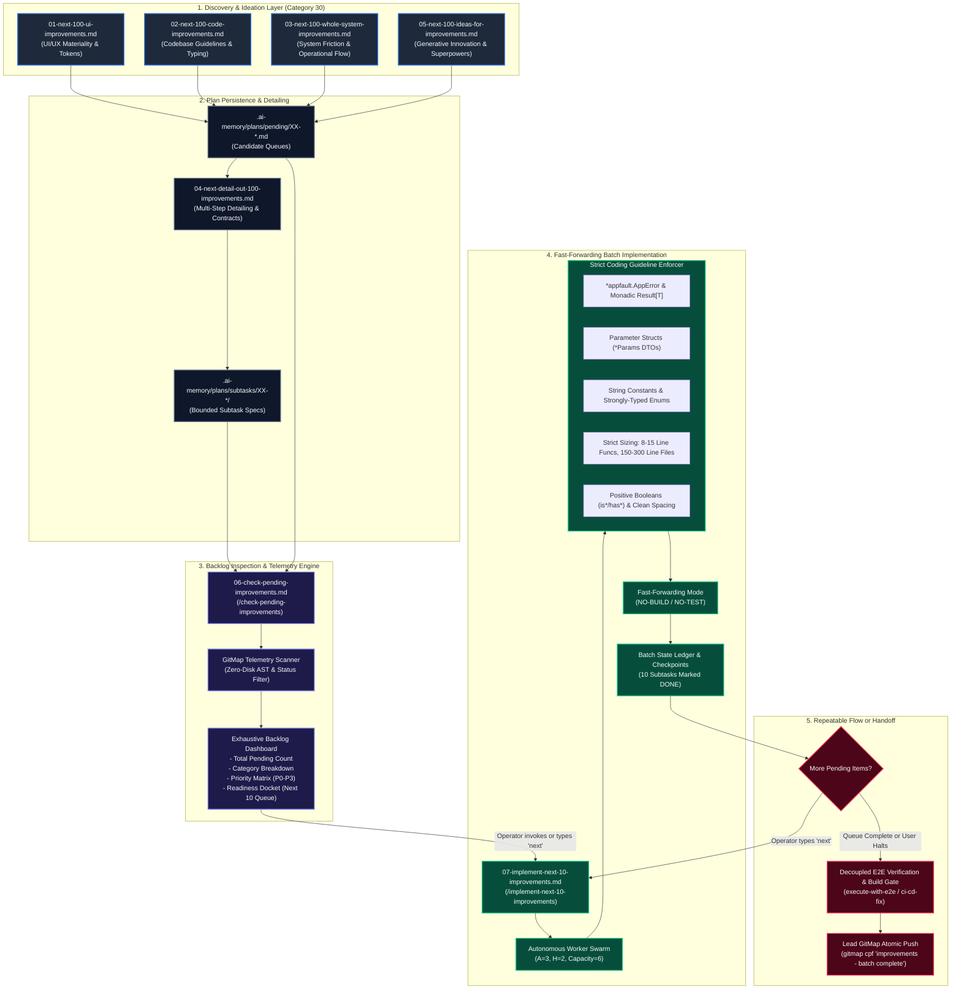

# Specification 01: Improvements Folder Prompts — Architecture, System Continuum & Implementation Engine

> [!IMPORTANT]
> **Specification Identifier:** `02-spec/21-app/05-improvements-folder-prompts/01-architecture-spec.md`  
> **Target Subsystem:** Category 30 (`01-prompts/30-improvements/`) & Parent Task Execution V6  
> **Status:** `APPROVED`  
> **Author:** Spec Author 01 (Architecture & System Design Lead)  
> **Companion Deliverables:**  
> - `02-spec/21-app/05-improvements-folder-prompts/02-component-spec.md`  
> - `02-spec/21-app/05-improvements-folder-prompts/03-migration-and-verification-spec.md`  
> - `.ai-memory/plans/subtasks/05-improvements-folder-prompts/01-subtask-architecture-and-contracts.md`  

---

## 1. Executive Summary & Problem Statement

### 1.1 The Context: The Category 30 Improvements Continuum
The `30-improvements` prompt family in the Prompt Architect meta-repository governs the complete lifecycle of system enhancement, innovation, and code quality refinement. This continuum encompasses:
1. **Multi-Dimensional Discovery:** Generating 100 grounded candidates across UI/UX polish (`01-next-100-ui-improvements.md`), codebase hygiene and type safety (`02-next-100-code-improvements.md`), whole-system ergonomics (`03-next-100-whole-system-improvements.md`), and generative superpowers (`05-next-100-ideas-for-improvements.md`).
2. **Deep Specification & Detailing:** Expanding candidate items into actionable 8-field blueprints and structural contracts (`04-next-detail-out-100-improvements.md`).
3. **Plan Persistence:** Enqueueing structured roadmaps in `.ai-memory/plans/pending/` and bounded subtasks in `.ai-memory/plans/subtasks/`.

### 1.2 The Problem: Backlog Invisibility & Build-Test Friction Drag
While the discovery and detailing engines successfully generate high-authority backlogs, two critical architectural bottlenecks exist in the downstream execution phase:
1. **Backlog Invisibility & Status Fragmentation:** Operators and AI swarms lack a consolidated, real-time command dashboard to answer fundamental questions: *How many total improvements are pending across all plans? Which categories (UI, Codebase, System, Detailing, Ideas) contain pending items? What is the current completion percentage and readiness state?* Without a dedicated inspection prompt, backlogs remain dispersed across dozens of markdown files in `.ai-memory/plans/pending/` and `.ai-memory/plans/subtasks/`.
2. **The Build-Test Friction Drag in Micro-Batching:** When executing small batches of improvements, running full compilation cycles (`go build`, `npm run build`) and exhaustive test suites (`go test ./...`, Playwright, Vitest) after every micro-edit creates massive latency, exhausts developer flow, and introduces transient build failures. Autonomous agents become trapped in circular test debugging for unintegrated intermediate changes.
3. **Repeated Context Switching:** Operators lack a fluid, repeatable conversational mechanism to say "next" and have the AI immediately consume the next sequential batch of 10 items from the active queue while strictly adhering to production-grade coding standards.

### 1.3 The Solution: Backlog Telemetry (`06`) & Fast-Forwarding Batch Execution (`07`)
This specification establishes the architectural architecture, contracts, and interaction models for two new foundational prompts in Category 30:
- **`06-check-pending-improvements.md` (Check Pending Improvements):**  
  An autonomous backlog inspection and telemetry engine that scans `.ai-memory/plans/pending/`, `.ai-memory/plans/subtasks/`, and active improvement roadmaps. It aggregates and renders an exhaustive inventory dashboard featuring: total pending count, categorical distribution (UI, Codebase, Whole System, Detailing, Ideas), status distribution (`PENDING`, `IN_PROGRESS`, `DONE`, `BLOCKED`), overall completion percentage, priority rankings (P0–P3), and an actionable readiness docket highlighting the next 10 candidates queued for execution.
- **`07-implement-next-10-improvements.md` (Implement Next 10 Improvements):**  
  A high-throughput, bounded batch implementation engine that claims and implements the next 10 pending improvements from the prioritized queue. It operates in **Fast-Forwarding Mode**: zero compilation and zero test execution during implementation turns (`NO-BUILD`, `NO-TEST`). It guarantees strict adherence to core coding guidelines (`*appfault.AppError`, monadic `Result[T]`, parameter structs, string constants/enums, 8–15 line functions, 150–300 line files, positive booleans, vertical spacing). It establishes an effortless repeatable workflow where the operator can trigger subsequent batches simply by entering "next", while gracefully deferring comprehensive test execution to a dedicated end-to-end verification phase.
- **V6 Checkpoint Enhancements:**  
  Integrates checkpointing mechanisms and fast-forwarding flags directly into the canonical V6 parent task execution prompt (`01-prompts/14-execute/02-execute-parent-task-with-n-steps-v6.md`) and companion skills.

### 1.4 Non-Negotiable Invariants & Guardrails
All components specified herein strictly adhere to the repository guardrails:
- **Strict Relative Git Paths:** All file paths, references, and citations must use relative paths from the repository root (e.g. `01-prompts/30-improvements/...`, `02-spec/21-app/...`, `.ai-memory/plans/...`). Absolute paths and `file:///` URIs are strictly banned.
- **Strict Lowercase File Naming:** All created and modified files, directories, and scripts must strictly use lowercase naming without exception.
- **Fast-Forwarding Invariant (`NO-BUILD`, `NO-TEST`):** During implementation turns of Prompt 07, running builds or tests is strictly prohibited. Verification is isolated to structural linter checks and deferred to dedicated E2E verification suites.
- **Worker Git Command Ban:** Subagents must never run git staging, committing, or pushing commands. Commits are reserved for lead orchestrators using GitMap hyphen-separated syntax (`gitmap cpf "<module> - <summary>"`).

---

## 2. Mermaid Architecture Diagram

The diagram below illustrates the end-to-end continuum of Category 30 (`30-improvements`), demonstrating the transition from discovery through detailing, real-time backlog inspection, fast-forwarding batch implementation, and decoupled end-to-end verification:



---

## 3. Synergistic Architecture: The 7-Prompt Improvement Continuum

With the introduction of Prompts 06 and 07, Category 30 completes an unbroken, industrial-grade operational loop spanning generation, refinement, observability, execution, and verification:

| Prompt Identifier | File Name | Lifecycle Stage | Primary Responsibilities & Operational Capabilities |
| :--- | :--- | :--- | :--- |
| **Prompt 01** | `01-next-100-ui-improvements.md` | Discovery (UI/UX) | Scans user interfaces, styling tokens, typography scales, glassmorphism, depth hierarchy, and WCAG AAA compliance to output 100 concrete UI improvements. |
| **Prompt 02** | `02-next-100-code-improvements.md` | Discovery (Codebase) | Audits code quality, guideline adherence, monadic error wrapping, parameter bloat, and boolean discipline to formulate 100 codebase improvements. |
| **Prompt 03** | `03-next-100-whole-system-improvements.md` | Discovery (Whole System) | Inspects the end-to-end operational surface across 10 DX/system clusters, diagnosing friction points and formulating 100 systemic improvements. |
| **Prompt 04** | `04-next-detail-out-100-improvements.md` | Detailing & Contracts | Deconstructs discovered items into exhaustive 8-field execution blueprints, AST caller blast radius analysis, and review dockets with strict review-first gating. |
| **Prompt 05** | `05-next-100-ideas-for-improvements.md` | Discovery (Innovation) | Conducts a 5-layer diagnostic inspection to synthesize 100 innovative superpowers and unbuilt capabilities, avoiding reactive maintenance traps. |
| **Prompt 06** | `06-check-pending-improvements.md` | Telemetry & Observability | Scans all pending plan files and subtask folders to render an exhaustive backlog inventory: exact pending counts, category splits, priority tiers, and readiness dockets. |
| **Prompt 07** | `07-implement-next-10-improvements.md` | Fast-Forward Execution | Implements bounded batches of 10 items in fast-forwarding mode (`NO-BUILD`, `NO-TEST`), enforcing strict coding guidelines with fluid "next" command iteration. |

---

## 4. Architectural Specification of Prompt 06: `check-pending-improvements`

### 4.1 Purpose, User Experience & Invocations
- **Core Purpose:** To provide instantaneous, authoritative visibility into all uncompleted improvement tasks across the workspace. It answers: *What work remains, where does it live, what are the priorities, and what is ready for immediate implementation?*
- **Slash Command:** `/check-pending-improvements`
- **User Invocation Phrases:** `check improvements`, `check pending improvements`, `how many improvements pending`, `show improvement backlog`.

### 4.2 Telemetry Ingestion Engine
Prompt 06 executes a zero-disk-overhead, read-only scan of the plan repository using GitMap high-speed streaming utilities:
1. **Target Discovery:**
   - Evaluates `.ai-memory/plans/pending/` for plan manifests (e.g. `XX-next-100-*.md`, `XX-improvements-*.md`).
   - Evaluates `.ai-memory/plans/subtasks/` across all child directories for atomic subtask markdown files.
   - Evaluates active specification dockets in `02-spec/21-app/`.
2. **Metadata Extraction:**
   - Parses frontmatter and metadata tables for: `Status` (`PENDING`, `IN_PROGRESS`, `DONE`, `BLOCKED`), `Category` (UI, Codebase, Whole System, Detailing, Ideas), `Priority` (`P0-Critical`, `P1-High`, `P2-Medium`, `P3-Low`), and `Target File(s)`.
   - Counts completed tasks (`[x]`) vs. uncompleted tasks (`[ ]`).

### 4.3 Output Schema & Dashboard Architecture
Prompt 06 renders a structured markdown dashboard in visible chat containing six mandatory components:

```markdown
# 📊 Pending Improvements Backlog & Telemetry Dashboard

## 1. Executive Summary
- **Total Registered Improvements:** [Total Count]
- **Total Pending Improvements:** [Pending Count]
- **Completed Improvements:** [Completed Count]
- **System Completion Percentage:** [Percentage]%
- **Ready for Immediate Batching (Prompt 07):** [Ready Count]

## 2. Category Breakdown Matrix
| Category | Source File / Scope | Total | Pending | Done | % Complete |
| :--- | :--- | :---: | :---: | :---: | :---: |
| **UI Polish & Tokens** | `01-next-100-ui-improvements.md` | 100 | [N] | [N] | [%] |
| **Codebase Guidelines** | `02-next-100-code-improvements.md` | 100 | [N] | [N] | [%] |
| **Whole System UX** | `03-next-100-whole-system-improvements.md` | 100 | [N] | [N] | [%] |
| **Detailed Roadmaps** | `04-next-detail-out-100-improvements.md` | [N] | [N] | [N] | [%] |
| **Generative Ideas** | `05-next-100-ideas-for-improvements.md` | 100 | [N] | [N] | [%] |
| **Application Tasks** | Active subtasks in `.ai-memory/plans/subtasks/` | [N] | [N] | [N] | [%] |

## 3. Priority & Risk Distribution
- **P0 - Critical Path / Architecture:** [Count] items
- **P1 - High Velocity / Core Standards:** [Count] items
- **P2 - Medium Ergonomics / Polish:** [Count] items
- **P3 - Low / Nice-to-Have Exploration:** [Count] items

## 4. Next 10 Queue (Readiness Docket for Prompt 07)
| Queue # | Item Identifier | Category | Target File(s) | Estimated Lines | Priority |
| :---: | :--- | :--- | :--- | :---: | :---: |
| 1 | `IMP-001` | Codebase | `pkg/domain/service.go` | ~25 lines | P0 |
| ... | ... | ... | ... | ... | ... |
| 10 | `IMP-010` | UI Polish | `src/components/button.tsx` | ~15 lines | P1 |

## 5. Recommended Next Action
Run `/implement-next-10-improvements` or type `next` to implement Queue items 1–10 in fast-forwarding mode.
```

---

## 5. Architectural Specification of Prompt 07: `implement-next-10-improvements`

### 5.1 Purpose & Conversational Repeatability
- **Core Purpose:** To execute rapid, surgical implementation of exactly 10 improvements per invocation, pulling deterministically from the readiness docket identified by Prompt 06.
- **Slash Command:** `/implement-next-10-improvements`
- **Conversational Repeatability ("next" workflow):** When an operator submits "next" or re-runs the prompt, the agent:
  1. Inspects the ledger to determine which items were completed in the prior batch.
  2. Pulls the subsequent 10 unblocked, pending items.
  3. Executes the 10 implementations under strict guideline constraints.
  4. Updates the subtask ledger to mark them `[x] DONE`.
  5. Outputs a summary of the 10 changes and prompts: *"Batch [N] complete (10 items). Type 'next' to implement the next 10 pending improvements, or run verification when ready."*

### 5.2 Fast-Forwarding Paradigm: Zero Build / Zero Test (`NO-BUILD`, `NO-TEST`)
A central innovation of Prompt 07 is the **Fast-Forwarding Protocol**:
> [!IMPORTANT]
> **Strict Fast-Forwarding Invariant (`NO-BUILD`, `NO-TEST`):**  
> During implementation of the 10 improvements, agents MUST NOT execute compiler commands (`go build`, `npm run build`, `vite build`), test suites (`go test`, `pytest`, `npm test`, `vitest`), or end-to-end runners.  
> **Rationale:** Eliminates the intermediate compile-test churn that stalls batch implementation. Quality and correctness are guaranteed structurally through grounded coding standards and syntax-level precision. Full end-to-end compilation and testing are decoupled into a dedicated phase at the conclusion of all batches.

### 5.3 Strict Coding Guideline Enforcement Matrix
Every modification performed during the batch must comply with the following non-negotiable coding standards:

```text
+---------------------------------------------------------------------------------------------------+
|                            STRICT CODING GUIDELINES ENFORCEMENT MATRIX                            |
+------------------------------------+--------------------------------------------------------------+
| Guideline Category                 | Concrete Rule & Architectural Invariant                      |
+------------------------------------+--------------------------------------------------------------+
| 1. Error Management                | - Zero orphaned errors: `_ = err` is TOTALLY BANNED.        |
|                                    | - Structured error returns must use `*appfault.AppError`.    |
|                                    | - Preserves error causality via `.Wrap()` or `.WithCause()`. |
+------------------------------------+--------------------------------------------------------------+
| 2. Monadic Result Envelopes        | - Functions returning complex types or fallible data must    |
|                                    |   return `Result[T]` or `*appfault.AppError`.                |
|                                    | - Elimination of naked multi-value error tuples.             |
+------------------------------------+--------------------------------------------------------------+
| 3. Parameter Struct Encapsulation  | - Signatures with >2-3 parameters are STRICTLY BANNED.       |
|                                    | - Multiple arguments encapsulated into dedicated `*Params`   |
|                                    |   structs/DTOs (e.g. `ExecuteBatchParams`).                  |
+------------------------------------+--------------------------------------------------------------+
| 4. String Constants & Enums        | - Zero raw magic strings or inline string literals.          |
|                                    | - All domain keys, statuses, and tokens must be declared     |
|                                    |   as constants or strongly-typed enums.                      |
+------------------------------------+--------------------------------------------------------------+
| 5. Function Sizing Guardrails      | - Functions must be kept strictly between 8 and 15 lines.   |
|                                    | - Complex procedures decomposed into discrete helper verbs.  |
+------------------------------------+--------------------------------------------------------------+
| 6. File Sizing Guardrails          | - Files strictly bounded within 150 to 300 lines.            |
|                                    | - UI components strictly under 100 lines.                    |
|                                    | - Oversized files partitioned into modular siblings.         |
+------------------------------------+--------------------------------------------------------------+
| 7. Vertical Spacing Rhythm         | - Blank line mandatory before `if`.                          |
|                                    | - Blank line mandatory after closing brace `}`.              |
|                                    | - Blank line mandatory before `return`.                      |
|                                    | - Blank line surrounding multiline struct instantiations.    |
+------------------------------------+--------------------------------------------------------------+
| 8. Positive Boolean Standards      | - Affirmative prefixes only (`is*`, `has*`).                 |
|                                    | - Implicit boolean evaluation: `if isReady { ... }`.         |
|                                    | - TOTAL BAN on explicit true checks (`== true`).             |
|                                    | - TOTAL BAN on mixed polarity in single conditions.          |
+------------------------------------+--------------------------------------------------------------+
```

### 5.4 Batch Execution Pipeline & Ledger Transitions
Each batch of 10 items executes through four atomic steps:
1. **Queue Lock & Claim:** The agent extracts the top 10 items from `.ai-memory/plans/subtasks/` or `.ai-memory/plans/pending/`, assigning them temporary state `IN_PROGRESS` in the active memory ledger.
2. **Micro-File Editing:** Edits are performed file-by-file in disjoint scopes using `edit_file` or `write_file`. Edits strictly conform to the 8 coding guidelines above.
3. **Ledger Checkpoint:** Upon completing each item, the agent toggles the item status to `[x] DONE` in the respective subtask or plan markdown document.
4. **Batch Handoff:** The agent reports the completed 10 items in chat, indicates the remaining backlog count, and provides the operator with two explicit paths:
   - **Continue Iteration:** Type `next` to trigger the subsequent batch of 10 improvements.
   - **Initiate Verification:** Run `/execute-with-e2e` or the decoupled build/test suite once desired batches have completed.

### 5.5 Hand-off to Decoupled End-to-End Verification
Once the operator completes the desired number of batches (or drains the pending queue), the fast-forwarding mode terminates, and the operator initiates the decoupled verification ceremony:
1. **Compilation Preflight:** Compiles all impacted packages (`go build ./...`, `npm run build`).
2. **Surgical Verification:** Executes relevant unit tests and integration suites corresponding to modified packages (`go test -v ./pkg/...`, `npm run test:e2e`).
3. **Atomic Commit & Push:** Lead orchestrator commits all modified files via `gitmap cpf "<module> - implement next 10 improvements"` using hyphen separation without colons.

---

## 6. V6 Parent Task Checkpoint & Governance Enhancements

To ensure full compatibility with canonical execution swarms, the improvements fast-forwarding protocol is integrated directly into `01-prompts/14-execute/02-execute-parent-task-with-n-steps-v6.md`:

### 6.1 Checkpoint Architecture in V6
In Phase 2 and Phase 3 of the V6 execution pipeline, the following checkpoint enhancements are established:
1. **Fast-Forward Micro-Batch Flag:** Introduces support for `--fast-forward` or `FAST_FORWARD_MODE = true` in the V6 parameter header, enabling worker subagents to bypass compile-and-test steps during repetitive subtask waves.
2. **Intermediate Batch Checkpoint Protocol:** Mandates that after every wave of $A \times H$ operations (e.g. 6 operations), the lead orchestrator validates file boundaries and updates the audit ledger without triggering heavy system test runners.
3. **Decoupled Verification Gate:** Phase 3 of V6 is partitioned into two distinct sub-phases:
   - **Phase 3A (Fast-Forward Code Wave):** Pure implementation of subtask files with strict coding guideline linting and zero intermediate builds/tests.
   - **Phase 3B (Consolidated Verification Gate):** A single, consolidated end-to-end build and test run that validates all batched changes in unison before atomic push.

### 6.2 Strict Coding Guidelines Injection into V6
The V6 prompt is enhanced to explicitly reference the 8 coding guidelines from Section 5.3 in its worker dispatch contract, ensuring that all spawned worker subagents automatically adopt parameter structs, monadic results, `*appfault.AppError`, string enums, and 8–15 line function sizing.

---

## 7. Data Contracts & Plan Persistence Structures

### 7.1 Schema of Pending Improvement Cards (`04-next-detail-out-100-improvements.md`)
Every improvement item detailed under Category 30 adheres to the structured 8-part contract:

```markdown
### `[IMP-NNN]` <Title of Improvement>
- **Category:** `[UI | Codebase | Whole System | Detailing | Ideas]`
- **Priority:** `[P0-Critical | P1-High | P2-Medium | P3-Low]`
- **Status:** `[PENDING | IN_PROGRESS | DONE | BLOCKED]`
- **Target File(s):** `<relative/path/to/target_file>`
- **Blast Radius:** `<impacted caller packages or UI trees>`
- **Problem Statement:** <1-2 sentences identifying root cause>
- **Solution & Interface Blueprint:**
  ```go
  // Structured contract following *appfault.AppError and Result[T]
  type ExecuteParams struct {
      Context context.Context
      Option  string
  }
  func Execute(params ExecuteParams) Result[Output] { ... }
  ```
- **Binary Acceptance Criteria:** <Deterministic verification command or output expectation>
```

### 7.2 Subtask Manifest in `.ai-memory/plans/subtasks/`
Subtask files generated for improvements follow a standard naming convention:
- Path format: `.ai-memory/plans/subtasks/XX-<task-slug>/<NN>-subtask-<subtask-slug>.md`
- Markdown checklist: Contains discrete checkboxes (`- [ ] IMP-NNN`) allowing Prompt 06 to calculate percentage completion mechanically.

---

## 8. Multi-Agent Swarm Concurrency & Dynamic Allocation

### 8.1 Concurrency Model
When executing Prompt 07 or multi-agent improvement sweeps:
- **Lead Orchestrator ($L$):** Manages queue claiming, ledger updates, and communication with the operator. Never modifies code files solo.
- **Worker Subagents ($A = 3$):** Spawned concurrently via `invoke_subagent` with 2 operational hands ($H = 2$), providing a concurrent capacity of 6 operations.
- **Disjoint Workspaces:** Each worker subagent is assigned a strict disjoint bounding box of target files (e.g. Worker 1 handles items 1–3, Worker 2 handles items 4–7, Worker 3 handles items 8–10). Shared files are serialized to eliminate merge conflicts.

### 8.2 Dynamic Worker Respawn
In compliance with V6 swarm invariants:
- Concurrency remains pinned at 3 active subagents throughout execution.
- If Worker 1 finishes its 3 items early, the lead orchestrator immediately commands Worker 1 to take the next pending item or assist with guideline verification, preserving a 100% duty cycle.

---

## 9. Architectural Invariants & Compliance Matrix

| Rule ID | Core Constraint | Architectural Mechanism | Compliance Status |
| :--- | :--- | :--- | :---: |
| **R1** | **Relative Git Paths Only** | Absolute filesystem paths and `file:///` URIs are totally banned. All paths start from repo root. | `ENFORCED` |
| **R2** | **Strict Lowercase Naming** | All new prompts, skills, specs, and directories use strictly lowercase characters. | `ENFORCED` |
| **R3** | **Fast-Forwarding (`NO-BUILD`, `NO-TEST`)** | Prompt 07 completely disables compile/test runs during batch execution; verified at final gate. | `ENFORCED` |
| **R4** | **Repeatable "next" Workflow** | State stored in `.ai-memory/plans/`; consecutive invocations smoothly pick up next 10 items. | `ENFORCED` |
| **R5** | **`*appfault.AppError` Standard** | All error wrapping in Go files uses `*appfault.AppError`; orphaned errors are banned. | `ENFORCED` |
| **R6** | **Monadic `Result[T]` Returns** | Fallible functions return monadic `Result[T]` or `*appfault.AppError`. | `ENFORCED` |
| **R7** | **Parameter Structs** | Functions with >2-3 parameters encapsulate arguments into `*Params` structs. | `ENFORCED` |
| **R8** | **Function & File Sizing** | Functions bounded to 8–15 lines; files bounded to 150–300 lines (components <100 lines). | `ENFORCED` |
| **R9** | **Positive Booleans** | Affirmative `is*`/`has*`, implicit checks, total ban on explicit `== true` and mixed polarity. | `ENFORCED` |
| **R10**| **Decoupled Verification Gate** | End-to-end compilation and test suites run separately after batch implementation finishes. | `ENFORCED` |
