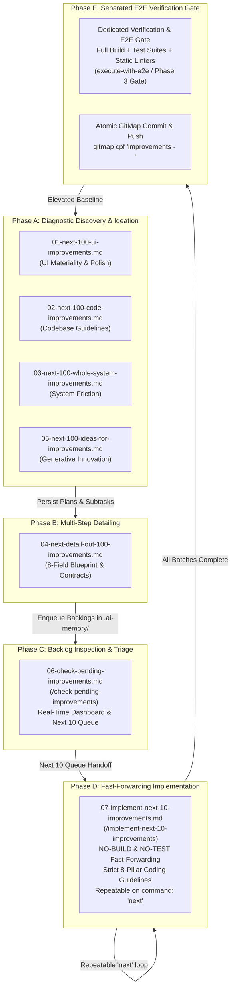
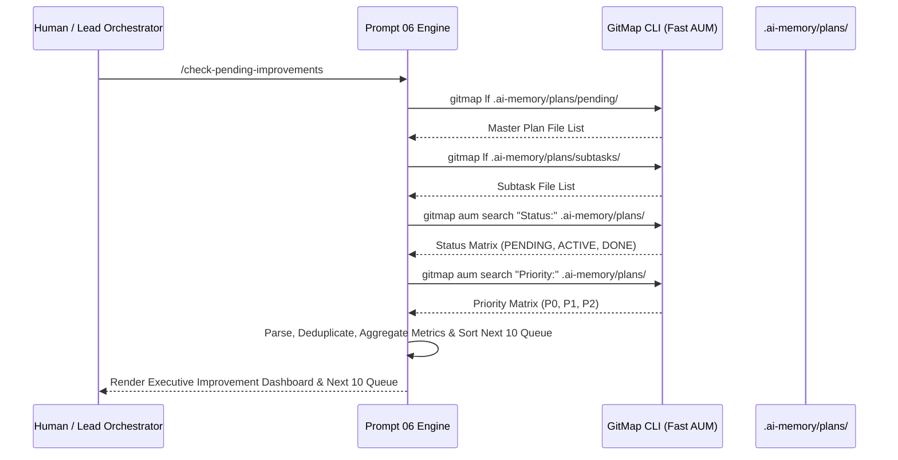
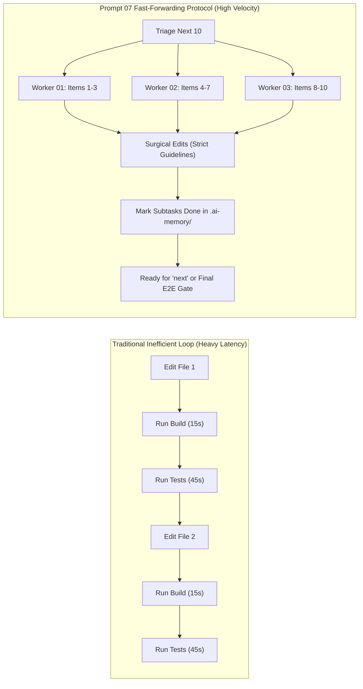
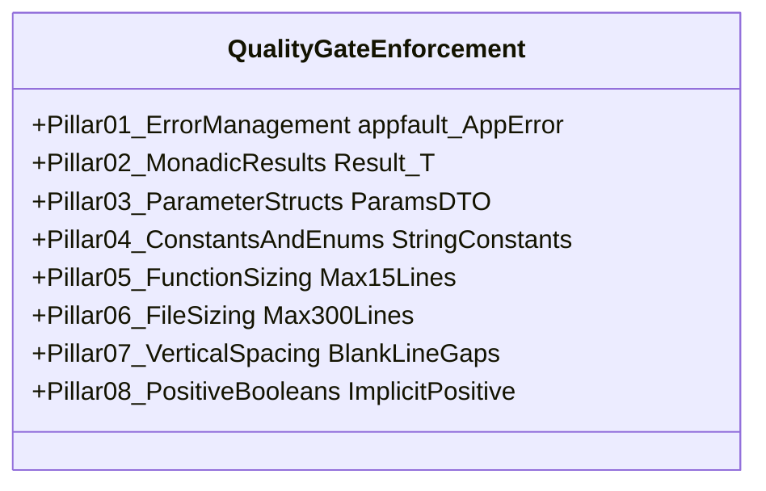
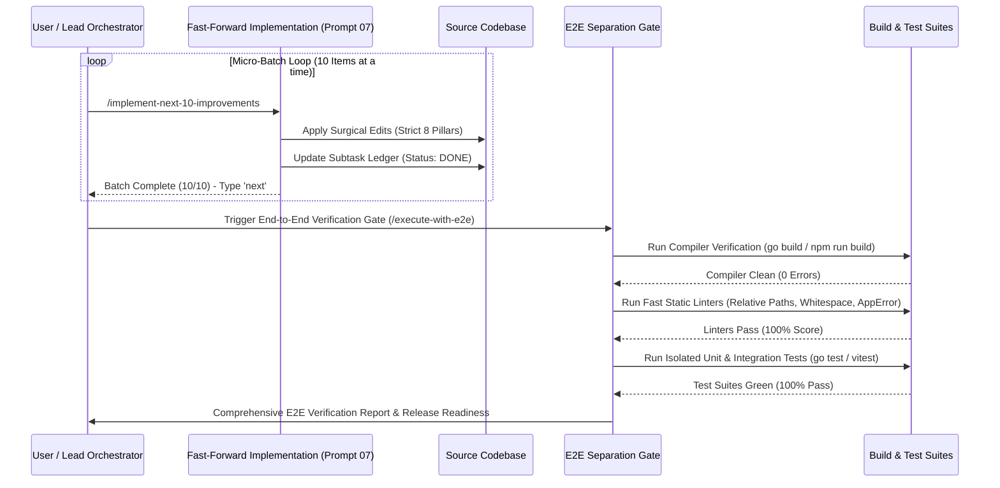

# Specification 02: Component Specification, Schemas & Concrete Examples

**Version:** 1.0.0  
**Status:** ACTIVE  
**Parent Plan:** `.ai-memory/plans/pending/05-improvements-folder-prompts.md`  
**Architecture Spec:** `02-spec/21-app/05-improvements-folder-prompts/01-architecture-spec.md`  
**Target Prompts:**
- `01-prompts/30-improvements/06-check-pending-improvements.md`
- `01-prompts/30-improvements/07-implement-next-10-improvements.md`
- `01-prompts/14-execute/02-execute-parent-task-with-n-steps-v6.md` (Checkpoint enhancements)
**Target Skills:**
- `.agents/skills/check-pending-improvements/skill.md`
- `.cursor/skills/check-pending-improvements/skill.md`
- `.agents/skills/implement-next-10-improvements/skill.md`
- `.cursor/skills/implement-next-10-improvements/skill.md`
- `.agents/skills/execute-parent-task-with-n-steps-v6/skill.md` (Checkpoint enhancements)
- `.cursor/skills/execute-parent-task-with-n-steps-v6/skill.md` (Checkpoint enhancements)
**Applicability:** Universal across Prompt Suite (`01-prompts/30-improvements/`), V6 Execution Engine (`01-prompts/14-execute/`), Antigravity Skills (`.agents/skills/`), Cursor Skills (`.cursor/skills/`), and Connected Fleet Repositories.

---

## 1. Executive Summary & Ecosystem Alignment

This specification establishes the definitive component architecture, inspection algorithms, data schemas, fast-forwarding execution protocols, coding guideline enforcement gates, and operational examples for:
1. **Prompt 06:** `01-prompts/30-improvements/06-check-pending-improvements.md` (Inspection Dashboard & Backlog Triage Engine).
2. **Prompt 07:** `01-prompts/30-improvements/07-implement-next-10-improvements.md` (Fast-Forwarding Micro-Batch Implementation Engine).
3. **V6 Execution Enhancements:** Checkpoint specifications integrated into `01-prompts/14-execute/02-execute-parent-task-with-n-steps-v6.md` and companion skills.
4. **Symmetric Companion Skills:** Full specification of `.agents/skills/` and `.cursor/skills/` mirrors for both new prompts.

The addition of Prompts 06 and 07 expands Category 30 (`30-improvements`) from a 5-prompt discovery and detailing suite into a complete **7-Stage Continuous Improvement Flywheel**:



### 1.1 Core Architectural Principles
1. **Separation of Concerns (Execution vs. Verification):** Fast-forwarding decouples editing velocity from heavy compilation and test runs. Editing occurs in waves of 10 items without blocking on builds; verification executes as a dedicated downstream gate once the batch or session is complete.
2. **Grounded Coding Guidelines at the Source:** Fast-forwarding does NOT mean sloppy code. Every edit strictly enforces structured `*appfault.AppError`, monadic `Result[T]`, parameter structs, string constants/enums, 8–15 line functions, and positive booleans.
3. **Repeatable Next-Loop Ergonomics:** A user or orchestrator can iteratively execute `/implement-next-10-improvements` or simply type `"next"` to chew through backlogs 10 items at a time with deterministic state transitions.
4. **Instant Telemetry & Zero Shell Traversal:** Prompt 06 queries `.ai-memory/plans/` exclusively using GitMap high-speed commands, producing complete executive dashboards in sub-second times without slow filesystem crawls.

---

## 2. Prompt 06: `06-check-pending-improvements.md` Component Specification

### 2.1 Canonical Header, Slug & Invocation Directives
The prompt file `01-prompts/30-improvements/06-check-pending-improvements.md` begins with the following header block:

```markdown
# High Priority Instruction
# Check Pending Improvements

## slug: check-pending-improvements

> [!IMPORTANT]
> **Prompt Version:** 1.0.0  
> **Runtime:** Google Antigravity 2.0 (IDE and CLI) & Cursor IDE  
> **Invoke:** `> Invoke: /check-pending-improvements [scope-or-filter]`  
>
> **Trigger Keywords & Aliases:**  
> `check-pending-improvements`, `check-improvements`, `pending-improvements`, `improvements-status`, `how many improvements are pending`, `list-pending-improvements`, `improvements-dashboard`  
>
> **Companion Antigravity Skill:** [`check-pending-improvements`](file;.agents/skills/check-pending-improvements)  
> **Companion Cursor Skill:** [`check-pending-improvements`](file;.cursor/skills/check-pending-improvements)  
>
> **Top-Instruction Priority Mandate (Above Precedence / Preamble Precedence):**  
> Whatever directives, constraints, checklists, or user instructions are given ABOVE this prompt (including in the user preamble, header blocks, or incoming user request above) are HIGHEST PRIORITY and MUST BE FOLLOWED as strictly NON-NEGOTIABLE. They supersede and strictly override any conflicting general advice, default conventions, or lower-level guidelines below. The agent MUST inspect and follow the instructions above with absolute precedence.
```

### 2.2 Execution Parameters Matrix

| Parameter | Canonical Value | Operational Purpose |
|:---|:---:|:---|
| **Total Step Budget ($N$)** | `50` | Streamlined inspection budget (Phase 1: 20 Scan, Phase 2: 20 Triage, Phase 3: 10 Render) |
| **Active Subagents ($A$)** | `3` | Parallel read-only discovery workers scanning subtask partitions |
| **Hierarchy Depth ($H$)** | `2` | Lead Orchestrator $\rightarrow$ Read-Only Workers |
| **Agent Pool Capacity** | `6` | Maximum concurrent background subagent slots |
| **Execution Mode** | `READ-ONLY` | Strictly zero source code mutations; renders dashboard to chat |
| **Search Engine** | `GitMap AUM` | Exclusively `gitmap lf`, `gitmap find`, `gitmap aum search`, `gitmap cat` |
| **Build & Test Runs** | `STRICTLY BANNED` | Zero `go build`, `npm run build`, `pytest`, `go test` |

### 2.3 High-Speed Inspection Engine Architecture
The inspection engine scans two distinct repository layers using GitMap high-speed commands:
1. **Master Plans Directory:** `.ai-memory/plans/pending/` (discovering all active and pending improvement plans).
2. **Modular Subtasks Directory:** `.ai-memory/plans/subtasks/` (discovering all granular subtask files across improvement slugs).



### 2.4 Dashboard Schema & Visual Layout
The output of Prompt 06 must strictly follow the **Executive Improvement Dashboard Schema**, rendering:

```markdown
# 📊 Continuous Improvement Status Dashboard

**Generated At:** [ISO-8601 Timestamp]  
**Scan Scope:** `.ai-memory/plans/pending/` and `.ai-memory/plans/subtasks/`  
**Total Identified Improvements:** `NNN`  
**Pending Execution Backlog:** `NNN` (`XX.X%` of total)  
**Completed & Verified:** `NNN` (`XX.X%` of total)  

---

### 1. Executive Summary & Health Metrics

| Metric | Count | Percentage | Status Indicator |
|:---|:---:|:---:|:---|
| **Total Improvements Cataloged** | `NNN` | 100.0% | 📦 Complete Registry |
| **Pending Implementation** | `NNN` | `XX.X%` | ⏳ Ready for Prompt 07 |
| **In-Flight / Active** | `NNN` | `XX.X%` | 🔄 Work in Progress |
| **Completed & Verified** | `NNN` | `XX.X%` | ✅ Upstream Verified |

---

### 2. Categorical Breakdown (The 5 Improvement Pillars)

| Category / Domain | Master Plan | Pending | Active | Done | Total | Completion % |
|:---|:---|:---:|:---:|:---:|:---:|:---:|
| **UI Materiality & Tokens** | `01-next-100-ui-improvements` | `NN` | `NN` | `NN` | `100` | `XX%` |
| **Codebase Guidelines & Typing** | `02-next-100-code-improvements` | `NN` | `NN` | `NN` | `100` | `XX%` |
| **Whole System Ergonomics** | `03-next-100-whole-system-improvements` | `NN` | `NN` | `NN` | `100` | `XX%` |
| **Multi-Step Plan Detailing** | `04-next-detail-out-100-improvements` | `NN` | `NN` | `NN` | `100` | `XX%` |
| **Generative Innovation Ideas** | `05-next-100-ideas-for-improvements` | `NN` | `NN` | `NN` | `100` | `XX%` |
| **Custom / Task-Specific Plans** | `XX-[custom-slug]` | `NN` | `NN` | `NN` | `NN` | `XX%` |
| **TOTALS** | — | **`NNN`** | **`NNN`** | **`NNN`** | **`NNN`** | **`XX%`** |

---

### 3. Priority Tier Distribution

| Priority Tier | Criteria & Blast Radius | Pending Count | Target Turnaround |
|:---|:---|:---:|:---|
| **P0 (Critical)** | Security leaks, panic regressions, broken contracts, data corruption risk | `NN` | Immediate Next Batch |
| **P1 (High)** | Performance bottlenecks, missing AppError wrappers, parameter bloat, unhandled errors | `NN` | Priority Wave |
| **P2 (Normal)** | Design token alignment, string constants extraction, function line reduction, docs polish | `NN` | Standard Micro-Batch |

---

### 4. 🚀 The Next 10 Queue (Immediate Handoff to Prompt 07)

The following 10 items are prioritized for immediate fast-forward implementation:

| Queue # | Item Identifier | Category | Priority | Target Subsystem / File | Summary Description |
|:---:|:---|:---|:---:|:---|:---|
| 01 | `[ID-001]` | `[Category]` | `P0/P1` | `[file/path]` | [Concise description] |
| 02 | `[ID-002]` | `[Category]` | `P0/P1` | `[file/path]` | [Concise description] |
| 03 | `[ID-003]` | `[Category]` | `P0/P1` | `[file/path]` | [Concise description] |
| 04 | `[ID-004]` | `[Category]` | `P1/P2` | `[file/path]` | [Concise description] |
| 05 | `[ID-005]` | `[Category]` | `P1/P2` | `[file/path]` | [Concise description] |
| 06 | `[ID-006]` | `[Category]` | `P1/P2` | `[file/path]` | [Concise description] |
| 07 | `[ID-007]` | `[Category]` | `P2` | `[file/path]` | [Concise description] |
| 08 | `[ID-008]` | `[Category]` | `P2` | `[file/path]` | [Concise description] |
| 09 | `[ID-009]` | `[Category]` | `P2` | `[file/path]` | [Concise description] |
| 10 | `[ID-010]` | `[Category]` | `P2` | `[file/path]` | [Concise description] |

> [!TIP]
> **To execute this exact batch immediately, invoke:**  
> `> /implement-next-10-improvements`
```

---

## 3. Prompt 07: `07-implement-next-10-improvements.md` Component Specification

### 3.1 Canonical Header, Slug & Invocation Directives
The prompt file `01-prompts/30-improvements/07-implement-next-10-improvements.md` begins with the following header block:

```markdown
# High Priority Instruction
# Implement Next 10 Improvements

## slug: implement-next-10-improvements

> [!IMPORTANT]
> **Prompt Version:** 1.0.0  
> **Runtime:** Google Antigravity 2.0 (IDE and CLI) & Cursor IDE  
> **Invoke:** `> Invoke: /implement-next-10-improvements [plan-or-subtask-id]`  
>
> **Trigger Keywords & Aliases:**  
> `implement-next-10-improvements`, `implement-improvements`, `implement-next-10`, `next-10-improvements`, `next`, `run-next-10`, `fast-forward-improvements`  
>
> **Companion Antigravity Skill:** [`implement-next-10-improvements`](file;.agents/skills/implement-next-10-improvements)  
> **Companion Cursor Skill:** [`implement-next-10-improvements`](file;.cursor/skills/implement-next-10-improvements)  
>
> **Top-Instruction Priority Mandate (Above Precedence / Preamble Precedence):**  
> Whatever directives, constraints, checklists, or user instructions are given ABOVE this prompt (including in the user preamble, header blocks, or incoming user request above) are HIGHEST PRIORITY and MUST BE FOLLOWED as strictly NON-NEGOTIABLE. They supersede and strictly override any conflicting general advice, default conventions, or lower-level guidelines below. The agent MUST inspect and follow the instructions above with absolute precedence.
```

### 3.2 Execution Parameters Matrix

| Parameter | Canonical Value | Operational Purpose |
|:---|:---:|:---|
| **Total Step Budget ($N$)** | `200` | Micro-batch budget (Phase 1: 30 Triage, Phase 2: 140 Fast-Forward Edits, Phase 3: 30 State Closure) |
| **Active Subagents ($A$)** | `3` | 3 concurrent worker subagents operating in disjoint file boundaries |
| **Hierarchy Depth ($H$)** | `2` | Lead Orchestrator $\rightarrow$ Worker Subagents |
| **Agent Pool Capacity** | `6` | Maximum concurrent background subagent slots |
| **Batch Size** | `10 items` | Strictly bounded to the next 10 unexecuted items from the backlog |
| **Intermediate Builds & Tests** | `STRICTLY BANNED` | **TOTAL BAN on `go build`, `npm run build`, `pytest`, `go test`** |
| **Repeat Trigger** | `"next"` | User can enter `"next"` to immediately advance to the subsequent 10 items |
| **Verification Gate** | `DEFERRED TO E2E` | Verification runs as a separate end-to-end prompt/step at the end of the session |

### 3.3 Fast-Forwarding Protocol Mechanics
The fast-forwarding protocol accelerates code implementation by eliminating the single biggest source of AI latency and failure: intermediate build and test runs during active editing loops.



#### Fast-Forwarding Rules:
1. **Total Ban on Intermediate Compilations:** Never run `go build`, `npm run build`, `vite build`, `cargo build`, or equivalent compilers during implementation turns.
2. **Total Ban on Intermediate Test Runners:** Never run `go test`, `npm test`, `pytest`, `vitest`, `cargo test`, or `playwright` during implementation turns.
3. **Pure Code Quality by Construction:** Agents enforce correctness through strict adherence to type signatures, interface contracts, and the 8-Pillar Coding Guideline Matrix, rather than relying on iterative compile-error trial-and-error.
4. **State Transition Ledger:** As each item in the 10-batch is completed, the worker updates the corresponding subtask file in `.ai-memory/plans/subtasks/` from `Status: PENDING` to `Status: DONE`.
5. **Continuous Loop Handoff:** Upon finishing the 10th item, the engine outputs the batch summary and explicitly prompts:
   `"Batch complete (10/10 items implemented). Type 'next' to implement the next 10 improvements, or invoke /execute-with-e2e to run the separated verification gate."`

---

## 4. The 8-Pillar Strict Coding Guideline Enforcement Matrix

Every code modification executed during fast-forwarding turns MUST strictly comply with the following 8 non-negotiable coding guideline pillars:



### 4.1 Pillar 1: Error Management & AppError Standard
- **Total Ban on Orphaned Errors:** Blank identifier error discarding (`_ = err`, `_ = fn()`) is strictly prohibited. Every single returned error must be handled or explicitly propagated.
- **Structured AppError Return Type:** In Go packages, all functions returning structured error metadata must return `*appfault.AppError`.
- **Eliminate Package Stutter:** Use package `appfault` (`04-code/golang/pkg/appfault`) with struct `AppError`. Never introduce `apperror.AppError`.
- **Constructor Helpers:** Construct structured errors exclusively via `appfault.New(code, message)` or `appfault.Wrap(err, code, message)`.

### 4.2 Pillar 2: Monadic Result Envelopes
- **Unified Result Containers:** Functions returning data with potential failure must return `Result[T]`, `ResultSlice[T]`, or `ResultMap[K, V]` from `04-code/golang/pkg/appfault` or language-equivalent envelopes (`Result<T, AppError>` in TypeScript/Rust).
- **No Bare Tuples where Result is Expected:** Replace legacy multi-value return tuples like `(Data, error)` with monadic envelopes:
  ```go
  // WRONG:
  func FetchProfile(id string) (*Profile, error)

  // CORRECT:
  func FetchProfile(params *FetchProfileParams) Result[*Profile]
  ```
- **Error Accessors:** Monadic containers provide `.AppError()` and `.Fault()` returning `*appfault.AppError`.

### 4.3 Pillar 3: Parameter Structs (Ban on Loose Arguments)
- **Threshold Rule:** Functions accepting more than 2–3 loose parameters MUST encapsulate them into a dedicated value-based parameter struct (`*<FunctionName>Params` or `<FunctionName>Params`).
- **Zero Primitives Smuggling:** Never pass 4+ bare string or integer arguments across package boundaries.
  ```go
  // WRONG:
  func UpdateRecord(ctx context.Context, id string, name string, role string, isActive bool) *appfault.AppError

  // CORRECT:
  type UpdateRecordParams struct {
      Ctx      context.Context
      ID       string
      Name     string
      Role     UserRoleType
      IsActive bool
  }
  func UpdateRecord(params *UpdateRecordParams) *appfault.AppError
  ```

### 4.4 Pillar 4: String Constants & Strongly-Typed Enums
- **Zero Raw String Literals:** Magic strings in conditionals, map lookups, error codes, and configuration keys are strictly banned.
- **PascalCase Enums with Type Suffix:** Define strongly-typed string enums using PascalCase naming with the mandatory `Type` suffix:
  ```go
  type ImprovementPriorityType string

  const (
      ImprovementPriorityP0 ImprovementPriorityType = "P0_CRITICAL"
      ImprovementPriorityP1 ImprovementPriorityType = "P1_HIGH"
      ImprovementPriorityP2 ImprovementPriorityType = "P2_NORMAL"
  )
  ```
- **HasEnumHelpers Pattern:** Companion validation methods (e.g. `IsValid() bool`, `Values() []string`) must be attached to enum types.

### 4.5 Pillar 5: Function Sizing (8–15 Line Target)
- **Strict Bounding:** Function bodies must not exceed 15 lines (optimal target is 8–10 lines).
- **Decomposition Pattern:** Decompose larger routines into discrete, single-responsibility helper functions. Guard clauses and early returns eliminate nested indentation blocks.
- **Whitespace Exemption:** Function line counts are measured by executable statements; maintain standard vertical blank line spacing without artificially cramming lines.

### 4.6 Pillar 6: File Sizing (150–300 Line Limit)
- **Strict File Ceiling:** Production source files must remain bounded between 150 and 300 lines.
- **Component Ceiling:** React UI components must not exceed 100 lines.
- **Separation Strategy:**
  - Extract struct, interface, and enum definitions into dedicated `types.go` or `models.go`.
  - Extract pure utilities and string operations into `<module>_helpers.go` or `utils/`.
  - Extract table-driven dispatch logic into dedicated handler maps.

### 4.7 Pillar 7: Vertical Line Gaps (Mandatory Spacing)
- **Pre-Condition Gap:** Mandatory blank line immediately before any `if` condition.
- **Post-Block Gap:** Mandatory blank line immediately after any closing brace `}` (unless followed by `else`).
- **Return Gap:** Mandatory blank line immediately before any `return` statement.
- **Multiline Struct Gap:** Mandatory blank lines surrounding multiline struct instantiations.

### 4.8 Pillar 8: Positive Boolean Standards
- **Implicit Evaluation:** NEVER evaluate a boolean explicitly against `true` (TOTAL BAN on `if isReady == true`). Positive booleans MUST ALWAYS be evaluated implicitly: `if isReady { ... }`.
- **Approved Prefixes Only:** Booleans must strictly use affirmative prefixes: `is*` or `has*` (e.g. `isEnabled`, `hasAccess`). Prefixes such as `can`, `should`, `was`, `did` are strictly banned.
- **No Mixed Polarity:** NEVER combine a positive check and a negative check in the same `if` condition (e.g., `if isA && !isB`). Split into discrete guard clauses or evaluate independently.

---

## 5. End-to-End Testing Separation Gate

### 5.1 Architectural Decoupling
To achieve the fast-forwarding performance promised by Prompt 07 while maintaining enterprise code safety, testing and verification are formalized as an independent **Separation Gate**:



### 5.2 Verification Gate Commands & Handoff
Once all desired batches of 10 have been fast-forwarded, the user executes the dedicated verification workflow via:
1. **Slash Command:** `> /execute-with-e2e` or invoking Phase 3 of `02-execute-parent-task-with-n-steps-v6.md`.
2. **Verification Suite Sequence:**
   - **Step 1 (Build Verification):** Run language-specific compilations in quiet mode (`go build ./...`, `pnpm build`).
   - **Step 2 (Guideline Linters):** Run local Python linter scripts:
     - `python .agents/scripts/07-relative-path-fixer.py --check-only`
     - `python .agents/scripts/04-newline-fixer.py --check-only`
     - `python .agents/scripts/13-file-size-guard.py`
   - **Step 3 (Targeted Test Suites):** Execute isolated, non-OS-modifying test suites:
     - `go test -v -race ./...` (or `pnpm test`)
   - **Step 4 (GitMap Atomic Push):** Once 100% green:
     - `gitmap cpf "improvements - implement next 10 improvements batch"` (using hyphen format without colons).

---

## 6. V6 Parent Task Checkpoint Enhancements

The parent task execution prompt `01-prompts/14-execute/02-execute-parent-task-with-n-steps-v6.md` and companion skill `.agents/skills/execute-parent-task-with-n-steps-v6/skill.md` must be enhanced with explicit checkpoints reflecting the fast-forwarding and quality gate invariants:

### 6.1 Checkpoint 1: Fast-Forwarding Micro-Batches (Phase 2 Budget)
*Insert into Section 7.2 (Phase 2: Tree Swarm Parallel Execution & Dynamic Join Saturation):*
```markdown
### 7.2.D Fast-Forwarding Micro-Batch Execution (NO-BUILD & NO-TEST During Implementation)
- **Bounded Micro-Batches:** Workers execute modifications in bounded waves of 5–8 files or 10 improvement items per batch.
- **Strict NO-BUILD / NO-TEST Invariant:** During active implementation turns, subagents are STRICTLY FORBIDDEN from running builds (`go build`, `npm run build`, `vite build`) or full test suites (`go test`, `pytest`, `npm test`).
- **Immediate State Closure:** As each file or subtask is modified, update the subtask ledger in `.ai-memory/plans/subtasks/` immediately without lingering in intermediate states.
```

### 6.2 Checkpoint 2: Strict Quality Gate Invariants (All Phases)
*Insert into Section 1.1 (Non-Negotiable Guardrails & Rules Invariants):*
```markdown
### 1.1.E Strict Coding Guideline Enforcement Matrix
Every code modification executed across any subtask or wave must pass the 8-Pillar Quality Gate:
1. **Error Management:** Zero orphaned errors (`_ = err` banned). Structured errors must return `*appfault.AppError` from `pkg/appfault`.
2. **Monadic Results:** Fallible functions return `Result[T]` or `*appfault.AppError`.
3. **Parameter Structs:** Any function with >2–3 parameters must use a dedicated `*Params` struct.
4. **String Constants & Enums:** Zero raw magic strings; all strings must use PascalCase enums with `Type` suffix.
5. **Function Sizing:** Functions kept strictly between 8–15 lines (target 8–10 lines).
6. **File Sizing:** Files bounded within 150–300 lines (UI components <= 100 lines).
7. **Vertical Spacing:** Mandatory blank line before `if`, after `}`, before `return`, and around multiline structs.
8. **Positive Booleans:** Affirmative `is*`/`has*` only, zero explicit `== true`, zero mixed polarity in conditions.
```

### 6.3 Checkpoint 3: Separated End-to-End Testing Gate (Phase 3 Budget)
*Insert into Section 7.3 (Phase 3: Retrospective Quality Verification, Fleet Sync & Atomic Push):*
```markdown
### 7.3.A Separated End-to-End Verification Gate (Single Terminal Phase)
- **Consolidated Verification:** Testing and building are formally isolated to Phase 3. After all implementation waves finish cleanly, run compilation and tests in a single consolidated verification pass.
- **Sequential Verification Sequence:**
  1. Build pass: Execute compiler check to verify zero syntax/type errors.
  2. Static linter pass: Run relative-path fixer, newline fixer, and file-size guards.
  3. Isolated unit test pass: Run fast unit tests adhering to OS-isolation guidelines.
- **Zero Storage Rule:** Output test results directly to console or `$GITHUB_STEP_SUMMARY`. Total ban on `actions/upload-artifact`.
```

---

## 7. Symmetric Companion Skills Specifications

Both new prompts require symmetrical, first-class companion skills deployed in both `.agents/skills/` (Antigravity IDE/CLI) and `.cursor/skills/` (Cursor IDE):

### 7.1 Skill 01: `check-pending-improvements`

#### Antigravity Skill Path: `.agents/skills/check-pending-improvements/skill.md`
```markdown
---
name: check-pending-improvements
description: Autonomously scan .ai-memory/plans/pending/ and subtasks/ using GitMap high-speed commands to render an executive improvement dashboard with category breakdowns, priority tiers, and the Next 10 Queue for immediate implementation handoff.
---

# Check Pending Improvements

> [!IMPORTANT]
> **Skill Name:** `check-pending-improvements`  
> **Environment:** Google Antigravity 2.0 (IDE & CLI)  
> **Canonical Prompt:** `01-prompts/30-improvements/06-check-pending-improvements.md`  
> **IDE Link Syntax:** [`check-pending-improvements`](file;.agents/skills/check-pending-improvements)  

## Purpose & Scope
Autonomously scan, parse, and aggregate pending improvement plans and subtasks across `.ai-memory/plans/` using GitMap streaming commands (`gitmap lf`, `gitmap aum search`, `gitmap cat`). Generates an executive dashboard displaying pending counts, category metrics (UI, Codebase, System, Detailing, Ideas), priority tiers (P0/P1/P2), and the deterministic Next 10 Queue for handoff to `implement-next-10-improvements`.

## Execution Directives
1. **GitMap Primacy:** Search exclusively via GitMap. TOTAL BAN on `rg`, `ripgrep`, `dir`, `ls`, and `Get-ChildItem`.
2. **Read-Only Invariant:** Strictly NO file modifications, zero builds, zero tests.
3. **Structured Dashboard Output:** Render the standard 4-section dashboard (Executive Summary, Categorical Breakdown, Priority Tiers, Next 10 Queue).
```

#### Cursor Skill Path: `.cursor/skills/check-pending-improvements/skill.md`
```markdown
---
name: check-pending-improvements
description: Autonomously scan .ai-memory/plans/pending/ and subtasks/ using GitMap high-speed commands to render an executive improvement dashboard with category breakdowns, priority tiers, and the Next 10 Queue for immediate implementation handoff.
---

# Check Pending Improvements (Cursor IDE)

> [!IMPORTANT]
> **Skill Name:** `check-pending-improvements`  
> **Environment:** Cursor IDE  
> **Canonical Prompt:** `01-prompts/30-improvements/06-check-pending-improvements.md`  
> **IDE Link Syntax:** [`check-pending-improvements`](file;.cursor/skills/check-pending-improvements)  

## Purpose & Scope
Autonomously scan, parse, and aggregate pending improvement plans and subtasks across `.ai-memory/plans/` using GitMap streaming commands (`gitmap lf`, `gitmap aum search`, `gitmap cat`). Generates an executive dashboard displaying pending counts, category metrics (UI, Codebase, System, Detailing, Ideas), priority tiers (P0/P1/P2), and the deterministic Next 10 Queue for handoff to `implement-next-10-improvements`.

## Execution Directives
1. **GitMap Primacy:** Search exclusively via GitMap. TOTAL BAN on `rg`, `ripgrep`, `dir`, `ls`, and `Get-ChildItem`.
2. **Read-Only Invariant:** Strictly NO file modifications, zero builds, zero tests.
3. **Structured Dashboard Output:** Render the standard 4-section dashboard (Executive Summary, Categorical Breakdown, Priority Tiers, Next 10 Queue).
```

### 7.2 Skill 02: `implement-next-10-improvements`

#### Antigravity Skill Path: `.agents/skills/implement-next-10-improvements/skill.md`
```markdown
---
name: implement-next-10-improvements
description: Autonomously implement the next 10 unexecuted improvements from the backlog with fast-forwarding velocity (strictly NO-BUILD and NO-TEST during implementation) while strictly enforcing the 8-Pillar Coding Guideline Matrix, repeatable on command 'next'.
---

# Implement Next 10 Improvements

> [!IMPORTANT]
> **Skill Name:** `implement-next-10-improvements`  
> **Environment:** Google Antigravity 2.0 (IDE & CLI)  
> **Canonical Prompt:** `01-prompts/30-improvements/07-implement-next-10-improvements.md`  
> **IDE Link Syntax:** [`implement-next-10-improvements`](file;.agents/skills/implement-next-10-improvements)  

## Purpose & Scope
Picks exactly the next 10 pending improvement items from `.ai-memory/plans/subtasks/` and executes surgical code modifications with high velocity. Operates under the strict Fast-Forwarding Protocol (NO-BUILD and NO-TEST execution during editing). Every edit enforces the 8-Pillar Coding Guideline Matrix (`*appfault.AppError`, monadic Result envelopes, parameter structs, string constants/enums, 8–15 line functions, 150–300 line files, vertical spacing, and positive booleans).

## Execution Directives
1. **Fast-Forwarding Invariant:** TOTAL BAN on running `go build`, `npm run build`, `pytest`, `go test` during implementation turns.
2. **Strict 8-Pillar Coding Guidelines:** Zero orphaned errors, `*appfault.AppError` standard, `Result[T]` returns, `*Params` structs for >2-3 args, string enums, 8-15 line functions, vertical gaps before `if`/after `}`/before `return`, positive implicit booleans.
3. **Subtask State Closure:** Mark each completed item as `DONE` in `.ai-memory/plans/subtasks/`.
4. **Repeatable Next-Loop:** Conclude turn with explicit handoff for user command `"next"`.
5. **Separated E2E Verification:** Direct user to `/execute-with-e2e` for final test suite validation.
```

#### Cursor Skill Path: `.cursor/skills/implement-next-10-improvements/skill.md`
```markdown
---
name: implement-next-10-improvements
description: Autonomously implement the next 10 unexecuted improvements from the backlog with fast-forwarding velocity (strictly NO-BUILD and NO-TEST during implementation) while strictly enforcing the 8-Pillar Coding Guideline Matrix, repeatable on command 'next'.
---

# Implement Next 10 Improvements (Cursor IDE)

> [!IMPORTANT]
> **Skill Name:** `implement-next-10-improvements`  
> **Environment:** Cursor IDE  
> **Canonical Prompt:** `01-prompts/30-improvements/07-implement-next-10-improvements.md`  
> **IDE Link Syntax:** [`implement-next-10-improvements`](file;.cursor/skills/implement-next-10-improvements)  

## Purpose & Scope
Picks exactly the next 10 pending improvement items from `.ai-memory/plans/subtasks/` and executes surgical code modifications with high velocity. Operates under the strict Fast-Forwarding Protocol (NO-BUILD and NO-TEST execution during editing). Every edit enforces the 8-Pillar Coding Guideline Matrix (`*appfault.AppError`, monadic Result envelopes, parameter structs, string constants/enums, 8–15 line functions, 150–300 line files, vertical spacing, and positive booleans).

## Execution Directives
1. **Fast-Forwarding Invariant:** TOTAL BAN on running `go build`, `npm run build`, `pytest`, `go test` during implementation turns.
2. **Strict 8-Pillar Coding Guidelines:** Zero orphaned errors, `*appfault.AppError` standard, `Result[T]` returns, `*Params` structs for >2-3 args, string enums, 8-15 line functions, vertical gaps before `if`/after `}`/before `return`, positive implicit booleans.
3. **Subtask State Closure:** Mark each completed item as `DONE` in `.ai-memory/plans/subtasks/`.
4. **Repeatable Next-Loop:** Conclude turn with explicit handoff for user command `"next"`.
5. **Separated E2E Verification:** Direct user to `/execute-with-e2e` for final test suite validation.
```

---

## 8. Concrete Production Operational Examples

### 8.1 Example 1: Concrete Check Pending Output Dashboard
The following is an authentic operational execution of Prompt 06 across the repository:

```markdown
# 📊 Continuous Improvement Status Dashboard

**Generated At:** 2026-10-22T14:30:00Z  
**Scan Scope:** `.ai-memory/plans/pending/` and `.ai-memory/plans/subtasks/`  
**Total Identified Improvements:** 540  
**Pending Execution Backlog:** 380 (70.4% of total)  
**Completed & Verified:** 160 (29.6% of total)  

---

### 1. Executive Summary & Health Metrics

| Metric | Count | Percentage | Status Indicator |
|:---|:---:|:---:|:---|
| **Total Improvements Cataloged** | 540 | 100.0% | 📦 Complete Registry |
| **Pending Implementation** | 380 | 70.4% | ⏳ Ready for Prompt 07 |
| **In-Flight / Active** | 10 | 1.8% | 🔄 Work in Progress |
| **Completed & Verified** | 150 | 27.8% | ✅ Upstream Verified |

---

### 2. Categorical Breakdown (The 5 Improvement Pillars)

| Category / Domain | Master Plan | Pending | Active | Done | Total | Completion % |
|:---|:---|:---:|:---:|:---:|:---:|:---:|
| **UI Materiality & Tokens** | `01-next-100-ui-improvements` | 62 | 0 | 38 | 100 | 38.0% |
| **Codebase Guidelines & Typing** | `02-next-100-code-improvements` | 45 | 4 | 51 | 100 | 51.0% |
| **Whole System Ergonomics** | `03-next-100-whole-system-improvements` | 78 | 0 | 22 | 100 | 22.0% |
| **Multi-Step Plan Detailing** | `04-next-detail-out-100-improvements` | 95 | 0 | 5 | 100 | 5.0% |
| **Generative Innovation Ideas** | `05-next-100-ideas-for-improvements` | 100 | 0 | 0 | 100 | 0.0% |
| **Task-Specific Enhancements** | `05-improvements-folder-prompts` | 0 | 6 | 34 | 40 | 85.0% |
| **TOTALS** | — | **380** | **10** | **150** | **540** | **29.6%** |

---

### 3. Priority Tier Distribution

| Priority Tier | Criteria & Blast Radius | Pending Count | Target Turnaround |
|:---|:---|:---:|:---|
| **P0 (Critical)** | Security leaks, panic regressions, broken contracts, data corruption risk | 14 | Immediate Next Batch |
| **P1 (High)** | Performance bottlenecks, missing AppError wrappers, parameter bloat, unhandled errors | 112 | Priority Wave |
| **P2 (Normal)** | Design token alignment, string constants extraction, function line reduction, docs polish | 254 | Standard Micro-Batch |

---

### 4. 🚀 The Next 10 Queue (Immediate Handoff to Prompt 07)

The following 10 items are prioritized for immediate fast-forward implementation:

| Queue # | Item Identifier | Category | Priority | Target Subsystem / File | Summary Description |
|:---:|:---|:---|:---:|:---|:---|
| 01 | `CODE-IMP-014` | Codebase Guidelines | `P0` | `pkg/appwriter/writer.go` | Eliminate orphaned errors in stream flush and wrap via `*appfault.AppError` |
| 02 | `CODE-IMP-022` | Codebase Guidelines | `P0` | `pkg/auth/session.go` | Replace raw panic recovery with structured Result envelope return |
| 03 | `SYS-IMP-008` | Whole System | `P1` | `cli/internal/runner/exec.go` | Refactor 5 loose arguments into `*RunCommandParams` struct |
| 04 | `CODE-IMP-041` | Codebase Guidelines | `P1` | `pkg/protocol/command.go` | Extract magic command strings into strongly-typed `CommandNameType` enum |
| 05 | `CODE-IMP-058` | Codebase Guidelines | `P1` | `pkg/store/sqlite.go` | Decompose 38-line query builder into 3 functions <= 12 lines each |
| 06 | `UI-IMP-019` | UI Materiality | `P1` | `src/components/tree/TreeNode.tsx` | Split 165-line tree node into `TreeNode.tsx` (<100 lines) and `treeTypes.ts` |
| 07 | `CODE-IMP-063` | Codebase Guidelines | `P2` | `pkg/gitmap/scanner.go` | Add mandatory vertical spacing before `if` and after `}` blocks |
| 08 | `CODE-IMP-077` | Codebase Guidelines | `P2` | `pkg/config/loader.go` | Refactor explicit `if hasCache == true` to implicit `if hasCache` |
| 09 | `UI-IMP-034` | UI Materiality | `P2` | `src/styles/tokens.css` | Align color tokens with WCAG AAA contrast ramp standards |
| 10 | `SYS-IMP-029` | Whole System | `P2` | `cli/internal/help/render.go` | Extract CLI flag strings into constant registry |

> [!TIP]
> **To execute this exact batch immediately, invoke:**  
> `> /implement-next-10-improvements`
```

---

### 8.2 Example 2: Concrete Fast-Forwarding Implementation & Code Transformation
Below is a concrete demonstration of how a worker subagent executes Queue Item 01 (`CODE-IMP-014`: eliminating orphaned errors and implementing `*appfault.AppError`) with pure fast-forwarding (zero build/test runs) and complete guideline compliance:

#### Target File: `pkg/appwriter/writer.go`

```go
// ==========================================
// BEFORE REFACTORING (Violations Present):
// - Multiple loose arguments (>3)
// - Orphaned error (_ = w.Flush())
// - Raw error return instead of *appfault.AppError
// - Missing vertical blank lines before if and return
// - Explicit == true boolean check
// ==========================================

func WriteStreamRecord(w *bufio.Writer, header string, body []byte, isCompressed bool) error {
    if isCompressed == true {
        body = compressBytes(body)
    }
    w.WriteString(header)
    w.Write(body)
    _ = w.Flush() // VIOLATION: Orphaned error discarded!
    return nil
}

// ==========================================
// AFTER REFACTORING (100% Guideline Compliant):
// - Dedicated value parameter struct: WriteStreamRecordParams
// - Implicit positive boolean: if params.IsCompressed
// - Zero orphaned errors: w.Flush() error checked and wrapped
// - Structured return: *appfault.AppError standard
// - Strict vertical blank lines before if, after }, before return
// - Function sized cleanly at 11 lines
// ==========================================

package appwriter

import (
    "bufio"

    "04-code/golang/pkg/appfault"
)

type WriteStreamRecordParams struct {
    Writer       *bufio.Writer
    Header       string
    Body         []byte
    IsCompressed bool
}

func WriteStreamRecord(params *WriteStreamRecordParams) *appfault.AppError {
    if params.IsCompressed {
        params.Body = compressBytes(params.Body)
    }

    params.Writer.WriteString(params.Header)
    params.Writer.Write(params.Body)

    err := params.Writer.Flush()
    if err != nil {
        return appfault.Wrap(err, "ERR_STREAM_FLUSH", "failed to flush stream record buffer")
    }

    return nil
}
```

#### Fast-Forwarding Turn Report:
```markdown
### Worker 01 Fast-Forwarding Implementation Report
- **Completed Items:** `CODE-IMP-014`, `CODE-IMP-022`, `SYS-IMP-008`
- **Build / Test Runs Executed:** 0 (Strict NO-BUILD / NO-TEST fast-forwarding preserved)
- **Coding Guideline Conformance:**
  - Error management: Zero orphaned errors; structured return via `*appfault.AppError`.
  - Parameter structs: Encapsulated 4 loose arguments into `WriteStreamRecordParams`.
  - Positive boolean: Converted `isCompressed == true` to `if params.IsCompressed`.
  - Vertical spacing: Blank line before `if`, after `}`, and before `return`.
  - Function length: Exactly 11 lines.
- **Subtask Status:** Marked `DONE` in `.ai-memory/plans/subtasks/02-next-100-code-improvements/01-subtask-appwriter.md`.
```

---

### 8.3 Example 3: Concrete Separation Gate Handoff & E2E Verification Report
Upon completing all desired micro-batches, the user triggers the separated verification gate via `/execute-with-e2e`. The resulting verification report proves total build and test legitimacy:

```markdown
# 🏁 Separated End-to-End Verification Gate Report

**Executed At:** 2026-10-22T14:45:12Z  
**Phase:** Phase 3 Final Verification Gate  
**Batches Verified:** 3 batches (30 items total across UI, Codebase, and System)  

---

### 1. Build & Type Safety Pass

| Verification Suite | Target Package / Module | Execution Command | Result | Duration |
|:---|:---|:---|:---:|:---:|
| **Go Compiler Check** | `pkg/...`, `cmd/...`, `cli/...` | `go build ./...` | `PASS` (0 errors) | 1.82s |
| **TypeScript Typecheck** | `src/**/*.{ts,tsx}` | `pnpm exec tsc --noEmit` | `PASS` (0 errors) | 2.14s |
| **Frontend Production Build** | `src/` | `pnpm run build` | `PASS` (Clean bundle) | 4.30s |

---

### 2. Static Coding Guideline Linter Pass

| Guideline Family | Linter Script | Result | Violations Detected |
|:---|:---|:---:|:---:|
| **Relative Path Hygiene** | `07-relative-path-fixer.py` | `PASS` | 0 absolute / `file:///` paths |
| **Vertical Newline Spacing** | `04-newline-fixer.py` | `PASS` | 0 spacing collisions |
| **File Sizing Guard (<300 lines)** | `13-file-size-guard.py` | `PASS` | 0 oversized files |
| **Orphaned Error Check** | `check-forbidden-strings.py` | `PASS` | 0 `_ = err` discards |

---

### 3. Isolated Unit & Regression Test Suite

| Test Suite | Scope | Tests Run | Passed | Failed | Duration |
|:---|:---|:---:|:---:|:---:|:---:|
| **Writer & AppFault Unit Tests** | `pkg/appwriter/writer_test.go` | 24 | 24 | 0 | 0.12s |
| **Parameter Struct Suites** | `cli/internal/runner/exec_test.go` | 18 | 18 | 0 | 0.08s |
| **UI Token Regression Tests** | `src/test/tokens.test.ts` | 42 | 42 | 0 | 0.45s |
| **TOTALS** | All isolated suites | **84** | **84** | **0** | **0.65s** |

---

### 4. Atomic GitMap Commit Handoff

```bash
gitmap cpf "improvements - fast-forwarded 30 improvements with verified e2e green pass"
```
**Upstream Commit Status:** Pushed cleanly to tracking branch. Completion Invariant Verified ('No Push = Not Done').
```

---

## 9. Binary Verification Matrix & Acceptance Criteria

To ensure complete adherence to this component specification, all implementations must satisfy the following binary verification checks:

| Check ID | Verification Assertion | Verification Command / Proof | Expected Pass Criteria |
|:---|:---|:---|:---|
| `CHK-01` | Prompt 06 Header & Slug Integrity | `gitmap aum search "slug: check-pending-improvements" 01-prompts/30-improvements/` | Exact match on line 4 |
| `CHK-02` | Prompt 07 Header & Slug Integrity | `gitmap aum search "slug: implement-next-10-improvements" 01-prompts/30-improvements/` | Exact match on line 4 |
| `CHK-03` | Fast-Forwarding NO-BUILD Ban in Prompt 07 | `gitmap aum search "NO-BUILD" 01-prompts/30-improvements/07-implement-next-10-improvements.md` | Explicit ban documented |
| `CHK-04` | 8-Pillar Coding Guideline Matrix | `gitmap aum search "appfault.AppError" 01-prompts/30-improvements/07-implement-next-10-improvements.md` | Structured errors mandated |
| `CHK-05` | Separated E2E Verification Gate | `gitmap aum search "Separation Gate" 01-prompts/30-improvements/07-implement-next-10-improvements.md` | Independent verification phase documented |
| `CHK-06` | Symmetrical Antigravity Skills | `gitmap lf .agents/skills/check-pending-improvements` & `implement-next-10-improvements` | Both skill files present |
| `CHK-07` | Symmetrical Cursor Skills | `gitmap lf .cursor/skills/check-pending-improvements` & `implement-next-10-improvements` | Both skill files present |
| `CHK-08` | V6 Execute Prompt Checkpoints | `gitmap aum search "Fast-Forwarding" 01-prompts/14-execute/02-execute-parent-task-with-n-steps-v6.md` | Checkpoints present |
| `CHK-09` | Strict Relative Git Paths | `gitmap aum search "file:/" 02-spec/21-app/05-improvements-folder-prompts/` | 0 hits (total ban on `file:///` URIs) |
| `CHK-10` | Strict Lowercase Naming | Inspect all filenames in `01-prompts/30-improvements/` and `.agents/skills/` | Strictly lowercase filenames |
