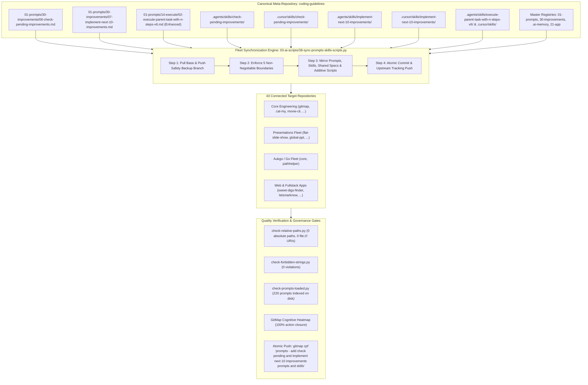
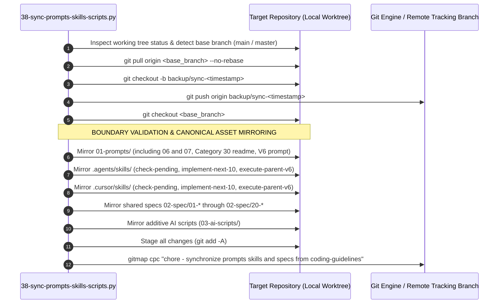
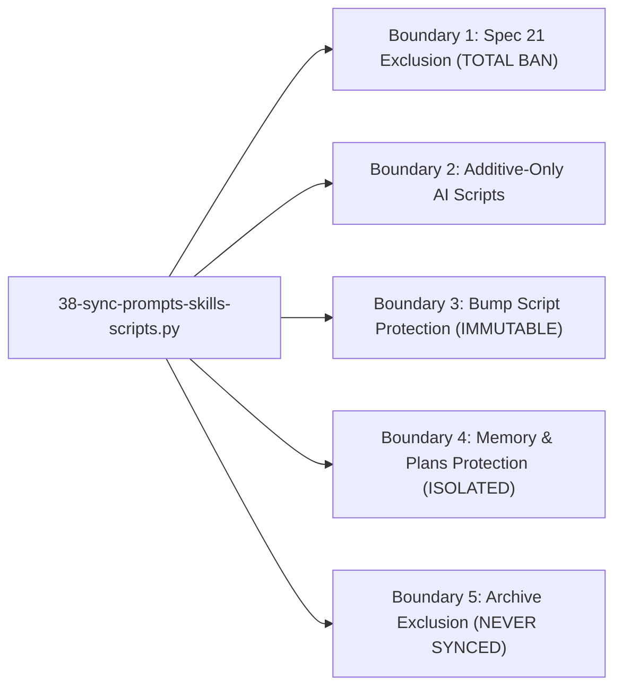
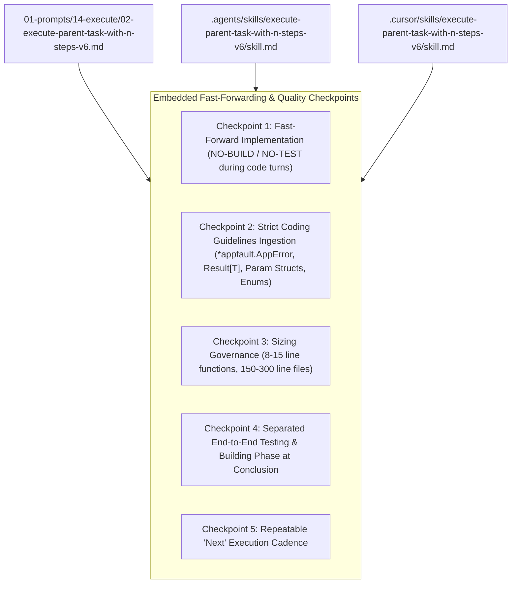
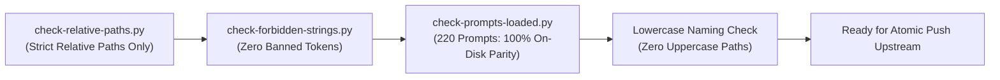
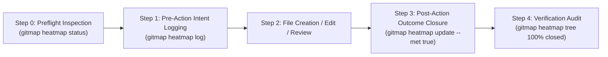

# Specification 03: Migration, Fleet Synchronization & Quality Verification

## 1. System Overview & Problem Statement

Task `05-improvements-folder-prompts` completes and operationalizes the Category `30-improvements` suite by introducing two foundational execution and monitoring prompts: `06-check-pending-improvements.md` and `07-implement-next-10-improvements.md`, accompanied by symmetric companion skills across Google Antigravity (`.agents/skills/`) and Cursor IDE (`.cursor/skills/`), cross-cutting enhancements to the canonical V6 Parent Task execution engine (`01-prompts/14-execute/02-execute-parent-task-with-n-steps-v6.md`), and comprehensive multi-repository synchronization across all 43 connected repositories.

### The Complete 7-Part Continuous Improvement & Fast-Forward Implementation Suite

With Prompts 06 and 07 integrated, Category `30-improvements` expands from a 5-part discovery, detailing, and ideation radar into a complete, self-sustaining 7-part operational lifecycle:

| Prompt Identifier | Canonical File Path | Domain Scope | Primary Responsibility |
| :--- | :--- | :--- | :--- |
| **Prompt 01** | `01-prompts/30-improvements/01-next-100-ui-improvements.md` | UI / UX / Styling / Tokens | Autonomous discovery and planning of 100 UI-level improvements across design token registries, typography clamp scales, WCAG AAA contrast, glassmorphic surfaces, and presenter HUDs. |
| **Prompt 02** | `01-prompts/30-improvements/02-next-100-code-improvements.md` | Codebase Quality & Hygiene | Autonomous discovery and planning of 100 code-level improvements enforcing monadic Result envelopes, domain `*appfault.AppError`, positive booleans, parameter structs, map dispatch tables, and value semantics. |
| **Prompt 03** | `01-prompts/30-improvements/03-next-100-whole-system-improvements.md` | Whole-System Architecture & DX | Autonomous discovery and planning of 100 whole-system improvements across 10 operational UX clusters: DX/CLI ergonomics, UI tokens, agent swarms, prompt architecture, fleet sync, code quality, performance, diagnostics, test isolation, and spec governance. |
| **Prompt 04** | `01-prompts/30-improvements/04-next-detail-out-100-improvements.md` | Multi-Step Plan Detailing | Multi-step detailing of active, pending, and completed plans into exhaustive review dockets with strict review-first gating, concrete blueprints, caller blast radius analysis, and binary verification criteria. |
| **Prompt 05** | `01-prompts/30-improvements/05-next-100-ideas-for-improvements.md` | Autonomous Ideation Flywheel | Autonomous discovery, structuring, and cataloging of the next 100 high-leverage innovation, product differentiation, automation, and architectural leap ideas for any target codebase. |
| **Prompt 06** | `01-prompts/30-improvements/06-check-pending-improvements.md` | Operational Backlog Visibility | Autonomous discovery and aggregation of pending improvements across `.ai-memory/plans/pending/`, `.ai-memory/plans/subtasks/`, and active roadmaps; generates comprehensive category scorecards, priority tiers, readiness scorecards, and exact pending counts. |
| **Prompt 07** | `01-prompts/30-improvements/07-implement-next-10-improvements.md` | Fast-Forward Implementation Engine | Consumes the next 10 pending improvements in a bounded micro-batch; applies surgical code changes enforcing strict coding guidelines (`*appfault.AppError`, `Result[T]`, parameter structs, string enums/constants, 8–15 line functions, 150–300 line files) under `NO-BUILD` / `NO-TEST` rules; repeats seamlessly on "next"; defers verification to a final dedicated E2E phase. |

### Symmetrical Companion Skills Architecture

Every prompt in Category `30-improvements` is paired symmetrically with native runtime skills across both Google Antigravity and Cursor IDE:

| Prompt Key | Antigravity Runtime Skill | Cursor IDE Runtime Skill | Invocation Slash Command |
| :--- | :--- | :--- | :--- |
| **Prompt 01** | `.agents/skills/next-100-ui-improvements/` | `.cursor/skills/next-100-ui-improvements/` | `/next-100-ui-improvements` |
| **Prompt 02** | `.agents/skills/next-100-code-improvements/` | `.cursor/skills/next-100-code-improvements/` | `/next-100-code-improvements` |
| **Prompt 03** | `.agents/skills/next-100-whole-system-improvements/` | `.cursor/skills/next-100-whole-system-improvements/` | `/next-100-whole-system-improvements` |
| **Prompt 04** | `.agents/skills/next-detail-out-100-improvements/` | `.cursor/skills/next-detail-out-100-improvements/` | `/next-detail-out-100-improvements` |
| **Prompt 05** | `.agents/skills/next-100-ideas-for-improvements/` | `.cursor/skills/next-100-ideas-for-improvements/` | `/next-100-ideas-for-improvements` |
| **Prompt 06** | `.agents/skills/check-pending-improvements/` | `.cursor/skills/check-pending-improvements/` | `/check-pending-improvements` |
| **Prompt 07** | `.agents/skills/implement-next-10-improvements/` | `.cursor/skills/implement-next-10-improvements/` | `/implement-next-10-improvements` |



### The Multi-Repository Fleet Distribution Challenge

When introducing new operational prompts, companion skills, and cross-cutting execution checkpoints into the central `coding-guidelines` meta-repository, distributing them across the 43 downstream repositories involves distinct operational requirements:

1. **Fast-Forwarding Implementation Alignment:** Downstream repositories executing autonomous improvement runs require a standardized protocol that suppresses intermediate compilation and test suite runs during coding micro-batches (`NO-BUILD`, `NO-TEST`), eliminating development friction while preserving strict coding standards (`*appfault.AppError`, `Result[T]`, parameter structs, enums, sizing limits).
2. **Catalog and Index Drift Elimination:** All master catalogs (`01-prompts/readme.md`, `01-prompts/30-improvements/readme.md`, `.ai-memory/prompts.md`, `.ai-memory/plans/readme.md`, `02-spec/21-app/readme.md`) must be synchronized so automated linter gates confirm 100% parity across disk and index representations.
3. **Boundary Integrity Preservation:** Synchronization scripts must never leak private application specifications (`02-spec/21-*` through `25-*`), overwrite customized downstream version bump routines (`bump*`, `version.json`), or overwrite operational task memory (`.ai-memory/plans/`, `.ai-memory/memory/`).
4. **Symmetric Dual-IDE Support:** Both Google Antigravity and Cursor IDE runtime skill trees must be updated in lockstep to avoid developer experience divergence across toolchains.

This specification details the end-to-end synchronization protocol, catalog update matrices, V6 parent task enhancement, and automated verification quality gates governing this rollout.

---

## 2. Fleet Synchronization Engine Mechanics & Implementation Contract

The propagation of the expanded Category 30 suite, companion skills, and V6 execution enhancements is automated via `03-ai-scripts/38-sync-prompts-skills-scripts.py` (mirrored in `.agents/scripts/38-sync-prompts-skills-scripts.py`).

### Lifecycle Sequence & Safety Protocol



### The 5 Non-Negotiable Boundaries

Under `AGENTS.md` Section 11, multi-repository synchronization across all 43 repositories must enforce the **5 Non-Negotiable Boundaries**:



#### Boundary 1: Spec 21 Exclusion (TOTAL BAN)
- **Mandate:** NEVER synchronize, copy, or touch `02-spec/21-*` through `02-spec/25-*` (private application specifications, issues, databases, UI designs, and specification audits). Only shared foundational specifications `02-spec/01-*` through `02-spec/20-*` are synchronized across repositories.
- **Engine Enforcement:** Function `is_spec_21(path)` evaluates whether any path segment contains `21-` through `29-` and blocks mirroring immediately.
- **Verification Rule:** Target repositories must contain 0 files matching `02-spec/21-*` through `02-spec/25-*`.

#### Boundary 2: Additive-Only AI Scripts
- **Mandate:** Brand-new AI scripts (`03-ai-scripts/`, `.agents/scripts/`) that do not exist in the target repository are copied cleanly. Existing scripts modified by or unique to the target repository must NEVER be overwritten.
- **Engine Enforcement:** Flag `is_additive_only=True` triggers git status and change-detection inspections before copying any script file.

#### Boundary 3: Bump Script Protection (IMMUTABLE)
- **Mandate:** NEVER overwrite version bump scripts, manifests, or configuration files (`bump*`, `bump_versions.py`, `bump-version.mjs`, `version.json`, `version.template.json`). Each repository maintains custom SemVer release targets, tagging logic, and build steps.
- **Engine Enforcement:** Function `is_bump_script(path)` intercepts all files containing `bump` or `version`.

#### Boundary 4: Memory & Plans Protection (TOTAL ISOLATION)
- **Mandate:** NEVER modify, sync, or mirror `.ai-memory/memory/`, `.ai-memory/plans/`, `.ai-memory/temp-agents/`, `.ai-memory/cicd-issues/`, or `.ai-memory/ambiguous-questions/`. Each repository independently owns its operational memory, backlog, and active subtasks.
- **Engine Enforcement:** Function `is_protected_memory_or_plan(path)` strictly rejects any target operational memory file or directory. Only canonical indices (`.ai-memory/prompts.md`, `.ai-memory/coding-guidelines.md`) are conditionally synchronized.

#### Boundary 5: Archive Exclusion
- **Mandate:** NEVER synchronize `06-archive/` or `06-old-prompts/`. Legacy archived materials reside exclusively in `coding-guidelines` for historical provenance.
- **Engine Enforcement:** Excluded via `EXCLUDE_NAMES` set. Stale archive directories in target repositories are automatically unlinked.

---

## 3. Target Repositories Catalog (43 Connected Repositories)

The synchronization routine propagates Prompts 06 and 07, their companion skills, and the V6 execution enhancements across all 43 connected repositories:

| Index | Repository Name | Relative Workspace Path | Tier / Ecosystem |
| :---: | :--- | :--- | :--- |
| 1 | `ai-empathy-prompt-tuner-v1` | `02-prompts/ai-empathy-prompt-tuner` | Prompts & AI Tuning |
| 2 | `alim-cv-v8` | `alim-cv` | Documentation & Portfolio |
| 3 | `alim-karim-profile-v2` | `alim-karim-profile` | Documentation & Portfolio |
| 4 | `alim.karim.profile` | `aukgit/alim.karim.profile` | Documentation & Portfolio |
| 5 | `Antigravity-Manager` | `antigravity-manager` | System & Developer Tools |
| 6 | `cat-my-v12` | `cat-my` | CLI & Developer Utilities |
| 7 | `core-v9` | `03-aukgo/core` | Aukgo / Go Shared Libraries |
| 8 | `digital-name-card` | `digital-name-card` | Web & Identity |
| 9 | `flat-slide-show` | `presentations-repos/flat-slide-show` | Presentations Engine |
| 10 | `gitlogger-new-v2` | `gitlogger-new` | Git & Telemetry Utilities |
| 11 | `gitmap-v28` | `gitmap` | GitMap Core Architecture |
| 12 | `global-ppt-v1` | `presentations-repos/global-ppt-v1` | Presentations Engine |
| 13 | `hiltrax-v1` | `presentations-repos/hiltrax` | Presentations Engine |
| 14 | `icon-coding-guidelines` | `icon-coding-guidelines` | Design & Visual Assets |
| 15 | `img-pdf-v2` | `img-pdf` | Image & Document Processing |
| 16 | `ki-health-ppt-v5` | `presentations-repos/ki-health-ppt` | Presentations Engine |
| 17 | `kubernetes-training-v1` | `aukgit/kubernetes-training` | Cloud & Infrastructure |
| 18 | `lara-licensing-v4` | `lara-licensing` | Licensing & Auth Services |
| 19 | `lara-publishing-v1` | `lara-publishing` | Publishing Framework |
| 20 | `laravel-automation-v1` | `laravel-automation` | Backend Automation |
| 21 | `letsmarknow-ui-v2` | `letsmarknow-ui` | Frontend Web UI |
| 22 | `letsmarknow-v2` | `letsmarknow` | Web Application Core |
| 23 | `macro-ahk-v55` | `macro-ahk` | Macro & Automation Engine |
| 24 | `maid-app-spec-presentation-v1` | `presentations-repos/maid-app-spec-presentation` | Presentations Engine |
| 25 | `movie-cli-v8` | `movie-cli` | CLI & Media Workflow |
| 26 | `pathhelper` | `03-aukgo/pathhelper` | Aukgo / Go Shared Libraries |
| 27 | `presentation-aug-2026-plans-alim` | `presentations-repos/presentation-aug-2026-plans-alim` | Presentations Engine |
| 28 | `prompts-connect-v3` | `02-prompts/prompts-connect` | Prompts & Workflow Utilities |
| 29 | `punam-case-studies-v1` | `punam-case-studies-v1` | Case Studies & Docs |
| 30 | `rasia-logo` | `presentations-repos/rasia-logo` | Design & Visual Assets |
| 31 | `scripts-fixer-v20` | `scripts-fixer` | Linter & Remediation Tools |
| 32 | `slides-spec` | `presentations-repos/slides-spec` | Presentations Engine |
| 33 | `spec-builder-v11` | `spec-builder` | Spec Architecture Scaffolding |
| 34 | `sweet-digs-finder` | `web-system/sweet-digs-finder` | Fullstack Web Application |
| 35 | `ui-prompts-cat` | `ui-prompts-cat` | UI & Prompt Engineering |
| 36 | `white-presentation-v1` | `presentations-repos/white-presentation-v1` | Presentations Engine |
| 37 | `workflowy-ui-v1` | `workflowy-ui` | Frontend Web UI |
| 38 | `workflowy-v3` | `workflowy` | Web Application Core |
| 39 | `wp-exam-v2` | `wp-exam` | WordPress Testing & Exam Engine |
| 40 | `wp-git-log-v3` | `wp-git-log` | WordPress Git Integration |
| 41 | `wp-html-automate` | `wp-html-automate` | WordPress HTML Utilities |
| 42 | `wp-link-manager-v5` | `wp-link-manager` | WordPress Link Architecture |
| 43 | `wp-onboarding-v17` | `wp-onboarding` | WordPress User Onboarding |

---

## 4. Master Catalog Update Matrices Across Documentation Roots

All central registries and catalogs across the repository must be synchronously updated to incorporate Prompts 06 and 07 and Task `05-improvements-folder-prompts`:

### 1. `01-prompts/30-improvements/readme.md` (Category 30 Catalog)

- **Directory Index & Catalog Table:**
  ```markdown
  | Prompt File | Version | Scope | Key Capabilities |
  | :--- | :--- | :--- | :--- |
  | [`01-next-100-ui-improvements.md`](01-next-100-ui-improvements.md) | V6 / 1.0.0 | UI/UX & Design Tokens | 100 UI-level UX improvements covering design token registries, typography clamp formulas, WCAG AAA contrast, glassmorphic depth, virtualized trees, and presenter HUDs. |
  | [`02-next-100-code-improvements.md`](02-next-100-code-improvements.md) | V6 / 1.0.0 | Codebase Quality & Hygiene | 100 codebase-level improvements enforcing monadic Result envelopes, domain `*appfault.AppError`, positive booleans, parameter structs, map dispatch tables, and value semantics. |
  | [`03-next-100-whole-system-improvements.md`](03-next-100-whole-system-improvements.md) | V6 / 1.0.0 | Whole-System Architecture | 100 whole-system improvements across 10 UX clusters: DX/CLI ergonomics, UI tokens, agent swarms, prompt architecture, fleet sync, code quality, performance, diagnostics, test isolation, and spec governance. |
  | [`04-next-detail-out-100-improvements.md`](04-next-detail-out-100-improvements.md) | V6 / 1.0.0 | Multi-Step Detailing & Review Dockets | Autonomously details out active, pending, and completed plans and discovered improvements into exhaustive multi-step execution roadmaps, structural contracts, dependency graphs, and review dockets with strict review-first gating (no immediate execution without user review). |
  | [`05-next-100-ideas-for-improvements.md`](05-next-100-ideas-for-improvements.md) | V6 / 1.0.0 | Autonomous Ideation Flywheel | Autonomous discovery, structuring, and cataloging of the next 100 high-leverage innovation, product differentiation, automation, and architectural leap ideas across 10 innovation clusters with continuous self-looping and pending plan enqueuing. |
  | [`06-check-pending-improvements.md`](06-check-pending-improvements.md) | V6 / 1.0.0 | Operational Backlog Visibility | Autonomous discovery, inventorying, and dashboard aggregation of pending improvements across `.ai-memory/plans/pending/`, `.ai-memory/plans/subtasks/`, and active roadmaps; surfaces category breakdown, priority tiers, readiness scorecards, and exact pending count. |
  | [`07-implement-next-10-improvements.md`](07-implement-next-10-improvements.md) | V6 / 1.0.0 | Fast-Forward Implementation Engine | Consumes next 10 pending improvements from backlog; applies surgical code changes enforcing strict coding guidelines (`*appfault.AppError`, `Result[T]`, parameter structs, string enums/constants, 8–15 line functions, 150–300 line files) under `NO-BUILD` / `NO-TEST` rules; repeats on "next"; defers verification to separate end-to-end testing phase. |
  ```

- **Directory Tree Update:**
  ```text
  01-prompts/30-improvements/
  ├── 01-next-100-ui-improvements.md
  ├── 02-next-100-code-improvements.md
  ├── 03-next-100-whole-system-improvements.md
  ├── 04-next-detail-out-100-improvements.md
  ├── 05-next-100-ideas-for-improvements.md
  ├── 06-check-pending-improvements.md
  ├── 07-implement-next-10-improvements.md
  └── readme.md
  ```

- **Companion Skills Table:**
  ```markdown
  | Companion Skill | Runtime Environment | Path | Slash Command |
  | :--- | :--- | :--- | :--- |
  | `next-100-ui-improvements` | Antigravity / Cursor | `.agents/skills/next-100-ui-improvements/`<br/>`.cursor/skills/next-100-ui-improvements/` | `/next-100-ui-improvements` |
  | `next-100-code-improvements` | Antigravity / Cursor | `.agents/skills/next-100-code-improvements/`<br/>`.cursor/skills/next-100-code-improvements/` | `/next-100-code-improvements` |
  | `next-100-whole-system-improvements` | Antigravity / Cursor | `.agents/skills/next-100-whole-system-improvements/`<br/>`.cursor/skills/next-100-whole-system-improvements/` | `/next-100-whole-system-improvements` |
  | `next-detail-out-100-improvements` | Antigravity / Cursor | `.agents/skills/next-detail-out-100-improvements/`<br/>`.cursor/skills/next-detail-out-100-improvements/` | `/next-detail-out-100-improvements` |
  | `next-100-ideas-for-improvements` | Antigravity / Cursor | `.agents/skills/next-100-ideas-for-improvements/`<br/>`.cursor/skills/next-100-ideas-for-improvements/` | `/next-100-ideas-for-improvements` |
  | `check-pending-improvements` | Antigravity / Cursor | `.agents/skills/check-pending-improvements/`<br/>`.cursor/skills/check-pending-improvements/` | `/check-pending-improvements` |
  | `implement-next-10-improvements` | Antigravity / Cursor | `.agents/skills/implement-next-10-improvements/`<br/>`.cursor/skills/implement-next-10-improvements/` | `/implement-next-10-improvements` |
  ```

### 2. `01-prompts/readme.md` (Master Prompts Catalog)

- **Table of Categories Update (Category 30 Row):**
  ```markdown
  | **30** | `30-improvements/` | `01-next-100-ui-improvements.md`, `02-next-100-code-improvements.md`, `03-next-100-whole-system-improvements.md`, `04-next-detail-out-100-improvements.md`, `05-next-100-ideas-for-improvements.md`, `06-check-pending-improvements.md`, `07-implement-next-10-improvements.md` | Autonomous continuous improvement, ideation, backlog visibility, and fast-forward implementation suite covering UI, codebase quality, whole-system UX, review dockets, pending counts, and bounded 10-item execution loops without intermediate builds/tests |
  ```

- **Directory Tree Section Update:**
  ```text
  └── 30-improvements/
      ├── 01-next-100-ui-improvements.md
      ├── 02-next-100-code-improvements.md
      ├── 03-next-100-whole-system-improvements.md
      ├── 04-next-detail-out-100-improvements.md
      ├── 05-next-100-ideas-for-improvements.md
      ├── 06-check-pending-improvements.md
      ├── 07-implement-next-10-improvements.md
      └── readme.md
  ```

### 3. `.ai-memory/prompts.md` (Operational Memory Prompts Matrix)

- **Category 30 Entries (including Prompts 06 and 07):**
  ```markdown
  | `30-improvements` | [`30-improvements/01-next-100-ui-improvements.md`](../01-prompts/30-improvements/01-next-100-ui-improvements.md) | Next 100 UI Improvements — Autonomous UI Discovery & Planning Flywheel (slug: `next-100-ui-improvements`, invoke: `/next-100-ui-improvements`) |
  | `30-improvements` | [`30-improvements/02-next-100-code-improvements.md`](../01-prompts/30-improvements/02-next-100-code-improvements.md) | Next 100 Code Improvements — Autonomous Code Quality & Guideline Flywheel (slug: `next-100-code-improvements`, invoke: `/next-100-code-improvements`) |
  | `30-improvements` | [`30-improvements/03-next-100-whole-system-improvements.md`](../01-prompts/30-improvements/03-next-100-whole-system-improvements.md) | Next 100 Whole System Improvements — Full-System Architecture & DX Flywheel (slug: `next-100-whole-system-improvements`, invoke: `/next-100-whole-system-improvements`) |
  | `30-improvements` | [`30-improvements/04-next-detail-out-100-improvements.md`](../01-prompts/30-improvements/04-next-detail-out-100-improvements.md) | Next Detail Out 100 Improvements — Multi-Step Detailing & Review-First Gate (slug: `next-detail-out-100-improvements`, invoke: `/next-detail-out-100-improvements`) |
  | `30-improvements` | [`30-improvements/05-next-100-ideas-for-improvements.md`](../01-prompts/30-improvements/05-next-100-ideas-for-improvements.md) | Next 100 Ideas for Improvements — Autonomous Ideation Flywheel & High-Leverage Innovation Engine (slug: `next-100-ideas-for-improvements`, invoke: `/next-100-ideas-for-improvements`) |
  | `30-improvements` | [`30-improvements/06-check-pending-improvements.md`](../01-prompts/30-improvements/06-check-pending-improvements.md) | Check Pending Improvements — Operational Backlog Dashboard & Pending Count (slug: `check-pending-improvements`, invoke: `/check-pending-improvements`) |
  | `30-improvements` | [`30-improvements/07-implement-next-10-improvements.md`](../01-prompts/30-improvements/07-implement-next-10-improvements.md) | Implement Next 10 Improvements — Fast-Forward Implementation Engine & Coding Guideline Guardrails (slug: `implement-next-10-improvements`, invoke: `/implement-next-10-improvements`) |
  | `30-improvements` | [`30-improvements/readme.md`](../01-prompts/30-improvements/readme.md) | Improvements Prompts (`30-improvements`) — Index & Catalog |
  ```

- **Disk-to-Index Parity Target:** Total prompt files on disk = `220`. Index must reference all 220 files with 0 orphan prompts and 0 dangling references.

### 4. `.ai-memory/plans/readme.md` (Plans Index)

- **Pending Plans Section Entry:**
  ```markdown
  - [05-improvements-folder-prompts.md](pending/05-improvements-folder-prompts.md): Check pending improvements dashboard prompt, implement next 10 improvements fast-forwarding engine, companion skills across Antigravity and Cursor, V6 parent task execution checkpoints, master catalog updates, and multi-repository synchronization across 43 connected repositories.
  ```

### 5. `02-spec/21-app/readme.md` (Application Specifications Index)

- **Active Contents Table Entry:**
  ```markdown
  | [`05-improvements-folder-prompts/`](05-improvements-folder-prompts/) | Improvements Folder Prompts: Check Pending & Implement Next 10 Improvements Spec, Skills & Fleet Sync | Active Task Spec | Active |
  ```

---

## 5. V6 Parent Task Synchronization & Cross-Prompt Governance

To ensure seamless coordination between continuous improvement workflows and general autonomous execution, canonical checkpoints must be incorporated into the master V6 Parent Task execution prompt (`01-prompts/14-execute/02-execute-parent-task-with-n-steps-v6.md`) and mirrored symmetrically in `.agents/skills/execute-parent-task-with-n-steps-v6/skill.md` and `.cursor/skills/execute-parent-task-with-n-steps-v6/skill.md`:



### Specific Checkpoints Integrated into V6:

1. **Fast-Forward Implementation Invariant (`NO-BUILD`, `NO-TEST`):**  
   During active worker implementation turns, autonomous subagents MUST NOT invoke compiler builds, unit test suites, or package test runners. Code modifications proceed rapidly without intermediate build-break friction.
2. **Mandatory Coding Guideline Standards Enforced During Implementation:**
   - **Error Management:** Zero orphaned errors. All fallible operations must return structured `*appfault.AppError` types and wrap errors in monadic `Result[T]` envelopes where required.
   - **Parameter Structs:** Prohibit loose parameters exceeding 2–3 arguments; group parameters into dedicated `*Params` or `Config` structs.
   - **String Constants & Dynamic Enums:** All string literals, action types, status tokens, and dictionary keys must use defined constants or typed enums.
   - **Function Sizing:** Keep function lengths within 8–15 lines. Extract discrete helper functions, validators, and transformers.
   - **File Sizing:** Restrict source file lengths to 150–300 lines. Decompose oversized modules into focused domain files.
3. **Separated End-to-End Testing & Build Verification Gate:**  
   Compilation, linters, and end-to-end testing are strictly quarantined to a single, dedicated verification phase executed after all implementation micro-batches are complete. This guarantees fast execution without compromising final delivery quality.
4. **Repeatable "Next" Execution Rhythm:**  
   Enable worker waves to execute bounded 10-item micro-batches sequentially, advancing automatically when commanded with "next" while maintaining an immutable execution ledger.

---

## 6. Quality Verification Gates & Linter Matrix

Before declaring completion or executing the final atomic push, four automated quality gates must be validated with zero errors:



### 1. Relative Paths Verification (`linter-scripts/check-relative-paths.py`)
- **Execution Command:**
  ```bash
  python linter-scripts/check-relative-paths.py
  ```
- **Rule:** Absolute filesystem paths (`C:\`, `/home/`, `/absolute/path/`) and absolute file URIs (`file:///...`) are strictly banned across all markdown and repository files (`AGENTS.md` Section 5).
- **Pass Threshold:** 0 violations.

### 2. Forbidden Strings Verification (`linter-scripts/check-forbidden-strings.py`)
- **Execution Command:**
  ```bash
  python linter-scripts/check-forbidden-strings.py
  ```
- **Rule:** Validates files against `linter-scripts/forbidden-strings.toml`, prohibiting forbidden template placeholders, raw secrets, unescaped tokens, and malformed links.
- **Pass Threshold:** 0 violations.

### 3. Prompts Loaded Contract (`linter-scripts/check-prompts-loaded.py`)
- **Execution Command:**
  ```bash
  python linter-scripts/check-prompts-loaded.py
  ```
- **Rule:** Every prompt file residing in `01-prompts/` (total 220 files with Prompts 06 and 07 added) must have a valid, active entry in `.ai-memory/prompts.md`. No orphan prompt files on disk, and no dangling references in the index.
- **Pass Threshold:** Exit code `0` (PASS — index matches disk prompts directory exactly).

### 4. Filename Convention Verification
- **Rule:** All newly created or modified files and directories must adhere to strictly lowercase naming (`AGENTS.md` Section 4).
- **Pass Threshold:** 0 uppercase characters in any path segment.

---

## 7. GitMap Cognitive Heatmap Telemetry Protocol

In compliance with `AGENTS.md` Section 15, all file operations, specification actions, and verification gates must be tracked via the GitMap Cognitive Heatmap engine:



### Cognitive Logging Lifecycle

1. **Step 0 Preflight Inspection:**
   ```bash
   gitmap heatmap status --task "05-improvements-folder-prompts"
   gitmap heatmap tables
   ```

2. **Pre-Action Intent Logging:**
   Before creating or editing any deliverable file:
   ```bash
   gitmap heatmap log --task "05-improvements-folder-prompts" --action "CREATE" --file "<relative-path>" --state "EXECUTION" --expected "<expected-deliverable-goal>"
   ```

3. **Post-Action Outcome Closure:**
   Immediately following completion of each action:
   ```bash
   gitmap heatmap update --id "<action-id>" --outcome "<verified-outcome-summary>" --met true
   ```

4. **Phase 3 Verification Audit:**
   ```bash
   gitmap heatmap tree --task "05-improvements-folder-prompts"
   gitmap heatmap status --task "05-improvements-folder-prompts"
   ```
   *Pass Threshold:* 100% action closure (`met=true`). Zero unclosed or dangling entries.

---

## 8. Release Ceremony & Final Atomic Commit Syntax

Under `AGENTS.md` Section 10 and Section 13 ('No Push = Not Done'):

### 1. Preflight Working Tree Checklist
- Verify `01-prompts/30-improvements/06-check-pending-improvements.md` and `07-implement-next-10-improvements.md` exist and contain complete instructions.
- Verify `.agents/skills/check-pending-improvements/skill.md`, `.cursor/skills/check-pending-improvements/skill.md`, `.agents/skills/implement-next-10-improvements/skill.md`, and `.cursor/skills/implement-next-10-improvements/skill.md` exist symmetrically.
- Verify `01-prompts/14-execute/02-execute-parent-task-with-n-steps-v6.md` and companion skills contain enhanced fast-forwarding and coding guideline checkpoints.
- Verify all 5 master catalogs (`01-prompts/30-improvements/readme.md`, `01-prompts/readme.md`, `.ai-memory/prompts.md`, `.ai-memory/plans/readme.md`, `02-spec/21-app/readme.md`) are updated.
- Verify all linters pass with exit code 0 (`check-relative-paths.py`, `check-forbidden-strings.py`, `check-prompts-loaded.py`).
- Verify `03-ai-scripts/38-sync-prompts-skills-scripts.py` ran cleanly across all 43 repositories.

### 2. Atomic Commit & Push Syntax
Execute the atomic commit and push upstream following strict GitMap hyphen formatting:

```bash
gitmap cpf "prompts - add check pending and implement next 10 improvements prompts and skills"
```

> [!CAUTION]
> **Total Ban on Colons in Commit Messages:**  
> In all GitMap commit commands (`gitmap cpf`, `gitmap cpb`, `gitmap cpc`, `gitmap cpr`), NEVER include colons inside the message argument. GitMap automatically provides structured prefixes (`Feature: `, `Bug: `, `chore: `). Format messages strictly with hyphens (e.g. `prompts - add check pending and implement next 10 improvements prompts and skills`).

### 3. Upstream Completion Invariant
- Verify that the commit is successfully pushed to the GitHub upstream tracking branch (`origin/main` or `origin/master`).
- Verify that the local working tree is completely clean (`gitmap status`).
- A task is strictly INCOMPLETE and NOT DONE until this upstream push is confirmed.
