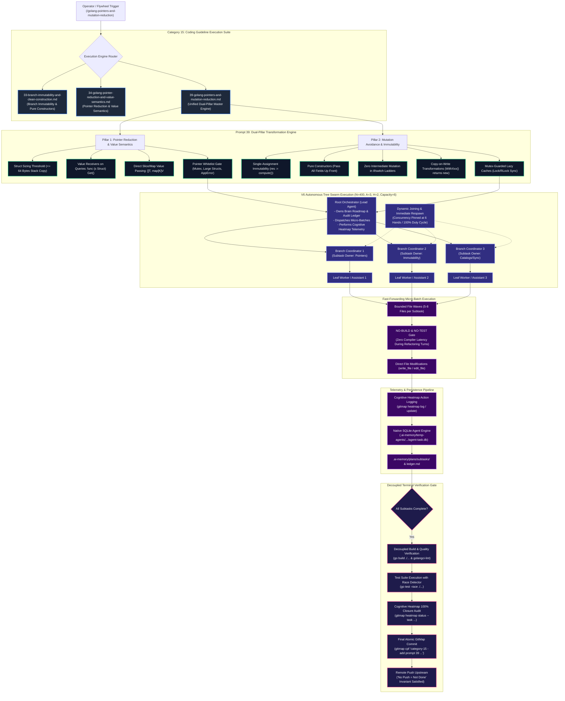

# Specification 01: Golang Pointer Reduction & Mutation Avoidance — Architecture, Systems Rationale & Swarm Execution Spec

## 1. Executive Summary & Problem Statement

### 1.1 The Operational Context: Elevating Golang Engineering in Category 15
Category `15-cg-execute` serves as the repository's canonical fleet of autonomous coding standard execution engines. Within large-scale distributed systems and CLI developer toolings written in Go (such as GitMap, appfault, streamwriter, and fileutil), subtle anti-patterns in memory management and state mutation compound into severe architectural liabilities over time.

To address these challenges at root level, this specification establishes the authoritative systems architecture, design rationale, and operational continuum for adding **Prompt 39** (`39-golang-pointers-and-mutation-reduction.md`) to `01-prompts/15-cg-execute/`, along with its symmetric IDE companions:
- Antigravity IDE Skill: `.agents/skills/cg-golang-pointers-and-mutation-reduction/skill.md`
- Cursor IDE Skill: `.cursor/skills/cg-golang-pointers-and-mutation-reduction/skill.md`

Prompt 39 unifies and elevates two foundational architectural concerns—**Pointer Elimination / Value Semantics** and **Mutation Avoidance / Branch Immutability**—into an integrated, production-grade autonomous execution engine adhering strictly to `execute-parent-task-with-n-steps-v6`.

---

### 1.2 The Architectural Problem: Memory Overhead & State Volatility

Golang codebases developed under traditional OOP or C/C++ mental models frequently suffer from dual architectural failure modes:

#### 1.2.1 Problem Part A: Excessive Pointer Usage (`*T`) & Heap Escape Explosion
In Go, indiscriminate use of pointers (`*Struct`, `*[]T`, `*map[K]V`, pointer receivers on simple queries) introduces critical runtime inefficiencies:
1. **Unnecessary Heap Escapes & GC Thrashing:**
   When a variable is passed or returned as a pointer, the Go compiler's escape analysis frequently cannot prove its lifetime is bounded to the calling stack frame. The variable escapes to the heap, incurring allocation overhead and dramatically increasing Garbage Collector (GC) mark-sweep pause times and CPU pacing cycles.
2. **CPU Cache Misses & Pointer Chasing:**
   Value types placed contiguously in memory (or within the function stack frame) maximize L1/L2 cache line locality. Pointers introduce indirection ("pointer chasing"), causing CPU cache line invalidations and stalling modern superscalar pipelines.
3. **Nil-Pointer Dereference Panic Hazards:**
   Every pointer receiver, parameter, or struct field represents an unverified tri-state: uninitialized/nil, valid, or dangling. This forces repetitive defensive boilerplate (`if s == nil`) or leaves applications vulnerable to catastrophic runtime panics.
4. **Pointer-to-Reference Redundancy:**
   Passing pointers to reference types (e.g. `*[]string`, `*map[string]int`, `*chan Event`) is fundamentally redundant. Slices (24 bytes: pointer, length, capacity) and maps (8 bytes: pointer to `hmap`) are already lightweight header structs designed for direct stack value copying.

#### 1.2.2 Problem Part B: In-Place Mutation & Branch Re-Assignment Fragility
In-place variable mutation and delayed post-construction field mutation introduce severe cognitive and operational risks:
1. **Hidden Race Conditions:**
   When multiple goroutines or asynchronous routines retain references to a mutable struct, in-place field updates (`cfg.Port = 8080`) trigger data races, corrupt memory, or demand complex locking semantics that degrade throughput.
2. **Branch Re-Assignment & Partial Initialization:**
   Mutating a variable across deep `if-else if` ladders or `switch` statements means the variable passes through inconsistent, half-initialized intermediate states. If an early return or error branch is taken, callers receive corrupt or partially assembled objects.
3. **High Cognitive Load & Non-Deterministic Dataflow:**
   When functions mutate their input parameters in place rather than returning fresh values, caller code cannot predict whether its data structures remain intact without reading the full callee implementation.

---

### 1.3 The Combined Dual Solution: Value Semantics & Pure Immutability

Prompt 39 resolves both vectors through a unified, complimentary dual-pillar architecture:

```text
+--------------------------------------------------------------------------------------------------+
|                            GO ARCHITECTURAL EXCELLENCE CONTINUUM                                 |
+-------------------------------------------------+------------------------------------------------+
|       PILLAR 1: VALUE SEMANTICS & ESCAPES       |      PILLAR 2: IMMUTABILITY & CONSTRUCTORS     |
+-------------------------------------------------+------------------------------------------------+
| - Small structs (<= 64B) copied on stack        | - Single-assignment immutability (:= once)     |
| - Value receivers for read-only queries         | - Pure constructors (buildXxx/NewXxx)          |
| - Slices & maps passed directly by value        | - Zero intermediate mutation across branches   |
| - Whitelist-only pointer justification          | - Copy-on-write functional transformations     |
| - Zero heap escapes & L1 cache line locality    | - Mutex-synchronized thread-safe caches        |
+-------------------------------------------------+------------------------------------------------+
```

1. **Pillar 1 (Pointer Reduction & Value Semantics):**
   Prioritizes stack allocation and value semantics for all small data transfer objects, domain records, configuration structs, and query receivers. Restricts pointers strictly to a proven, whitelisted set of operational necessities (such as concurrency primitives and structured error envelopes).
2. **Pillar 2 (Mutation Avoidance & Immutability):**
   Enforces single-assignment immutability, pure constructors passing all fields up front, zero intermediate variable mutation across conditional branches, and copy-on-write functional transformations for evolving state.

---

## 2. Mermaid Architecture Diagram

The following diagram models the end-to-end architecture, from operator invocation through the dual-pillar transformation engine, the Tree Swarm concurrent execution lifecycle, and the decoupled terminal verification gate:



---

## 3. Pillar 1: Pointer Reduction & Value Semantics Architecture

### 3.1 The 64-Byte Stack Threshold Rule
In Golang's 64-bit runtime architecture, stack allocation is virtually instantaneous: it increments a stack pointer register, avoiding heap metadata tracking, garbage collector scan phases, and write barriers.
- **Rule:** Any struct with an aggregate memory footprint of **64 bytes or fewer** (equivalent to 8 64-bit words, e.g. 8 pointers/integers, or 2 strings, or 1 string + 1 slice + 2 ints) MUST be passed and returned as a direct value (`Struct`), never as a pointer (`*Struct`), unless explicitly whitelisted under Section 3.4.
- **Copy Cost Reality:** Copying 64 bytes on modern x86-64 / ARM64 processors requires only 1 to 4 L1 cache-resident register moves, which is orders of magnitude faster than a single heap pointer indirection resulting in a main memory cache miss.

### 3.2 Value Receivers on Query & Read-Only Methods
Method receivers dictate the memory semantics of object-oriented Go code:
- **Anti-Pattern:** Blindly declaring `func (s *User) FullName() string` when `FullName` does not mutate `User`. This forces callers who have a value `User` to address-take `&u`, frequently causing `u` to escape to the heap.
- **Standard:** All read-only queries, formatters, calculators, validators, and inspection methods MUST use value receivers:
  ```go
  // CORRECT: Value receiver on read-only query
  func (c Config) ServerAddress() string {
      return c.Host + ":" + strconv.Itoa(c.Port)
  }

  func (s SessionContext) IsAuthenticated() bool {
      return s.UserID != ""
  }
  ```

### 3.3 Direct Reference Type Passing (Slices and Maps)
A common anti-pattern among engineers migrating from C++ is passing pointers to slices (`*[]T`) or maps (`*map[K]V`) "to save memory":
- **Internal Structure:**
  - Slice header: 24 bytes (`[ Data unsafe.Pointer, Len int, Cap int ]`).
  - Map header: 8 bytes (`*hmap` pointer wrapper).
- **Rule:** Slices and maps MUST ALWAYS be passed and returned by value directly (`items []string`, `lookup map[string]int`). Passing `*[]T` or `*map[K]V` adds a layer of pointer indirection without saving any allocation overhead, and is strictly prohibited unless resizing a slice header across the call boundary is fundamentally necessary.

### 3.4 Strict Pointer Justification Whitelist
Pointers (`*T`) are not banned unconditionally; rather, every pointer in a Go codebase MUST be justified by one of the following five operational criteria:

| Whitelist Criterion | Permissible Syntax | Rationale & Mechanical Reason |
| :--- | :--- | :--- |
| **W1: Concurrency Primitives** | `type SafeCache struct { mu sync.Mutex ... }`<br/>`func (c *SafeCache) Put(...)` | `sync.Mutex` and `sync.RWMutex` contain atomic CPU memory locks and MUST NEVER be copied by value. |
| **W2: State Mutation Receivers** | `func (b *Buffer) Write(p []byte) (int, error)` | Methods that genuinely modify internal receiver state require pointer receivers to mutate caller state. |
| **W3: Tri-State Nilability** | `type PatchRequest struct { Active *bool }` | Where `nil` represents "field omitted / do not update", distinct from `false`. |
| **W4: Structured AppError Envelopes** | `func Validate() *appfault.AppError` | Standardized Go failure envelope compliant with `appfault.AppError` contract. |
| **W5: Large Memory Structs** | `type MasterReport struct { ... 50 fields ... }` | Structs exceeding 128 bytes where stack copy overhead demonstrably exceeds pointer dereference cost. |

---

## 4. Pillar 2: Mutation Avoidance & Immutability Architecture

### 4.1 Single-Assignment Immutability
Variables that change values multiple times during function execution create tracking confusion and race hazards:
- **Anti-Pattern:** Declaring a bare variable with `var x Type` and re-assigning it 4 times through an imperative algorithm.
- **Standard:** Variables must be declared and initialized simultaneously using single-assignment (`x := compute()`). If a value transforms, declare a new, descriptively named immutable variable (`rawConfig` -> `validatedConfig` -> `activeConfig`).

### 4.2 Pure Constructor Functions
Post-construction field mutation is a major source of bugs:
```go
// ANTI-PATTERN: Partial construction followed by field mutation
u := &User{}
u.ID = "u-123"
u.Name = "Alice"
u.Roles = []string{"admin"}
```
- **Standard:** Structs must be constructed fully formed in a single pure expression, either via direct struct literals or through pure constructor helpers (`buildXxx` / `newXxx`):
```go
// CORRECT: Fully formed construction
u := User{
    ID:    "u-123",
    Name:  "Alice",
    Roles: []string{"admin"},
}
```

### 4.3 Zero Intermediate Mutation Across Branch Ladders
Chained `if-else if` and `switch` statements must not mutate an accumulator in each branch:
- **Anti-Pattern:**
  ```go
  var label string
  if code == 200 {
      label = "OK"
  } else if code == 404 {
      label = "Not Found"
  } else {
      label = "Unknown"
  }
  ```
- **Standard:** Eliminate intermediate mutation by returning directly from dedicated pure helper functions or using declarative map lookups:
  ```go
  // CORRECT: Direct functional return
  func resolveStatusLabel(code int) string {
      switch code {
      case 200:
          return "OK"
      case 404:
          return "Not Found"
      default:
          return "Unknown"
      }
  }
  ```

### 4.4 Copy-on-Write Functional Transformations
When an existing struct must produce an altered state, do not mutate the receiver in place. Return a newly constructed instance with the target modifications applied:
```go
// CORRECT: Functional copy-on-write transformation
func (s SessionContext) WithTenant(tenantID string) SessionContext {
    return SessionContext{
        UserID:   s.UserID,
        TenantID: tenantID,
        Roles:    s.Roles,
        IssuedAt: s.IssuedAt,
    }
}
```

### 4.5 Mutex-Guarded Unavoidable State (Lazy Caches & Buffers)
Where state mutation cannot be avoided (e.g. in-memory LRU caches, lazy-loaded configuration buffers, or metric counters), all access and mutation must be encapsulated behind strict synchronization primitives:
- Caches must use `sync.RWMutex` with clear `RLock()` (for queries) and `Lock()` (for mutations).
- Mutex-protected state MUST expose safe value-copy accessors (e.g., `GetLinesLock()`) so callers receive immutable copies of internal data buffers.

---

## 5. Execution Pattern Architecture (`execute-parent-task-with-n-steps-v6`)

Prompt 39 strictly implements the V6 autonomous execution engine. This architecture guarantees high throughput, deterministic progress tracking, and zero agent stalling.

### 5.1 Concurrency Parameters ($N = 400$, $A = 3$, $H = 2$, Capacity = 6)
- **Step Budget ($N = 400$):** A comprehensive 400-step execution envelope:
  - Phase 1 (Steps 1–100): Planning, discovery subagents, codebase AST scan, struct sizing audit, mutation hotspots identification, brain roadmap creation.
  - Phase 2 (Steps 101–250): Intermediate specification, catalog updates, prerequisite refactoring, bounded 5–8 file micro-batch dispatch.
  - Phase 3 (Steps 251–400): Parallel tree swarm execution, dynamic join saturation, decoupled terminal verification, atomic commit and upstream push.
- **Subagents ($A = 3$):** Exactly 3 concurrent autonomous subagents spawned via `invoke_subagent`. Solo lead execution is an auto-reject failure.
- **Hands ($H = 2$):** Dual-task processing capacity per agent, maintaining **System Concurrency Capacity = 6**.
- **Dynamic Join Protocol:** As soon as any worker completes its assigned subtask, the orchestrator immediately respawns a replacement or commands the worker to dynamically join an active subtask to assist with companion linting and memory persistence (100% duty cycle, zero idle capacity).

### 5.2 Tree Swarm Hierarchy
```text
                  +-----------------------------------+
                  |      Root Orchestrator (Lead)     |
                  |  - Unified Roadmap & Ledger Owner |
                  |  - Heatmap Telemetry Controller   |
                  |  - Final Atomic Commit & Push     |
                  +-----------------+-----------------+
                                    |
          +-------------------------+-------------------------+
          |                         |                         |
+---------v---------+     +---------v---------+     +---------v---------+
| Branch Coord 1    |     | Branch Coord 2    |     | Branch Coord 3    |
| (Subtask Owner:   |     | (Subtask Owner:   |     | (Subtask Owner:   |
| Pointers & Size)  |     | Immutability)     |     | Catalogs & Sync)  |
+---------+---------+     +---------+---------+     +---------+---------+
          |                         |                         |
+---------v---------+     +---------v---------+     +---------v---------+
| Leaf Worker 1     |     | Leaf Worker 2     |     | Leaf Worker 3     |
| (Micro-Batch A)   |     | (Micro-Batch B)   |     | (Micro-Batch C)   |
+-------------------+     +-------------------+     +-------------------+
```

### 5.3 Fast-Forwarding Micro-Batches & Strict NO-BUILD / NO-TEST
During active refactoring waves:
- Codebases are partitioned into bounded micro-batches of **5 to 8 files**.
- **Strict Rule R1 (NO-BUILD & NO-TEST):** Workers NEVER execute compiler checks (`go build`) or test suites (`go test`) during intermediate refactoring turns. Running compilers between edits causes high latency, lock contention, and thrashing.
- Changes are applied directly and surgically using `write_file` and `edit_file`.

### 5.4 Decoupled Terminal Verification Gate
Verification is completely decoupled from active refactoring:
1. Once all micro-batch subtasks are marked `[DONE]`, the Root Orchestrator triggers the Terminal Verification Gate.
2. Full repository build: `go build ./...` across all packages.
3. Race detector test execution: `go test -race ./...`.
4. Static analysis and guideline linting: `golangci-lint run`.
5. Cognitive Heatmap telemetry closure audit: `gitmap heatmap status --task <slug>` ensuring 100% action closure.

### 5.5 Cognitive Heatmap Telemetry
All operations emit native cognitive action telemetry to SQLite (`heatmap.db`):
- **Pre-Action Intent:** `gitmap heatmap log --task <task> --action <ACTION> --file <path> --state <STATE> --expected "<goal>"`
- **Post-Action Closure:** `gitmap heatmap update --id <id> --outcome "<outcome>" --met true`
- **Verification Audit:** `gitmap heatmap tree --task <task>` validates that every cognitive action was satisfied before final commit.

---

## 6. Synergistic Continuum in Category 15 (`15-cg-execute`)

Prompt 39 synthesizes and builds upon the specialized prompts of Category 15:

| Prompt Filename | Primary Scope | Granular Focus | Relationship to Prompt 39 |
| :--- | :--- | :--- | :--- |
| `33-branch-immutability-and-clean-construction.md` | Polyglot Immutability | Eliminating mutation across `if`/`switch` ladders, decomposing compound booleans, extracting pure `buildXxx` constructors. | Serves as the conceptual foundation for Pillar 2; Prompt 39 tailors these rules specifically to Go idioms and type systems. |
| `34-golang-pointer-reduction-and-value-semantics.md` | Golang Pointers | Heap escape minimization, 64-byte struct sizing threshold, value receivers on read-only queries. | Serves as the conceptual foundation for Pillar 1; Prompt 39 integrates this with immutability rules. |
| `39-golang-pointers-and-mutation-reduction.md` | **Unified Go Master Engine** | **Synthesizes both Pillar 1 (Value Semantics) and Pillar 2 (Mutation Avoidance) into a unified, battle-tested execution prompt and companion skills.** | **The canonical, comprehensive execution engine governing all memory and state architecture across Go repositories.** |

---

## 7. Non-Negotiable Invariants & Architectural Governance

| Invariant ID | Rule Description | Architectural Enforcement Mechanism |
| :--- | :--- | :--- |
| **INV-01** | **Strict Relative Git Paths** | Total ban on absolute filesystem paths (`C:\...`, `/home/...`) and `file:///` URIs across all specs, subtasks, prompts, and notes. |
| **INV-02** | **Strict Lowercase File Naming** | All directories, markdown files, and scripts use strictly lowercase characters without exception. |
| **INV-03** | **Zero Git Command Rule for Workers** | Subagents never execute git commands (`git add`, `git commit`, `git push`, `git status`). Git lifecycle is reserved strictly for lead. |
| **INV-04** | **Fast-Forwarding Micro-Batching** | Refactoring partitioned into 5–8 file batches with strict NO-BUILD and NO-TEST during editing turns. |
| **INV-05** | **Decoupled Verification Gate** | Compilers, race detectors, and linters run only after all editing subtasks achieve completion. |
| **INV-06** | **Cognitive Heatmap 100% Closure** | All cognitive actions must be logged before file access and verified closed via `gitmap heatmap status`. |
| **INV-07** | **No Push = Not Done** | Task is only complete when committed via `gitmap cpf` (hyphen format) and pushed upstream to tracking branch. |

---

## 8. Conclusion

This architecture specification provides the complete conceptual and operational blueprint for `06-cg-execute-golang-pointers-and-mutation-reduce`. By pairing value semantics with branch immutability under the proven V6 Tree Swarm execution framework, Go codebases achieve maximum memory efficiency, zero unnecessary heap escapes, predictable dataflow, and rock-solid thread safety.
