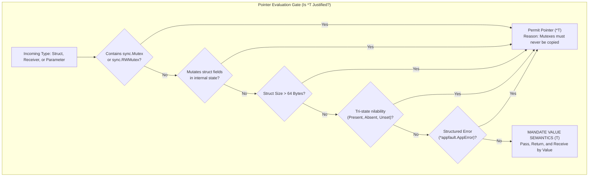
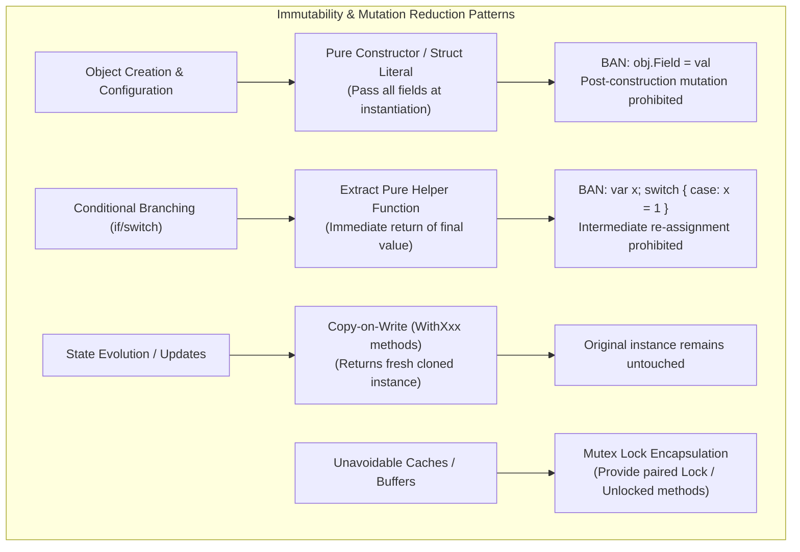

# Specification 02: Golang Pointer Reduction & Mutation Avoidance — Component Specification, Transformation Rules & Skill Schemas

**Version:** 1.0.0  
**Status:** ACTIVE  
**Parent Plan:** `.ai-memory/plans/pending/06-cg-execute-golang-pointers-and-mutation-reduce.md`  
**Architecture Spec:** `02-spec/21-app/06-cg-execute-golang-pointers-and-mutation-reduce/01-architecture-spec.md`  
**Target Prompts:**
- `01-prompts/15-cg-execute/39-golang-pointers-and-mutation-reduction.md`
- `01-prompts/15-cg-execute/readme.md` (Registry update)
**Target Skills:**
- `.agents/skills/cg-golang-pointers-and-mutation-reduction/skill.md`
- `.cursor/skills/cg-golang-pointers-and-mutation-reduction/skill.md`
**Applicability:** Universal across Go packages, CLI binaries, runtime libraries, and connected fleet repositories.

---

## 1. Executive Summary & Component Scope

This component specification defines the definitive technical requirements, structural schemas, execution parameters, code transformation rules, and companion skill contracts for **Prompt 39** (`39-golang-pointers-and-mutation-reduction.md`) and its symmetric IDE companion skills.

Prompt 39 integrates two foundational principles of modern Go systems programming into a unified, autonomous execution engine:
1. **Pointer Reduction & Value Semantics:** Eliminating unnecessary pointer indirection (`*T`), heap escapes, CPU cache thrashing, and nil-pointer panic surfaces by favoring stack-allocated value types.
2. **Mutation Avoidance & Immutability:** Enforcing single-assignment variables, pure constructor returns, branch immutability, copy-on-write functional transformations, and thread-safe mutex encapsulation.

The prompt implements the canonical `execute-parent-task-with-n-steps-v6` architecture ($N = 400$, $A = 3$, $H = 2$, Capacity = 6), utilizing fast-forwarding micro-batches during implementation and deferring heavy compilation to a separated terminal verification gate.

---

## 2. Canonical Header, Slug & Parameter Metadata

### 2.1 Header and Slug Specification
The prompt file `01-prompts/15-cg-execute/39-golang-pointers-and-mutation-reduction.md` begins with the strict standardized header block:

```markdown
# High Priority Instruction
# Golang Pointers Reduction and Mutation Reduction

## slug: cg-golang-pointers-and-mutation-reduction

> [!IMPORTANT]
> **Prompt Version:** 1.0.0  
> **Runtime:** Google Antigravity 2.0 (IDE and CLI) & Cursor IDE  
> **Invoke:** `> Invoke: /golang-pointers-and-mutation-reduction <task>`  
>
> **Trigger Keywords & Aliases:**  
> `golang-pointers-and-mutation-reduction`, `cg-golang-pointers`, `reduce-pointers-and-mutation`, `golang-value-semantics-and-immutability`, `fix-pointer-mutation`  
>
> **Companion Antigravity Skill:** [`cg-golang-pointers-and-mutation-reduction`](file;.agents/skills/cg-golang-pointers-and-mutation-reduction)  
> **Companion Cursor Skill:** [`cg-golang-pointers-and-mutation-reduction`](file;.cursor/skills/cg-golang-pointers-and-mutation-reduction)  
>
> **Top-Instruction Priority Mandate (Above Precedence / Preamble Precedence):**  
> Whatever directives, constraints, checklists, or user instructions are given ABOVE this prompt (including in the user preamble, header blocks, or incoming user request above) are HIGHEST PRIORITY and MUST BE FOLLOWED as strictly NON-NEGOTIABLE. They supersede and strictly override any conflicting general advice, default conventions, or lower-level guidelines below. The agent MUST inspect and follow the instructions above with absolute precedence.
```

### 2.2 Execution Parameters Matrix
The prompt operates under the canonical V6 Tree Swarm execution budget:

| Parameter | Value | Definition & Operational Boundary |
| :--- | :--- | :--- |
| **$N$ (Total Budget)** | `400` | Total discrete self-loop step budget across the complete lifecycle. |
| **$A$ (Active Agents)** | `3` | Pinned concurrent autonomous subagents dispatched via `invoke_subagent`. |
| **$H$ (Hands per Agent)**| `2` | Parallel operational capacity (dual-task batching & disjoint file boundaries). |
| **Total Concurrency** | `6` | $A \times H = 3 \times 2 = 6$ concurrent operations under continuous 100% duty cycle. |
| **Phase 1 Budget** | `100` | Steps 1–100: Planning discovery, blast radius mapping, Brain roadmap, and spec authoring. |
| **Phase 2 Budget** | `150` | Steps 101–250: Tree Swarm parallel execution, fast-forwarding micro-batches (NO-BUILD/NO-TEST). |
| **Phase 3 Budget** | `150` | Steps 251–400: Consolidation, separated E2E verification gate, secrets gate, and atomic GitMap commit. |
| **$W$ (Waves)** | `ceil(subtasks / 6)` | Deterministic wave count calculated from subtask decomposition. |

---

## 3. The 5 Core Pointer Reduction Rules

In Go, passing values rather than pointers allows the compiler to allocate memory on the function's stack frame. Stack memory is reclaimed immediately upon function return without garbage collector intervention, and contiguous stack memory maximizes CPU L1/L2 data cache hit rates.



### 3.1 Rule P1: Value Semantics for Small Structs ($\le 64$ Bytes)
**Principle:** Small structs whose fields total 64 bytes or fewer (the standard size of a modern 64-bit CPU cache line) must always be passed as values `T` and returned as values `T`, never as pointers `*T`.

```go
// ❌ WRONG: Passing and returning small structs as pointers escapes to heap
type Point struct {
    X int64 // 8 bytes
    Y int64 // 8 bytes
} // Total: 16 bytes <= 64 bytes

func NewPoint(x, y int64) *Point {
    return &Point{X: x, Y: y} // Heap escape!
}

func CalculateDistance(p1, p2 *Point) float64 {
    if p1 == nil || p2 == nil { // Nil-check boilerplate
        return 0.0
    }
    dx := float64(p1.X - p2.X)
    dy := float64(p1.Y - p2.Y)
    return math.Sqrt(dx*dx + dy*dy)
}
```

```go
// ✅ CORRECT: Pure value semantics. Zero heap allocation, zero nil danger.
type Point struct {
    X int64
    Y int64
} // Total: 16 bytes

func NewPoint(x, y int64) Point {
    return Point{
        X: x,
        Y: y,
    }
}

func CalculateDistance(p1, p2 Point) float64 {
    dx := float64(p1.X - p2.X)
    dy := float64(p1.Y - p2.Y)

    return math.Sqrt(dx*dx + dy*dy)
}
```

### 3.2 Rule P2: Value Receivers on Read-Only / Query Methods
**Principle:** Methods that inspect, calculate, format, or query struct state without mutating fields must use a value receiver `func (s MyStruct) Query() Result[T]`. Pointer receivers `func (s *MyStruct)` are strictly prohibited on query methods because they imply mutable state and prevent callers with value instances from invoking them without taking addresses.

```go
// ❌ WRONG: Pointer receiver on a pure query method
type TokenClaims struct {
    Subject   string
    ExpiresAt int64
    Issuer    string
}

func (c *TokenClaims) IsExpired(now int64) bool {
    if c == nil {
        return true
    }
    return now > c.ExpiresAt
}
```

```go
// ✅ CORRECT: Value receiver on pure query method
type TokenClaims struct {
    Subject   string
    ExpiresAt int64
    Issuer    string
}

func (c TokenClaims) IsExpired(now int64) bool {
    return now > c.ExpiresAt
}
```

### 3.3 Rule P3: Pure Slice (`[]T`) and Map (`map[K]V`) Parameter Passing
**Principle:** In Go, slices are 24-byte header structs (pointer to backing array, length, and capacity), and maps are single-pointer descriptors (pointing to runtime `hmap`). Passing a pointer to a slice (`*[]T`) or pointer to a map (`*map[K]V`) introduces double-pointer indirection, dereference syntax noise, and heap escape risks. Slices and maps must always be passed and returned directly by value.

```go
// ❌ WRONG: Pointer to slice and pointer to map
func FilterPrefix(items *[]string, prefix string) *[]string {
    if items == nil {
        return nil
    }
    result := make([]string, 0, len(*items))
    for _, item := range *items {
        if strings.HasPrefix(item, prefix) {
            result = append(result, item)
        }
    }
    return &result
}

func MergeCounts(target *map[string]int, source map[string]int) {
    if target == nil || *target == nil {
        return
    }
    for k, v := range source {
        (*target)[k] += v
    }
}
```

```go
// ✅ CORRECT: Slices and maps passed directly by value
func FilterPrefix(items []string, prefix string) []string {
    result := make([]string, 0, len(items))

    for _, item := range items {
        if strings.HasPrefix(item, prefix) {
            result = append(result, item)
        }
    }

    return result
}

func MergeCounts(target map[string]int, source map[string]int) map[string]int {
    for k, v := range source {
        target[k] += v
    }

    return target
}
```

### 3.4 Rule P4: Value-Based Small Parameter Structs
**Principle:** Parameter structs (`Params`) grouping 3 or more arguments to prevent parameter bloat should be passed by value when their size is $\le 64$ bytes. This eliminates nil checks on parameter objects and allows the Go compiler to pass struct fields directly in CPU registers (under Go 1.17+ register-based ABI).

```go
// ❌ WRONG: Pointer to small parameter struct requires nil check
type FetchParams struct {
    Timeout    time.Duration // 8 bytes
    MaxRetries int           // 8 bytes
    IsVerbose  bool          // 1 byte
} // 24 bytes with alignment

func ExecuteQuery(ctx context.Context, query string, params *FetchParams) Result[Response] {
    if params == nil {
        params = &FetchParams{Timeout: 5 * time.Second, MaxRetries: 3}
    }
    // Execution logic...
}
```

```go
// ✅ CORRECT: Parameter struct passed by value
type FetchParams struct {
    Timeout    time.Duration
    MaxRetries int
    IsVerbose  bool
}

func ExecuteQuery(ctx context.Context, query string, params FetchParams) Result[Response] {
    // Guaranteed non-nil, zero heap escape, fields in CPU registers
    client := buildClient(params.Timeout)

    return client.Run(ctx, query)
}
```

### 3.5 Rule P5: The Pointer Justification Whitelist
**Principle:** Pointers (`*T`) are NOT globally banned; they are strictly restricted to proven, legitimate architectural requirements. A pointer is justified **only** when one or more of the following conditions hold:

| Whitelist Criterion | Technical Rationale | Permitted Syntax |
| :--- | :--- | :--- |
| **1. Concurrency Primitives** | Structs embedding `sync.Mutex`, `sync.RWMutex`, or `sync.WaitGroup` cannot be copied after first use (violates Go lock invariants). | `func (m *SafeCache) Read() Val` |
| **2. Stateful Mutation Methods** | Methods whose intentional purpose is mutating the internal state of the receiver struct. | `func (b *Buffer) Write(p []byte)` |
| **3. Large Structs (> 64 Bytes)** | Structs containing large fixed arrays or many fields where copying overhead exceeds pointer dereference cost. | `func ProcessBuffer(buf *LargeFrame)` |
| **4. Tri-State Nilability** | Optional parameters or JSON payloads where `nil` denotes "unset / omitted" vs zero value. | `type PatchRequest struct { Name *string }` |
| **5. Standard Error Types** | Structured errors implementing the `appfault.AppError` standard. | `func Run() *appfault.AppError` |

---

## 4. The 5 Core Mutation Reduction Rules

In-place mutation introduces cognitive overhead, temporal coupling, and concurrency hazards. When state can mutate anywhere at any time, understanding a function requires mentally simulating all execution paths. Immutability ensures that objects are always completely valid from the moment of construction.



### 4.1 Rule M1: Single-Assignment Immutability
**Principle:** Variables must be declared and initialized in a single atomic assignment (`:=`). Re-assigning a variable after initialization is prohibited unless accumulating data within an explicit loop.

```go
// ❌ WRONG: Variable declared with zero-value, then mutated across statements
var formatted string
if isVerbose {
    formatted = fmt.Sprintf("[DEBUG] %s", msg)
} else {
    formatted = fmt.Sprintf("[INFO] %s", msg)
}
```

```go
// ✅ CORRECT: Single-assignment immutability via immediate initialization or pure helper
prefix := formatPrefix(isVerbose)
formatted := fmt.Sprintf("[%s] %s", prefix, msg)

// ✅ ALSO CORRECT: Pure helper returning complete value
formatted := buildFormattedMessage(isVerbose, msg)
```

### 4.2 Rule M2: Pure Construction & Zero Post-Construction Field Mutation
**Principle:** Objects must be completely initialized at construction time. Creating an empty or default object and subsequently mutating its fields (`obj.Field = x`) is strictly banned. Pass all required values directly to pure constructors or struct literals.

```go
// ❌ WRONG: Post-construction field mutation
func InitServer(port int, host string) ServerConfig {
    cfg := NewDefaultConfig()
    cfg.Port = port
    cfg.Host = host
    cfg.IsActive = true
    return cfg
}
```

```go
// ✅ CORRECT: Direct complete struct literal
func InitServer(port int, host string) ServerConfig {
    return ServerConfig{
        Port:     port,
        Host:     host,
        IsActive: true,
        Timeout:  30 * time.Second,
    }
}

// ✅ ALSO CORRECT: Pure constructor accepting all mandatory parameters
func InitServer(port int, host string) ServerConfig {
    return NewServerConfig(port, host, true, 30*time.Second)
}
```

### 4.3 Rule M3: Zero Intermediate Variable Mutation Across Branch Ladders
**Principle:** Banned intermediate variable mutation across `switch` statements, `if-else if` ladders, or loop iterations. Instead of declaring a mutable accumulator variable before a branch and assigning to it inside each case, return immediately from each branch or delegate to a pure mapper.

```go
// ❌ WRONG: Intermediate variable mutated across switch cases
func DetermineHandler(kind string) Handler {
    var selected Handler

    switch kind {
    case "json":
        selected = NewJSONHandler()
    case "yaml":
        selected = NewYAMLHandler()
    default:
        selected = NewDefaultHandler()
    }

    return selected
}
```

```go
// ✅ CORRECT: Direct immediate return from each branch
func DetermineHandler(kind string) Handler {
    switch kind {
    case "json":
        return NewJSONHandler()

    case "yaml":
        return NewYAMLHandler()

    default:
        return NewDefaultHandler()
    }
}
```

### 4.4 Rule M4: Copy-on-Write / Functional Transformation Patterns
**Principle:** When an existing immutable configuration or record needs modification, methods must return a new copy with the updated field rather than mutating the receiver in place.

```go
// ❌ WRONG: In-place mutation method modifies receiver state
type RequestOptions struct {
    Timeout time.Duration
    Headers map[string]string
}

func (o *RequestOptions) SetTimeout(t time.Duration) {
    o.Timeout = t // Mutates caller's instance!
}
```

```go
// ✅ CORRECT: Copy-on-write functional update returning a new immutable instance
type RequestOptions struct {
    Timeout time.Duration
    Headers map[string]string
}

func (o RequestOptions) WithTimeout(t time.Duration) RequestOptions {
    o.Timeout = t // Modifies local stack copy only

    return o
}

func (o RequestOptions) WithHeader(key, val string) RequestOptions {
    newHeaders := make(map[string]string, len(o.Headers)+1)
    for k, v := range o.Headers {
        newHeaders[k] = v
    }
    newHeaders[key] = val
    o.Headers = newHeaders

    return o
}
```

### 4.5 Rule M5: Synchronized Mutex Encapsulation for Unavoidable Mutable State
**Principle:** When mutable state is architecturally unavoidable (e.g. high-performance caches, ring buffers, write streamers), the mutable state must be completely encapsulated behind private fields and accessed exclusively through synchronized mutex locks. Provide paired public locked methods and private lockless primitives:

```go
// ✅ CORRECT: Thread-safe mutex encapsulation with paired methods
type SessionCache struct {
    sync.RWMutex
    entries map[string]SessionData
}

func NewSessionCache() *SessionCache {
    return &SessionCache{
        entries: make(map[string]SessionData),
    }
}

// Public locked accessor: safe for external concurrent consumption
func (c *SessionCache) GetSessionLock(id string) (SessionData, bool) {
    c.RLock()
    defer c.RUnlock()

    return c.getSession(id)
}

// Private unlocked helper: for internal composition under an already-acquired lock
func (c *SessionCache) getSession(id string) (SessionData, bool) {
    entry, hasEntry := c.entries[id]

    return entry, hasEntry
}
```

---

## 5. V6 Execute Prompt Structure: Section 4 Integration Schema

In the canonical `01-prompts/15-cg-execute/39-golang-pointers-and-mutation-reduction.md` prompt, Section 4 is the dedicated rules engine placed between Section 3 (GitMap High-Speed Command Primacy) and Section 5 (Step 0: Preflight, Platform Handshake & SQLite Task DB Initialization).

The prompt file must embed the following structured Section 4 definition:

```markdown
## 4. Golang Pointer Reduction & Mutation Safety Rules Engine

This execution engine rigorously scans and refactors Go source files to eliminate pointer overhead and in-place variable mutation.

### 4.1 Pointer Reduction Directives (Cite by ID: P1–P5)
- **P1 Stack Value Sizing:** Structs with memory footprints <= 64 bytes MUST be passed and returned as value types `T`. Never return `*T` unless explicitly justified by P5.
- **P2 Value Receivers for Queries:** Any method that does not modify receiver fields MUST use a value receiver `func (s Struct) Method()`. Pointer receivers on query methods are strictly banned.
- **P3 Slice & Map Value Semantics:** Slices (`[]T`) and maps (`map[K]V`) are lightweight header descriptors. NEVER pass or return pointers to slices (`*[]T`) or maps (`*map[K]V`).
- **P4 Value Parameter Structs:** Small parameter structs (`*Params` <= 64 bytes) MUST be passed as values `Params`, eliminating nil-pointer checks and enabling register passing.
- **P5 Whitelist Justification:** Pointers (`*T`) are permitted ONLY for:
  1. Concurrency primitives (`sync.Mutex`, `sync.RWMutex`).
  2. Stateful mutation methods where receiver modification is intentional.
  3. Large structs exceeding 64 bytes where copying overhead is measurable.
  4. Tri-state nilability (optional/omitted JSON fields).
  5. Standard structured errors (`*appfault.AppError`).

### 4.2 Mutation Reduction Directives (Cite by ID: M1–M5)
- **M1 Single-Assignment:** Initialize variables upon declaration in one atomic statement. Banned re-assignment outside of explicit aggregation loops.
- **M2 Pure Construction:** Ban post-construction field mutation (`obj := New(); obj.Field = val`). Pass all values directly into constructors or struct literals.
- **M3 Branch Immutability:** Ban mutable intermediate variables across `switch` or `if-else if` ladders. Return values directly from branch arms or extract pure mapper functions.
- **M4 Copy-on-Write:** Methods updating struct state must return a fresh copy (`func (s Config) WithTimeout(...) Config`) rather than mutating the receiver.
- **M5 Synchronized Encapsulation:** Unavoidable mutable state (caches, buffers) MUST be encapsulated behind mutexes, providing paired locked methods (`GetLinesLock()`) and private unlocked helpers.
```

---

## 6. Symmetric Companion Skill Schemas

Prompt 39 requires two companion skill files providing progressive disclosure for AI agents:
1. Antigravity Skill: `.agents/skills/cg-golang-pointers-and-mutation-reduction/skill.md`
2. Cursor IDE Skill: `.cursor/skills/cg-golang-pointers-and-mutation-reduction/skill.md`

### 6.1 Antigravity Companion Skill Schema
The Antigravity skill file uses the mandatory `.agents/skills/` directory structure and IDE link syntax `[skill](file;.agents/skills/skill)`:

```markdown
---
name: cg-golang-pointers-and-mutation-reduction
description: Autonomously audits, refactors, and migrates Golang codebases to value semantics and immutability, eliminating unnecessary pointers (*T), heap escapes, nil hazards, and in-place variable mutations using a 400-step 3-phase self-loop.
---

# Golang Pointers Reduction and Mutation Reduction Skill

> [!IMPORTANT]
> **Skill Identifier:** `.agents/skills/cg-golang-pointers-and-mutation-reduction/skill.md`  
> **Master Prompt:** `01-prompts/15-cg-execute/39-golang-pointers-and-mutation-reduction.md`  
> **Invoke Command:** `> Invoke: /golang-pointers-and-mutation-reduction <task>`  
> **Antigravity Skill Link:** [`cg-golang-pointers-and-mutation-reduction`](file;.agents/skills/cg-golang-pointers-and-mutation-reduction)  

## Operational Directives
When invoked to optimize Go memory management or clean up variable mutations:
1. Enforce the 5 Pointer Reduction Rules:
   - Small structs (<= 64B) passed and returned by value `T`.
   - Read-only query methods use value receiver `func (s Struct) Query()`.
   - Slices and maps passed directly by value (no `*[]T` or `*map[K]V`).
   - Small parameter structs passed by value `Params`.
   - Whitelist validation for permitted pointers (`sync.Mutex`, mutators, `*appfault.AppError`).
2. Enforce the 5 Mutation Reduction Rules:
   - Single-assignment variables.
   - Pure constructor returns and struct literals; zero post-construction field updates.
   - Zero intermediate variable mutation across branch ladders.
   - Copy-on-Write functional updates (`WithXxx()`).
   - Mutex synchronization for unavoidable mutable state (`GetLinesLock()`).
3. Adhere to the V6 Swarm Protocol ($N = 400$, $A = 3$, $H = 2$, Capacity = 6). Fast-forward during Phase 2 editing waves (NO-BUILD / NO-TEST). Verify completely at Phase 3.
```

### 6.2 Cursor Companion Skill Schema
The Cursor skill file mirrors the Antigravity skill but targets `.cursor/skills/` and uses Cursor's IDE link syntax `[skill](file;.cursor/skills/skill)`:

```markdown
---
name: cg-golang-pointers-and-mutation-reduction
description: Autonomously audits, refactors, and migrates Golang codebases to value semantics and immutability, eliminating unnecessary pointers (*T), heap escapes, nil hazards, and in-place variable mutations using a 400-step 3-phase self-loop.
---

# Golang Pointers Reduction and Mutation Reduction Skill (Cursor IDE)

> [!IMPORTANT]
> **Skill Identifier:** `.cursor/skills/cg-golang-pointers-and-mutation-reduction/skill.md`  
> **Master Prompt:** `01-prompts/15-cg-execute/39-golang-pointers-and-mutation-reduction.md`  
> **Invoke Command:** `> Invoke: /golang-pointers-and-mutation-reduction <task>`  
> **Cursor Skill Link:** [`cg-golang-pointers-and-mutation-reduction`](file;.cursor/skills/cg-golang-pointers-and-mutation-reduction)  

## Operational Directives
[Mirrors operational directives of Antigravity skill with Cursor-specific tool bindings]
```

---

## 7. Concrete Production Transformation Case Studies

### 7.1 Case Study 1: CLI Configuration & Options Refactoring
Refactoring an option parser from mutable pointer patterns to immutable value semantics:

#### Before Refactoring:
```go
package config

import "time"

type ClientOptions struct {
    Endpoint string
    Timeout  time.Duration
    Retries  int
    Debug    bool
}

func DefaultOptions() *ClientOptions {
    return &ClientOptions{
        Endpoint: "https://api.internal.net",
        Timeout:  10 * time.Second,
        Retries:  3,
        Debug:    false,
    }
}

func (o *ClientOptions) ApplyOverrides(endpoint string, debug bool) {
    if endpoint != "" {
        o.Endpoint = endpoint
    }
    o.Debug = debug
}

func (o *ClientOptions) GetEndpoint() string {
    if o == nil {
        return ""
    }
    return o.Endpoint
}
```

#### After Refactoring (100% Guideline Compliant):
```go
package config

import "time"

// Size: 16 (string) + 8 (Duration) + 8 (int) + 1 (bool) = 33 bytes <= 64 bytes
type ClientOptions struct {
    Endpoint string
    Timeout  time.Duration
    Retries  int
    IsDebug  bool
}

func DefaultOptions() ClientOptions {
    return ClientOptions{
        Endpoint: "https://api.internal.net",
        Timeout:  10 * time.Second,
        Retries:  3,
        IsDebug:  false,
    }
}

// Copy-on-write functional transformation
func (o ClientOptions) WithEndpoint(endpoint string) ClientOptions {
    if endpoint != "" {
        o.Endpoint = endpoint
    }

    return o
}

func (o ClientOptions) WithDebug(isDebug bool) ClientOptions {
    o.IsDebug = isDebug

    return o
}

// Pure value receiver query
func (o ClientOptions) Endpoint() string {
    return o.Endpoint
}
```

---

### 7.2 Case Study 2: Repository Scanner & File Metadata Extraction
Refactoring a file inventory scanner to eliminate slice pointers and post-construction mutations:

#### Before Refactoring:
```go
package scanner

import "os"

type FileMeta struct {
    Path string
    Size int64
    Mode os.FileMode
}

func ScanDirectory(dir string) (*[]*FileMeta, error) {
    entries, err := os.ReadDir(dir)
    if err != nil {
        return nil, err
    }

    var results []*FileMeta
    for _, entry := range entries {
        meta := new(FileMeta)
        meta.Path = entry.Name()
        info, _ := entry.Info()
        meta.Size = info.Size()
        meta.Mode = info.Mode()
        results = append(results, meta)
    }

    return &results, nil
}
```

#### After Refactoring (100% Guideline Compliant):
```go
package scanner

import (
    "os"
    "path/filepath"
    "pkg/appfault"
    "pkg/result"
)

type FileMeta struct {
    Path string
    Size int64
    Mode os.FileMode
}

func ScanDirectory(dir string) result.Result[[]FileMeta] {
    entries, err := os.ReadDir(dir)
    if err != nil {
        return result.Fail[[]FileMeta](appfault.Wrap(err, "ScanDirectory", "failed to read directory"))
    }

    results := make([]FileMeta, 0, len(entries))

    for _, entry := range entries {
        info, err := entry.Info()
        if err != nil {
            continue
        }

        // Pure constructor literal; zero post-construction mutation
        results = append(results, FileMeta{
            Path: filepath.Join(dir, entry.Name()),
            Size: info.Size(),
            Mode: info.Mode(),
        })
    }

    return result.Ok(results)
}
```

---

## 8. Verification & Acceptance Criteria

Every implementation of Prompt 39 and companion skills must satisfy the following deterministic acceptance criteria:

| Check ID | Verification Assertion | Pass Requirement |
| :--- | :--- | :--- |
| **AC-01** | Header slug format | Line matches `## slug: cg-golang-pointers-and-mutation-reduction`. |
| **AC-02** | Parameter specification | Defines $N=400, A=3, H=2, \text{Capacity}=6$. |
| **AC-03** | 5 Pointer Reduction Rules | P1 through P5 fully articulated with Before/After code blocks. |
| **AC-04** | 5 Mutation Reduction Rules | M1 through M5 fully articulated with Before/After code blocks. |
| **AC-05** | Section 4 V6 prompt integration | Section 4 schema ready for clean insertion into prompt 39. |
| **AC-06** | Companion skills link syntax | Antigravity uses `[skill](file;.agents/skills/...)`; Cursor uses `[skill](file;.cursor/skills/...)`. |
| **AC-07** | Strict relative Git paths | 100% relative paths; 0 absolute paths; 0 `file:///` URIs. |
| **AC-08** | Lowercase file naming | All paths strictly lowercase. |
| **AC-09** | Fast-forwarding invariants | Explicit NO-BUILD and NO-TEST execution during Phase 2 micro-batches. |
| **AC-10** | Separated E2E gate | Full build/test suite deferred strictly to Phase 3 terminal gate. |
