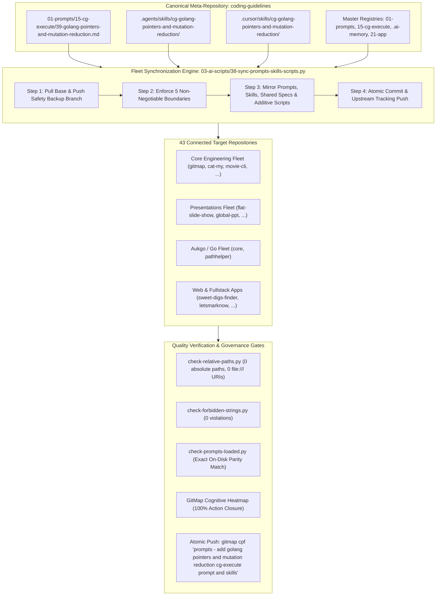
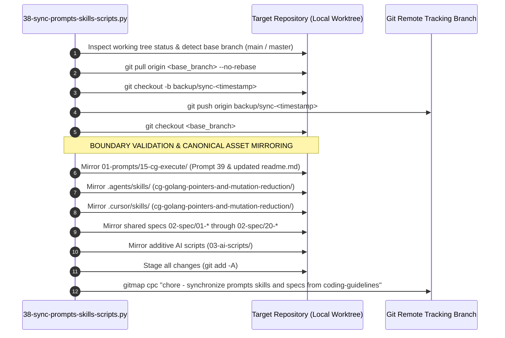
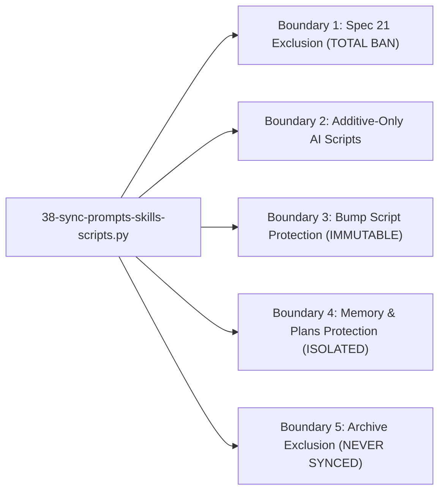
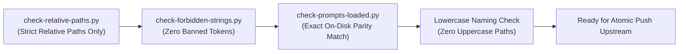
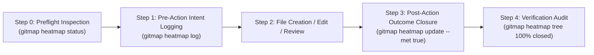

# Specification 03: Migration, Fleet Synchronization & Quality Verification

## 1. System Overview & Problem Statement

Task `06-cg-execute-golang-pointers-and-mutation-reduce` establishes canonical prompt 39 in Category `15-cg-execute`: `39-golang-pointers-and-mutation-reduction.md`, accompanied by symmetrical companion skills across Google Antigravity (`.agents/skills/cg-golang-pointers-and-mutation-reduction/`) and Cursor IDE (`.cursor/skills/cg-golang-pointers-and-mutation-reduction/`), comprehensive master catalog registrations, and automated multi-repository fleet synchronization across all 43 connected repositories.

### The Golang Pointer Reduction & Mutation Elimination Continuum

Category `15-cg-execute` provides granular, automated rule enforcement prompts across codebases. Prior prompts laid initial groundwork for value semantics and branch immutability:
- **Prompt 33 (`33-branch-immutability-and-clean-construction.md`):** Focused on branch immutability, banning object field mutation across conditional ladders and enforcing pure constructor helpers.
- **Prompt 34 (`34-golang-pointer-reduction-and-value-semantics.md`):** Focused on reducing pointer usage and enforcing value semantics for small structs.

Prompt 39 (`39-golang-pointers-and-mutation-reduction.md`) unifies, hardens, and operationalizes these paradigms into a production-grade, authoritative execution engine operating under the canonical V6 Tree Swarm architecture ($N = 400$, $A = 3$, $H = 2$, Capacity = 6). It enforces:

1. **Strict Value Semantics for Small Structs:** Structs $\le 64$ bytes (or containing primitive value fields) must be passed and returned by value rather than pointer (`*T`), eliminating unnecessary heap escapes, garbage collector overhead, and pointer indirection.
2. **Read-Only / Query Receiver Semantics:** Methods that inspect or query state without mutating fields must declare value receivers (`func (s Struct) Method()`) rather than pointer receivers (`func (s *Struct) Method()`).
3. **Pure Slice and Map Parameter Passing:** Slices (`[]T`) and maps (`map[K]V`) are already runtime reference descriptors; wrapping them in pointers (`*[]T`, `*map[K]V`) is strictly banned.
4. **Single-Assignment Immutability:** Variables and configuration objects must be initialized once upon declaration, eliminating reassignment and mutating setup steps.
5. **Zero Post-Construction Field Mutation:** Modifying object fields after construction (`s.Field = x`) is strictly prohibited; all initial values must be provided directly to pure constructors or struct literals.
6. **Zero Intermediate Variable Mutation Across Branch Ladders:** Calculating values by mutating a shared variable across `if-else if` or `switch` branches is banned; branches must return computed values directly or use declarative map dispatch tables.
7. **Copy-on-Write Transformations:** Operations that transform state must return a newly constructed instance containing updated fields, preserving original instance immutability.
8. **Mutex-Protected Lazy State:** Unavoidable mutable state (such as lazily populated caches or line buffers) must be encapsulated and protected behind dedicated mutex locks (e.g. `GetLinesLock()`).
9. **Pointer Justification Whitelist:** Pointers are restricted to four strict cases:
   - Structs embedding `sync.Mutex` or `sync.RWMutex` (which must never be copied by value).
   - Methods that explicitly mutate internal struct state.
   - Tri-state nilable fields where `nil` conveys distinct domain meaning (e.g., unset vs default).
   - Structured error returns returning `*appfault.AppError`.

### Symmetrical Companion Skills Architecture

Prompt 39 is paired symmetrically with native runtime skills across both Google Antigravity and Cursor IDE:

| Prompt Key | Antigravity Runtime Skill | Cursor IDE Runtime Skill | Invocation Slash Command |
| :--- | :--- | :--- | :--- |
| **Prompt 39** | `.agents/skills/cg-golang-pointers-and-mutation-reduction/` | `.cursor/skills/cg-golang-pointers-and-mutation-reduction/` | `/golang-pointers-and-mutation-reduction` |



---

## 2. Fleet Synchronization Engine Mechanics & Implementation Contract

The propagation of Prompt 39, its companion skills, and supporting shared specifications across all 43 connected repositories is executed via `03-ai-scripts/38-sync-prompts-skills-scripts.py` (and mirrored in `.agents/scripts/38-sync-prompts-skills-scripts.py`, also referenced as `38-sync-prompts-scripts.py`).

### Lifecycle Sequence & Pre-Change Safety Protocol

To guarantee zero regression risk and full auditability during multi-repository rollouts, the synchronization engine enforces an atomic safety lifecycle:



### The 5 Non-Negotiable Boundaries

Under `AGENTS.md` Section 11, multi-repository synchronization across all 43 repositories must strictly enforce the **5 Non-Negotiable Boundaries**:



#### Boundary 1: Spec 21 Exclusion (TOTAL BAN)
- **Mandate:** NEVER synchronize, copy, or touch `02-spec/21-*` through `02-spec/25-*` (private application specifications, issues, databases, UI designs, and specification audits). Only shared foundational specifications `02-spec/01-*` through `02-spec/20-*` are synchronized across repositories.
- **Engine Enforcement:** The function `is_spec_21(path)` evaluates whether any path segment contains `21-` through `29-` and immediately blocks mirroring.
- **Verification Rule:** Target repositories must contain 0 files matching `02-spec/21-*` through `02-spec/25-*`.

#### Boundary 2: Additive-Only AI Scripts
- **Mandate:** Brand-new AI scripts (`03-ai-scripts/`, `.agents/scripts/`) that do not exist in the target repository are copied cleanly. Existing scripts modified by or unique to the target repository must NEVER be overwritten.
- **Engine Enforcement:** Flag `is_additive_only=True` triggers git status and change-detection inspections before copying any script file.

#### Boundary 3: Bump Script Protection (IMMUTABLE)
- **Mandate:** NEVER overwrite version bump scripts, manifests, or configuration files (`bump*`, `bump_versions.py`, `bump-version.mjs`, `version.json`, `version.template.json`). Each repository maintains custom SemVer release targets, tagging logic, and build steps.
- **Engine Enforcement:** The function `is_bump_script(path)` intercepts and protects all files containing `bump` or `version`.

#### Boundary 4: Memory & Plans Protection (TOTAL ISOLATION)
- **Mandate:** NEVER modify, sync, or mirror `.ai-memory/memory/`, `.ai-memory/plans/`, `.ai-memory/temp-agents/`, `.ai-memory/cicd-issues/`, or `.ai-memory/ambiguous-questions/`. Each repository independently owns its operational memory, backlog, and active subtasks.
- **Engine Enforcement:** The function `is_protected_memory_or_plan(path)` rejects any target operational memory file or directory. Only canonical indices (`.ai-memory/prompts.md`, `.ai-memory/coding-guidelines.md`) are conditionally synchronized.

#### Boundary 5: Archive Exclusion
- **Mandate:** NEVER synchronize `06-archive/` or `06-old-prompts/`. Legacy archived materials reside exclusively in `coding-guidelines` for historical provenance.
- **Engine Enforcement:** Excluded via `EXCLUDE_NAMES` set. Stale archive directories in target repositories are automatically unlinked.

---

## 3. Target Repositories Catalog (43 Connected Repositories)

The synchronization routine propagates Prompt 39, its companion skills, and shared specs across all 43 connected repositories:

| Index | Repository Name | Relative Workspace Path | Tier / Ecosystem |
| :---: | :--- | :--- | :--- |
| 1 | `ai-empathy-prompt-tuner-v1` | `02-prompts/ai-empathy-prompt-tuner` | Prompts & AI Tuning |
| 2 | `alim-cv-v8` | `alim-cv` | Documentation & Portfolio |
| 3 | `alim-karim-profile-v2` | `alim-karim-profile` | Documentation & Portfolio |
| 4 | `alim.karim.profile` | `aukgit/alim.karim.profile` | Documentation & Portfolio |
| 5 | `Antigravity-Manager` | `antigravity-manager` | System & Developer Tools |
| 6 | `cat-my-v12` | `cat-my` | CLI & Developer Utilities |
| 7 | `core-v9` | `03-aukgo/core` | Aukgo / Go Shared Libraries |
| 8 | `digital-name-card` | `digital-name-card` | Web & Identity |
| 9 | `flat-slide-show` | `presentations-repos/flat-slide-show` | Presentations Engine |
| 10 | `gitlogger-new-v2` | `gitlogger-new` | Git & Telemetry Utilities |
| 11 | `gitmap-v28` | `gitmap` | GitMap Core Architecture |
| 12 | `global-ppt-v1` | `presentations-repos/global-ppt-v1` | Presentations Engine |
| 13 | `hiltrax-v1` | `presentations-repos/hiltrax` | Presentations Engine |
| 14 | `icon-coding-guidelines` | `icon-coding-guidelines` | Design & Visual Assets |
| 15 | `img-pdf-v2` | `img-pdf` | Image & Document Processing |
| 16 | `ki-health-ppt-v5` | `presentations-repos/ki-health-ppt` | Presentations Engine |
| 17 | `kubernetes-training-v1` | `aukgit/kubernetes-training` | Cloud & Infrastructure |
| 18 | `lara-licensing-v4` | `lara-licensing` | Licensing & Auth Services |
| 19 | `lara-publishing-v1` | `lara-publishing` | Publishing Framework |
| 20 | `laravel-automation-v1` | `laravel-automation` | Backend Automation |
| 21 | `letsmarknow-ui-v2` | `letsmarknow-ui` | Frontend Web UI |
| 22 | `letsmarknow-v2` | `letsmarknow` | Web Application Core |
| 23 | `macro-ahk-v55` | `macro-ahk` | Macro & Automation Engine |
| 24 | `maid-app-spec-presentation-v1` | `presentations-repos/maid-app-spec-presentation` | Presentations Engine |
| 25 | `movie-cli-v8` | `movie-cli` | CLI & Media Workflow |
| 26 | `pathhelper` | `03-aukgo/pathhelper` | Aukgo / Go Shared Libraries |
| 27 | `presentation-aug-2026-plans-alim` | `presentations-repos/presentation-aug-2026-plans-alim` | Presentations Engine |
| 28 | `prompts-connect-v3` | `02-prompts/prompts-connect` | Prompts & Workflow Utilities |
| 29 | `punam-case-studies-v1` | `punam-case-studies-v1` | Case Studies & Docs |
| 30 | `rasia-logo` | `presentations-repos/rasia-logo` | Design & Visual Assets |
| 31 | `scripts-fixer-v20` | `scripts-fixer` | Linter & Remediation Tools |
| 32 | `slides-spec` | `presentations-repos/slides-spec` | Presentations Engine |
| 33 | `spec-builder-v11` | `spec-builder` | Spec Architecture Scaffolding |
| 34 | `sweet-digs-finder` | `web-system/sweet-digs-finder` | Fullstack Web Application |
| 35 | `ui-prompts-cat` | `ui-prompts-cat` | UI & Prompt Engineering |
| 36 | `white-presentation-v1` | `presentations-repos/white-presentation-v1` | Presentations Engine |
| 37 | `workflowy-ui-v1` | `workflowy-ui` | Frontend Web UI |
| 38 | `workflowy-v3` | `workflowy` | Web Application Core |
| 39 | `wp-exam-v2` | `wp-exam` | WordPress Testing & Exam Engine |
| 40 | `wp-git-log-v3` | `wp-git-log` | WordPress Git Integration |
| 41 | `wp-html-automate` | `wp-html-automate` | WordPress HTML Utilities |
| 42 | `wp-link-manager-v5` | `wp-link-manager` | WordPress Link Architecture |
| 43 | `wp-onboarding-v17` | `wp-onboarding` | WordPress User Onboarding |

---

## 4. Master Catalog Update Matrices Across Documentation Roots

All central registries and catalogs across the repository must be synchronously updated to incorporate Prompt 39 and Task `06-cg-execute-golang-pointers-and-mutation-reduce`:

### 1. `01-prompts/15-cg-execute/readme.md` (Category 15 Catalog)

- **Directory Index & Catalog Table Addition (Row 39):**
  ```markdown
  | **39** | [`39-golang-pointers-and-mutation-reduction.md`](./39-golang-pointers-and-mutation-reduction.md) | Golang Pointer Reduction, Mutation Elimination & Clean Construction | `cg-golang-pointers-mutation`, `cg-pointer-mutation`, `cg-execute golang-pointers-mutation`, `golang-pointers-mutation` | Reduce heap pointer indirection, enforce value semantics for structs <= 64B, value receivers on query methods, ban post-construction field mutation, ban intermediate branch mutation, copy-on-write immutability, and mutex-protected lazy state | `golangci-lint`, `validate-guidelines.py`, `check-function-lengths.py` |
  ```

- **Directory Tree Update:**
  ```text
  01-prompts/15-cg-execute/
  ├── 01-execute-coding-guideline-fix.md
  ├── ...
  ├── 38-map-dispatch-and-handler-lookup.md
  ├── 39-golang-pointers-and-mutation-reduction.md
  └── readme.md
  ```

- **Catalog Summary Update:**
  Update the category summary and total prompt count in `01-prompts/15-cg-execute/readme.md` to reflect 39 prompts registered in the suite.

### 2. `01-prompts/readme.md` (Master Prompts Catalog)

- **Table of Categories Update (Category 15 Row):**
  ```markdown
  | **15** | `15-cg-execute/` | `01-execute-coding-guideline-fix.md` through `39-*` | Granular coding guideline rule enforcement suite (all 39 prompts V6 compliant) |
  ```

- **Directory Tree Branch Update:**
  Include `39-golang-pointers-and-mutation-reduction.md` under the `15-cg-execute/` tree in `01-prompts/readme.md`.

### 3. `.ai-memory/prompts.md` (Operational Memory Prompts Matrix)

- **Category 15 Entry Addition:**
  ```markdown
  | `15-cg-execute` | [`15-cg-execute/39-golang-pointers-and-mutation-reduction.md`](../01-prompts/15-cg-execute/39-golang-pointers-and-mutation-reduction.md) | Golang Pointer Reduction, Mutation Elimination & Clean Construction (slug: `cg-golang-pointers-and-mutation-reduction`, invoke: `/golang-pointers-and-mutation-reduction`) |
  ```

- **On-Disk Parity Target:**
  Verify that the total count of prompts indexed in `.ai-memory/prompts.md` matches disk reality exactly, leaving 0 orphan files and 0 dangling references.

### 4. `.ai-memory/plans/readme.md` (Plans Index)

- **Pending Plans Section Addition:**
  ```markdown
  - [06-cg-execute-golang-pointers-and-mutation-reduce.md](pending/06-cg-execute-golang-pointers-and-mutation-reduce.md): Golang pointer reduction and mutation elimination prompt (Prompt 39), companion skills across Antigravity and Cursor, master catalog updates, quality verification linters, and multi-repository synchronization across 43 connected repositories.
  ```

### 5. `02-spec/21-app/readme.md` (Application Specifications Index)

- **Active Contents Table Addition:**
  ```markdown
  | [`06-cg-execute-golang-pointers-and-mutation-reduce/`](06-cg-execute-golang-pointers-and-mutation-reduce/) | Golang Pointer Reduction & Mutation Elimination Prompt, Companion Skills & Fleet Sync | Active Task Spec | Active |
  ```

---

## 5. Quality Verification Gates & Linter Matrix

Before declaring completion or executing the final atomic push, automated quality verification gates must be validated with zero errors:



### 1. Relative Paths Verification (`linter-scripts/check-relative-paths.py`)
- **Execution Command:**
  ```bash
  python linter-scripts/check-relative-paths.py
  ```
- **Rule:** Absolute filesystem paths (`C:\`, `/home/`, `/absolute/path/`) and absolute file URIs (`file:///...`) are strictly banned across all markdown and repository files (`AGENTS.md` Section 5).
- **Pass Threshold:** 0 violations.

### 2. Forbidden Strings Verification (`linter-scripts/check-forbidden-strings.py`)
- **Execution Command:**
  ```bash
  python linter-scripts/check-forbidden-strings.py
  ```
- **Rule:** Validates files against `linter-scripts/forbidden-strings.toml`, prohibiting forbidden template placeholders, raw secrets, unescaped tokens, and malformed links.
- **Pass Threshold:** 0 violations.

### 3. Prompts Loaded Contract (`linter-scripts/check-prompts-loaded.py`)
- **Execution Command:**
  ```bash
  python linter-scripts/check-prompts-loaded.py
  ```
- **Rule:** Every prompt file residing in `01-prompts/` (including `39-golang-pointers-and-mutation-reduction.md`) must have a valid, active entry in `.ai-memory/prompts.md`. No orphan prompt files on disk, and no dangling references in the index.
- **Pass Threshold:** Exit code `0` (PASS — index matches disk prompts directory exactly).

### 4. Filename Convention Verification
- **Rule:** All newly created or modified files and directories must adhere to strictly lowercase naming (`AGENTS.md` Section 4).
- **Pass Threshold:** 0 uppercase characters in any path segment.

---

## 6. GitMap Cognitive Heatmap Telemetry Protocol

In compliance with `AGENTS.md` Section 15, all file operations, specification actions, and verification gates must be tracked via the GitMap Cognitive Heatmap engine:



### Cognitive Logging Lifecycle

1. **Step 0 Preflight Inspection:**
   ```bash
   gitmap heatmap status --task "06-cg-execute-golang-pointers-and-mutation-reduce"
   gitmap heatmap tables
   ```

2. **Pre-Action Intent Logging:**
   Before creating or editing any deliverable file:
   ```bash
   gitmap heatmap log --task "06-cg-execute-golang-pointers-and-mutation-reduce" --action "CREATE" --file "<relative-path>" --state "EXECUTION" --expected "<expected-deliverable-goal>"
   ```

3. **Post-Action Outcome Closure:**
   Immediately following completion of each action:
   ```bash
   gitmap heatmap update --id "<action-id>" --outcome "<verified-outcome-summary>" --met true
   ```

4. **Phase 3 Verification Audit:**
   ```bash
   gitmap heatmap tree --task "06-cg-execute-golang-pointers-and-mutation-reduce"
   gitmap heatmap status --task "06-cg-execute-golang-pointers-and-mutation-reduce"
   ```
   *Pass Threshold:* 100% action closure (`met=true`). Zero unclosed or dangling entries.

---

## 7. Release Ceremony & Final Atomic Commit Syntax

Under `AGENTS.md` Section 10 and Section 13 ('No Push = Not Done'):

### 1. Preflight Working Tree Checklist
- Verify `01-prompts/15-cg-execute/39-golang-pointers-and-mutation-reduction.md` exists and contains complete instructions.
- Verify `.agents/skills/cg-golang-pointers-and-mutation-reduction/skill.md` and `.cursor/skills/cg-golang-pointers-and-mutation-reduction/skill.md` exist symmetrically.
- Verify all 5 master catalogs (`01-prompts/15-cg-execute/readme.md`, `01-prompts/readme.md`, `.ai-memory/prompts.md`, `.ai-memory/plans/readme.md`, `02-spec/21-app/readme.md`) are updated.
- Verify all linters pass with exit code 0 (`check-relative-paths.py`, `check-forbidden-strings.py`, `check-prompts-loaded.py`).
- Verify `03-ai-scripts/38-sync-prompts-skills-scripts.py` ran cleanly across all 43 repositories.

### 2. Atomic Commit & Push Syntax
Execute the atomic commit and push upstream following strict GitMap hyphen formatting:

```bash
gitmap cpf "prompts - add golang pointers and mutation reduction cg-execute prompt and skills"
```

> [!CAUTION]
> **Total Ban on Colons in Commit Messages:**  
> In all GitMap commit commands (`gitmap cpf`, `gitmap cpb`, `gitmap cpc`, `gitmap cpr`), NEVER include colons inside the message argument. GitMap automatically provides structured prefixes (`Feature: `, `Bug: `, `chore: `). Format messages strictly with hyphens (e.g. `prompts - add golang pointers and mutation reduction cg-execute prompt and skills`).

### 3. Upstream Completion Invariant
- Verify that the commit is successfully pushed to the GitHub upstream tracking branch (`origin/main` or `origin/master`).
- Verify that the local working tree is completely clean (`gitmap status`).
- A task is strictly INCOMPLETE and NOT DONE until this upstream push is confirmed.
