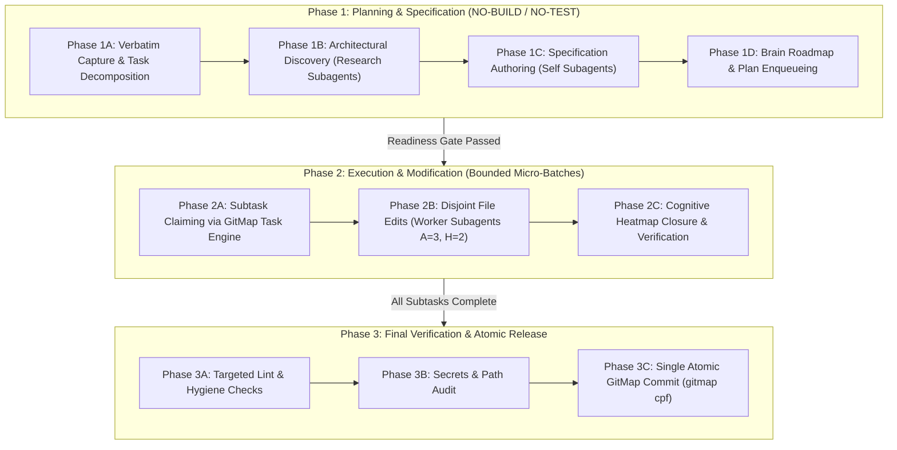

# Specification: Sequential Slug Convention (`XX-<slug>`) & Planning / Execution Decoupling

## 1. Executive Summary & System Overview

This specification establishes two foundational architectural standards across the repository's prompt library, AI skills, and specification lifecycle:

1. **Sequential Slug Mandate (`XX-<slug>`)**:
   - Every specification directory authored under `02-spec/21-app/` and every primary plan document registered under `.ai-memory/plans/` (including subtask directories in `.ai-memory/plans/subtasks/`) MUST incorporate a zero-padded sequential numeric prefix: `XX-<slug>`.
   - `XX` represents the chronological two-digit sequence index (e.g. `24-coding-guideline-and-prompt-execution-improvement`).
   - This eliminates non-deterministic folder sprawl where unnumbered bare slugs (`coding-guideline-and-prompt-execution-improvement`, `gitmap-skills-enhancement`) competed with numbered slugs (`21-letterly-muse-ssh-heatmap-general-installer`, `22-mobile-letterly-tree-swarm-dynamic-join`), corrupting discovery algorithms and breaking blind agent onboarding.

2. **Decoupling Planning from Execution**:
   - A strict operational boundary is enforced between **Planning Phase (Phase 1)** and **Execution Phase (Phase 2 & 3)**.
   - When prompts and formatters define planning instructions (Actionable Item 2 / Phase 1), there is **NO NEED to include execution steps**.
   - Planning steps are strictly dedicated to codebase exploration, dependency tracing, architectural specification authoring, interface contracts, bounded subtask decomposition, and binary acceptance criteria definition under strict **NO-BUILD, NO-TEST, and NO-CODE-CHANGES** rules.
   - Execution steps (refactoring, implementation, compilation, validation, commits) belong exclusively to subsequent execution phases and dedicated execution prompt templates.

---

## 2. Problem Statement & Root Cause Analysis

### 2.1 The Bare `<slug>` Ambiguity
In earlier revisions of `AGENTS.md` (Section 10), Letterly prompt formatters (`01-prompts/22-letterly/`), and Cursor mirrors (`01-prompts/23-cursor-prompts/`), the standard Actionable Item 2 read:

```text
2. Write spec under 02-spec/21-app/<slug>/ and enqueue plan task in .ai-memory/plans/<slug>.md (subtasks in .ai-memory/plans/subtasks/<slug>/) first
```

Because `<slug>` was specified without explicit sequence instructions, autonomous AI agents interpreted the instruction literally as a bare hyphenated name (e.g. `02-spec/21-app/letterly-prompts-heatmap-one-liner-integration/`). Concurrently, other prompt sections mandated sequential prefixes (`nn-<slug>`). This created two conflicting directory paradigms within `02-spec/21-app/`:
- **Sequential Directories:** `20-ssh-identity-format-and-gitmap-skills-update`, `21-letterly-muse-ssh-heatmap-general-installer`, `22-mobile-letterly-tree-swarm-dynamic-join`, `23-mobile-prompt-input-placement`.
- **Bare Unnumbered Directories:** `cd-execute-prompt-and-skill-synchronization`, `gitmap-rc-heatmap-integration-and-agent-task-management`, `letterly-prompts-heatmap-one-liner-integration`.

This inconsistency created significant operational friction:
- Automated discovery scripts could not infer the latest task sequence.
- Subagents spawned into `Workspace: inherit` suffered file path mismatches between parent plans and child subtasks.
- Version history became disjointed across `.ai-memory/plans/pending/` and `02-spec/21-app/`.

### 2.2 Planning and Execution Conflation
Previous prompt formulations frequently blurred the boundary between planning and execution. Actionable Item lists generated for planning sessions often mixed architectural deliverables with premature execution commands (e.g. instructing agents to write specs and immediately run test suites or mutate source code in the same pass).

This premature execution introduced severe failure modes:
- Agents attempted code refactoring before specifications or contracts were finalized.
- Credit budget and turn limits were exhausted during Phase 1 by compiling or testing unfinished code.
- Multi-agent coordination failed because disjoint boundaries had not yet been defined before workers started editing files.

---

## 3. The Sequential Slug Mandate (`XX-<slug>`)

### 3.1 Syntax and Structural Format
Every new application specification, parent plan, and subtask suite MUST adhere to the following naming structure:

```text
XX-<slug>
```

- **`XX` (Sequential Index):** A two-digit zero-padded decimal integer (`01`, `02`, ..., `24`, `25`, ...). If the sequence exceeds 99, three-digit formatting is adopted seamlessly (`100`, `101`, ...).
- **Hyphen (`-`):** Exactly one ASCII hyphen separating the numeric sequence from the descriptive slug.
- **`<slug>` (Descriptive Slug):** All lowercase ASCII letters, digits, and hyphens describing the technical capability or system domain (e.g., `coding-guideline-and-prompt-execution-improvement`). Uppercase letters, underscores, and special characters are strictly prohibited.

### 3.2 Canonical Directory & File Target Paths
For any task assigned sequence `XX` and slug `<slug>`:

| Artifact Type | Standard Canonical Path | Example |
| :--- | :--- | :--- |
| **Application Specification Directory** | `02-spec/21-app/XX-<slug>/` | `02-spec/21-app/24-coding-guideline-and-prompt-execution-improvement/` |
| **Primary Architecture Spec** | `02-spec/21-app/XX-<slug>/01-architecture-spec.md` | `02-spec/21-app/24-coding-guideline-and-prompt-execution-improvement/01-architecture-spec.md` |
| **Secondary Component Spec** | `02-spec/21-app/XX-<slug>/02-component-spec.md` | `02-spec/21-app/24-coding-guideline-and-prompt-execution-improvement/02-gitmap-skills-and-slug-convention-spec.md` |
| **Specification Readme / Index** | `02-spec/21-app/XX-<slug>/readme.md` | `02-spec/21-app/24-coding-guideline-and-prompt-execution-improvement/readme.md` |
| **Pending Parent Plan** | `.ai-memory/plans/pending/XX-<slug>.md` | `.ai-memory/plans/pending/24-coding-guideline-and-prompt-execution-improvement.md` |
| **Subtask Plan Directory** | `.ai-memory/plans/subtasks/XX-<slug>/` | `.ai-memory/plans/subtasks/24-coding-guideline-and-prompt-execution-improvement/` |
| **Individual Subtask Plans** | `.ai-memory/plans/subtasks/XX-<slug>/NN-subtask-<name>.md` | `.ai-memory/plans/subtasks/24-coding-guideline-and-prompt-execution-improvement/01-subtask-git-sync-and-preflight.md` |
| **Completed Parent Plan** | `.ai-memory/plans/completed/XX-<slug>.md` | `.ai-memory/plans/completed/24-coding-guideline-and-prompt-execution-improvement.md` |
| **Temporary Agent Runtime** | `.ai-memory/temp-agents/XX-<slug>/` | `.ai-memory/temp-agents/24-coding-guideline-and-prompt-execution-improvement/` |

### 3.3 Dynamic Sequence Resolution Algorithm
Before initializing a new task, the orchestrator or agent MUST determine `XX` via the following deterministic sequence:
1. Query existing directories in `02-spec/21-app/` using GitMap high-speed inventory:
   ```pwsh
   gitmap find "*.*" 02-spec/21-app
   ```
2. Scan top-level folder names matching the regex `^(\d+)-(.+)$`.
3. Extract the integer value of `\d+`, find the maximum index `M`, and assign:
   ```text
   XX = M + 1 (formatted with leading zero: printf("%02d", XX))
   ```
4. If a task is explicitly provided with a sequence prefix (e.g. `24-coding-guideline-and-prompt-execution-improvement`), that sequence MUST be honored directly without re-indexing.

### 3.4 Dual-Slug Backward Compatibility Policy
During the transition period or when subagents are assigned tasks created under bare slug names:
- The agent creates the primary canonical artifact in `02-spec/21-app/XX-<slug>/`.
- If existing plans or subtasks reference the bare slug `02-spec/21-app/<slug>/`, the agent MUST duplicate or mirror the specification files into the bare slug directory to ensure 100% path resolution across all subagents and linters without broken references.

---

## 4. Decoupling Planning from Execution

### 4.1 Strict Phase Isolation Architecture

Execution in this repository is strictly governed by three isolated phases:



### 4.2 Planning Phase Operational Constraints
During Phase 1 (Planning and Specification):
- **NO BUILD:** Never execute `go build`, `npm run build`, `vite build`, `cargo build`, or any compiler toolchain.
- **NO TEST:** Never execute unit tests, test suites, integration tests, or test runners.
- **NO CODE MODIFICATIONS:** Never modify production source code files (`src/`, `cmd/`, `pkg/`, etc.). Modifications are restricted strictly to `02-spec/21-app/XX-<slug>/`, `.ai-memory/plans/`, and `.ai-memory/temp-agents/`.
- **NO EXECUTION DIRECTIVES IN PLANNING PROMPTS:** Planning prompt templates (`04-plan-letterly.md`, `04-plan-letterly-cursor.md`, `plan-spec-steps-v2`) must strictly omit refactoring steps, implementation steps, and build instructions. Their scope is solely bounded to architecture, data models, boundaries, and acceptance criteria.

### 4.3 Transition Contract: Planning to Execution
The handover from planning to execution occurs ONLY when:
1. The specification suite in `02-spec/21-app/XX-<slug>/` is written and verified.
2. The subtask plans in `.ai-memory/plans/subtasks/XX-<slug>/` define explicit disjoint file boundaries (`Owned Files (Exclusive)`).
3. The cognitive heatmap log entries for specification are updated with successful outcomes.
4. The SQLite task database has been populated with subtasks via `gitmap agent subtask add`.

---

## 5. Standardized Actionable Item 2 Template

### 5.1 Canonical Template Definition
All prompt formatters, execution templates, and guideline documents MUST replace the outdated bare `<slug>` directive with the following canonical standard:

```text
2. Write spec under 02-spec/21-app/XX-<slug>/ and enqueue plan task in .ai-memory/plans/pending/XX-<slug>.md (subtasks in .ai-memory/plans/subtasks/XX-<slug>/) first, where XX is the zero-padded sequence of that folder.
```

### 5.2 Canonical 4-Item Non-Negotiable Header
Every execution prompt template in the repository begins with the following four fixed, immutable items:

```markdown
# Actionable Items Must Follow Non-Negotiable

1. Git pull BEFORE starting any work — first try `gitmap pull <repo path>` (or run `gitmap pull` in repository folder); if that fails, fall back to regular `git pull` and resolve any merge conflicts so the repository is completely up to date and clean before starting.
2. Write spec under 02-spec/21-app/XX-<slug>/ and enqueue plan task in .ai-memory/plans/pending/XX-<slug>.md (subtasks in .ai-memory/plans/subtasks/XX-<slug>/) first, where XX is the zero-padded sequence of that folder.
3. Search codebase exclusively via GitMap (gitmap aum search, gitmap find, gitmap cat, gitmap ps, gitmap py, gitmap llm train); TOTAL BAN on rg, ripgrep, grep, git grep, Select-String
4. Strictly use relative Git paths (02-spec/..., .ai-memory/..., cmd/...); only add the relative paths, never add the absolute path during your work, and ensure this is respected on the release page and in release notes as well
5. ....other steps and more steps sequentially from the input direction. Create more steps in between.
```

### 5.3 Planning Prompt Template Variation (`04-plan-letterly.md`)
In planning mode formatters, Item 2 and Item 5 are structured specifically for planning deliverables without execution leakage:

```markdown
# Actionable Items Must Follow Non-Negotiable

1. Git pull BEFORE starting any work — first try `gitmap pull <repo path>` (or run `gitmap pull` in repository folder); if that fails, fall back to regular `git pull` and resolve any merge conflicts so the repository is completely up to date and clean before starting.
2. Write plan and architectural spec first under 02-spec/21-app/XX-<slug>/ adhering to 02-spec/01-spec-authoring-guide/, where XX is the zero-padded sequence of that folder.
3. Search codebase exclusively via GitMap (gitmap aum search, gitmap find, gitmap cat, gitmap ps, gitmap py, gitmap llm train); TOTAL BAN on rg, ripgrep, grep, git grep, Select-String
4. Strictly use relative Git paths (02-spec/..., .ai-memory/..., cmd/...); only add the relative paths, never add the absolute path during your work, and ensure this is respected on the release page and in release notes as well
5. Write first step on task decomposition and bounded subtasks under .ai-memory/plans/subtasks/XX-<slug>/
6. Enforce strict no-build and no-test rules throughout planning phase
7. Define binary acceptance criteria for every subtask
```

---

## 6. Comprehensive Modification Matrix across the Repository

The following files require updates to align with the Sequential Slug Mandate and Planning Decoupling:

### 6.1 Meta-Repository Rules & Guidelines
- `AGENTS.md`:
  - Section 10: Update the rule defining Item 1 of Actionable Items to mandate `02-spec/21-app/XX-<slug>/` and `.ai-memory/plans/pending/XX-<slug>.md` (with subtasks in `.ai-memory/plans/subtasks/XX-<slug>/`), explicitly documenting `XX` as the zero-padded sequential index.

### 6.2 Canonical Letterly Prompts (`01-prompts/22-letterly/`)
- `01-mobile-letterly.md`: Update single-line output contract and instructions to incorporate `XX-<slug>`.
- `02-desktop-letterly.md`: Update Item 2 to canonical `XX-<slug>` syntax.
- `03-execute-n-steps-letterly.md`: Update Item 2 in instructions and output format.
- `04-plan-letterly.md`: Update Items 2 and 5 to canonical `XX-<slug>` syntax and reinforce planning decoupling.
- `05-release-letterly.md`: Update spec reference to `XX-<slug>`.
- `06-cicd-fix-release-letterly.md`: Update spec/plan path references.
- `07-mobile-cicd-fix-letterly.md`: Update mobile single-line output contract.
- `08-run-letterly.md`: Update task path references.
- `09-execute-with-verification-letterly.md`: Update Item 2 to canonical `XX-<slug>` syntax.
- `10-execute-with-release-letterly.md`: Update Item 2 to canonical `XX-<slug>` syntax.
- `11-git-pull-first-letterly.md`: Update Item 2 to canonical `XX-<slug>` syntax.

### 6.3 Canonical Cursor Mirrors (`01-prompts/23-cursor-prompts/`)
- Exact 1:1 parity updates across all 11 mirrors:
  - `01-mobile-letterly-cursor.md` through `11-git-pull-first-letterly-cursor.md`.
  - Maintain `.cursor/skills/` skill links instead of `.agents/skills/`.

### 6.4 Execution Engine & Native Skills
- `01-prompts/14-execute/02-execute-parent-task-with-n-steps-v6.md`:
  - Standardize all occurrences of `<slug>` in spec and plan paths to `XX-<slug>`.
  - Update Phase 1 Spec Authoring payload examples (`Spec Author 01`, `Spec Author 02`, `Spec Author 03`) to reflect `02-spec/21-app/XX-<slug>/` and `.ai-memory/plans/subtasks/XX-<slug>/`.
- `.agents/skills/execute-parent-task-with-n-steps-v6/skill.md`: Parity update with V6 prompt.
- `.cursor/skills/execute-parent-task-with-n-steps-v6/skill.md`: Parity update with Cursor links.
- `.agents/skills/plan-spec-steps-v2/skill.md`: Enforce strict planning decoupling and `XX-<slug>`.
- `.cursor/skills/plan-spec-steps-v2/skill.md`: Parity update with Cursor links.

---

## 7. Acceptance Criteria

| Criteria ID | Requirement | Verification Method |
| :--- | :--- | :--- |
| **AC-SLUG-001** | All references to spec paths in prompt formatters use `02-spec/21-app/XX-<slug>/` with `XX` defined as zero-padded sequential index | Inspect Item 2 across `01-prompts/22-letterly/*.md` |
| **AC-SLUG-002** | All references to plan paths use `.ai-memory/plans/pending/XX-<slug>.md` and `.ai-memory/plans/subtasks/XX-<slug>/` | Inspect Item 2 and 5 across `01-prompts/22-letterly/*.md` |
| **AC-SLUG-003** | Cursor prompt mirrors maintain identical `XX-<slug>` syntax with `.cursor/` skill links | Inspect `01-prompts/23-cursor-prompts/*.md` |
| **AC-SLUG-004** | Planning prompts (`04-plan-letterly.md`, `plan-spec-steps-v2`) strictly exclude execution steps (no builds, no tests, no code edits) | Inspect Actionable Items in planning prompt templates |
| **AC-SLUG-005** | `AGENTS.md` Section 10 explicitly documents the `XX-<slug>` sequential slug mandate | Inspect `AGENTS.md` Section 10 text |
| **AC-SLUG-006** | V6 execution prompt (`02-execute-parent-task-with-n-steps-v6.md`) uses `XX-<slug>` uniformly across all sections and subagent dispatch payloads | Inspect Phase 1 and Phase 2 dispatch payloads in V6 prompt |
| **AC-SLUG-007** | Strict Relative Git Paths Mandate: 100% of paths in specs, plans, and prompts are relative from repository root (0 absolute paths, 0 `file:///` URIs) | Run relative paths audit |
| **AC-SLUG-008** | All files and directory names adhere to strict lowercase naming conventions | Run lowercase naming audit |

---

## 8. Defensive Invariants & Edge Case Handling

1. **Handling Legacy Unnumbered Folders:**
   - Existing unnumbered directories in `02-spec/21-app/` and `.ai-memory/plans/` are treated as immutable history. They MUST NOT be renamed or deleted during routine turns to prevent breaking active git branches or release logs.
   - All newly initiated tasks strictly mandate `XX-<slug>`.
2. **Preventing Sequence Number Collisions:**
   - When determining the next sequence number `XX`, the agent inspects both `02-spec/21-app/` and `.ai-memory/plans/` (including `pending/` and `completed/`) to find the global maximum sequence number.
3. **Subagent Bounding Box Isolation:**
   - Subagents are strictly bound to their assigned files (`Owned Files (Exclusive)`).
   - In shared workspace mode, subagents must never attempt to mutate shared indexes (`02-spec/21-app/readme.md`, `.ai-memory/plans/readme.md`), which belong exclusively to the lead orchestrator.
4. **Cognitive Heatmap Tracking:**
   - All specification authoring and planning activities must be pre-logged via `gitmap heatmap log` and closed with `gitmap heatmap update` to ensure complete observability.
