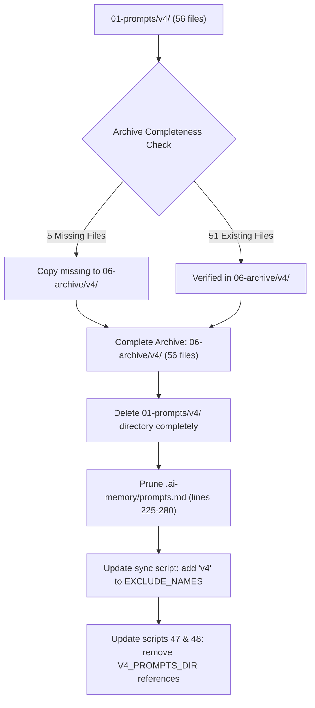

# Specification 01: v4 Prompts Archival & Skill Purge

## 1. System Overview & Problem Statement

Legacy prompt templates in `01-prompts/v4/` (comprising 56 markdown files) represent an obsolete iteration of the autonomous execution framework. Previous multi-repository synchronization workflows (`03-ai-scripts/38-sync-prompts-skills-scripts.py`) synchronized the entire `01-prompts/` directory to downstream consumer repositories without filtering out `v4`. This caused deprecated prompts to leak into 42 downstream projects.

Furthermore, active skills in `.agents/skills/` and `.cursor/skills/` must be audited to ensure no active workflow invokes `01-prompts/v4/` prompts, and that no deprecated `v4` skills remain active.



## 2. Archival Gap Analysis

The destination directory `06-archive/v4/` already preserves 51 files from earlier archival sweeps. Exactly 5 files in `01-prompts/v4/` are absent from `06-archive/v4/`:

| Missing File Path | Target Archive Destination |
| :--- | :--- |
| `01-prompts/v4/14-execute/08-execute-with-e2e.md` | `06-archive/v4/14-execute/08-execute-with-e2e.md` |
| `01-prompts/v4/15-cg-execute/38-map-dispatch-and-handler-lookup.md` | `06-archive/v4/15-cg-execute/38-map-dispatch-and-handler-lookup.md` |
| `01-prompts/v4/24-sync/01-sync.md` | `06-archive/v4/24-sync/01-sync.md` |
| `01-prompts/v4/24-sync/02-sync-other-codebase.md` | `06-archive/v4/24-sync/02-sync-other-codebase.md` |
| `01-prompts/v4/24-sync/readme.md` | `06-archive/v4/24-sync/readme.md` |

### Invariant:
Once these 5 files are copied to `06-archive/v4/`, the archive becomes a 100% complete replica (56 files). `01-prompts/v4/` can then be removed from the canonical tree.

## 3. Skills Audit & References

Discovery research confirmed:
1. Active skills in `.agents/skills/` containing `v4` in their names (`autonomous-qa-and-testing-v4` and `unified-ai-prompt-v4`) DO NOT reference `01-prompts/v4/`.
   - `autonomous-qa-and-testing-v4/skill.md` links to `01-prompts/06-testing-and-qa/03-autonomous-qa-and-testing-v4.md`.
   - `unified-ai-prompt-v4/skill.md` links to `01-prompts/02-core-workflow/01-unified-ai-prompt-v4.md`.
2. Zero active skills in `.agents/skills/` or `.cursor/skills/` reference `01-prompts/v4/`.
3. No active prompts reference `01-prompts/v4/`.

## 4. Metadata & Linter Alignment

`linter-scripts/check-prompts-loaded.py` verifies that all files in `01-prompts/` are indexed in `.ai-memory/prompts.md`. Lines 225–280 of `.ai-memory/prompts.md` currently catalog `v4/`. When `01-prompts/v4/` is deleted, these lines must be removed so CI passes cleanly:

```python
# check-prompts-loaded.py verification contract
# Actual files in 01-prompts == Indexed files in .ai-memory/prompts.md
```

## 5. Script Hardening

1. `03-ai-scripts/38-sync-prompts-skills-scripts.py`: Add `"v4"` to `EXCLUDE_NAMES` set in `sync_prompts()`:
   ```python
   EXCLUDE_NAMES = {"archive", ".git", ".ai-memory", "v4"}
   ```
2. `03-ai-scripts/47-upgrade-cg-execute-to-v6.py`: Remove `V4_PROMPTS_DIR` definition and loop.
3. `03-ai-scripts/48-standardize-execution-prompts.py`: Remove `V4_DIR` definition and loop.

## 6. Verification Protocol

1. `gitmap find "*.*" 01-prompts/v4` returns 0 results.
2. `gitmap find "*.*" 06-archive/v4` returns 56 files.
3. `python linter-scripts/check-prompts-loaded.py` passes with returncode 0.
4. `python linter-scripts/check-forbidden-strings.py` passes with returncode 0.
