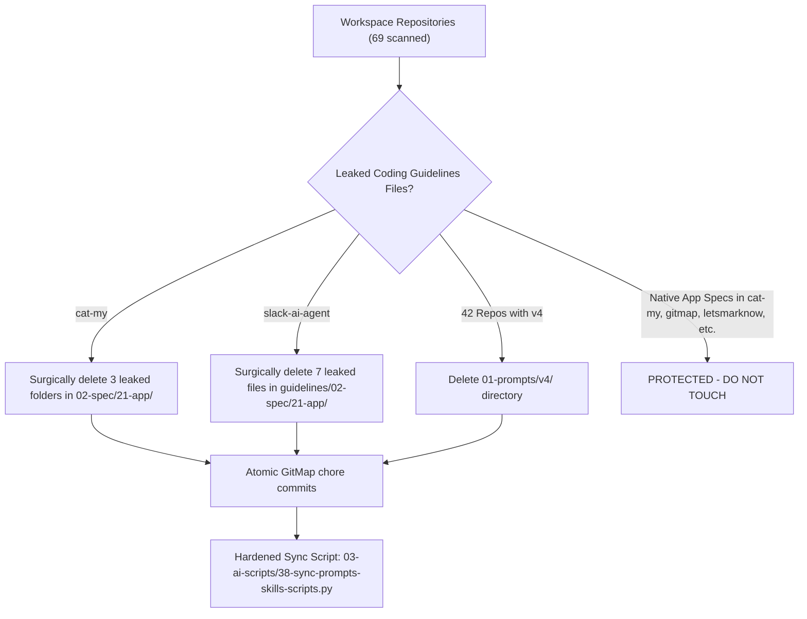

# Specification 03: Multi-Repository Leak Detection & Cleanup

## 1. System Overview & Problem Statement

Cross-repository synchronization tools (`03-ai-scripts/38-sync-prompts-skills-scripts.py`) propagate shared prompts and skills across connected projects in the workspace. Due to missing exclusions in earlier runs:
1. `01-prompts/v4/` was copied to 42 downstream repositories.
2. In rare cases, files from `coding-guidelines`'s `02-spec/21-app/` leaked into downstream repositories (`cat-my` and `slack-ai-agent`).

The user's instruction is non-negotiable and absolute:
> "make sure that any one of the files from these coding guidelines spec folder and folder 21 app, if the same file from the coding guideline is synced with any other app or any other repository, you should actually sync and remove those only. So do not by default remove anything inside the app folder to other repository without checking the similar files. Do you understand? This is very critical. You should not remove anything else."

## 2. Exhaustive Audit Findings

A complete scan of all 69 repositories in the workspace revealed:

### Category A: Repositories with Leaked `02-spec/21-app/` Files (Strict Surgical Target)

| Repository | Leaked File/Folder Path | Native App Specs Present? | Action |
| :--- | :--- | :--- | :--- |
| `cat-my` | `02-spec/21-app/01-variadic-spread-params-and-multi-repo` | Yes (80+ native photo editor specs) | **Surgically delete ONLY these 3 leaked folders** |
| `cat-my` | `02-spec/21-app/02-string-normalization-and-equalfoldany` | Yes (80+ native photo editor specs) | **Surgically delete ONLY these 3 leaked folders** |
| `cat-my` | `02-spec/21-app/07-coding-guideline-actionable-checklist-and-acceptance` | Yes (80+ native photo editor specs) | **Surgically delete ONLY these 3 leaked folders** |
| `slack-ai-agent` | `guidelines/02-spec/21-app/01-architecture-spec.md` | No | **Surgically delete leaked files** |
| `slack-ai-agent` | `guidelines/02-spec/21-app/02-component-and-examples-spec.md` | No | **Surgically delete leaked files** |
| `slack-ai-agent` | `guidelines/02-spec/21-app/03-migration-and-verification-spec.md` | No | **Surgically delete leaked files** |
| `slack-ai-agent` | `guidelines/02-spec/21-app/checkpoints.md` | No | **Surgically delete leaked files** |
| `slack-ai-agent` | `guidelines/02-spec/21-app/findings.md` | No | **Surgically delete leaked files** |
| `slack-ai-agent` | `guidelines/02-spec/21-app/readme.md` | No | **Surgically delete leaked files** |
| `slack-ai-agent` | `guidelines/02-spec/21-app/validation-matrix.md` | No | **Surgically delete leaked files** |

### Category B: Repositories with 100% Native App Specs (Protected - DO NOT TOUCH)

The following repositories have `02-spec/21-app/` containing authentic, project-owned application specifications and have ZERO files from `coding-guidelines`:
- `antigravity-manager` (native AGY manager specs)
- `flat-slide-show` (native presentation engine specs)
- `gitmap` (native GitMap toolchain specs)
- `letsmarknow` (native markdown editor specs)
- `macro-ahk` (native Windows automation specs)
- `movie-cli` (native streaming CLI specs)
- `spec-builder` (native specification generator specs)
- `wp-exam` (native WordPress examination specs)
- `wp-link-manager` (native link manager specs)

### Category C: Repositories with `01-prompts/v4/` (42 Repositories Cleaned)

The following 42 downstream repositories contained `01-prompts/v4/` and had that folder deleted:
`active-memory-monitor`, `ai-actionable-matrix`, `ai-context-wrapper`, `ai-doc-creator`, `ai-doc-writer`, `ai-flow`, `ai-joke-generator`, `ai-persona`, `ai-post-generator`, `ai-reddit-reader`, `ai-rules-creator`, `ai-seo-optimizer`, `ai-step-creator`, `ai-sub-agent-swarm`, `antigravity-manager`, `cat-my`, `chrome-profile-reconciler`, `data-sync-hub`, `domain-search-cli`, `flat-slide-show`, `gitmap`, `gitmap-v28`, `letsmarknow`, `linkedin-banner-generator`, `logo-craft`, `macro-ahk`, `markdown-formatter`, `md-to-deck`, `mock-api-generator`, `movie-cli`, `og-image-designer`, `prompt-architect-desktop`, `prompt-vault`, `quick-terminal-ai`, `quote-card-maker`, `readme-ai-enhancer`, `slack-ai-agent`, `slides-app`, `spec-builder`, `term-canvas`, `wp-exam`, `wp-link-manager`.

## 3. Surgical Execution Process

### Step 1: Cleanup in `cat-my`
1. Navigate to repository `cat-my`.
2. Delete ONLY the 3 matching leaked folders:
   - `02-spec/21-app/01-variadic-spread-params-and-multi-repo`
   - `02-spec/21-app/02-string-normalization-and-equalfoldany`
   - `02-spec/21-app/07-coding-guideline-actionable-checklist-and-acceptance`
3. Delete `01-prompts/v4/` if present.
4. Stage changes, commit via `gitmap cpc "spec - surgically purge leaked coding guidelines folders"`.

### Step 2: Cleanup in `slack-ai-agent`
1. Navigate to repository `slack-ai-agent`.
2. Delete ONLY the 7 matching leaked files in `guidelines/02-spec/21-app/`.
3. Delete `01-prompts/v4/` if present.
4. Stage changes, commit via `gitmap cpc "spec - surgically purge leaked coding guidelines files"`.

### Step 3: Cleanup of `01-prompts/v4/` across the Remaining Repositories
1. For each target repository:
   - Check if `01-prompts/v4/` exists.
   - If present, remove directory.
   - Commit via `gitmap cpc "chore - purge deprecated v4 prompts"`.

### Step 4: Permanent Sync Script Hardening
1. In `coding-guidelines/03-ai-scripts/38-sync-prompts-skills-scripts.py`:
   - Update `EXCLUDE_NAMES` to add `"v4"`.
   - Re-verify Rule 11 boundary checks: `02-spec/21-*` is unconditionally excluded from cross-repo synchronization.

## 4. Verification Protocol

1. `gitmap find "*.*" cat-my/02-spec/21-app/01-variadic-spread-params-and-multi-repo` returns 0 results.
2. `gitmap find "*.*" cat-my/02-spec/21-app/02-string-normalization-and-equalfoldany` returns 0 results.
3. `gitmap find "*.*" cat-my/02-spec/21-app/07-coding-guideline-actionable-checklist-and-acceptance` returns 0 results.
4. All native photo editor specs in `cat-my/02-spec/21-app/` remain 100% intact.
5. In `slack-ai-agent`, `guidelines/02-spec/21-app/` is clean.
6. Across all 42 repositories, `01-prompts/v4/` is gone.
