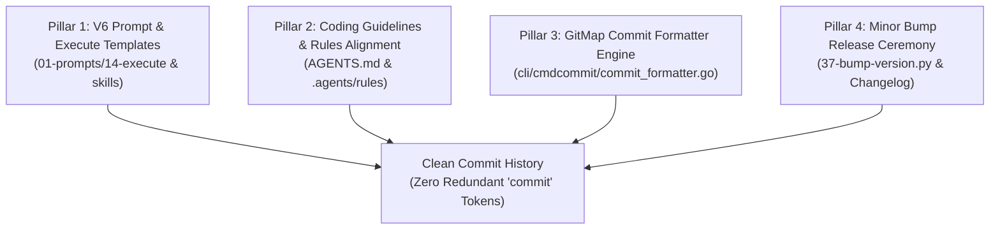

# Master Audit Ledger: Commit Pseudo-Module Root Cause Analysis & Remediation

> **Module:** `02-spec/21-app/30-root-cause-analysis-and-fix`  
> **Sequence ID:** 30  
> **Parent Prompt:** Root Cause Analysis and Fix (Non-Negotiable Task)  
> **Status:** Phase 1 Architecture & Discovery  
> **Author:** Antigravity Architect  

---

## 1. Verbatim User Request & Issue Context

> "Why this commit part is here? Can you please find the root cause of it and fix? There should be never commit. Commit is what? I don't get it. It is already committing, why it's it rise at the beginning commits? I don't get it. And you can have a title case, that's absolutely fine. Or lower case is also fine. Find the root cause in the instruction, in the execute prompt in the v6, in the coding guideline, keep map the skills in the coding guideline and also in the code. Find the root cause and tell me the root cause, fix the root cause, and make a release with minor bump. Do you understand?"

### Visual Evidence Audit
User highlighted the commit message generated in the previous turn:
```text
Chore: commit - lowercase module names and conventional commit syntax in commit formatter
```
The red box explicitly highlighted `commit` in the module slot (`[commit] - `).

---

## 2. Core Problem Decomposition & Systems Understanding

1. **Tautological Redundancy ("Commit is what? It is already committing"):**
   - The command executed is `gitmap cpc "commit - ..."` or `gitmap cpf "commit - ..."`.
   - The Git operation is *by definition* a commit.
   - Using `"commit"` as a module produces tautologies like `Chore: commit - ...` or `Feature: commit - ...`.
2. **Four-Layer Root Cause Architecture:**
   - **Layer 1 (Execute Prompts & V6):** Prompt templates and examples in `execute-parent-task-with-n-steps-v6` and `01-prompts/14-execute/` historically included generic examples where AI agents substituted the word `commit` when modifying commit-related files.
   - **Layer 2 (Coding Guidelines & Rules):** Rule 10 in `AGENTS.md` and `.agents/rules/` required `- Feature: gitmap cpf "<module> - <summary>"`. When agents operated on commit tools, they defaulted to `commit` as `<module>`.
   - **Layer 3 (Skills in Coding Guideline):** Several skills in `.agents/skills/` demonstrated commit commands with placeholder or literal `commit` references.
   - **Layer 4 (GitMap Engine Code):** In `d:/work/gitmap/cli/cmdcommit/commit_formatter.go`, `isCommitTypeToken` already checks for and strips redundant type tokens (`FEATURE`, `FEAT`, `RELEASE`, `REL`, `VERSION`, `BUG`, `CHORE`, `REFACTOR`, `REFACT`, `SPEC`), but `COMMIT`, `COMMITS`, and `GITCOMMIT` were omitted.
3. **Casing Invariant:**
   - The user accepts either Title Case (`Feature: Auth - ...`) or lowercase (`Feature: auth - ...`), but bans ALL-CAPS shout-casing (`Feature: AUTH - ...`) and bans using `commit` as a module name entirely.

---

## 3. Four Core Remediation Pillars



1. **Pillar 1 (V6 Prompts & Skills):**
   - Audit all V6 execute prompts and remove any references or examples encouraging `commit` as a module name.
   - Codify Rule: NEVER use `commit` or `commits` as a module in GitMap commit commands.
2. **Pillar 2 (Coding Guidelines & AGENTS.md):**
   - Update `AGENTS.md` Section 10 to explicitly forbid using `commit` as a module name.
   - Explain the invariant: the commit operation is already established by GitMap; the module must represent the functional subsystem (e.g., `cli`, `auth`, `ui`, `scanner`, `rules`, `guidelines`), never `commit`.
   - Clarify that valid modules may be formatted in Title Case (e.g. `Ui`, `Guidelines`, `Auth`) or lowercase (`ui`, `guidelines`, `auth`), but never ALL-CAPS shout case.
3. **Pillar 3 (GitMap Formatter Engine):**
   - In `cli/cmdcommit/commit_formatter.go`, add `COMMIT`, `COMMITS`, `GITCOMMIT` to `isCommitTypeToken()`.
   - If an agent or user passes `gitmap cpc "commit - <summary>"`, GitMap automatically strips the redundant token to produce `Chore: <summary>`.
   - If nested, e.g. `gitmap cpc "commit - docs - <summary>"`, GitMap promotes the actual module `docs` to produce `Chore: docs - <summary>`.
   - In `resolveHyphenModuleAndItem()`, allow Title Case or lowercase for genuine module names, while strictly down-casing any accidental ALL-CAPS words.
4. **Pillar 4 (Minor Bump Release):**
   - Execute minor release ceremony with automated version bump, release documentation, and remote push.

---

## 4. Verification Evidence Contract

- `gitmap cpc -n "commit - update readme"` -> `Chore: update readme` (no `commit - `).
- `gitmap cpf -n "commit - cli - enhance parsing"` -> `Feature: cli - enhance parsing` (promotes real module).
- `gitmap cpf -n "Auth - support oauth2"` -> `Feature: Auth - support oauth2` (preserves Title Case).
- `gitmap cpf -n "auth - support oauth2"` -> `Feature: auth - support oauth2` (preserves lowercase).
- `gitmap cpf -n "AUTH - support oauth2"` -> `Feature: auth - support oauth2` (downcases shout-case).
- All unit tests in `cli/cmdcommit/commit_formatter_test.go` pass 100%.
- Coding guidelines, AGENTS.md, and skills reflect the invariant.
- Minor release ceremony completed.
