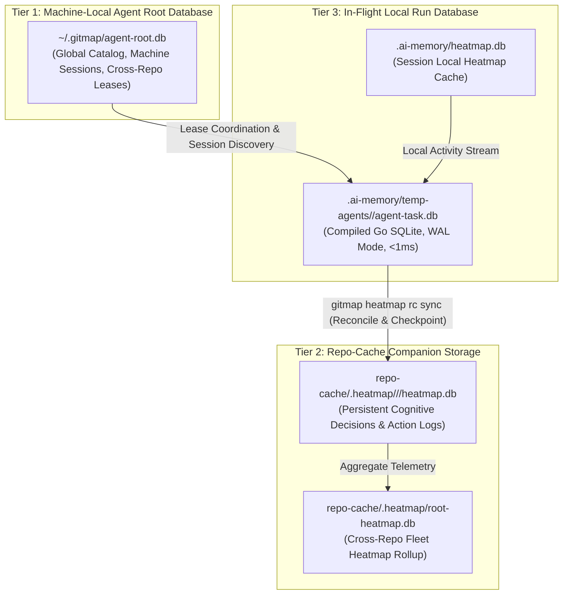

# Architecture Specification: Coding Guidelines V6 Upgrade, Data Schema Verification & GitMap Heatmap Integration

> **Spec Identifier:** `02-spec/21-app/cg-execute-folder-synchronization-and-heatmap-integration/01-architecture-spec.md`  
> **Status:** APPROVED & BINDING  
> **Version:** 6.0.0  
> **Target Subsystems:** `01-prompts/15-cg-execute/`, `.agents/skills/cg-*`, `.cursor/skills/cg-*`, GitMap Heatmap & Task Engine  
> **Total Steps Budget:** N = 400 (Phase 1: 100, Phase 2: 150, Phase 3: 150)  
> **System Concurrency Capacity:** A = 3, H = 2 (Capacity = 6 subtasks, 100% duty cycle)  
> **Local Completion Boundary:** STRICT LOCAL ONLY (Total ban on fleet multi-repo sync)

---

## 1. Executive Summary & Strategic Rationale

### 1.1 Context & Problem Statement
The Coding Guidelines execution suite (`01-prompts/15-cg-execute/` and companion `cg-*` skills under `.agents/skills/` and `.cursor/skills/`) orchestrates automated guideline auditing, refactoring, and quality enforcement across polyglot repositories. Historically, these prompts and skills operated under legacy V4/V5 concurrency limits (N = 300, A = 2, H = 2) and lacked:
1. **Upfront Data Schema Verification:** Subagents often initiated task processing without inspecting SQLite database catalogs, leading to unverified table structures, negative boolean flags (`can_read`, `should_skip`), snake_case column inconsistencies, and unvalidated foreign key relationships.
2. **Cognitive Telemetry & Heatmap Integration:** File inspections and modification decisions were carried out without recording the agent's explicit operational reasoning into persistent telemetry databases, obscuring the cognitive trace and impairing post-mortem crash forensics.
3. **Database Location Transparency:** Multi-agent operations did not provide human operators or supervisory agents with explicit filepaths to the active SQLite databases or executable inspection queries, creating opacity across the multi-tier database topology.
4. **Subagent Concurrency Bottlenecks:** Operating at A = 2 with wave-based blocking delayed execution cycles compared to modern V6 tree swarm dynamic join architecture (A = 3, H = 2, Capacity = 6 with dynamic immediate respawn).

### 1.2 Strategic Objectives
This specification mandates upgrading all 37 prompt specifications in `01-prompts/15-cg-execute/` and their corresponding skills in `.agents/skills/` and `.cursor/skills/` to the V6 unified architecture:
- **Enforce Step 0 Preflight Data Schema Verification:** Mandate schema verification commands (`gitmap agent task status --ddl` and `--json`) ensuring singular PascalCase tables, `{TableName}Id` keys, positive boolean constraints (`Is*`, `Has*`), and relational integrity.
- **Embed 3-Tier Database Architecture & Relational Topology:** Formalize Tier 1 (Machine-Local Root DB), Tier 2 (Repo-Cache Companion DB), and Tier 3 (In-Flight Local Run DB) with strict split-database boundaries.
- **Implement GitMap Heatmap Telemetry:** Inject mandatory pre-edit lease contention checks (`gitmap heatmap discuss`) and granular cognitive action logging (`gitmap heatmap log` / `gitmap agent log`) recording explicit reasoning before touching or editing files.
- **Mandate Database Location Transparency:** Require agents to report explicit database filepaths and executable read-only SQL queries (`gitmap heatmap rc query`) in all status and telemetry outputs.
- **Adopt V6 Concurrency Invariants:** Standardize on N = 400 (Phase 1 = 100, Phase 2 = 150, Phase 3 = 150), A = 3, H = 2, Capacity = 6 with immediate dynamic respawn.
- **Enforce Strict Local Completion Boundary:** Guarantee 100% local completion, verification, and commit without triggering external fleet synchronization.

---

## 2. The 3-Tier Database Architecture & Relational Topology

The V6 multi-agent task and telemetry engine operates across three distinct database tiers to guarantee zero worktree pollution, sub-millisecond local execution, and persistent cross-session memory.



### 2.1 Tier 1: Machine-Local Agent Root Database (`~/.gitmap/agent-root.db`)
- **Location:** Resides in the user's home directory (`~/.gitmap/agent-root.db`), completely decoupled from any repository worktree.
- **Purpose:** Serves as the global machine-level catalog for active workspaces, concurrent agent sessions, and cross-repository file contention leases.
- **Characteristics:**
  - Tracks all registered AI sessions across workspaces on the machine.
  - Manages machine-wide contention locks when multiple agent swarms execute concurrently across related repositories.
  - Stores persistent operator preferences, telemetry credentials, and global telemetry endpoints.

### 2.2 Tier 2: Repo-Cache Companion Database (`repo-cache/.heatmap/...`)
- **Location:** Resides strictly within the `repo-cache` (`repo-storage`) companion repository:
  - Repository-specific: `repo-cache/.heatmap/<ai-slug>/<repo-slug>/heatmap.db`
  - Global rollup: `repo-cache/.heatmap/root-heatmap.db`
- **Purpose:** Provides persistent, commit-tracked companion storage for cognitive decisions, file exploration reasoning, and subtask action logs without dirtying git worktrees of active projects.
- **Characteristics:**
  - Multi-AI Namespace Isolation: Segregated by AI slug (`<ai-slug>`: `antigravity`, `letterly`, `cursor`, `muse`).
  - Worktree Cleanliness: Active working repositories maintain clean `git status` because long-term telemetry is committed into `repo-cache`.
  - Synchronization: Synchronized bi-directionally via `gitmap heatmap rc sync` and checkpointed via `gitmap heatmap rc commit`.
  - Non-blocking read-only inspection supported via `gitmap heatmap rc query "<sql>"`.

### 2.3 Tier 3: In-Flight Local Run Database (`.ai-memory/temp-agents/...`)
- **Location:** Resides within the repository's `.ai-memory/` directory:
  - Task state: `.ai-memory/temp-agents/<slug>/agent-task.db`
  - Session heatmap cache: `.ai-memory/heatmap.db`
- **Purpose:** Sub-millisecond compiled Go SQLite engine for in-flight task tracking, dynamic subtask claiming, crash autopsy, and granular cognitive decision logging during active turns.
- **Characteristics:**
  - Engine: Native compiled Go binary (`gitmap agent` / `gitmap task`), eliminating Python VM startup latency (<1ms vs ~200ms).
  - WAL Mode: Mandates `PRAGMA journal_mode=WAL; PRAGMA busy_timeout=5000;` on connection initialization to guarantee non-blocking concurrent reads and serialized fast writes.
  - Lifecycle: Created at Step 0 preflight (`gitmap agent task init`), updated per subtask action, and archived upon task completion.

---

## 3. Data Schema Verification Protocol (Step 0 Preflight)

Before any planning synthesis, code inspection, or subagent dispatch, the lead agent and worker subagents must perform Step 0 schema verification to confirm structural integrity and compliance with coding guidelines.

### 3.1 Preflight Inspection Commands
Agents MUST inspect the active database schema using native GitMap commands:
```bash
# 1. Output SQLite Data Definition Language (DDL) statements for all tables
gitmap agent task status --ddl

# 2. Inspect structured schema metadata, table metrics, and column constraints in JSON format
gitmap agent task status --json

# 3. Inspect table list and row counts across database tiers
gitmap heatmap tables --db local
gitmap heatmap rc tables
```

### 3.2 Canonical Data Integrity & Schema Invariants
All tables across all database tiers must conform strictly to these relational standards:

| Constraint Category | Invariant Rule | Compliant Pattern | Banned Anti-Pattern |
|---|---|---|---|
| **Table Naming** | Strict Singular PascalCase | `ParentTask`, `Subtask`, `AgentActionLog`, `FileLease` | `parent_tasks`, `subtasks`, `tbl_action_log` |
| **Primary Keys** | `{TableName}Id` convention | `ParentTaskId`, `SubtaskId`, `AgentActionLogId` | `id`, `uuid`, `pk_id`, `row_id` |
| **Column Naming** | Strict PascalCase | `StatusCode`, `CreatedAt`, `OwnedFilesJson`, `ReasoningText` | `status_code`, `created_at`, `owned_files` |
| **Boolean Standard** | Positive Booleans Only (`Is*`, `Has*`) | `IsActive`, `HasCompleted`, `IsBlocked`, `HasFailed` | `can_read`, `should_skip`, `was_active`, explicit `== true` |
| **Boolean Storage** | Non-null `INTEGER` with default `0` | `IsActive INTEGER NOT NULL DEFAULT 1` | `is_active TEXT`, `NULL` boolean states |
| **Payload Columns** | Structured JSON with `*Json` suffix | `OwnedFilesJson TEXT NOT NULL DEFAULT '[]'` | Unstructured comma-separated strings |
| **Foreign Keys** | Explicit physical FK within DB | `FOREIGN KEY (ParentTaskId) REFERENCES ParentTask(ParentTaskId)` | Missing relational constraints |
| **Cross-DB Relations** | Logical repository enforcement | Verified by Go runtime across split DBs | Raw cross-database SQLite joins |

### 3.3 Core DDL Schema Definition (Compiled Go Reference)
```sql
-- ParentTask: Master task container
CREATE TABLE IF NOT EXISTS ParentTask (
    ParentTaskId INTEGER PRIMARY KEY AUTOINCREMENT,
    Slug TEXT NOT NULL UNIQUE,
    Title TEXT NOT NULL,
    TotalBudget INTEGER NOT NULL DEFAULT 400,
    PhaseOneBudget INTEGER NOT NULL DEFAULT 100,
    PhaseTwoBudget INTEGER NOT NULL DEFAULT 150,
    PhaseThreeBudget INTEGER NOT NULL DEFAULT 150,
    StatusCode TEXT NOT NULL DEFAULT 'INITIALIZED',
    IsActive INTEGER NOT NULL DEFAULT 1,
    HasCompleted INTEGER NOT NULL DEFAULT 0,
    CreatedAt TEXT NOT NULL DEFAULT CURRENT_TIMESTAMP,
    UpdatedAt TEXT NOT NULL DEFAULT CURRENT_TIMESTAMP
);

-- Subtask: Atomic decomposed work units
CREATE TABLE IF NOT EXISTS Subtask (
    SubtaskId INTEGER PRIMARY KEY AUTOINCREMENT,
    ParentTaskId INTEGER NOT NULL,
    Code TEXT NOT NULL UNIQUE,
    Title TEXT NOT NULL,
    AgentRole TEXT NOT NULL,
    ClaimedByAgent TEXT,
    OwnedFilesJson TEXT NOT NULL DEFAULT '[]',
    StatusCode TEXT NOT NULL DEFAULT 'PENDING',
    IsBlocked INTEGER NOT NULL DEFAULT 0,
    HasCompleted INTEGER NOT NULL DEFAULT 0,
    EvidenceText TEXT,
    FailureReason TEXT,
    CreatedAt TEXT NOT NULL DEFAULT CURRENT_TIMESTAMP,
    UpdatedAt TEXT NOT NULL DEFAULT CURRENT_TIMESTAMP,
    FOREIGN KEY (ParentTaskId) REFERENCES ParentTask(ParentTaskId) ON DELETE CASCADE
);

-- AgentActionLog: In-flight cognitive decisions and telemetry
CREATE TABLE IF NOT EXISTS AgentActionLog (
    AgentActionLogId INTEGER PRIMARY KEY AUTOINCREMENT,
    SubtaskId INTEGER,
    AgentName TEXT NOT NULL,
    ActionType TEXT NOT NULL,
    FilePath TEXT NOT NULL,
    ReasoningText TEXT NOT NULL,
    StepPhase TEXT NOT NULL,
    ExecutionDurationMs INTEGER DEFAULT 0,
    CreatedAt TEXT NOT NULL DEFAULT CURRENT_TIMESTAMP,
    FOREIGN KEY (SubtaskId) REFERENCES Subtask(SubtaskId) ON DELETE SET NULL
);
```

---

## 4. GitMap Heatmap & RC Agent Command Parity

The V6 architecture establishes complete command parity between task management, live telemetry, and companion storage.

### 4.1 Command Matrix & High-Speed Aliases

| Functional Area | Full GitMap Command | Alias | Purpose & Operational Advantage |
|---|---|---|---|
| **Preflight DDL Inspection** | `gitmap agent task status --ddl` | `gitmap task status -d` | Verifies table schemas, PascalCase, and positive booleans |
| **Schema Metadata JSON** | `gitmap agent task status --json` | `gitmap task status -j` | Machine-readable verification of task ledger state |
| **Contention & Leases** | `gitmap heatmap discuss [--window 15m]` | `gitmap agent heatmap` | Pre-edit blast radius and write-collision hotspot check |
| **In-Flight Action Log** | `gitmap heatmap log -t <slug> -a <type> -f <path> -r <reason>` | `gitmap heatmap log` | Records cognitive decisions and rationale to local DB |
| **Agent Task Engine Log** | `gitmap agent log --subtask <id> --agent <name> --action <act> --file <path> --details <reason>` | `gitmap agent log` | Direct subtask-linked action telemetry (<1ms compiled Go) |
| **Live Telemetry Stream** | `gitmap heatmap live` | `gitmap heatmap live` | Real-time continuous activity feed across active subagents |
| **Hierarchical Tree View** | `gitmap heatmap tree [-t <slug>]` | `gitmap heatmap tree` | Visualizes touched files and density by subtask |
| **Activity Status** | `gitmap heatmap status [-t <slug>]` | `gitmap heatmap status` | Aggregated action metrics, file counts, and durations |
| **Read-Only SQL Query** | `gitmap heatmap rc query "<sql>" [--format json]` | `gitmap rc query` | Zero-lock `mode=ro` SQL query against companion database |
| **Master Tables Catalog** | `gitmap heatmap rc tables` | `gitmap rc tables` | Discovers companion SQLite tables and row counts |
| **View Table Records** | `gitmap heatmap rc view <table> [--limit <n>]` | `gitmap rc view` | Rapid tabular view of cognitive records in companion DB |
| **Reconcile Companion DB** | `gitmap heatmap rc sync` | `gitmap rc sync` | Bi-directional synchronization between local and `repo-cache` |
| **Checkpoint Commit** | `gitmap heatmap rc commit [-m "<msg>"]` | `gitmap rc commit` | Stages and auto-commits telemetry in `repo-cache` |

### 4.2 Reporting Contract & Location Transparency
Whenever an agent or subagent outputs status, evidence, or task reports involving heatmap telemetry, it MUST fulfill the **Database Location Transparency Contract**:
1. **Explicit Database Paths:** State the exact relative or companion path to the queried SQLite database (e.g., `.ai-memory/temp-agents/<slug>/agent-task.db`, `.ai-memory/heatmap.db`, or `repo-cache/.heatmap/<ai-slug>/<repo-slug>/heatmap.db`).
2. **Executable Inspection Commands:** Provide the exact executable GitMap command allowing human operators or supervisory agents to verify the output independently.
3. **Write Contention Summary:** Report active file leases, contention warnings, or write overlap status discovered via `gitmap heatmap discuss`.

**Example Compliant Reporting Block:**
```markdown
### Telemetry & Database Verification
- **Local Run DB:** `.ai-memory/temp-agents/01-cg-execute/agent-task.db`
- **Companion Heatmap DB:** `repo-cache/.heatmap/antigravity/coding-guidelines/heatmap.db`
- **Verification Command:** `gitmap heatmap rc query "SELECT ActionType, FilePath, ReasoningText FROM AgentActionLog ORDER BY AgentActionLogId DESC LIMIT 5" --format table`
- **Active Leases:** 0 contention collisions detected (`gitmap heatmap discuss --window 15m` -> OK).
```

---

## 5. Concurrency Invariants & Concurrency Topology

### 5.1 Concurrency Parameters
The V6 execution protocol establishes strict quantitative execution bounds:

```text
N = 400 (Total self-loop steps budget — editable top-header parameter, default: 400)
A = 3   (MANDATORY number of spawned autonomous subagents running concurrently via invoke_subagent, default: 3)
H = 2   (Operational hands per agent: dual-task batch capacity & parallel tool dispatch, default: 2)
C = 30  (Tool calls per worker before it must report, default: 30)

System Concurrency Capacity = A × H = 3 agents × 2 hands = 6 concurrent subtask operations
Tree Hierarchy = Lead Orchestrator (Root Node) -> Branch Coordinators (Subtask Owners) -> Leaf Workers & Dynamic Joining Assistants
PHASE_1_BUDGET = 100     (Steps 1 .. 100: Planning, Discovery Subagents, Up-Front Brain & Roadmap Creation, Lean Subtasks)
PHASE_2_BUDGET = 150     (Steps 101 .. 250: Intermediate Archival, Sanitization, Prerequisite Refactoring, Intermediate Checkpoints)
PHASE_3_BUDGET = 150     (Steps 251 .. 400: Tree Swarm Parallel Execution, Dynamic Join Capacity Saturation, Targeted Quality Linting, Atomic Push)
WAVES = ceil(subtasks / (A x H))
```

### 5.2 Dynamic Immediate Respawn Protocol (100% Duty Cycle)
- The lead orchestrator MUST NOT wait for an entire wave of 3 subagents to finish before spawning additional workers.
- When any individual subagent completes its subtask, the orchestrator immediately respawns a replacement subagent for the next pending subtask, or commands the agent to dynamically join an active subtask in collaborative assistance mode (parallel reading, symbol caller discovery, companion lint verification).
- Worker capacity `A` remains pinned at exactly 3 active agents throughout Phase 2 and Phase 3, ensuring 100% duty cycle utilization.

### 5.3 Non-Negotiable Boundaries & Safety Invariants
1. **Strict Local-Only Execution (TOTAL BAN ON FLEET SYNC):**
   - All prompt and skill modifications are executed strictly within the local repository (`coding-guidelines`).
   - NEVER trigger multi-repo fleet synchronization (`gitmap sync`, `03-ai-scripts/38-sync-prompts-skills-scripts.py`) during or at the end of this task. Local verification and validation must complete in isolation.
2. **GitMap High-Speed Search Primacy (TOTAL BAN ON RAW GREP):**
   - TOTAL BAN on `rg`, `ripgrep`, `grep`, `git grep`, `Select-String`, `Get-ChildItem -Recurse`, and `findstr`.
   - All discoveries must utilize `gitmap aum search`, `gitmap search`, `gitmap find`, and `gitmap cat`.
3. **Worker Git Command Ban (Lock Collision Prevention):**
   - Subagents NEVER execute git commands (`git add`, `git commit`, `git push`, `git status`, `git diff`, `git checkout`).
   - Git operations are exclusively reserved for the Lead Orchestrator upon task completion to prevent `.git/index.lock` collisions.
4. **Strict Relative Git Paths:**
   - TOTAL BAN on absolute filesystem paths (`D:\...`, `C:\...`, `/home/...`) and `file:///` URIs.
   - All paths must be relative to the repository root (`01-prompts/...`, `02-spec/...`, `.agents/skills/...`).
5. **Strict Lowercase Naming:**
   - All new or modified filenames, directories, and references must strictly use lowercase naming with hyphens.
6. **Positive Boolean Evaluation:**
   - NEVER evaluate boolean flags against explicit `== true`. Positive booleans must be evaluated implicitly (`if isActive { ... }`).
   - NEVER combine positive and negative checks in the same condition (`if isA && !isB` is strictly banned).

---

## 6. Migration & Rollout Scope across `01-prompts/15-cg-execute/` and Skills

### 6.1 Affected Prompt Inventory (`01-prompts/15-cg-execute/`)
All 37 prompt specifications in `01-prompts/15-cg-execute/` and `01-prompts/15-cg-execute/readme.md` must be upgraded to V6 parity:

1. `01-execute-coding-guideline-fix.md`
2. `02-error-management.md`
3. `03-nested-if-and-guard-clauses.md`
4. `04-booleans-and-complex-conditions.md`
5. `05-naming-conventions-and-boolean-prefixes.md`
6. `06-constants-and-enums.md`
7. `07-data-and-schema.md`
8. `08-react-frontend-guidelines.md`
9. `09-code-hygiene.md`
10. `10-style-guidelines.md`
11. `11-testing-and-coverage.md`
12. `12-relative-paths.md`
13. `13-cli-commands-and-help.md`
14. `14-function-signatures-and-return-types.md`
15. `15-typescript-guidelines-and-types.md`
16. `16-multi-language-enums-and-traits.md`
17. `17-terminal-ui-and-cli-styling.md`
18. `18-function-argument-reduction-and-params.md`
19. `19-result-wrapper-and-apperror-returns.md`
20. `20-extract-generic-types-to-types-go.md`
21. `21-lazy-regex-and-pattern-matching.md`
22. `22-file-size-and-function-reduction.md`
23. `23-string-operations-and-efficiency.md`
24. `24-isolate-destructive-os-and-heavy-unit-tests.md`
25. `25-nuclear-package-modularization-and-unit-test-optimization.md`
26. `26-python-boolean-and-conditional-enhancement.md`
27. `27-python-constants-and-magic-number-elimination.md`
28. `28-python-array-constants-and-dynamic-enums.md`
29. `29-code-dryness-and-library-extraction.md`
30. `30-clean-repo-build-and-caches.md`
31. `31-cg-execute-in-below-steps.md`
32. `32-cg-follow-other-prompts.md`
33. `33-branch-immutability-and-clean-construction.md`
34. `34-golang-pointer-reduction-and-value-semantics.md`
35. `35-clean-work-artifacts-and-os-caches.md`
36. `36-variadic-and-spread-parameters.md`
37. `37-string-normalization-and-equalfoldany.md`

### 6.2 Affected Companion Skills Inventory
All companion skills corresponding to the execution suite must be upgraded across `.agents/skills/` and mirrored in `.cursor/skills/`:
- `.agents/skills/cg-execute/skill.md`
- `.agents/skills/execute-coding-guideline-fix/skill.md`
- `.agents/skills/audit-execute-coding-guideline-fix/skill.md`
- `.agents/skills/cg-error-management/skill.md`
- `.agents/skills/nested-if-and-guard-clauses/skill.md`
- `.agents/skills/boolean-improvements-v2/skill.md`
- `.agents/skills/cg-boolean-and-naming/skill.md`
- `.agents/skills/cg-enum-standards/skill.md`
- `.agents/skills/multi-language-enums-and-traits/skill.md`
- `.agents/skills/cg-database-conventions/skill.md`
- `.agents/skills/react-frontend-guidelines/skill.md`
- `.agents/skills/code-hygiene/skill.md`
- `.agents/skills/style-guidelines/skill.md`
- `.agents/skills/testing-and-coverage/skill.md`
- `.agents/skills/relative-paths/skill.md`
- `.agents/skills/cli-commands-and-help/skill.md`
- `.agents/skills/function-signatures-and-return-types/skill.md`
- `.agents/skills/typescript-guidelines-and-types/skill.md`
- `.agents/skills/terminal-ui-and-cli-styling/skill.md`
- `.agents/skills/function-argument-reduction-and-params/skill.md`
- `.agents/skills/result-wrapper-and-apperror-returns/skill.md`
- `.agents/skills/cg-extract-types/skill.md`
- `.agents/skills/lazy-regex-and-pattern-matching/skill.md`
- `.agents/skills/cg-file-size-and-function-reduction/skill.md`
- `.agents/skills/cg-string-efficiency/skill.md`
- `.agents/skills/cg-isolate-os-tests/skill.md`
- `.agents/skills/nuclear-package-modularization-and-unit-test-optimization/skill.md`
- `.agents/skills/python-boolean-and-conditional-enhancement/skill.md`
- `.agents/skills/python-constants-and-magic-number-elimination/skill.md`
- `.agents/skills/python-array-constants-and-dynamic-enums/skill.md`
- `.agents/skills/cg-code-dryness-and-library-extraction/skill.md`
- `.agents/skills/cg-clean-repo-build-and-caches/skill.md`
- `.agents/skills/cg-execute-in-below-steps/skill.md`
- `.agents/skills/cg-follow-other-prompts/skill.md`
- `.agents/skills/cg-branch-immutability-and-clean-construction/skill.md`
- `.agents/skills/cg-golang-pointer-reduction-and-value-semantics/skill.md`
- `.agents/skills/clean-artifacts-and-git-history/skill.md`
- `.agents/skills/cg-variadic-and-spread-parameters/skill.md`
- `.agents/skills/cg-string-normalization-and-equalfoldany/skill.md`

### 6.3 Standard Upgrade Transformation
Each target prompt and skill is updated to embed:
1. **Header Block:**
   `N = 400`, `A = 3`, `H = 2`, `C = 30`, `Capacity = 6`, `PHASE_1_BUDGET = 100`, `PHASE_2_BUDGET = 150`, `PHASE_3_BUDGET = 150`.
2. **Step 0 Preflight Section:**
   `gitmap agent task status --ddl` and `gitmap agent task status --json` inspection instructions.
3. **Heatmap & Telemetry Section:**
   `gitmap heatmap discuss` pre-edit lease contention check, `gitmap heatmap log` cognitive decision recording, and `gitmap heatmap live` real-time telemetry.
4. **Database Location Transparency Section:**
   Reporting requirements specifying `.ai-memory/temp-agents/...` and `repo-cache/.heatmap/...` database paths with executable inspection commands (`gitmap heatmap rc query`).
5. **Negative Guardrails:**
   Total ban on raw search tools (`rg`, `ripgrep`, `grep`, `Select-String`), total ban on worker git commands, strict relative Git paths, and local-only completion.

---

## 7. Verification & Acceptance Criteria

### 7.1 Automated Verification Commands
```bash
# 1. Verify schema inspection parity
gitmap agent task status --ddl
gitmap agent task status --json

# 2. Verify heatmap contention and logging capabilities
gitmap heatmap discuss --window 15m
gitmap heatmap log -t cg-execute-folder-synchronization-and-heatmap-integration -a "READ" -f "01-prompts/15-cg-execute/readme.md" -r "Verifying V6 prompt header parity" -s "PLANNING"
gitmap heatmap rc tables

# 3. Verify zero absolute filesystem paths or file:/// URIs
python 03-ai-scripts/11-relative-path-linter.py 01-prompts/15-cg-execute/
python 03-ai-scripts/11-relative-path-linter.py .agents/skills/
```

### 7.2 Acceptance Checklist
- [x] Executive summary articulates the V6 upgrade rationale, schema verification, heatmap telemetry, and database location transparency.
- [x] 3-tier database architecture defines Tier 1 (`~/.gitmap/agent-root.db`), Tier 2 (`repo-cache/.heatmap/...`), and Tier 3 (`.ai-memory/temp-agents/...`).
- [x] Step 0 preflight schema verification protocol specifies `gitmap agent task status --ddl` / `--json`, singular PascalCase tables, and positive booleans.
- [x] Command parity table maps `gitmap heatmap log`, `gitmap heatmap discuss`, `gitmap heatmap live`, `gitmap heatmap rc query`, and `gitmap agent task status`.
- [x] Reporting contract mandates explicit database filepaths and executable inspection commands.
- [x] Concurrency parameters set to N = 400, A = 3, H = 2, Capacity = 6 with immediate dynamic respawn.
- [x] Strict local-only execution boundary is established with a total ban on fleet multi-repo sync.
