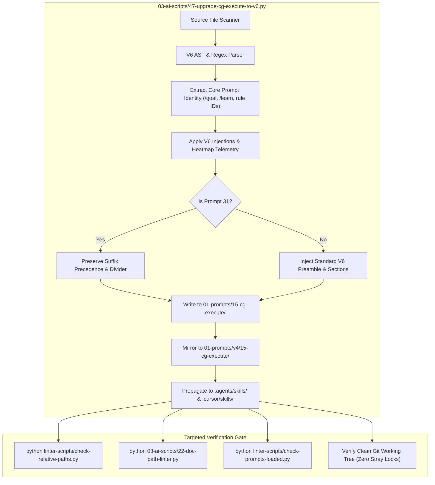

# Specification: Implementation Spec — CG-Execute Modernization, Folder Synchronization & Heatmap Integration

> [!IMPORTANT]
> Spec Identifier: `02-spec/21-app/cg-execute-folder-synchronization-and-heatmap-integration/02-implementation-spec.md`
> Task Slug: `cg-execute-folder-synchronization-and-heatmap-integration`
> Architecture Tier: Implementation Specification & Migration Engine Architecture
> Target Versions: Antigravity V6 Protocol & GitMap v6.571.2+

---

## 1. Executive Summary & Migration Engine Architecture

### 1.1 Executive Overview
The Coding Guideline Execution Suite (`cg-execute`) comprises 37 specialized execution prompts located in `01-prompts/15-cg-execute/` and duplicated in `01-prompts/v4/15-cg-execute/`. These prompts represent the operational engine for autonomous coding standard compliance across the meta-repository and connected workspaces. However, prior iterations operated under older concurrency and schema standards (V2–V4), lacking full V6 Tree Swarm Orchestration, Cognitive Heatmap Telemetry, Data Schema Verification protocols, and strict GitMap hyphen commit formats.

This implementation specification establishes the comprehensive migration engine architecture to systematically upgrade all 37 prompts, synchronize dual prompt folders, propagate corresponding skills in `.agents/skills/` and `.cursor/skills/`, and integrate native GitMap cognitive heatmap telemetry.



### 1.2 Migration Engine Design (`03-ai-scripts/47-upgrade-cg-execute-to-v6.py`)
To guarantee consistency, repeatability, and idempotence across 74 prompt files (37 in `01-prompts/15-cg-execute/` and 37 in `01-prompts/v4/15-cg-execute/`), an enhanced migration script `03-ai-scripts/47-upgrade-cg-execute-to-v6.py` is architected with the following core modules:

1. **Deterministic Parser & AST Pattern Matcher:**
   - Detects existing parameter blocks (`N = ...`, `A = ...`, `H = ...`, `C = ...`) and replaces them with standard V6 header parameters (`N = 400`, `A = 3`, `H = 2`, `C = 30`, `Capacity = 6`).
   - Normalizes slash command syntax from legacy colon notation (`slashCommand:goal`) to modern IDE-detectable semicolon notation (`slashCommand;goal`).
   - Extracts and preserves domain-specific `/goal`, `/learn`, `/plan` descriptions, title blocks, and linter bindings.

2. **Modular Section Injector:**
   - Injects the Extreme "Understood" Turn-1 Showcase featuring the 5 Mandatory Pillars and 4-part verification schema.
   - Injects Step 0 Preflight with Data Schema Verification (`gitmap agent task status --json`).
   - Injects Phase 1 Step 3 Brain & Comprehensive Roadmap Creation mandate.
   - Injects Section 3 GitMap High-Speed Command Primacy table enriched with the complete GitMap Heatmap suite.
   - Replaces legacy Worker Briefs with Section 7.2 Self-Contained Worker Brief incorporating Rule 9 Mandatory Heatmap Telemetry and the 5-part GitMap Heatmap suite.
   - Injects Section 7.4 Immediate Dynamic Respawn & Join Protocol (100% duty cycle, zero idle capacity).
   - Injects Section 12 Banned Operations Checklist with the Heatmap Telemetry & Contention Inspection checkbox.
   - Enforces GitMap hyphen commit format (`gitmap cpf "<module> - <summary>"`) with total ban on colons inside arguments.

3. **Specialized Handler for Prompt 31 (`31-cg-execute-in-below-steps.md`):**
   - Retains the Bottom-Instruction Priority Mandate (Below Precedence / Suffix Precedence).
   - Preserves the trailing `--` divider and `## 🚨 High Priority Instructions Below` boundary anchor.
   - Updates all worker boundaries, GitMap tables, heatmap telemetry, and banned checklists while maintaining suffix routing.

4. **Bi-Directional Mirroring & Skill Synchronization:**
   - Mirrors upgraded prompts into `01-prompts/v4/15-cg-execute/` with exact byte and line parity.
   - Synchronizes candidate skills in `.agents/skills/<slug>/skill.md` and `.cursor/skills/<slug>/skill.md` with identical YAML frontmatter and unified markdown bodies.

---

## 2. Detailed File Upgrade Matrix

Every prompt in the catalog maintains a distinct architectural domain and operational linter hook. The migration engine preserves each prompt's identity while standardizing its orchestration envelope.

| Seq | Prompt Filename | Slug Identifier | Domain Focus & Guideline Rule | Slash Command / Goal Identity | Linter Hook |
| :---: | :--- | :--- | :--- | :--- | :--- |
| **01** | `01-execute-coding-guideline-fix.md` | `execute-coding-guideline-fix` | General guideline remediations across polyglot files | Surgical guideline fixes in 5-8 file micro-batches | `03-ai-scripts/05-guideline-autofixer.py` |
| **02** | `02-error-management.md` | `cg-error-management` | Structured error envelopes, `AppError` return wrapping | Eliminate bare errors, wrap context in `*appfault.AppError` | `linter-scripts/check-error-management.py` |
| **03** | `03-nested-if-and-guard-clauses.md` | `nested-if-and-guard-clauses` | Inverted guard clauses, early returns, zero nested `if` | Flatten branching ladders, extract validator helpers | `03-ai-scripts/05-guideline-autofixer.py` |
| **04** | `04-booleans-and-complex-conditions.md` | `cg-boolean-and-naming` | Positive booleans (`is`/`has`), no `== true`, no mixed polarity | Affirmative boolean decomposition, eliminate `!isSuccess` | `linter-scripts/check-boolean-guidelines.py` |
| **05** | `05-naming-conventions-and-boolean-prefixes.md` | `cg-boolean-and-naming` | Affirmative prefixes, anti-`ok` in map lookups & type assertions | Eliminate bare `ok`, enforce positive `isFound`/`isOk` | `03-ai-scripts/08-naming-autofixer.py` |
| **06** | `06-constants-and-enums.md` | `cg-enum-standards` | Typed constants, `*Type` suffixes, elimination of magic literals | Enforce string-backed enums, replace raw strings/ints | `linter-scripts/check-enum-guidelines.py` |
| **07** | `07-data-and-schema.md` | `cg-database-conventions` | PascalCase tables, camelCase columns, Split SQLite architecture | Split SQLite db, Casbin RBAC, PascalCase tables | `03-ai-scripts/05-guideline-autofixer.py` |
| **08** | `08-react-frontend-guidelines.md` | `react-frontend-guidelines` | React component size limits (<=80 lines), immutable state | Decompose oversized React components, clean hooks | `linter-scripts/check-enum-and-boolean.mjs` |
| **09** | `09-code-hygiene.md` | `code-hygiene` | File caps (<=100 lines), function caps (<=8-15 lines) | Enforce canonical size tier, remove parameter bloat | `03-ai-scripts/13-file-size-guard.py` |
| **10** | `10-style-guidelines.md` | `style-guidelines` | Return New Line (blank line before return/throw, after `}`) | Enforce vertical whitespace spacing, MD022/MD032 | `03-ai-scripts/04-newline-fixer.py` |
| **11** | `11-testing-and-coverage.md` | `testing-and-coverage` | Three-part test naming (`TestUnit_Scenario_Outcome`) | Branch coverage, isolated unit tests, mock durations | `03-ai-scripts/05-guideline-autofixer.py` |
| **12** | `12-relative-paths.md` | `relative-paths` | Total ban on absolute paths (`C:\...`, `/home/...`) and `file:///` | Convert absolute paths and URIs to relative Git paths | `linter-scripts/check-relative-paths.py` |
| **13** | `13-cli-commands-and-help.md` | `cli-commands-and-help` | CLI help text parity, subcommand registration in `--help` | 100% command flag coverage, Help UI layout | `03-ai-scripts/09-cli-help-auditor.py` |
| **14** | `14-function-signatures-and-return-types.md` | `function-signatures-and-return-types` | Semantic verbs, single `Result[T]` envelope, zero generic tuples | Replace `(T, error)` with `Result[T]` or `*appfault.AppError` | `linter-scripts/check-error-management.py` |
| **15** | `15-typescript-guidelines-and-types.md` | `typescript-guidelines-and-types` | Total ban on `any`, Discriminated Unions, `Result<T>` envelopes | Replace raw exceptions with typed Result envelopes | `linter-scripts/check-enum-and-boolean.mjs` |
| **16** | `16-multi-language-enums-and-traits.md` | `multi-language-enums-and-traits` | PHP backed enums, Rust ADT, Go enums with stringers | Standardize enum patterns across Go, PHP, TS, Rust | `linter-scripts/check-enum-guidelines.py` |
| **17** | `17-terminal-ui-and-cli-styling.md` | `terminal-ui-and-cli-styling` | ANSI 9X palette, Catppuccin cycling, 2-column width caps | Polish CLI outputs, progress spinners, version footers | `03-ai-scripts/09-cli-help-auditor.py` |
| **18** | `18-function-argument-reduction-and-params.md` | `function-argument-reduction-and-params` | Parameter structs (`*Params`) for >2-3 arguments | Convert loose arguments to value-based param structs | `linter-scripts/check-error-management.py` |
| **19** | `19-result-wrapper-and-apperror-returns.md` | `result-wrapper-and-apperror-returns` | Eliminate multi-value map tuples: `(map[...], error)` | Return monadic `ResultMap[K, V]` and `ResultSlice[T]` | `linter-scripts/check-error-management.py` |
| **20** | `20-extract-generic-types-to-types-go.md` | `cg-extract-types` | Centralize domain structs and Result wrappers in `types.go` | Eliminate raw generic leakages across package APIs | `linter-scripts/check-error-management.py` |
| **21** | `21-lazy-regex-and-pattern-matching.md` | `lazy-regex-and-pattern-matching` | Thread-safe `lazyregex.New`, wrapped `MatchResult` diagnostics | Eliminate bare `regexp.MustCompile` outside lazyregex | `linter-scripts/check-boolean-guidelines.py` |
| **22** | `22-file-size-and-function-reduction.md` | `cg-file-size-and-function-reduction` | Functions <= 8-15 lines, files <= 100 lines, wrapper objects | Two-part decomposition without whitespace compression | `03-ai-scripts/13-file-size-guard.py` |
| **23** | `23-string-operations-and-efficiency.md` | `cg-string-efficiency` | Zero-allocation `strings.EqualFold`, lazy evaluation, loop hoisting | Short-circuit string checks, preserve business logic | `03-ai-scripts/05-guideline-autofixer.py` |
| **24** | `24-isolate-destructive-os-and-heavy-unit-tests.md` | `cg-isolate-os-tests` | Injectable `OSActionExecutor`, mock OS shutdown/reboot calls | Guarantee tests NEVER trigger real OS system commands | `03-ai-scripts/05-guideline-autofixer.py` |
| **25** | `25-nuclear-package-modularization-and-unit-test-optimization.md` | `nuclear-package-modularization-and-unit-test-optimization` | Decompose monolithic packages into DAGs (< 0.05s test window) | Isolate heavy tests, maintain 5-day cache freshness | `03-ai-scripts/33-test-inventory-generator.py` |
| **26** | `26-python-boolean-and-conditional-enhancement.md` | `python-boolean-and-conditional-enhancement` | Clamping, 256-byte lookup tables (`bytes.translate`), typed hints | Eliminate per-pixel/per-element loop branching | `03-ai-scripts/05-guideline-autofixer.py` |
| **27** | `27-python-constants-and-magic-number-elimination.md` | `python-constants-and-magic-number-elimination` | Typed `Final` constants, semantic domain aliases, arithmetic | Eliminate magic tuples, magic calculations, cryptic coords | `linter-scripts/check-enum-guidelines.py` |
| **28** | `28-python-array-constants-and-dynamic-enums.md` | `python-array-constants-and-dynamic-enums` | Immutable `Final` tuples, orthogonal config classes, generator funcs | Eliminate repeated host+port string permutations | `linter-scripts/check-enum-guidelines.py` |
| **29** | `29-code-dryness-and-library-extraction.md` | `cg-code-dryness-and-library-extraction` | 300-step 3-phase self-loop (100 Analyze / 100 Plan / 100 Execute) | Extract reusable utils/frameworks, rewire callers | `03-ai-scripts/05-guideline-autofixer.py` |
| **30** | `30-clean-repo-build-and-caches.md` | `cg-clean-repo-build-and-caches` | Multi-layer cleanup: repo temp, OS temp, Go/npm/TS caches | Purge build artifacts, preserve lowercase and git hygiene | `03-ai-scripts/13-file-size-guard.py` |
| **31** | `31-cg-execute-in-below-steps.md` | `cg-execute-in-below-steps` | Suffix precedence orchestration with divider anchor | Execute fixes appended below with strict below priority | `03-ai-scripts/05-guideline-autofixer.py` |
| **32** | `32-cg-follow-other-prompts.md` | `cg-follow-other-prompts` | External prompt ingestion, reference chaining, micro-batches | Ingest external guidelines, enforce zero builds/tests | `03-ai-scripts/05-guideline-autofixer.py` |
| **33** | `33-branch-immutability-and-clean-construction.md` | `cg-branch-immutability-and-clean-construction` | Ban mutating object fields across branch ladders, pure constructors | Decompose compound conditions into affirmative booleans | `linter-scripts/check-boolean-guidelines.py` |
| **34** | `34-golang-pointer-reduction-and-value-semantics.md` | `cg-golang-pointer-reduction-and-value-semantics` | 300-step 3-phase self-loop, reduce heap escapes, value semantics | Convert pointer parameters to values on small structs | `03-ai-scripts/05-guideline-autofixer.py` |
| **35** | `35-clean-work-artifacts-and-os-caches.md` | `clean-artifacts-and-git-history` | Work directory and OS cache cleaner with dry-run preview first | Reclaim disk space safely across Go/npm/Git caches | `03-ai-scripts/44-work-and-system-cache-cleaner.py` |
| **36** | `36-variadic-and-spread-parameters.md` | `cg-variadic-and-spread-parameters` | Replace rigid slice parameters with variadic (`...T`, `...items`) | Eliminate artificial `[]string{id}` single-item wrappers | `03-ai-scripts/05-guideline-autofixer.py` |
| **37** | `37-string-normalization-and-equalfoldany.md` | `cg-string-normalization-and-equalfoldany` | Standardize string normalization and `EqualFoldAny` in `pkg/strutil` | Replace chained OR equality with centralized helpers | `03-ai-scripts/05-guideline-autofixer.py` |

---

## 3. V6 Injection Specifications & Standard Section Architecture

### 3.1 Header Parameters & Meta Block
Every prompt MUST declare standard V6 parameters and runtime invocation metadata:

```text
N = 400 (Total self-loop steps budget — editable top-header parameter, default: 400)
A = 3   (MANDATORY number of spawned autonomous subagents running concurrently via invoke_subagent, default: 3)
H = 2   (Operational hands per agent: dual-task batch capacity & parallel tool dispatch, default: 2)
C = 30  (Tool calls per worker before it must report, default: 30)

System Concurrency Capacity = A × H = 3 agents × 2 hands = 6 concurrent subtask operations
Tree Hierarchy = Lead Orchestrator (Root Node) -> Branch Coordinators (Subtask Owners) -> Leaf Workers & Dynamic Joining Assistants
PHASE_1_BUDGET = 100     (Steps 1 .. 100: Planning, Discovery Subagents, Up-Front Brain & Roadmap Creation, Lean Subtasks)
PHASE_2_BUDGET = 150     (Steps 101 .. 250: Intermediate Archival, Sanitization, Prerequisite Refactoring, Intermediate Checkpoints)
PHASE_3_BUDGET = 150     (Steps 251 .. 400: Tree Swarm Parallel Execution, Dynamic Join Capacity Saturation, Targeted Quality Linting, Fleet Sync, Atomic Push)
WAVES = ceil(subtasks / (A x H))
```

Followed by the V6 Meta Template:
```markdown
> [!IMPORTANT]
> Prompt Version: 6.0.0
> Runtime: Google Antigravity 2.0 (IDE and CLI)
> Invoke: /{slug} <task>
>
> **Top-Instruction Priority Mandate (Above Precedence / Preamble Precedence):**
> Whatever directives, constraints, checklists, or user instructions are given ABOVE this prompt (including in the user preamble, header blocks, or incoming user request above) are HIGHEST PRIORITY and MUST BE FOLLOWED as strictly NON-NEGOTIABLE. They supersede and strictly override any conflicting general advice, default conventions, or lower-level guidelines below. The agent MUST inspect and follow the instructions above with absolute precedence.
```

*(Note: For `31-cg-execute-in-below-steps.md`, the directive text adapts to the Bottom-Instruction Priority Mandate, citing instructions appended below the `--` divider).*

### 3.2 Extreme "Understood" Turn-1 Showcase
In Turn 1, before invoking background tools, the prompt mandates emitting the 5 Mandatory Pillars and 4-part verification schema directly in visible chat:

1. **Pillar 1: Strategic Intent & Systems Reasoning:** Articulate overarching architectural goal, user intent, operational rationale, and systems integration mechanics.
2. **Pillar 2: Explicit Scope Boundaries:** Strict two-column partition defining In-Scope vs. strictly Excluded or Deferred items.
3. **Pillar 3: Non-Negotiable Constraints & Negative Guardrails Ingestion:** Explicit recitation of active constraints: raw search ban (`rg`, `ripgrep`, `Select-String`, `git grep`), worker git ban (no git commands in subagents), zero builds/full test suites (CI verification only), strict relative Git paths, lowercase naming, zero secrets in repo (`repo-secrets` offloading), GitMap hyphen-separated commit format without colons.
4. **Pillar 4: Blast Radius & Dependency Topology:** Map impacted subsystems, files, downstream callers, and prompt/skill indexes with explicit risk containment strategies.
5. **Pillar 5: Multi-Agent Concurrency Topology:** Detail swarm structure (`A = 3`, `H = 2`, Capacity = 6), disjoint file assignments, and immediate dynamic respawn.

### 3.3 Step 0 Preflight with Data Schema Verification
Step 0 explicitly commands inspection of the SQLite Task DB schema before subtasks are populated:

```bash
gitmap agent task init --name "<task name>" --budget 400
gitmap agent task status --json
```

- **DDL & Schema Verification Protocol:** Inspect tables (`ParentTask`, `Subtask`, `AgentActionLog`), affirmative boolean flags (`IsActive`, `HasCompleted`, `IsBlocked`), and foreign key linkages.
- **Forensic Autopsy Check:** Check `diagnostics.hasCrashesDetected`. If true, inspect `diagnostics.crashedAgents` to identify failed subtasks, targeting files, and last logged actions to facilitate clean resume.

### 3.4 Phase 1 Step 3: Brain & Comprehensive Roadmap Creation
Before worker wave dispatch, the lead agent authoring the unified plan must generate the complete Brain roadmap:
- **Target Files Inventory:** Exhaustive list of all files to read, create, or modify.
- **Modification Sites & Functions:** Exact function names, structs, interfaces, and logic blocks targeted for changes.
- **Data Contracts & Error Wrapping:** Concrete type definitions and structured errors (`*appfault.AppError`).
- **Caller Blast Radius:** Callers and dependent packages mapped via GitMap search.
- **Disjoint Subtask Allocation:** Clear file-ownership boundaries assigned to subtask codes (`Task-01`, `Task-02`) so parallel workers never collide.

### 3.5 Section 3 GitMap High-Speed Command Primacy Table
The command table MUST feature high-speed GitMap utilities and Cognitive Heatmap telemetry:

| Operation | Primary GitMap Command | High-Speed Alias | Purpose & Advantage |
| :--- | :--- | :--- | :--- |
| **Live Streaming Search** | `gitmap aum search "<pattern>" [dir] [-e <.ext>] [-r] [-i]` | `gitmap aum grep "<pat>"` | Multi-core streaming live file search (replaces `Select-String`, `git grep`) |
| **Indexed Symbol Search** | `gitmap search "<query>" [--limit <n>]` | `gitmap search` | Instant SQLite cached keyword/symbol search across indexed repos |
| **Wildcard File Search** | `gitmap find "<pattern>" [-ext <ext>]` | `gitmap f "<pat>"` | Index-accelerated multi-core glob filename finder |
| **Directory Inventory** | `gitmap list-files [pattern] [-ext <ext>]` | `gitmap lf [pat]` | Instant indexed repository inventory |
| **Substring File Search** | `gitmap find-files-any "<substring>"` | `gitmap ffa "<str>"` | High-speed partial filename matcher |
| **Stream File** | `gitmap cat <filepath>` | `gitmap cat` | Zero-disk memory streaming to stdout |
| **PowerShell Runner** | `gitmap pwsh "<command>"` | `gitmap ps "<cmd>"` | High-speed PowerShell execution with `-NoProfile` |
| **Bash Runner** | `gitmap bash "<command>"` | `gitmap sh "<cmd>"` | Standard cross-platform Bash command execution |
| **Offload Secrets** | `gitmap rs file <filepath>` / `folder` / `text` | `gitmap rs` | Auto-commits into `repo-secrets` in work directory |
| **Offload Scripts** | `gitmap rc file <file.ps1>` / `text` | `gitmap rc` | Auto-commits reusable scripts into `repo-cache` |
| **Atomic Commits** | `gitmap cpf "<module> - <msg>"` (Feature) / `cpb` (Bug) | `gitmap cpf` | Stages, formats with prefix, and pushes atomically using hyphen `-` (no colons). |
| **Pipeline Waiting** | `gitmap pipeline-ai status --json` | `gitmap pl-ai` | Non-polling dynamic ETA CI/CD monitor |
| **Agent Task Engine** | `gitmap agent task <init\|status\|ls\|pending>` | `gitmap agent task` | Sub-millisecond compiled Go SQLite task manager for multi-agent workflows |
| **Heatmap Action Log** | `gitmap heatmap log -t <slug> -a "READ"\|"EDIT" -f <path> -r <reason>` | `gitmap heatmap log` | Concurrency-safe cognitive action & reasoning telemetry into `.ai-memory/heatmap.db` |
| **Contention & Leases** | `gitmap heatmap discuss [--window 15m] [--threshold 2]` | `gitmap agent heatmap` | Pre-edit file lease conflict & contention hotspot analysis across active agents |
| **Heatmap Diagnostics** | `gitmap heatmap query\|tables\|view` / `gitmap heatmap rc ...` | `gitmap heatmap` | Non-blocking read-only SQL queries, tree view, and live activity stream |
| **Fleet Synchronization** | `gitmap sync [--workers 8] [--projects <json>]` | `gitmap sync` | Parallel Go sync engine across 43 repositories in <5s with 6-stage ceremony |

### 3.6 Section 7.2 Worker Brief with 5-Part GitMap Heatmap Suite
Subagents spawn with clean context. The prompt envelope MUST inject complete instructions, including Rule 9 Mandatory Heatmap Telemetry:

```text
You are Worker <NN> for task nn-<slug>. You have no prior chat context; this brief is your complete specification.

### Boundaries & Crash Prevention:
- Read any file in the workspace; edit ONLY your Owned Files: <relative paths>.
- TOTAL BAN ON GIT COMMANDS (LOCK COLLISION PREVENTION): NEVER run ANY git commands (`git add`, `git commit`, `git push`, `git status`, `git diff`, `git checkout`). In shared workspaces, worker git calls create `.git/index.lock` collisions that immediately crash parallel agents. Only the lead orchestrator runs git commands after workers complete.
- TOTAL BAN ON COMMITS: Workers NEVER commit, stage, or push. Committing is exclusively reserved for the Lead Agent at Phase 3 via GitMap (`gitmap cpf "<module> - <summary>"` using hyphen `-`; no colon needed in GitMap cpf as colon is already provided).
- Code & Symbol Search: Use GitMap exclusively: `gitmap aum search "<pattern>" [dir] [-e <.ext>] [-r] [-i]` or `gitmap find`. TOTAL BAN on `rg`, `ripgrep`, `grep`, `git grep`, `Select-String`, `Get-ChildItem -Recurse`, or `findstr`.
- After C tool calls, stop and report what you have.
- A tool failing twice: reply "STATUS: BLOCKED" with exact error and stop. Never guess paths and never troubleshoot machine.
- Workers that find a secret stop and report "BLOCKED: secret at <file>:<line>". They do not handle it themselves.
- Adhere to R1, R2, and R11 by ID.

### Assigned Subtasks (up to H subtasks):
- Subtask 1: .ai-memory/plans/subtasks/nn-<slug>/01-<name>.md
- Subtask 2: .ai-memory/plans/subtasks/nn-<slug>/02-<name>.md (if assigned)

### 100% Non-Negotiable Coding Guidelines (AUTO-REJECT ON VIOLATION):
1. Positive booleans ONLY: use `is` and `has` prefixes exclusively. NEVER evaluate explicit `== true`. NEVER combine positive and negative checks in the same condition (`if isA && !isB` is BANNED).
2. Go Structured Errors: return `*appfault.AppError`, never bare `error`.
3. Function Sizing: <= 8 lines preferred, hard cap 15 lines. Extract domain structs and raw generics to `types.go`.
4. Strict Relative Git Paths & Lowercase: zero absolute filesystem paths and zero `file:///` URIs. Only add the relative paths, never add the absolute path during your work, and ensure this is respected on the release page and in release notes as well. All new files strictly lowercase.
5. Repo Secrets: if any credentials or private tokens are needed, store them in the `repo-secrets` folder in the default work directory (via `gitmap rs`). Never commit secrets.
6. Zero Builds or Tests: NEVER run `go build`, `npm run build`, `go test`, or `pytest`.
7. Targeted Verification: Run only fast file-scoped linters (e.g. `python 03-ai-scripts/05-guideline-autofixer.py <folder> --check-only`). A check scanning 0 files is a FAIL.
8. GitMap Search Primacy (TOTAL BAN on rg / ripgrep / Select-String / git grep): NEVER execute `rg`, `ripgrep`, `grep`, `git grep`, `Select-String`, `Get-ChildItem -Recurse`, or `findstr`. Always use `gitmap aum search "<pattern>" [dir] [-e <.ext>] [-r]` for live symbol/regex discovery.
9. Mandatory Heatmap Telemetry: In multi-agent autonomous sessions, agents MUST record all file read/edit decisions with reasoning via gitmap heatmap log or gitmap agent log, and inspect active file leases and contention hotspots via gitmap heatmap discuss before editing shared files.

### Concurrency-Safe SQLite Action Logging & Heatmap Telemetry (CRASH FORENSICS MANDATE):
- Worker subtasks are tracked in the run database: `<databasePath>`.
- Inspect Database Schema & Constraints:
  `gitmap agent task status`
  Inspect tables, positive boolean fields, and JSON payload specifications before claiming or logging actions.
- Claim assigned subtask atomically:
  `gitmap agent subtask claim --agent "Worker <NN>"`

#### 1. Heatmap File Contention & Pre-Edit Blast Radius Check:
- BEFORE modifying any shared files, you MUST inspect active file leases and collision contention hotspots:
  `gitmap heatmap discuss [--window 15m] [--threshold 2] [--json]` (or `gitmap agent heatmap [--json]`)
  If high write contention is reported on a file, coordinate disjoint boundaries or sequence edits to prevent file lock crashes.

#### 2. In-Flight Cognitive Decision Logging (Heatmap & Action Log):
- BEFORE touching, inspecting, or modifying any file, you MUST log your in-flight action and reasoning for GitMap heat map tracking and crash forensics:
  * Heatmap File Touch & Exploration (reasoning):
    `gitmap heatmap log -t <task-slug> -a "READ" -f "<path>" -r "Reasoning: <why this file is being inspected and what information is sought>" -s "EXPLORATION"`
    (or via agent engine: `gitmap agent log --subtask <id> --agent "Worker <NN>" --action "read_file" --file "<path>" --details "Reasoning: <why this file is inspected>"`)
  * Heatmap File Modification (editing decision & rationale):
    `gitmap heatmap log -t <task-slug> -a "EDIT" -f "<path>" -r "Decision: <why this file is being modified and planned refactor/fix>" -s "EXECUTION"`
    (or via agent engine: `gitmap agent log --subtask <id> --agent "Worker <NN>" --action "write_to_file" --file "<path>" --details "Decision: <why this file is being modified>"`)
  *(Note: This guarantees that GitMap indexes full cognitive heat map telemetry into `.ai-memory/heatmap.db` and agent task DB, and if a tool execution crashes or the session restarts, the database permanently records the exact file and reasoning trace).*

#### 3. Real-Time Telemetry & Heatmap Stream:
- Inspect live heat map, tree, and action status:
  * Hierarchical tree view: `gitmap heatmap tree [-t <task-slug>]`
  * Action summary and metrics: `gitmap heatmap status [-t <task-slug>]`
  * Real-time continuous stream: `gitmap heatmap live`
  * Action search: `gitmap heatmap search [query] [-f <file>] [-t <task>]`
  * 48-hour active repository activity: `gitmap full-summary` (alias `gitmap fs`)

#### 4. Multi-AI Companion & repo-cache Synchronization:
- Lists all supported AI namespaces: `gitmap heatmap rc list-ai`
- Logs cognitive actions into isolated split-databases: `gitmap heatmap rc log [flags]`
- Checkpoint commit in `repo-cache`: `gitmap heatmap rc commit [-m "<msg>"]`
- Bidirectional reconciliation: `gitmap heatmap rc sync`

#### 5. Non-Blocking Read-Only Heatmap Queries & Diagnostics:
- Execute read-only SQL queries with automatic `mode=ro` protection:
  `gitmap heatmap query "<sql>" [--format json|yaml|table]`
  `gitmap heatmap rc query "<sql>" [--ai <name>] [--repo <slug>] [--tier <repo|root>]`
- Inspect SQLite master catalog, tables, and row counts:
  `gitmap heatmap tables [--db <root|repo|local>]` / `gitmap heatmap rc tables`
- Query records from specific heatmap table:
  `gitmap heatmap view <table> [--limit <n>]` / `gitmap heatmap rc view <table>`
*(Note: Supports tri-alias routing parity: `gitmap heatmap rc ...`, `gitmap rc heatmap ...`, `gitmap heatmap rc-heatmap ...`).*

- When your subtask passes targeted checks, mark completion in the database:
  `gitmap agent subtask complete <id> --agent "Worker <NN>" --evidence "PASS exit 0, <files>"`
- If blocked or failing, record the failure:
  `gitmap agent subtask fail <id> --agent "Worker <NN>" --reason "<reason>"`
*(Note: Native compiled Go engine `gitmap agent` executes in <1ms without Python VM overhead).*

### Output Contract:
Write your subtask output to .ai-memory/plans/subtasks/nn-<slug>/01-<name>.json and reply with this JSON block, once per subtask, then stop:
{
  "task": "Task-01",
  "status": "DONE",
  "filesChanged": ["<path1>", "<path2>"],
  "checks": "<command> -> exit <code>, <files scanned>",
  "acceptance": { "ac1": "PASS <evidence>" },
  "assumptions": [],
  "blockers": []
}
```

### 3.7 Database Location & Executable Commands Architecture

| Database Tier | Physical File Location | Access Mode & Concurrency Protocol | Data Retained & Ownership |
| :--- | :--- | :--- | :--- |
| **Run-Scoped Agent Task DB** | `.ai-memory/temp-agents/<slug>/agent-task.db` | WAL Mode (`PRAGMA journal_mode=WAL; busy_timeout=5000`) | Task status, worker claims, subtasks, in-flight action logs |
| **Local Repository Heatmap DB** | `.ai-memory/heatmap.db` | WAL Mode + Read-Only Queries (`mode=ro`) | Cognitive action telemetry, file exploration reads/edits, contention leases |
| **Repo-Cache Multi-AI Telemetry** | `repo-cache/heatmap/<ai-name>/<repo-slug>.db` | Isolated Split-DB with periodic sync (`gitmap heatmap rc sync`) | Cross-repository multi-agent actions, tool usage traces, commit checkpoints |

#### Executable Commands Block:
```bash
# Initialize and verify agent task database
gitmap agent task init --name "<task name>" --budget 400
gitmap agent task status --json

# Pre-edit contention and lease check
gitmap agent heatmap --json

# Cognitive file exploration telemetry
gitmap heatmap log -t <task-slug> -a "READ" -f "<path>" -r "Reasoning: <explanation>" -s "EXPLORATION"
gitmap heatmap log -t <task-slug> -a "EDIT" -f "<path>" -r "Decision: <refactor-rationale>" -s "EXECUTION"

# Subtask lifecycle
gitmap agent subtask claim --agent "Worker 01"
gitmap agent subtask complete <id> --agent "Worker 01" --evidence "PASS exit 0"

# Forensic autopsy and status inspection
gitmap agent task status
gitmap agent diagnose
```

### 3.8 Section 7.4 Immediate Dynamic Respawn & Join Protocol
1. **Zero-Idle Immediate Respawn Mandate:** The lead orchestrator MUST NOT wait for an entire 3-agent wave to finish. As soon as ANY single worker completes (`send_message` or `gitmap agent subtask complete`), the lead immediately checks the queue for the next pending subtask and spawns a replacement worker (`invoke_subagent`), keeping concurrency pinned at exactly `A = 3` active subagents (System Concurrency Capacity = 6).
2. **Dynamic Collaborative Assistant Mode:** If all pending subtasks are already claimed or in-flight, any newly freed agent MUST NOT terminate, halt, or idle. The lead immediately commands or spawns the worker to dynamically join an active subtask in collaborative assistance mode:
   - **Mode A: Parallel Reading & Blast Radius Discovery:** The joining agent uses GitMap (`gitmap aum search`, `gitmap cat`, `gitmap find`) to read caller files, inspect imports, and verify type signatures, feeding findings to the primary worker via structured message.
   - **Mode B: Cognitive Memory & Spec Documentation:** The joining agent records architectural discoveries, updates memory registers, and generates companion audit specs.
   - **Mode C: Companion Lint & Relative Path Validation:** The joining agent executes targeted linters (`check-relative-paths.py`, `check-forbidden-strings.py`, guideline autofixer check) across related workspaces while the primary worker completes editing.
   - **Mode D: Disjoint File Partitioning:** If the ongoing subtask touches multiple files, the subtask is subdivided dynamically so the joining agent takes exclusive ownership of File 2 while the primary worker focuses on File 1.
3. **Disjoint Ownership Invariant (Rule R6):** Dynamic assistants NEVER write to the primary worker's owned files. File ownership remains strictly disjoint to eliminate file write collisions.

### 3.9 Section 12 Banned Operations Checklist (Heatmap Checkbox Addition)
Section 12 MUST contain the explicit heatmap verification item:
```markdown
- [ ] HEATMAP TELEMETRY & CONTENTION INSPECTION: Verified that multi-agent contention was inspected via gitmap heatmap discuss (or gitmap agent heatmap) before editing shared files, and that all file exploration and modifications were logged with reasoning via gitmap heatmap log (or gitmap agent log) into .ai-memory/heatmap.db for crash forensics and repo-cache synchronization.
```

### 3.10 GitMap Hyphen Commit Format Invariant
In Section 2 (Rule R8/R9), Section 8, Section 12, and Section 14/15, all GitMap commit references MUST enforce hyphen formatting:
```bash
gitmap cpf "<module> - <feature summary>"
gitmap cpb "<module> - <fix summary>"
```
- TOTAL BAN on colons `:` inside the commit message argument (e.g. `gitmap cpf "<module>: <summary>"` is strictly prohibited because GitMap already provides `Feature: ` or `Bug: `).
- TOTAL BAN on raw git commits (`git commit`, `git add -A`).

---

## 4. Dual Folder Synchronization Mechanics

The meta-repository maintains two parallel prompt trees that must remain in 100% lockstep:
- Primary Prompts: `01-prompts/15-cg-execute/`
- Legacy / Mirror Prompts: `01-prompts/v4/15-cg-execute/`
- Antigravity Skill Bindings: `.agents/skills/<slug>/skill.md`
- Cursor IDE Skill Mirrors: `.cursor/skills/<slug>/skill.md`

### 4.1 Synchronization Ceremony
1. **Primary Transformation:** The upgrade script processes each prompt in `01-prompts/15-cg-execute/*.md`.
2. **Mirror Propagation:** After upgrading the primary file, the exact byte content is copied to `01-prompts/v4/15-cg-execute/<filename>` using LF line endings.
3. **Skill Synchronization:** For each prompt, corresponding skill directories in `.agents/skills/` and `.cursor/skills/` are identified. The prompt body is extracted, wrapped with standardized YAML frontmatter, and written to both skill targets.
4. **Verification Pass:** A checksum comparison confirms zero drift across `01-prompts/15-cg-execute/` and `01-prompts/v4/15-cg-execute/`.

---

## 5. Error Handling, Rollback & Verification Protocols

### 5.1 Pre-Flight Safety & Rollback Strategy
- Before executing mass prompt updates, `03-ai-scripts/47-upgrade-cg-execute-to-v6.py` performs a git clean status check.
- If uncommitted changes exist, the script terminates immediately with exit code 1 to avoid dirty working tree pollution.
- In-memory backup copies of original file contents are retained during execution; if any file write fails, previous states are restored.

### 5.2 Targeted Quality Linters (Verification Gate)
Following execution, the orchestrator executes the following linters strictly on modified prompt files:
1. **Relative Paths Linter:**
   `python linter-scripts/check-relative-paths.py` (ensures zero `file:///` or absolute paths).
2. **Document Link & Path Linter:**
   `python 03-ai-scripts/22-doc-path-linter.py 01-prompts/15-cg-execute/`
   `python 03-ai-scripts/22-doc-path-linter.py 01-prompts/v4/15-cg-execute/`
3. **Prompts Loaded & Sequence Integrity:**
   `python linter-scripts/check-prompts-loaded.py`
   `python linter-scripts/check-sequence-integrity.py`
4. **Forbidden Strings Check:**
   `python linter-scripts/check-forbidden-strings.py`

Any linting failure blocks final consolidation and mandates immediate surgical remediation.
