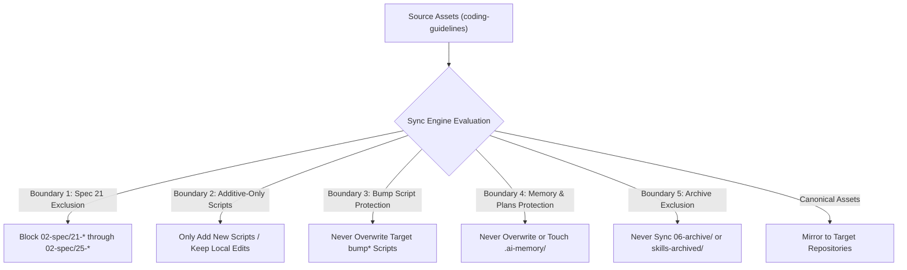

# Implementation Specification: Coding Guideline & Skill Catalog Optimization

> **/goal** Define the complete implementation architecture for purging Letterly skill duplicates, archiving ineffective and legacy skill stubs to a first-level archive, elevating Letterly prompts, and enforcing non-destructive cross-repository fleet synchronization.
> **/learn** Apply strict relative paths, lowercase naming conventions, positive boolean evaluation, and the 5 non-negotiable multi-repository boundaries.

## 🎯 Actionable Implementation Checklist

- [ ] Verify complete removal of all 11 `letterly-*` skill directories from `.agents/skills/` and `.cursor/skills/`.
- [ ] Establish first-level archival directories `.agents/skills-archived/` and `.cursor/skills-archived/`.
- [ ] Migrate deprecated `-old`, legacy planning stubs, duplicate v1 wrappers, 20-line stub duplicates, redundant CI/CD variants, and tone stubs into the archival directory.
- [ ] Upgrade Letterly prompts under `01-prompts/22-letterly/` and `01-prompts/23-cursor-prompts/` to enforce the 400-step execution budget and link directly to canonical skills (`execute-parent-task-with-n-steps-v6`).
- [ ] Enforce the non-destructive synchronization invariant (`removed == 0` unconditionally) across all 43 connected repositories.
- [ ] Verify all 5 non-negotiable multi-repository sync boundaries: Spec 21 exclusion, additive-only AI scripts, bump script protection, memory & plans protection, and archive exclusion.

**Version:** 1.0.0  
**Updated:** 2026-10-18  
**Status:** Active  
**AI Confidence:** Production-Ready (100%)  
**Ambiguity:** None (0%)  
**Category:** Implementation Architecture  

---

## 1. Executive Summary

This specification defines the architectural remediation and operational protocol for optimizing the agent skill catalog and cross-repository synchronization engine within the `coding-guidelines` meta-repository.

Over multiple development iterations, skill directories accumulated redundant duplicates, deprecated v1 implementations, tone-only text stubs, and external input formatters. Specifically:
1. **Letterly Skill Redundancy:** Letterly is an external voice dictation application running outside the IDE. Voice transcripts are ingested via prompt templates (`01-prompts/22-letterly/` and `01-prompts/23-cursor-prompts/`). Registering Letterly formatters as interactive agent skills within `.agents/skills/` and `.cursor/skills/` bloats the context window of active agent sessions without providing executable runtime tooling.
2. **Skill Catalog Bloat:** Over 38 skills represent legacy stubs (e.g. `-old` suffixes, single-rule 20-line stubs superseded by consolidated `cg-*` suites, redundant CI/CD permutations, and legacy planning protocols).
3. **Cross-Repository Synchronization Safety:** When synchronizing canonical assets to downstream repositories, target-owned files must remain intact. Deletion of stale files in target repositories (`removed > 0`) creates risk of accidental asset loss. Fleet synchronization must be strictly non-destructive.

This specification details the structural changes, archival mechanisms, prompt elevations, and synchronization guarantees required to resolve these issues.

---

## 2. Letterly Skill Purge & Prompt Elevation Architecture

### 2.1 Rationale & External Tool Dynamics

Letterly operates as an external mobile and desktop voice capture utility. It transforms spoken natural language into formatted markdown directives before sending them into Antigravity or Cursor chat interfaces.

Because the transcription and structuring occur prior to agent interaction, the agent does not execute a "Letterly skill" during code generation or repository manipulation. Instead, the agent executes canonical orchestration skills such as `execute-parent-task-with-n-steps-v6` or `ci-cd-fix-gitmap-release`. Maintaining duplicate `letterly-*` skill folders in `.agents/skills/` and `.cursor/skills/` introduces confusion, inflates skill index tables, and exhausts prompt context tokens during skill discovery.

### 2.2 Purge Targets: The 11 Letterly Skills

The following 11 skill directories must be completely removed from `.agents/skills/` and `.cursor/skills/`:

| # | Skill Directory Name | Former Purpose | Successor Location |
|---|----------------------|----------------|-------------------|
| 01 | `letterly-cicd-fix-release` | Formatted voice prompt for CI/CD fix and release | `01-prompts/22-letterly/` |
| 02 | `letterly-desktop` | Formatted desktop action prompt | `01-prompts/22-letterly/` |
| 03 | `letterly-execute-n-steps` | Formatted voice prompt for N-step execution | `01-prompts/22-letterly/` |
| 04 | `letterly-execute-with-release` | Formatted voice prompt for execution and release | `01-prompts/22-letterly/` |
| 05 | `letterly-execute-with-verification` | Formatted voice prompt for execution with audit | `01-prompts/22-letterly/` |
| 06 | `letterly-git-pull-first` | Formatted voice prompt prioritizing git pull | `01-prompts/22-letterly/` |
| 07 | `letterly-mobile` | Formatted chained mobile single-line goal | `01-prompts/22-letterly/` |
| 08 | `letterly-mobile-cicd-fix` | Formatted single continuous line mobile CI/CD fix | `01-prompts/22-letterly/` |
| 09 | `letterly-plan` | Formatted voice prompt for architecture planning | `01-prompts/22-letterly/` |
| 10 | `letterly-release` | Formatted voice prompt for version bump release | `01-prompts/22-letterly/` |
| 11 | `letterly-run` | Formatted voice prompt for project runner execution | `01-prompts/22-letterly/` |

### 2.3 Removal Action & Paths

All removals are executed directly against the file tree without modifying git history:

```text
.agents/skills/letterly-cicd-fix-release/
.agents/skills/letterly-desktop/
.agents/skills/letterly-execute-n-steps/
.agents/skills/letterly-execute-with-release/
.agents/skills/letterly-execute-with-verification/
.agents/skills/letterly-git-pull-first/
.agents/skills/letterly-mobile/
.agents/skills/letterly-mobile-cicd-fix/
.agents/skills/letterly-plan/
.agents/skills/letterly-release/
.agents/skills/letterly-run/

.cursor/skills/letterly-cicd-fix-release/
.cursor/skills/letterly-desktop/
.cursor/skills/letterly-execute-n-steps/
.cursor/skills/letterly-execute-with-release/
.cursor/skills/letterly-execute-with-verification/
.cursor/skills/letterly-git-pull-first/
.cursor/skills/letterly-mobile/
.cursor/skills/letterly-mobile-cicd-fix/
.cursor/skills/letterly-plan/
.cursor/skills/letterly-release/
.cursor/skills/letterly-run/
```

### 2.4 Prompt Modernization Architecture

Prompt templates located under `01-prompts/22-letterly/` and `01-prompts/23-cursor-prompts/` remain canonical and must be upgraded to modern standards:
1. **400-Step Execution Budget:** All execution prompts must declare a continuous 400-step budget self-loop with bounded subtasks and dynamic state tracking.
2. **Canonical Skill Referencing:** Prompts must link directly to active canonical skills using relative markdown links:
   - Orchestration: `.agents/skills/execute-parent-task-with-n-steps-v6/skill.md`
   - Planning: `.agents/skills/plan-spec-steps-v2/skill.md`
   - CI/CD Remediation: `.agents/skills/ci-cd-fix-gitmap-release/skill.md`
   - Release: `.agents/skills/minor-bump/skill.md`
   - Verification: `.agents/skills/ai-verification/skill.md`
3. **Link Hygiene:** Enforce strictly relative git repository root paths. No absolute filesystem paths (`C:\...`, `/home/...`) and no `file:///` URIs may appear inside prompt definitions.

---

## 3. Skill Catalog Optimization & First-Level Archival

### 3.1 Archival Directory Structure

To preserve institutional memory without cluttering active agent discovery, ineffective, deprecated, and duplicate skills are relocated to first-level archive folders:
- `.agents/skills-archived/`
- `.cursor/skills-archived/`

These folders reside at the repository root level alongside `.agents/skills/` and are strictly excluded from runtime skill discovery, AI prompts, and multi-repository downstream synchronization.

### 3.2 Inventory of Archived Skills

A total of 38 skills are targeted for first-level archival across six distinct operational categories:

#### Category A: Deprecated `-old` Skills (3 Skills)
Superfluous legacy implementations preserved only for historical audit:
- `audit-app-spec-old`
- `fix-spec-from-audit-old`
- `read-memory-old`

#### Category B: Legacy Planning Stubs (5 Skills)
Replaced by `plan-spec-steps-v2` and `ai-memory-consolidate-reduce`:
- `plan-maximum-enforcement`
- `plan-maximum-enforcement-v5`
- `plan-steps`
- `plan-steps-by-groups`
- `plan-spec-steps`

#### Category C: Duplicate v1 Wrappers (5 Skills)
Replaced by updated v2/v4 or canonical suites:
- `boolean-improvements` (Replaced by `boolean-improvements-v2` and `cg-boolean-and-naming`)
- `proofread` (Replaced by `proofread-v2`)
- `autonomous-qa-and-testing` (Replaced by `autonomous-qa-and-testing-v4`)
- `temp-end-to-end-test` (Replaced by `temp-end-to-end-tests`)
- `nuclear-package-modularization` (Replaced by `nuclear-package-modularization-and-unit-test-optimization`)

#### Category D: 20-Line Stub Duplicates Replaced by Canonical `cg-*` Skills (15 Skills)
Isolated, single-rule stubs whose logic has been consolidated into the comprehensive `cg-*` (Coding Guidelines) suite:

| Archived Stub Skill | Canonical Successor Skill | Focus Domain |
|---------------------|---------------------------|--------------|
| `branch-immutability-and-clean-construction` | `cg-branch-immutability-and-clean-construction` | Immutable branch constructor patterns |
| `clean-repo-build-and-caches` | `cg-clean-repo-build-and-caches` | Cache purging and build artifact hygiene |
| `code-dryness-and-library-extraction` | `cg-code-dryness-and-library-extraction` | DRY analysis and utility extraction |
| `file-size-and-function-reduction` | `cg-file-size-and-function-reduction` | File line caps and function decomposition |
| `golang-pointer-reduction-and-value-semantics` | `cg-golang-pointer-reduction-and-value-semantics` | Value semantics and pointer reduction |
| `extract-generic-types-to-types-go` | `cg-extract-types` | Type centralization in types.go |
| `string-operations-and-efficiency` | `cg-string-efficiency` | High-efficiency string allocations |
| `string-normalization-and-equalfoldany` | `cg-string-normalization-and-equalfoldany` | Case-folding and string normalization |
| `variadic-and-spread-parameters` | `cg-variadic-and-spread-parameters` | Variadic parameter transformations |
| `isolate-destructive-os-and-heavy-unit-tests` | `cg-isolate-os-tests` | Safe test runners and OS mock isolation |
| `booleans-and-complex-conditions` | `cg-boolean-and-naming` | Boolean naming and polarity hygiene |
| `naming-conventions-and-boolean-prefixes` | `cg-boolean-and-naming` | Boolean prefixes and naming conventions |
| `constants-and-enums` | `cg-enum-standards` | Typed enums and magic literal bans |
| `data-and-schema` | `cg-database-conventions` | PascalCase tables and SQLite split DB |
| `error-management` | `cg-error-management` | Structured AppError returns |

#### Category E: Redundant CI/CD Variants (7 Skills)
Consolidated into `ci-cd-fix`, `ci-cd-fix-gitmap-release`, and `cicd-pipeline-create`:
- `ci-cd-fix-with-n-steps`
- `ci-cd-fix-with-release`
- `ci-cd-fix-with-release-n-steps`
- `ci-cd-fix-with-release-tweak`
- `ci-cd-fix-tweak`
- `cicd-pipeline-create` (Legacy single-file variant; `ci-cd-create` remains canonical)
- `fix-ci-cd-and-run-scripts`

#### Category F: Tone Stubs (3 Skills)
Pure tone modifiers containing no operational actions or tools:
- `raw-insults`
- `consolidated-insults-v2`
- `insult-code-fix`

### 3.3 Active Canonical Catalog Post-Optimization

After archiving the 38 inactive skills and purging the 11 Letterly skills, the active skill catalog retains approximately 40 high-authority, production-ready skills:
- Core Orchestration: `execute-parent-task-with-n-steps-v6`, `unified-ai-prompt-v4`, `muse-master-prompt`
- Coding Guidelines Suite: `cg-boolean-and-naming`, `cg-branch-immutability-and-clean-construction`, `cg-clean-repo-build-and-caches`, `cg-code-dryness-and-library-extraction`, `cg-database-conventions`, `cg-enum-standards`, `cg-error-management`, `cg-extract-types`, `cg-file-size-and-function-reduction`, `cg-golang-pointer-reduction-and-value-semantics`, `cg-isolate-os-tests`, `cg-string-efficiency`, `cg-string-normalization-and-equalfoldany`, `cg-variadic-and-spread-parameters`, `cg-execute`, `cg-execute-in-below-steps`, `cg-follow-other-prompts`
- CI/CD & Testing: `ci-cd-create`, `ci-cd-fix`, `ci-cd-fix-gitmap-release`, `autonomous-qa-and-testing-v4`, `temp-end-to-end-tests`, `smart-test-runner-and-inventory`
- Planning & Specification: `plan-spec-steps-v2`, `audit-app-spec`, `fix-spec-from-audit`, `spec-authoring-and-validation`, `spec-reverse-engineering`, `write-and-enhance-design-spec`
- Release & Git Fleet: `minor-bump`, `patch-bump`, `major-bump`, `release-management`, `release-now`, `sync`, `prompts-and-skills-sync`, `gitmap`, `commit-and-push-all-repos`
- Memory & Documentation: `read-memory-enhanced`, `write-memory`, `ai-memory-consolidate-reduce`, `ai-verification`, `update-readme`, `lowercase-readme-and-sequence`

---

## 4. Cross-Repository Fleet Synchronization Invariant

### 4.1 The Non-Destructive Invariant

When `03-ai-scripts/38-sync-prompts-skills-scripts.py` or `gitmap sync` executes across the 43 connected repositories, it copies canonical updates from `coding-guidelines` to target repositories.

**Non-Destructive Invariant:**
Under no circumstances should any file or directory created or modified by a target repository on its own be deleted. In `38-sync-prompts-skills-scripts.py`:
- Stale file deletion in target repositories is strictly disabled.
- The `removed` counter must remain `0` unconditionally across all mirror operations.
- The synchronization engine only performs updates/replacements of canonical assets and additions of new canonical assets.

### 4.2 Pre-Change Safety Protocol

Every repository synchronization run must execute the following safety protocol before applying any file mutations:
1. **Base Branch Detection:** Discover the primary default branch (`main` or `master`) via `git branch --show-current` and `git branch --list`.
2. **Safe Pull:** Pull latest upstream changes without rebase: `git pull origin <base_branch> --no-rebase`.
3. **Automated Safety Backup Branch:** Create and push a safety backup branch prior to any file writes:
   ```bash
   git checkout -b backup/sync-<timestamp>
   git push origin backup/sync-<timestamp>
   ```
4. **Return to Base Branch:** Check out `<base_branch>` before mirroring files.
5. **Verify Tag:** Ensure a pre-change release tag exists for baseline rollback.

### 4.3 The 5 Non-Negotiable Boundaries

The synchronization engine enforces five immutable architectural boundaries:



1. **Boundary 1: Spec 21 Exclusion (TOTAL BAN)**  
   Never synchronize, copy, or touch `02-spec/21-*` through `02-spec/25-*`. These directories contain private application domain specifications, internal database structures, UI design systems, and app-specific issue logs. Only shared foundation specifications `02-spec/01-*` through `02-spec/20-*` may synchronize.
2. **Boundary 2: Additive-Only AI Scripts**  
   Scripts under `03-ai-scripts/` and `.agents/scripts/` that are new are copied cleanly. Existing scripts modified by the target repository must never be overwritten (`git status` and commit log check).
3. **Boundary 3: Bump Script Protection (IMMUTABLE)**  
   Version bump scripts (`bump*`, `bump_versions.py`, `bump-version.mjs`, `version.json`) must never be overwritten. Each target repository maintains custom SemVer targets and release logic.
4. **Boundary 4: Memory & Plans Protection (TOTAL ISOLATION)**  
   Never modify, sync, mirror, or delete `.ai-memory/memory/`, `.ai-memory/plans/`, `.ai-memory/temp-agents/`, `.ai-memory/cicd-issues/`, or operational task logs in target repositories.
5. **Boundary 5: Archive Exclusion**  
   Directories designated as archives (`06-archive/`, `06-old-prompts/`, `.agents/skills-archived/`, `.cursor/skills-archived/`) must never be synchronized to downstream repositories.

### 4.4 Execution Pipeline

Synchronization across the 43 repositories is executed via:
```bash
gitmap sync --workers 8
```
or directly via the verified Python synchronizer:
```bash
python 03-ai-scripts/38-sync-prompts-skills-scripts.py --workers 8
```

Dry-run validation is supported via `--dry-run` to inspect proposed file writes prior to execution.

---

## 5. Verification & Acceptance Criteria

### 5.1 AC-OPT-001: Letterly Skill Purge Verification
- **Given** The repository contains `.agents/skills/` and `.cursor/skills/`.
- **When** Auditing for `letterly-*` folders.
- **Then** Exactly 0 occurrences of `letterly-*` directories exist within `.agents/skills/` and `.cursor/skills/`.
- **Verification:** Inspection of folder listing shows zero `letterly-*` folders.

### 5.2 AC-OPT-002: First-Level Skill Archival Verification
- **Given** The list of 38 target ineffective/deprecated skills.
- **When** The archival procedure executes.
- **Then** All 38 target skills are moved to `.agents/skills-archived/` and `.cursor/skills-archived/`, and removed from active `.agents/skills/` and `.cursor/skills/`.
- **Verification:** Active `.agents/skills/` contains only modern canonical skills.

### 5.3 AC-OPT-003: Letterly Prompt Modernization Verification
- **Given** Prompts in `01-prompts/22-letterly/` and `01-prompts/23-cursor-prompts/`.
- **When** Inspecting prompt contents.
- **Then** Every prompt declares the 400-step execution budget, references `execute-parent-task-with-n-steps-v6`, and contains zero absolute paths or `file:///` URIs.

### 5.4 AC-OPT-004: Fleet Synchronization Safety Verification
- **Given** Target repository sync execution.
- **When** Running `python 03-ai-scripts/38-sync-prompts-skills-scripts.py --dry-run`.
- **Then** The reported `removed` count is exactly 0, all 5 boundaries are respected, and backup branches are registered.

---

## 6. Author & Attribution

**Author:** Md. Alim Ul Karim — Chief Software Engineer, Top 1% Crossover, [Stack Overflow](https://stackoverflow.com/users/513511/md-alim-ul-karim)  
**Organization:** [Riseup Asia LLC](https://riseup-asia.com) — Top Leading Software Company in Wyoming, USA (2026). Specializing in Framework Engineering, Research-Based AI Models, and Specification-First Development.  
**Social:** [@riseupasia](https://twitter.com/riseupasia) (Twitter/LinkedIn) · [@alimulkarim](https://twitter.com/alimulkarim) (Twitter)  
