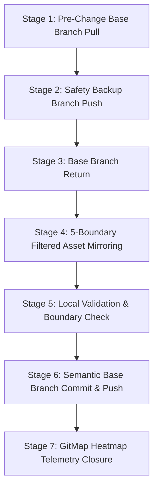

# Migration and Synchronization Specification: Execute Parent Task & Prompt Fixes

> **Target:** `02-spec/21-app/execute-parent-task-and-prompt-fixes/03-migration-and-sync-spec.md`  
> **Status:** Authoritative Migration & Fleet Synchronization Specification  
> **Version:** 1.0.0  
> **Date:** 2026-10-19  
> **Parent Plan:** `.ai-memory/plans/execute-parent-task-and-prompt-fixes.md`  
> **Architecture Spec:** `02-spec/21-app/execute-parent-task-and-prompt-fixes/01-architecture-spec.md`  

---

## 1. Overview & Architectural Purpose

This specification governs the propagation and validation of the upgraded **6-Part Task Verification Schema** (formalizing the mandatory `Understood / AI Comprehension` verification gate and `Azure AI / Model Runtime Context` declaration) from canonical source repository `coding-guidelines` across all 43 connected repositories in the workspace fleet.

Multi-repository synchronization is a high-consequence operation. Without rigid automated boundaries, fleet-wide distribution risks overwriting application-specific domain specs, corrupting custom repository bump logic, contaminating project-specific memory backlogs, or leaking sensitive credentials. This specification formalizes the exact execution steps, boundary enforcement mechanisms, and verification contracts required to guarantee safe, deterministic fleet deployment.

---

## 2. Multi-Repository Fleet Synchronization Protocol

Fleet synchronization is executed via the canonical orchestrator `03-ai-scripts/38-sync-prompts-skills-scripts.py`. The protocol follows a deterministic, 7-stage lifecycle for every target repository.

### 2.1 Fleet Target Scope (43 Repositories)

The target fleet includes all owned repositories located in the workspace parent directory, including:
- Core Go packages (`03-aukgo/core`, `03-aukgo/pathhelper`, `core-v9`, `enum-v10`, `errorwrapper-v4`, `extendcore`, `rediswrapper`, `strhelper`)
- Automation & CLI engines (`gitmap`, `movie-cli`, `macro-ahk`, `laravel-automation`, `scripts-fixer`, `antigravity-manager`)
- Web applications & UI suites (`letsmarknow`, `letsmarknow-ui`, `digital-name-card`, `workflowy-ui`, `alim-cv`)
- Presentation & design repositories (`flat-slide-show`, `global-ppt-v1`, `hiltrax`, `ki-health-ppt`, `slides-spec`)
- Prompt & spec engineering suites (`02-prompts/ai-empathy-prompt-tuner`, `02-prompts/prompts-connect`, `spec-builder`)
- Non-owned repositories (`omis`, `oh-my-zsh`, `ohmyzsh`, `zsh`, `oh-my-posh`, `dotfiles`, system runtimes) are **STRICTLY EXCLUDED** from the sync registry.

### 2.2 Seven-Stage Synchronization Lifecycle



1. **Stage 1: Pre-Change Base Branch Pull:**
   - Detect active tracking branch (`main` or `master`) via `git rev-parse --abbrev-ref HEAD`.
   - Reconcile tracking branch cleanly: `git pull origin <base_branch> --no-rebase`.
2. **Stage 2: Safety Backup Branch Creation & Push:**
   - Prior to writing any synced files, create a timestamped backup branch:
     `git checkout -b backup/sync-<timestamp>`
   - Push backup branch immediately upstream to remote:
     `git push origin backup/sync-<timestamp>`
3. **Stage 3: Return to Base Branch:**
   - Switch back to the base branch: `git checkout <base_branch>`.
4. **Stage 4: 5-Boundary Filtered Asset Mirroring:**
   - Mirror canonical prompts from `01-prompts/` (including `14-execute/` and `15-cg-execute/`) and `01-prompts/v4/`.
   - Mirror Antigravity skills from `.agents/skills/` and Cursor skills from `.cursor/skills/`.
   - Mirror shared specs strictly from `02-spec/01-*` through `02-spec/20-*`.
   - Mirror additive AI scripts from `03-ai-scripts/` and `.agents/scripts/`.
   - Mirror root instruction file `AGENTS.md`.
5. **Stage 5: Local Validation & Boundary Check:**
   - Validate that no protected directories or files were mutated.
   - Verify file permissions and encoding (UTF-8 LF line endings).
6. **Stage 6: Target Repository Base Branch Commit & Push:**
   - Stage synchronized assets and commit with structured message:
     `gitmap cpf "sync - update v6 prompts and skills with understood and azure ai schema"`
   - Push upstream to target remote repository.
7. **Stage 7: GitMap Heatmap Telemetry Closure:**
   - Log target synchronization outcome in GitMap telemetry database.

---

## 3. The 5 Non-Negotiable Boundaries: Enforcement & Verification

To protect repository isolation and maintain strict architectural hygiene, the synchronization engine enforces the **5 Non-Negotiable Boundaries**. Every boundary is backed by both a pre-execution filter and a post-sync verification check.

### 3.1 Boundary Matrix

| # | Boundary Name | Invariant Rule | Script Enforcement Mechanism | Post-Sync Verification Check |
| :-: | :--- | :--- | :--- | :--- |
| **1** | **Spec 21 Exclusion** | NEVER synchronize, copy, or mutate `02-spec/21-*` through `02-spec/25-*` | Directory scanner explicitly whitelists only `02-spec/01-*` to `02-spec/20-*`. Paths matching `21-*` through `25-*` are dropped from the sync file list. | Run `git status` and path inspect in target repos: zero modified or untracked files under `02-spec/21-*` through `02-spec/25-*`. |
| **2** | **Additive-Only AI Scripts** | Brand-new scripts are copied cleanly; existing scripts modified by target repos MUST NEVER be overwritten | `03-ai-scripts/` and `.agents/scripts/` file sync checks `target_file.exists()`. If true, copy is skipped, preserving local modifications. | Diff verification: existing scripts in target repositories retain identical SHA-256 hashes before and after sync. |
| **3** | **Bump Script Protection** | NEVER overwrite version bump scripts or release manifests (`bump*`, `bump_versions.py`, `bump-version.mjs`, `version.json`) | Regex pattern blacklist `^bump.*` and `version\.json` actively skips bump files during file copy tree walks. | Inspection of git status in target repos: bump files report 0 diffs. |
| **4** | **Memory & Plans Isolation** | NEVER modify, sync, or mirror `.ai-memory/memory/` or `.ai-memory/plans/` in target repositories | `.ai-memory/memory/` and `.ai-memory/plans/` are strictly excluded from mirror sources; only shared prompt catalogs or skills are eligible. | Verification that target `.ai-memory/plans/` directories remain completely isolated. |
| **5** | **Zero Secrets Leakage** | NEVER synchronize `.env` files, API keys, tokens, passwords, or credentials across repositories | Blacklist regex catches `.env*`, `*secret*`, `*token*`, `*credential*`. Secrets reside strictly in `repo-secrets` via `gitmap rs`. | Git pre-commit and post-sync scan verifying 0 credential patterns in staged diffs. |

### 3.2 Enforcement Architecture in `38-sync-prompts-skills-scripts.py`

1. **Shared Specification Filter:**
   ```python
   # Only sync shared specifications 01-* through 20-*
   SHARED_SPEC_DIRS = [
       d for d in (SOURCE_ROOT / "02-spec").iterdir()
       if d.is_dir() and re.match(r"^(0[1-9]|1[0-9]|20)-", d.name)
   ]
   ```
2. **Additive-Only Script Guard:**
   ```python
   # Never overwrite existing scripts in target repository
   if dest_path.exists():
       continue  # Additive-only invariant
   shutil.copy2(src_path, dest_path)
   ```
3. **Bump Script Blacklist:**
   ```python
   # Exclude all bump manifests and custom release logic
   if re.match(r"^bump", file_name, re.IGNORECASE) or file_name == "version.json":
       continue  # Immutable bump script protection
   ```

---

## 4. Verification Evidence Contract

Every execution of this specification requires concrete, reproducible proof across five gates before declaring completion. Assurances without exit code proof, diff evidence, or telemetry logs are auto-rejected.

### 4.1 Gate 1: Strict Relative Git Path Linter Audit

All authored specifications, subtask manifests, prompts, and notes MUST adhere strictly to relative Git paths.
- **Prohibited:** Any occurrence of `C:\`, `C:/`, `/home/`, `/Users/`, or `file:///`.
- **Allowed:** Paths starting relative to the repository root: `02-spec/...`, `01-prompts/...`, `.ai-memory/...`, `cmd/...`.
- **Verification Command:**
  ```bash
  python linter-scripts/check-relative-paths.py
  ```
- **Pass Threshold:** Exit code `0`, reporting 0 absolute filesystem paths and 0 `file:///` URIs across all tracked files.

### 4.2 Gate 2: Lowercase Filename Compliance

All files, scripts, documentation, and directories MUST use strictly lowercase naming.
- **Rule:** Filenames must conform to `^[0-9a-z_.-]+$` with zero uppercase characters.
- **Verification Command:**
  ```bash
  gitmap find "*[A-Z]*" 02-spec/21-app/execute-parent-task-and-prompt-fixes
  gitmap find "*[A-Z]*" .ai-memory/plans/subtasks/execute-parent-task-and-prompt-fixes
  ```
- **Pass Threshold:** 0 matching uppercase filenames returned.

### 4.3 Gate 3: GitMap Cognitive Heatmap Telemetry 100% Closure

Under Section 15 of `AGENTS.md`, all cognitive file operations (specifications, prompts, skills) must be recorded and closed in the telemetry database.
- **Verification Commands:**
  ```bash
  gitmap heatmap status --task "execute-parent-task-and-prompt-fixes"
  gitmap heatmap tree --task "execute-parent-task-and-prompt-fixes"
  ```
- **Pass Threshold:** 100% of logged actions marked with `met = true` and concrete outcome strings. Zero open or unverified actions remaining in the task tree.

### 4.4 Gate 4: Working Tree Cleanliness

Before the final commit, verify that no untracked artifacts, temporary scratch scripts, or unmanaged files exist in the repository.
- **Verification Command:**
  ```bash
  git status
  ```
- **Pass Threshold:** Only expected, modified, and authored files are present.

### 4.5 Gate 5: Final Semantic Auto-Pushing Commit & Remote Push

Under Section 10 and Section 13 ('No Push = Not Done') of `AGENTS.md`, task completion mandates an auto-pushing semantic commit with a hyphen separator and no colons inside the message argument.
- **Commit Command Syntax:**
  ```bash
  gitmap cpf "prompts - add understood gate and azure ai context to v6 prompts and sync fleet"
  ```
- **Syntax Invariants:**
  - Prefix `Feature: ` is automatically prepended by GitMap CLI.
  - Message argument MUST use a hyphen separator (`<module> - <summary>`).
  - Argument MUST NOT contain internal colons (e.g. `prompts: add ...` is strictly banned).
- **Completion Invariant:**
  - Remote push must succeed with exit code `0`.
  - Final `git status` reports working tree clean with branch up-to-date with `origin/main`.

---

## 5. Negative Guardrails & Strict Bans

1. **TOTAL BAN on Absolute Paths:** Never emit `C:\...`, `/home/...`, or `file:///` URIs in any markdown documentation, specifications, release notes, or commit messages.
2. **TOTAL BAN on Mutating Non-Owned Repositories:** Never touch, stage, commit, or push `omis`, `oh-my-zsh`, `ohmyzsh`, `zsh`, `oh-my-posh`, `dotfiles`, or runtime package directories.
3. **TOTAL BAN on Shell Search & Traversal Commands:** Never execute `Get-ChildItem`, `dir`, `ls`, `rg`, `ripgrep`, `grep`, `git grep`, `Select-String`, or `findstr`. Codebase search must use GitMap commands exclusively (`gitmap find`, `gitmap aum search`, `gitmap lf`, `gitmap cat`).
4. **TOTAL BAN on Colons in Commit Arguments:** Format commit arguments strictly with hyphens (`gitmap cpf "<module> - <summary>"`).
5. **TOTAL BAN on Disabling CI/CD:** Workflows and pipeline actions in target repositories must remain fully enabled and unbypassed.
6. **TOTAL BAN on Incomplete Task Completion:** Never claim success or conclude a turn without upstream push verification.
