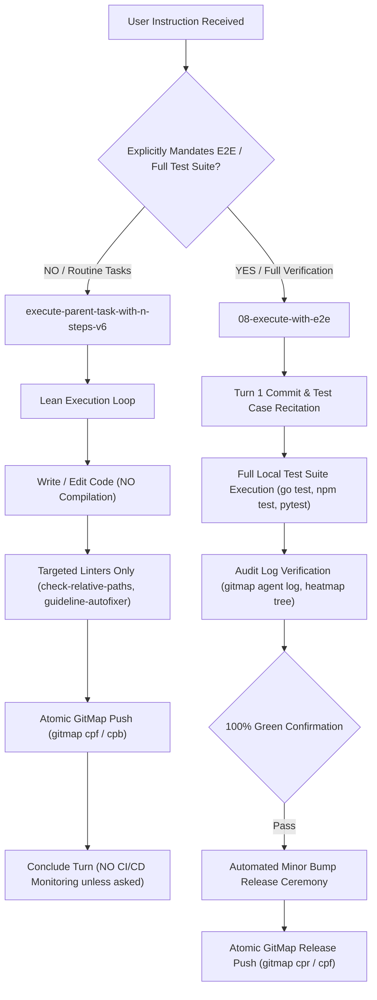

# Architecture Specification: Build/Test Ban Invariant & E2E Autonomous Execution Engine

## 1. System Overview & Problem Statement

Autonomous software engineering agents operating within the Prompt Architect meta-repository and connected repositories frequently suffer from execution bloat, unnecessary compute resource consumption, and pipeline latency caused by two conflicting patterns:
1. **Unrequested In-Flight Compilation & Heavy Local Test Suites:** Agents modify small files (markdown specifications, configuration items, or single-function logic) and immediately attempt to run full project builds (`go build`, `npm run build`, `vite build`, `cargo build`) or massive test suites (`go test ./...`, `pytest`, `npm test`). Every time code is written, agents default to rebuilding the entire tree.
2. **Unrequested Remote CI/CD Pipeline Monitoring:** After committing and pushing changes, agents frequently hang or loop querying remote GitHub Actions runs (`gitmap pe -t`, `gh run view`, `gitmap pipeline-ai status`) even when the user requested a simple code modification or specification update.

This specification formalizes the dual architectural paradigm:
- **Paradigm A: The Standard V6 Lean Execution Contract:** Strictly bans builds, full local test suites, unrequested E2E flows, and post-push CI/CD verification unless explicitly commanded by the user. "Every time you write code, you don't build the code."
- **Paradigm B: The Dedicated E2E Execution & Automated Release Engine (`08-execute-with-e2e.md`):** An inversion of the testing ban into an explicit, mandatory full-suite local test pass, commit and test-case recitation, audit log inspection, and automated minor version bump release ceremony.

---

## 2. The Core Architectural Invariants

### 2.1 Invariant 1: In-Flight Build Prohibition
> **Invariant Rule:** Every time you write code, you do not build the code.

In routine engineering turns, intermediate compilation is banned. Static analysis, AST checkers, and targeted linters provide syntactic validation without triggering full compiler toolchains. Full compilation is reserved exclusively for explicit user requests or dedicated E2E verification turns.

### 2.2 Invariant 2: Local Test Suite & E2E Scope Isolation
> **Invariant Rule:** Never run all tests locally or full build unless explicitly asked. Only do end-to-end testing based on mentioned test cases if explicitly asked.

Local test suites (`go test ./...`, `pytest`, `npm test`) are barred from routine turns. Running complete suites consumes hundreds of execution seconds and exhausts token context windows. If the user mentions a specific test case, the agent may execute *only* that specific test case if explicitly requested.

### 2.3 Invariant 3: CI/CD Verification Opt-In Model
> **Invariant Rule:** Do CI/CD verification only if asked; if not asked explicitly, don't do it.

Routine tasks terminate immediately upon successful upstream push via `gitmap cpf` or `gitmap cpb`. Agents must never query or sleep on remote CI/CD pipelines unless the user prompt specifically commands pipeline verification (e.g., "verify CI passes", "watch the pipeline").

### 2.4 Invariant 4: Dedicated E2E Prompt Lifecycle
The new prompt `08-execute-with-e2e.md` provides an isolated environment where full verification is explicitly expected:
1. **Turn 1 Recitation:** Displays the last 5 commits (`git log -n 5 --oneline`) and enumerates recent test cases.
2. **Comprehensive Local Test Execution:** Runs all local test suites to achieve a 100% green pass.
3. **Audit Log Inspection:** Inspects `.ai-memory/heatmap.db` and SQLite task logs to verify zero unaccounted actions.
4. **Automated Release Finalization:** Executes minor version bump ceremony (`npm run bump minor` or `python 03-ai-scripts/37-bump-version.py --tier minor`) and pushes upstream.

---

## 3. Boundary & Safety Model

| Invariant | Standard V6 (`02-execute-parent-task-with-n-steps-v6`) | Dedicated E2E (`08-execute-with-e2e`) |
| :--- | :--- | :--- |
| **In-Flight Code Builds** | BANNED: Do not build code after writing | ALLOWED: Built as part of local test suites |
| **Full Local Test Suites** | BANNED: Zero `go test ./...`, `npm test`, `pytest` | MANDATORY: 100% green local pass required |
| **End-to-End Testing** | BANNED unless test case is explicitly asked | MANDATORY: All recent and relevant test cases executed |
| **CI/CD Pipeline Waiting** | BANNED unless explicitly asked by user | ALLOWED / MONITORED if pipeline check requested |
| **Targeted Linters** | MANDATORY: Fast file-scoped linters only | MANDATORY: In addition to full test suites |
| **Release Ceremony** | BANNED: Zero unauthorized releases (R10) | MANDATORY: Automated minor bump on 100% green |

---

## 4. Multi-Agent Concurrency & Telemetry Architecture

Both prompts adhere strictly to the Tree Swarm Hierarchy:
- **Topology:** Root Orchestrator -> Branch Coordinators -> Leaf Workers ($A = 3$, $H = 2$, Capacity = 6).
- **Disjoint Bounding Boxes:** Zero file ownership overlap across concurrent subagents.
- **Heatmap Telemetry:** Concurrency-safe cognitive action logging into `.ai-memory/heatmap.db` with state tracking (`EXPLORATION`, `SPECIFICATION`, `EXECUTION`, `VERIFICATION`).
- **Relative Path Hygiene:** Strict ban on absolute filesystem paths and `file:///` URIs.
