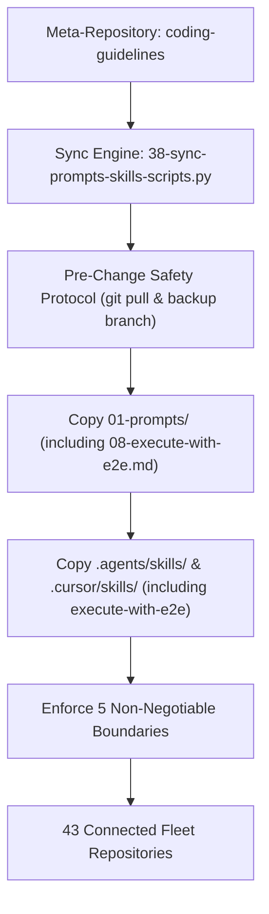

# Fleet Synchronization Specification: Prompt & Skill Distribution Across 43 Repositories

## 1. Synchronization Architecture

The Prompt Architect meta-repository (`coding-guidelines`) serves as the single source of truth for canonical prompts (`01-prompts/`), Antigravity skills (`.agents/skills/`), and Cursor skills (`.cursor/skills/`).

When updating existing prompts or creating new prompts and skills, changes must be synchronized cleanly across all 43 fleet repositories via `03-ai-scripts/38-sync-prompts-skills-scripts.py`.



---

## 2. The 5 Non-Negotiable Boundaries

During multi-repository synchronization, the sync engine and AI agents MUST strictly adhere to the 5 boundary invariants:
1. **Spec 21 Exclusion (TOTAL BAN):** NEVER synchronize, copy, or touch `02-spec/21-*` through `02-spec/25-*` (private application domain specs, issues, db, and UI designs). Only shared specifications `02-spec/01-*` through `02-spec/20-*` are synchronized.
2. **Additive-Only AI Scripts:** Brand-new AI scripts (`03-ai-scripts/`, `.agents/scripts/`) that do not exist in the target repository are copied cleanly. Existing scripts modified by the target repository must NEVER be overwritten.
3. **Bump Script Protection (IMMUTABLE):** NEVER overwrite version bump scripts or manifests (`bump*`, `bump_versions.py`, `bump-version.mjs`, `version.json`). Each repository maintains custom SemVer targets and release logic.
4. **Memory & Plans Protection (TOTAL ISOLATION):** NEVER modify, sync, or mirror `.ai-memory/memory/` or `.ai-memory/plans/` in target repositories.
5. **Zero Secrets Leakage:** NEVER synchronize `.env` files, tokens, or credentials across repositories. Secrets reside strictly in `repo-secrets` via `gitmap rs`.

---

## 3. Registries & Master Indexes to Update

The addition of `08-execute-with-e2e.md` and `execute-with-e2e` skill requires updating the following catalog registers in `coding-guidelines`:
1. `01-prompts/readme.md`: Add row to table under `14-execute` category.
2. `01-prompts/14-execute/readme.md`: Add entry for `08-execute-with-e2e.md`.
3. `01-prompts/v4/14-execute/readme.md`: Add entry for `08-execute-with-e2e.md`.
4. `.ai-memory/prompts.md`: Add catalog entry for `08-execute-with-e2e.md` with description and skill link syntax `[execute-with-e2e](file;.agents/skills/execute-with-e2e)`.

---

## 4. Execution Command Sequence

1. **Dry-Run Inspection:**
   ```powershell
   python 03-ai-scripts/38-sync-prompts-skills-scripts.py --dry-run
   ```
2. **Live Execution (Fleet Sync):**
   ```powershell
   python 03-ai-scripts/38-sync-prompts-skills-scripts.py
   ```
3. **Status Verification:**
   ```powershell
   git status --porcelain
   ```
