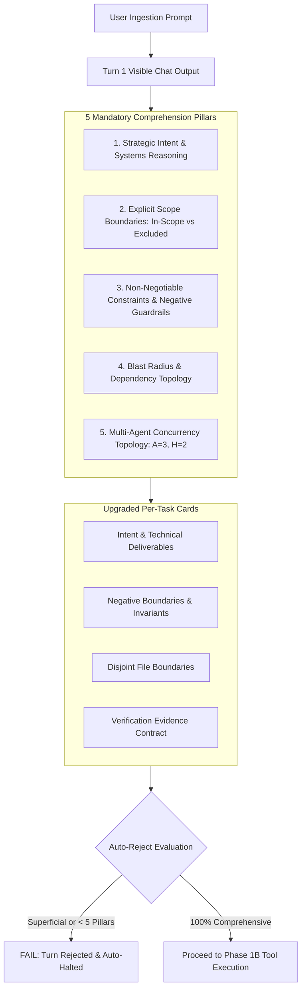
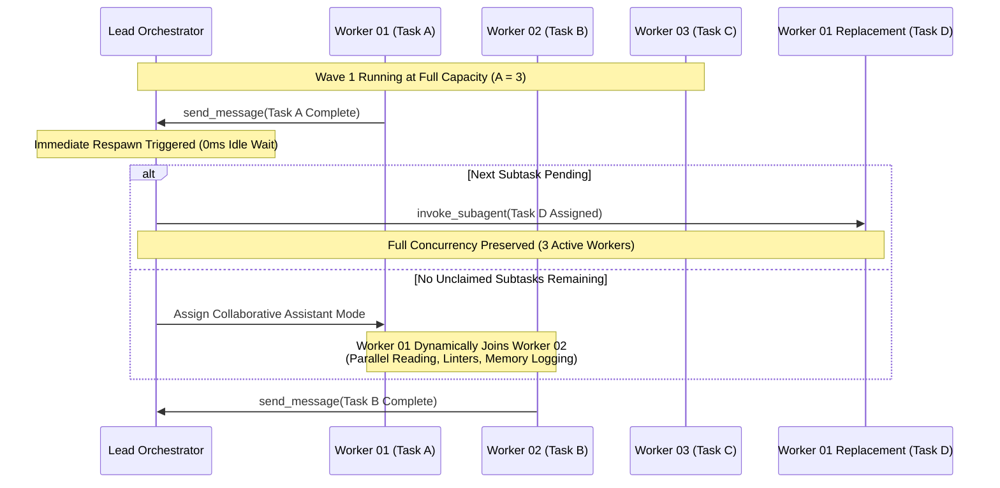

# Architectural Specification: Multi-Agent Concurrency Scaling, Immediate Dynamic Respawn & Extreme Turn-1 Comprehension

## User Request (Verbatim)

```text
# Muse Prompt and Git Repository Fix Instructions: high priority instruction, non-negotiable task

If it is verified that inside the Muse prompt, we have added that if Muse has to fix a Git repo or something like this, any command that should be written inside the repo cache with the Muse folder with the task information and other stuff, so that Muse can also read and understand. If it has to fix on Git or any other commands to fix the stuff, troubleshooting. It makes sure to have Muse in the prompt section. Muse should have, let's say, troubleshooting folder inside it. Only if it is troubleshooting or fixing it should update that. And also one more problem that I do see in the execute in NS steps in V6, it is not showing what it's supposed to do. Previously, in the past, it was supposed to show what it has understood that needs to be written out very extremely. Try to force that and also update the skills. Update this with all the other repositories, and then make sure that tiny bits and pieces are improved. And also the agent needs to run three agents from now on with the V6. Three agents so that parallel work and if one agent is done, it should spawn another agent. So same thing should be mentioned inside the Muse prompt as well. Enhance it, update the skill and sync the skill and prompts with all the repositories that you know of.
```

---

## 1. Executive Summary & Problem Statement

This specification defines the architectural evolution of the V6 execution engine (`02-execute-parent-task-with-n-steps-v6.md`) and companion Muse prompts/skills. It addresses three critical operational bottlenecks observed across production multi-agent runs:

```
+-------------------------------------------------------------------------------------------------------+
|                                    Core Operational Problems                                          |
+------------------------------------+----------------------------------+-------------------------------+
|  1. Turn-1 Comprehension Collapse  |  2. Concurrency Saturation Ceiling| 3. Idle Worker Latency Waste  |
|  - Superficial 1-sentence summaries|  - Hardcoded to A = 2 workers    | - Waiting for entire waves    |
|  - Missed negative guardrails      |  - 4 operations max capacity     | - Workers idle while tasks sit|
|  - Shallow boilerplate cards       |  - Linear serialization delays   | - Uneven subtask completion   |
+------------------------------------+----------------------------------+-------------------------------+
                                                |
                                                v
+-------------------------------------------------------------------------------------------------------+
|                                  Target Architectural Solution                                        |
+------------------------------------+----------------------------------+-------------------------------+
|  Extreme Turn-1 Showcase           |  Concurrency Scale: A = 3, H = 2 | Immediate Dynamic Respawn     |
|  - 5 Mandatory Ingestion Pillars   |  - 6 concurrent operations      | - Instant worker replacement  |
|  - Upgraded per-task schema        |  - WAVES = ceil(subtasks / 6)    | - Dynamic join assistance     |
|  - Binary auto-reject gate         |  - Tri-agent parallel execution  | - 100% duty cycle saturation  |
+------------------------------------+----------------------------------+-------------------------------+
```

### 1.1 Problem 1: Turn-1 Comprehension Collapse
In prior iterations of the V6 execution framework, agents frequently exhibited a "comprehension collapse" during Turn 1. While tasked with presenting what was understood before beginning background tool execution, agents defaulted to superficial, single-sentence boilerplate (e.g., `Understood: [YES] — Implement feature requirements`). This token-saving reflex bypassed critical architectural ingestion:
- Negative guardrails and banned actions (e.g., raw search bans, build bans) were acknowledged in theory but overlooked during execution.
- Blast radius and cross-file dependencies were left unmodeled until file collisions or runtime failures occurred.
- Deliverable acceptance criteria lacked concrete evidence contracts, allowing incomplete tasks to be marked as complete.

### 1.2 Problem 2: Concurrency Saturation Ceiling (`A = 2` -> `A = 3`)
The legacy V6 engine constrained multi-agent concurrency to two parallel workers (`A = 2, H = 2`), capping total operational throughput at 4 concurrent subtask actions. In repositories with 40+ interconnected files and complex prompt suites, this low concurrency ceiling introduced substantial serialization delays. Large tasks required 4 to 8 waves to complete, increasing total turnaround latency and stalling idle execution bandwidth.

### 1.3 Problem 3: Idle Worker Latency Waste (Wave Barrier Stalls)
Legacy execution adhered to rigid wave boundaries: when `Worker 01` finished a short task in 30 seconds while `Worker 02` was running a 3-minute refactoring task, `Worker 01` sat completely idle until the entire wave finished. This created significant idle worker latency waste. The engine lacked an immediate dynamic respawn mechanism to immediately dispatch a new worker for the next pending task or dynamically reassign the free agent to assist the running task.

---

## 2. Extreme "Understood" Turn-1 Showcase Architecture

To permanently eradicate comprehension collapse, Turn 1 of the V6 execution engine must mandate an exhaustive, visible comprehension showcase in chat before any background modifications occur. This showcase is divided into two structural components:
1. Top-Level Architectural Mandate (5 Mandatory Pillars)
2. Upgraded Per-Task Verification Schema (4-Part Deep Schema)



### 2.1 The 5 Mandatory Comprehension Pillars

Before listing individual task cards, the agent MUST output the top-level section `### 🧠 Deep Comprehension & Understood Mandate` containing the following five pillars written with extreme technical depth:

#### Pillar 1: Strategic Intent & Systems Reasoning
- Articulate the overarching architectural goal, user intent, and operational rationale.
- Explain *why* this change is necessary, how it integrates into the host repository architecture, and what downstream benefits it delivers.
- No generic summaries allowed; the agent must explain the specific mechanics of the solution.

#### Pillar 2: Explicit Scope Boundaries (In-Scope vs. Excluded / Deferred)
- Construct an explicit, two-column boundary defining exactly what is in-scope for this execution versus what is strictly excluded or deferred to follow-up plans.
- Prohibit scope creep: prevent agents from modifying out-of-scope files or fixing tangential issues found during inspection.

#### Pillar 3: Non-Negotiable Constraints & Negative Guardrails Ingestion
- Explicitly ingest and enumerate all active negative guardrails from `agents.md`, `.ai-memory/strictly-avoid.md`, and task instructions:
  - Total ban on raw shell search tools (`rg`, `ripgrep`, `grep`, `git grep`, `Select-String`, `Get-ChildItem -Recurse`, `findstr`).
  - Total ban on worker git commands (`git add`, `git commit`, `git push`, `git checkout`, `git diff`).
  - Total ban on full test suites and project builds (`go build`, `npm run build`, `go test ./...`, `pytest`).
  - Strict relative Git paths (ban on absolute filesystem paths and `file:///` URIs).
  - Strict lowercase filenames.
  - Zero secrets in standard repositories (`repo-secrets` offloading).
  - GitMap hyphen-separated commit message syntax without colons.

#### Pillar 4: Blast Radius & Dependency Topology
- Map every subsystem, file directory, downstream consumer, and prompt/skill reference impacted by the changes.
- Identify risk factors: file lock contention, merge conflicts, breaking schema changes, downstream repository sync failures.
- Define containment strategies for each identified risk factor.

#### Pillar 5: Multi-Agent Concurrency Topology & Wave Orchestration
- Formulate the swarm execution hierarchy: Lead Orchestrator (Root Node), Subtask Owners (Branch Coordinators), and dynamic assistants.
- Formulate the wave distribution: `A = 3`, `H = 2`, Capacity = 6, `WAVES = ceil(total_subtasks / 6)`.
- Detail the exact disjoint file assignments for each worker to guarantee zero overlap.

### 2.2 Upgraded Per-Task Verification Schema

Every task listed under `### 📋 Confirmed Task Breakdown & Requirement Ingestion` must abandon shallow `Understood: [YES]` checkboxes and replace them with this four-part deep verification schema:

```markdown
1. **Task-01: [Descriptive Task Title]**
   - **State:** `[IN PROGRESS — EXECUTING IMMEDIATELY]`
   - **Intent & Technical Deliverables:**
     - [Clear statement of the technical goal and deliverable artifacts]
     - [Precise implementation scope: functions, types, schemas, or prompt sections being added/edited]
     - [Quantifiable success metrics: e.g. line count, field completeness, schema compliance]
   - **Negative Boundaries & Invariants:**
     - [Explicit list of things this task MUST NOT do or alter]
     - [Untouchable files, reserved packages, or excluded dependencies]
     - [Invariants that must remain preserved after modification]
   - **Disjoint File Boundaries:**
     - `Owned Files (Exclusive):` `[strictly/relative/path/to/file-01.md]`, `[strictly/relative/path/to/file-02.md]`
     - `Read-Only Context Files:` `[strictly/relative/path/to/reference.md]`
   - **Verification Evidence Contract:**
     - [Exact command or check to be executed to prove completion]
     - [Expected exit code: e.g. exit 0]
     - [Required diffstat evidence or structural regex check]
```

### 2.3 Strict Auto-Reject Gate & Enforcement Protocol
- Any Turn 1 response that attempts background tool execution without first displaying the complete `### 🧠 Deep Comprehension & Understood Mandate` and all 5 pillars is classified as a critical protocol violation and is rejected immediately.
- Boilerplate phrases such as "Understood: Yes, I will do this task" or "Understood: Everything is clear" trigger an automatic failure.
- Every pillar and every task card must contain domain-specific, actionable technical detail derived directly from the task specifications and repository context.

---

## 3. Concurrency Scaling Specification (`A = 3, H = 2`, Capacity 6)

The multi-agent execution framework is officially scaled from 2 to 3 autonomous subagents.

```
+---------------------------------------------------------------------------------------------------+
|                            Tree Swarm Concurrency Topology (A = 3, H = 2)                         |
+---------------------------------------------------------------------------------------------------+
|                                                                                                   |
|                               +-------------------------------+                                   |
|                               |       Lead Orchestrator       |                                   |
|                               |       (Root Node / Parent)    |                                   |
|                               +---------------+---------------+                                   |
|                                               |                                                   |
|                        invoke_subagent        |       invoke_subagent                             |
|             +---------------------------------+---------------------------------+                 |
|             |                                 |                                 |                 |
|             v                                 v                                 v                 |
|   +--------------------+            +--------------------+            +--------------------+      |
|   |   Subagent 01      |            |   Subagent 02      |            |   Subagent 03      |      |
|   |   (Worker 01)      |            |   (Worker 02)      |            |   (Worker 03)      |      |
|   |   Capacity: H = 2  |            |   Capacity: H = 2  |            |   Capacity: H = 2  |      |
|   +---------+----------+            +---------+----------+            +---------+----------+      |
|             |                                 |                                 |                 |
|       +-----+-----+                     +-----+-----+                     +-----+-----+           |
|       |           |                     |           |                     |           |           |
|       v           v                     v           v                     v           v           |
|   [Subtask A] [Subtask B]           [Subtask C] [Subtask D]           [Subtask E] [Subtask F]     |
|                                                                                                   |
|   Total System Concurrency Capacity = 3 agents x 2 hands = 6 concurrent subtask operations        |
+---------------------------------------------------------------------------------------------------+
```

### 3.1 Mathematical Formulation & Parameters

```text
N = 400                    (Total self-loop steps budget — editable parameter, default: 400)
A = 3                      (MANDATORY number of spawned autonomous subagents running concurrently)
H = 2                      (Operational hands per agent: dual-task batch capacity & parallel dispatch)
C = 30                     (Tool calls per worker before reporting status back to Lead)

System Concurrency Capacity = A x H = 3 agents x 2 hands = 6 concurrent subtask operations
WAVES = ceil(total_subtasks / 6)
```

### 3.2 3-Stage Mandatory Subagent Dispatch
Solo execution by the Lead Orchestrator without calling `invoke_subagent` is an auto-reject failure. At every major stage of execution, `A = 3` subagents must be actively dispatched:
1. **Stage 1: Discovery & Planning (`A = 3`, `TypeName: "research"`):**
   - Lead spawns 3 parallel read-only discovery agents to explore distinct subsystems of the codebase simultaneously.
   - Subagent 01 explores prompt architectures and core execution templates.
   - Subagent 02 explores skills registries (`.agents/skills/` and `.cursor/skills/`).
   - Subagent 03 explores repository dependencies, scripts, and fleet synchronization targets.
2. **Stage 2: Specification & Subtask Authoring (`A = 3`, `TypeName: "self"`):**
   - Lead spawns 3 authoring subagents to write modular, disjoint specification documents in `02-spec/21-app/<slug>/` and subtasks in `.ai-memory/plans/subtasks/<slug>/`.
   - Each authoring agent owns strictly disjoint files; no two agents edit the same specification file.
3. **Stage 3: Parallel Execution (`A = 3`, `TypeName: "self"`):**
   - Lead spawns 3 execution worker subagents to apply surgical code refactoring and enhancements in strictly disjoint file boxes.
   - Each worker operates within its assigned files, enforcing coding guidelines, verification checks, and relative path hygiene.

### 3.3 Dynamic Agent Join & Immediate Respawn Protocol

To achieve 100% duty cycle utilization across all 3 subagents, the framework implements an **Immediate Dynamic Respawn & Join Protocol**:



#### Protocol Rules:
1. **Zero-Idle Immediate Respawn:** The exact moment any subagent returns via `send_message` or is confirmed complete, the Lead Orchestrator MUST NOT wait for the remaining running agents. The Lead immediately checks `.ai-memory/plans/subtasks/<slug>/` for the next unclaimed subtask and spawns a replacement subagent (`invoke_subagent`) immediately.
2. **Active Concurrency Pinned at 3:** Throughout Phase 1, Phase 2, and Phase 3, active subagent concurrency MUST remain pinned at `A = 3` until the entire subtask queue is empty.
3. **Dynamic Join Collaborative Mode:** If there are fewer than 3 unassigned subtasks remaining in the queue, newly available subagents are assigned as **Dynamic Collaborative Assistants** to assist running subtasks:
   - *Parallel Symbol & Caller Discovery:* Reading call sites and upstream references to feed context to the primary worker.
   - *Companion Lint & Relative Path Validation:* Running non-modifying targeted checks, verifying relative paths, and auditing lowercase compliance.
   - *Memory Ledger Synchronization:* Formatting status cards and drafting memory entries for the Lead.
   - *Disjoint Invariant:* Dynamic assistants NEVER write to the primary worker's owned files (maintaining Rule R6: One Owner Per File).

---

## 4. Budget Allocation: 400 Steps

The execution budget is structured into three discrete phases across 400 maximum steps:

```
[ Step 1 -------------------- Step 100 ] [ Step 101 -------------------- Step 250 ] [ Step 251 -------------------- Step 400 ]
+---------------------------------------+-------------------------------------------+-------------------------------------------+
|          PHASE 1: 100 STEPS           |            PHASE 2: 150 STEPS             |            PHASE 3: 150 STEPS             |
|  - Turn-1 Deep Comprehension Mandate  |  - Prerequisite Refactoring               |  - Tree Swarm Parallel Execution (A=3)    |
|  - Discovery Subagents (A=3 research) |  - Intermediate Checkpoints & Sanitization|  - Immediate Dynamic Respawn & Join       |
|  - Up-Front Brain & Roadmap Creation  |  - Spec Remediation & Baseline Lints      |  - Targeted File-Scoped Quality Lints     |
|  - Lean Subtasks & Spec Authoring     |  - Archival of Completed Subtask Artifacts|  - Fleet Cross-Repository Sync            |
|  - Disjoint Bounding Box Definition   |  - Dependency Boundary Verification       |  - Atomic GitMap Push via gitmap cpf/cpb  |
+---------------------------------------+-------------------------------------------+-------------------------------------------+
```

### 4.1 Phase 1 Budget: Steps 1 to 100 (Planning, Specs & Discovery Swarm)
- **Step 1:** Verbatim prompt capture, Turn-1 visible showcase with 5 mandatory pillars, and upgraded task cards.
- **Steps 2 to 30:** Dispatch 3 parallel research subagents (`TypeName: "research"`) for deep codebase discovery.
- **Steps 31 to 70:** Author modular specifications in `02-spec/21-app/<slug>/` and discrete subtask plans in `.ai-memory/plans/subtasks/<slug>/` using 3 parallel authoring subagents (`TypeName: "self"`).
- **Steps 71 to 100:** Initialize parent execution plan and audit ledger. Verify disjoint file boundaries across all planned tasks.

### 4.2 Phase 2 Budget: Steps 101 to 250 (Sanitization, Prerequisites & Archival)
- **Steps 101 to 150:** Execute prerequisite refactorings, directory preparations, and schema validations.
- **Steps 151 to 200:** Perform intermediate checkpoints, consolidate legacy or stale task artifacts, and verify that all pre-existing tests and linters remain intact.
- **Steps 201 to 250:** Audit workspace cleanliness: verify that no temporary files or OS caches exist, validate relative git paths, and confirm that all required target files are ready for parallel modification.

### 4.3 Phase 3 Budget: Steps 251 to 400 (Tree Swarm Execution, Respawn & Push)
- **Steps 251 to 340:** Execute code modifications using 3 concurrent worker subagents (`A = 3`, `H = 2`), enforcing immediate dynamic respawn and dynamic join capacity saturation until all subtasks are `DONE`.
- **Steps 341 to 370:** Run targeted quality checks and linters on modified files. Enforce strict relative Git paths and zero secrets.
- **Steps 371 to 390:** Execute cross-repository synchronization script (`03-ai-scripts/38-sync-prompts-skills-scripts.py`) to propagate updated prompts and skills across all connected repositories (`removed == 0` guarantee).
- **Steps 391 to 400:** Execute final atomic GitMap commit and remote push (`gitmap cpf "<module> - <summary>"`). Log final verification summary and terminate turn.

---

## 5. Quality Gates & Non-Negotiable Boundaries

All agents operating under this specification must strictly comply with the following non-negotiable operational invariants:

```
+----------------------------------------------------------------------------------------------------+
|                                Non-Negotiable Quality Guardrails                                   |
+------------------------------------+----------------------------------+----------------------------+
| Strict Relative Git Paths          | Strict Lowercase Filenames       | Total Ban on Raw Search    |
| - Ban on absolute filesystem paths | - All files strictly lowercase   | - No rg, ripgrep, grep     |
| - Ban on file:/// URIs             | - All directories lowercase      | - No Select-String/findstr |
| - Strict root-relative formatting  | - Zero uppercase characters      | - GitMap commands only     |
+------------------------------------+----------------------------------+----------------------------+
| Total Ban on Worker Git Calls      | Zero Build / Full Test Suites    | Zero Secrets in Repos      |
| - Workers never run git commands   | - No go build, npm run build     | - Offload to repo-secrets  |
| - Prevents .git/index.lock crashes | - No full test suite execution   | - Zero .env files committed|
| - Lead handles final atomic commit | - Targeted file checks only      | - Pre-commit secrets gate  |
+------------------------------------+----------------------------------+----------------------------+
```

1. **Strict Relative Git Paths (TOTAL BAN ON ABSOLUTE PATHS):**
   - Every file path cited in code, plans, specs, comments, and commit messages MUST be strictly relative to the repository root (e.g. `02-spec/21-app/...`, `.ai-memory/plans/...`).
   - Absolute paths (e.g. `C:\...`, `/home/...`) and `file:///` URIs are strictly prohibited.
2. **Strict Lowercase Filenames:**
   - All files, directories, scripts, and documentation must use lowercase naming without exception (e.g. `readme.md`, `01-architecture-spec.md`).
3. **Total Ban on Raw Search Tools:**
   - Subagents and leads MUST use compiled GitMap commands (`gitmap aum search`, `gitmap find`, `gitmap cat`, `gitmap lf`) for codebase discovery.
   - Raw tools (`rg`, `ripgrep`, `grep`, `git grep`, `Select-String`, `Get-ChildItem -Recurse`, `findstr`) are strictly banned.
4. **Total Ban on Worker Git Calls:**
   - Subagents NEVER execute git commands (`git add`, `git commit`, `git push`, `git status`, `git diff`, `git checkout`).
   - Git operations in shared workspaces create `.git/index.lock` collisions that immediately crash parallel agents. All git operations belong exclusively to the Lead Orchestrator.
5. **Zero Storage & Zero CI Artifact Uploads:**
   - GitHub Actions workflows must not upload routine build artifacts or logs. All diagnostic reports are output to console standard output or step summaries.
6. **Zero Secrets Policy (`repo-secrets` / `rs`):**
   - Private credentials, tokens, and API keys reside strictly in `repo-secrets` via `gitmap rs`. No credentials may ever be committed to standard repositories.
7. **GitMap Commit Formatting:**
   - Commit messages passed to `gitmap cpf` or `gitmap cpb` must use hyphens without colons (e.g. `gitmap cpf "v6-engine - scale concurrency to 3 agents and enforce turn 1 deep comprehension"`). GitMap automatically supplies the structured semantic prefix.
